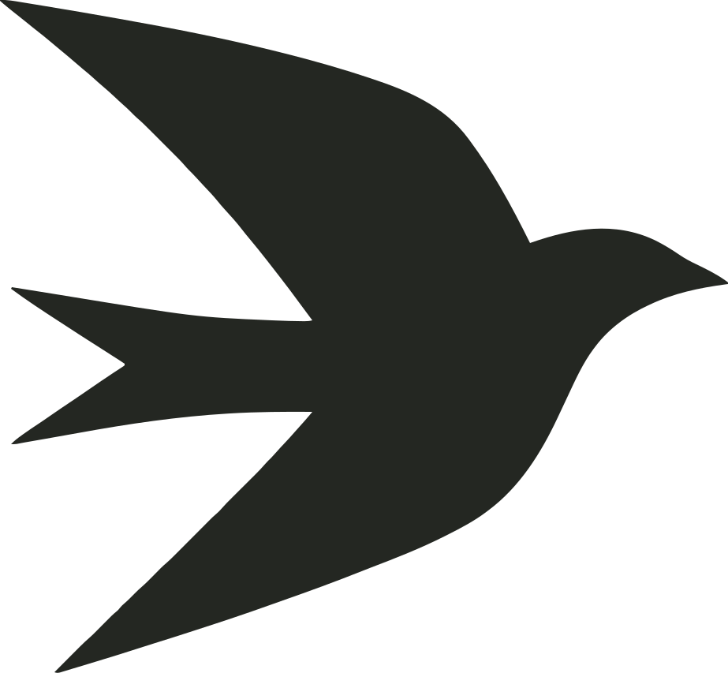

# DAYMARK

**Made for the everyday.** A production-oriented clothing ecommerce MVP for a fictional Vietnamese brand, built with Next.js, Medusa, PostgreSQL and Redis, with product suggestions as the advanced feature.

The business journey is **stock receipt → catalog → shopping → payment/order → fulfillment → status/notification → manual delivery and COD reconciliation**. The goal is one complete, measured and defensible flow, not a full enterprise retailer.

## Start here

- [Authoritative specification and teacher coverage](docs/README.md)
- [Business vision and requirements](docs/spec/01-business.md)
- [Flows, including warehouse/staff operations](docs/spec/02-flows.md)
- [Architecture and decisions](docs/spec/03-architecture.md)
- [NFRs and acceptance tests](docs/spec/05-testing.md)
- [What to implement first](docs/spec/07-delivery.md)
- [Local setup](docs/setup.md), [contributing](CONTRIBUTING.md), [agent rules](AGENTS.md)
- [Reusable presentations and reports](presentation/README.md)

## Implementation baseline

This documentation reset defines DAYMARK's target; the customer app now uses the approved swallow/name on its brand surfaces but is not yet fully seeded for that target. Existing commerce uses Medusa 2.21.2 with a Next.js 15 storefront. The current commerce seed contains three generic products without images. First-admin onboarding, a complete staff fulfillment demonstration and customer notifications remain acceptance work. Recommendation/personalization code exists behind feature gates; no research dataset is implicitly approved for public release.

The branding and scope changes are source changes only; this stage does not deploy the storefront or restart AWS.

The chosen backend pattern is a **modular monolith**, deployed as separate Medusa API/admin and worker processes. Full AWS uses ALB/ACM, ECS Fargate, private RDS PostgreSQL, Redis EC2 and private S3 through a backend image proxy in ap-southeast-2. EC2/Compose is a fallback. Dated [9 November release evidence](docs/report/aws-redeployment-main389e855-2026-11-09.md) records 18 public checks; it does not guarantee current availability, capacity or acceptance of the new scope.

## Repository

| Location | Responsibility |
| --- | --- |
| `apps/backend` | Medusa core/config, custom modules/workflows/API, Admin extensions |
| `apps/storefront` | Customer Next.js app and Playwright journeys |
| `deploy` | CloudFormation, lifecycle tooling and fallback runbooks |
| `load` | k6 catalog, checkout and recommendation scenarios |
| `scripts/hm` | Restricted offline recommendation research/data tooling |
| `docs/spec` | Current business-to-test specification |
| `docs/report`, `docs/erd` | Dated evidence and schema/fixture references |
| `presentation` | Shared report engine and independently versioned decks |

Use Node >=22.22.0 and the root npm package manager/lockfile. `npm ci` installs the workspaces. Local services and environment setup are documented in [setup](docs/setup.md). No credentials belong in source or presentation assets.
