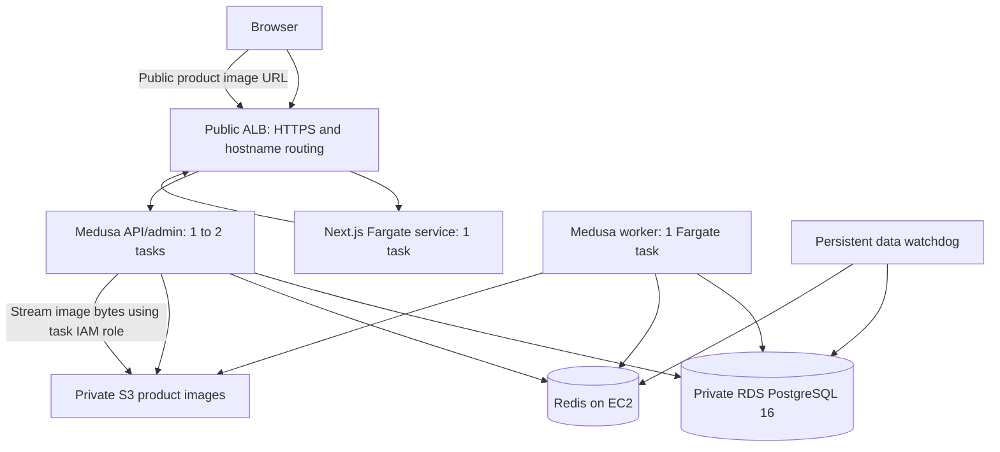

# AWS commerce demo

CloudFormation implementation of the approved course-project architecture. All regional resources use **ap-southeast-2**. The deployment profile is **aws-project**. This directory does not imply that any AWS resources have been created.

## Architecture and ownership



| Template | Resources and lifecycle |
| --- | --- |
| `foundation.yaml` | VPC, two public and two private database subnets across two AZs, security groups, retained ECR repositories; optional GitHub OIDC publishing role and ACM certificate |
| `data.yaml` | Single-AZ RDS `db.t4g.micro`, 20 GiB gp3, encrypted storage, generated secrets; Redis `t4g.micro`, 8 GiB encrypted EBS; private S3 and backend image proxy; shared session lease, persistent data watchdog, email notifications and monthly budget |
| `app.yaml` | Fargate task definitions and three services; ALB; bounded API scaling; CloudWatch dashboard; application shutdown watchdog; optional Route 53 aliases |

API: 1 vCPU / 2 GiB. Worker: 0.5 vCPU / 2 GiB. Storefront: 0.5 vCPU / 1 GiB. These are starting sizes, not validated capacity promises. API target CPU is 60%, desired task count is capped at two. Rolling deployments may temporarily run additional replacement tasks, and one-off migrations consume extra capacity. Worker count remains one.

Fargate uses public IPv4 for outbound access, with task ingress restricted to the ALB security group. No NAT Gateway, bastion, SSH ingress or Kubernetes control plane is provisioned. RDS has no public access. Redis is in a public subnet for outbound Docker pulls/SSM but allows inbound port 6379 only from application tasks. Redis transport is not TLS-encrypted; this is an isolated educational environment, not a production security baseline. RDS connections verify TLS using the AWS public CA bundle downloaded into the backend image.

The database and Redis host are single points of failure. Two-AZ subnet placement and API task replacement do not make the entire application highly available. The backend proxy serves **public product images only** at `https://<ApiDomain>/product-images/public-images/<key>`. S3 stays private with ACLs disabled; the application task IAM role reads objects. Do not upload private customer documents into the public image prefix or this dedicated image bucket.

## Product image delivery decision — 2026-11-08

The full Fargate/ALB/RDS architecture remains the course target; the tested single-EC2 Compose deployment is the fallback. CloudFront is replaced by a backend proxy because AWS project verification blocks distribution creation. The updated stack was deployed on November 8–9 and passed 14 public checks on November 9. See the [deployment report and evidence](../../docs/report/aws-fargate-deployment-2026-11-08.md).

`S3_FILE_URL=https://<ApiDomain>/product-images` and `S3_PUBLIC_IMAGE_PROXY=true` are supplied to API and worker tasks. Medusa's S3 provider prefixes new uploads with `public-images/` and returns URLs under that base. The public file-based route lives outside `/store`, so ordinary browser image requests do not need publishable-key headers. The route streams through Medusa's file service, sends `nosniff` and a one-hour public cache lifetime, and stops the S3 stream when the client disconnects. The file-based route uses Windows-safe named parameter directories (`[prefix]/[key]`). Use flat upload filenames, as the Admin uploader does; directory-style upload names are not supported by this route. Only JPEG, PNG, GIF, WebP and AVIF extensions in the public prefix are served; SVG, documents and keys outside the prefix are rejected. The prefix is the publication boundary, including for admin previews; do not use it for private files.

The data stack owns the private bucket and TLS-only bucket policy. Application task IAM permissions grant S3 access. `ImageUrl` now belongs to the **app stack output**, calculated from `ApiDomain`, rather than a data-stack CloudFront export. No distribution or origin access control is provisioned. Image traffic consumes API capacity, ALB capacity, S3 requests and internet transfer; there is no edge CDN cache. Load tests must include image traffic before choosing task sizes.

Existing database image URLs are not rewritten automatically. Existing S3 images intended for public delivery must be copied into `public-images/` and their catalog URLs updated in a separately reviewed migration; keep originals until verified. External image URLs remain unchanged. Do not broadly expose existing bucket keys as a migration shortcut.

The original `commerce-data` stack entered `ROLLBACK_FAILED`. On November 8 its seven retained resources were imported into the recovered data stack without replacements, followed by an `IN_SYNC` drift result. The full data and app updates are now deployed. The live file-module upload/read, public image delivery without an API key, direct S3 denial, missing-image and private-prefix checks passed; interactive admin upload/preview remains untested. For future recovery, preserve/import retained resources instead of creating a duplicate database or deleting data. See the [recovery and public verification record](../../docs/report/aws-fargate-deployment-2026-11-08.md).

## Cost model and operating limits

See `cost-estimate.json` for rates retrieved on 2026-10-27 from AWS Price List APIs and the exact arithmetic. Amounts are USD before credits and tax. Assumptions: three baseline tasks, six public IPv4 addresses (including two ALB addresses), one ALB LCU, minimum database/disk sizes, three secrets and one alarm-encryption KMS key.

| State / example | Modeled cost, before excluded variable items |
| --- | ---: |
| Running baseline | $0.22252/hour, plus retained monthly resources |
| Hibernate: app stack removed, RDS/Redis stopped | $5.728/month retained fixed resources |
| Pause for a full 730-hour month, ALB retained | $31.424/month |
| 40 running hours, otherwise hibernated, plus one month retained storage/secrets/key | $14.6288 |
| Baseline running for 730 hours | $168.1676/month |

Excluded: S3/ECR storage and requests, internet and inter-AZ transfer, logs/alarms/dashboard, Lambda/EventBridge/SSM/SNS/SQS requests, excess RDS CPU credits/backup storage, release overlap/migration tasks/scale-out, DNS/domain charges and taxes. This is an itemized baseline model, **not a complete bill or guaranteed upper bound**. Traffic can change LCU usage. Never rely on old-style free EC2/RDS hours; this project spends trial credit.

Initial session limit: four hours, renewable to a maximum of twelve per command. Both watchdogs check the shared UTC lease every five minutes. Expired or unreadable leases trigger shutdown attempts; failures raise alarms and failed async invocations go to an encrypted dead-letter queue. This is best-effort automation, not a hard spending cap. An in-flight update, service replacement, permission error or database transition can delay stopping.

Set `sessionHours` in local settings to change the default duration, or pass `--hours` explicitly. Starting with zero hours is rejected. One-off migration/seed/key tasks require a live lease, are marked `commerce-operation`, and are stopped by pause/hibernate or the application watchdog when the lease expires. If waiting for a one-off task fails or is interrupted, the management script requests its termination.

The data watchdog remains after app-stack deletion and stops RDS again if it automatically restarts after seven days. Keep its schedule enabled during hibernation. Confirm the SNS email subscription and monitor shutdown alarms. The project-wide monthly budget emails at $5/$10/$15 of gross usage excluding credits. Budget data is delayed and does not shut down resources. Check remaining credit and spend status in AWS Settings > Billing before each session.

## Domain configuration and remaining deployment inputs

The storefront hostname is `135791112.xyz`; the backend hostname is `api.135791112.xyz`. Both names target the same AWS load balancer, which routes by hostname. The Sydney ACM certificate must cover both names. The settings example includes these names in both foundation and application parameters.

1. Confirm DNS access for both hostnames, including the underscore-prefixed ACM validation CNAMEs. Choosing a hostname does not establish DNS control or create records.
2. Supply an operator email for budget and watchdog alerts.
3. Identify the DNS provider. If using an existing Route 53 hosted zone, supply its ID; this code does not purchase a domain or create a hosted zone.
4. Confirm the GitHub repository if using the optional publishing workflow. No GitHub resources or environment settings are created automatically.
5. Review this cost model and decide the first running window before applying a billable stack.

Copy `settings.example.json` to `settings.json` locally. That file is ignored by Git and Docker. It contains non-secret deployment inputs only: never put passwords, private keys or AWS access keys in it. Default stack prefix is `commerce`. Changing the prefix creates a different environment; preserve existing names.

`foundationParameters` accepts `GitHubRepository` (`owner/repository`), `GitHubOidcProviderArn`, `StoreDomain`, `ApiDomain`, and `HostedZoneId`. Leave optional values out until confirmed. If GitHub OIDC already exists in the AWS project, pass its ARN to avoid creating a duplicate provider. If both domains are supplied, foundation creates a Sydney ACM public certificate. Route 53 DNS validation is automatic only with `HostedZoneId`; otherwise add ACM's validation CNAMEs at your DNS provider while the change set executes. The stack waits for certificate validation.

`dataParameters.AlertEmail` is required. Database class may be `db.t4g.micro` or `db.t4g.small`; increasing it changes cost. Redis is ARM64, whereas application images are initially built for linux/amd64.

## Reviewed deployment and bootstrap

Use AWS CLI v2, Python 3 and Docker or the GitHub image workflow. No local Node installation is required when building in CI. CLI examples below are operator commands; run them only after the inputs and running window are confirmed. The management script deliberately separates planning from execution.

```bash
python3 deploy/cloudformation/manage.py plan foundation
python3 deploy/cloudformation/manage.py apply '<reviewed-change-set-ARN>'
python3 deploy/cloudformation/manage.py plan data
python3 deploy/cloudformation/manage.py apply '<reviewed-change-set-ARN>'
```

Inspect change-set replacements/deletions before applying. Account-aware pre-deployment checks happen when AWS creates change sets; local lint does not prove project policies, permissions, quotas or runtime health. AWS-managed CloudTrail controls may limit audit configuration in this project; inspect available event history during live validation.

Update plans preserve existing values for parameters omitted from local settings. Retained database, Redis host, bucket, secrets, encryption key and image repository replacements/removals are blocked by `apply` unless you explicitly pass `--allow-stateful-changes` after reviewing backups and recovery. This includes a newer Redis AMI resolving through the SSM parameter. Do not use that flag as a routine deployment option.

After data creation, confirm the SNS email subscription. The initial lease is zero, so the data watchdog stops data compute once provisioning completes. Run `start-data` before using one-off tasks.

Publish a backend image first. Set `BackendImage` to its immutable digest reference. For the **bootstrap only**, set `StorefrontImage` to that same backend reference and leave `StorefrontEnabled=false` and `PublishableKey=pk_bootstrap`. The storefront service stays at zero; no incorrect container is started. Set `CertificateArn` from the foundation output or an existing Sydney certificate covering both domains.

```bash
python3 deploy/cloudformation/manage.py plan app
python3 deploy/cloudformation/manage.py apply '<reviewed-change-set-ARN>'
python3 deploy/cloudformation/manage.py start-data --hours 4
python3 deploy/cloudformation/manage.py task migrate
python3 deploy/cloudformation/manage.py task seed
python3 deploy/cloudformation/manage.py task publishable-key
```

Read the **publishable** key from the API task's CloudWatch log group. It is intended for browsers, unlike secret/admin API keys. If the seed reports that data already exists, the key-print task still works. Preserve the seeded database rather than rerunning destructive operations.

Build the storefront with `NEXT_PUBLIC_MEDUSA_BACKEND_URL=https://<ApiDomain>` and that publishable key. Use the resulting storefront digest for `StorefrontImage`, put the same key into `PublishableKey`, and set `StorefrontEnabled=true`. Then plan/apply the app update and start the session:

```bash
python3 deploy/cloudformation/manage.py plan app
python3 deploy/cloudformation/manage.py apply '<reviewed-change-set-ARN>'
python3 deploy/cloudformation/manage.py start --hours 4
python3 deploy/cloudformation/manage.py status
```

`plan app` stages services at zero. `start` starts and waits for data services, verifies Redis via SSM, drains existing services, runs a one-off migration task and checks its exit code, then starts services and restores API scaling. A failure leaves the lease active until expiry; inspect and pause explicitly rather than assuming failure means zero cost. Initial SSM agent registration can take several minutes; if it is not yet online, retry `start-data` after checking instance initialization logs.

If `HostedZoneId` is supplied to the app stack, Route 53 aliases are managed automatically. Otherwise create two external DNS CNAMEs pointing to the `LoadBalancerDns` output and update them after app-stack recreation. Keep DNS records unproxied initially to simplify HTTPS debugging.

Check `https://<ApiDomain>/health` and `https://<StoreDomain>/health`, browse the seeded `/vn` storefront and complete a cash-on-delivery test order. The storefront health endpoint only checks liveness; a successful checkout is the readiness gate. Creating the first Medusa administrator is a separate one-off operator task; keep its password out of templates, logs and workflow inputs.

## Releases and GitHub workflow

`.github/workflows/aws-images.yml` builds/pushes immutable images and uploads digest references in `aws-release.json`. Create a protected GitHub environment named `aws-demo`. Set `AWS_IMAGE_PUBLISH_ROLE_ARN` from the optional foundation role output and optionally `AWS_FOUNDATION_STACK`. The OIDC trust is restricted to this repository and environment. Set required reviewers on the environment.

The publishing role can push to these two ECR repositories and read foundation outputs. **It cannot deploy infrastructure or read application secrets.** Deployment is the explicit change-set plan/apply/start sequence above, using the operator's existing AWS login. This preserves a review step for spending and resource replacement. No GitHub repository settings are changed by this implementation.

For subsequent releases, publish both required images, update digest references in local settings, pause, plan/apply, then start. Migrations must be backward-compatible with the previous release. Keep previous digests for rollback; do not automatically roll back a database migration. ECR lifecycle removes only untagged images after one day. Periodically prune old tagged releases after checking active task definitions and rollback requirements.

## Pause, hibernate and recovery

```bash
python3 deploy/cloudformation/manage.py renew --hours 4
python3 deploy/cloudformation/manage.py pause
python3 deploy/cloudformation/manage.py status
python3 deploy/cloudformation/manage.py hibernate
```

`pause` expires the lease, suspends scaling, drains services, reconciles the CloudFormation `Running` parameter and invokes the persistent data watchdog. Check status again until RDS and Redis actually report stopped. The ALB remains billable.

`hibernate` pauses first, then deletes **only the app stack** and waits for deletion. RDS, Redis, S3, ECR, secrets, alert key and persistent watchdog remain. Starting after hibernation requires `plan app`, reviewed `apply`, DNS verification and `start` again. Services always use the same architecture; this is a lifecycle change, not a migration to another deployment design.

Do not delete the data or foundation stack as a routine shutdown. Retained resources survive as billable orphans and are not automatically re-adopted when recreating a stack. Database deletion protection remains enabled. Redis root EBS has delete-on-termination disabled and the host is retained; replacement can leave an old disk requiring manual recovery. Never format or discard that disk without reviewing its contents and a backup plan.

### Retained database recovery guard

`retained-guard.yaml` is an optional recovery stack for a retained database whose normal data watchdog was removed during rollback. It checks one database every five minutes and requests a stop whenever it becomes available, including after RDS automatically restarts a stopped instance. It normally has no renewable lease (`RecoveryDeadline=0`). During retained-resource import only, a reviewed `RecoveryDeadline` Unix UTC timestamp can allow a bounded startup window; after the deadline the guard resumes stopping the database. Keep that window at most four hours and restore the normal data watchdog before removing the guard. Supply the database identifier as `DatabaseId` and deploy it in Sydney under the name `<stackPrefix>-retained-guard` only after reviewing the need for this additional persistent stack.

Restore normal data-stack ownership and its watchdog before removing this guard. Outside a bounded recovery window, delete the guard before intentionally starting the database; otherwise it will stop it again. `start-data` and `start` refuse startup while a guard stack with that name exists. The recovery guard has seven-day logs but no email failure alarm; check its executions while it is in use. Stopping compute does not remove retained database, secret, image repository or encryption-key charges.

See [live validation results](validation-2026-11-01.md) for the failed CloudFront deployment, temporary integration test and recovery state. That historical failure was recovered during the [November 8–9 deployment](../../docs/report/aws-fargate-deployment-2026-11-08.md).

Watchdog shutdown deliberately changes runtime ECS counts/scaling outside CloudFormation. `start` reconciles these settings and `pause` updates the template parameter. Expect lifecycle-induced drift after automatic expiry; review unrelated drift separately.

For long gaps, snapshot-and-delete RDS may reduce retained storage costs, but requires separate explicit approval, a verified restore and a different recovery procedure. This implementation does not perform that operation. A database snapshot alone does not protect Redis workflow state; back up Redis AOF before destructive host changes.

## Showcase experiment

Use `load/catalog.js` with a controlled ramp, initially below the existing 30 requests/second preset. Run the load generator outside the application tasks. Capture CPU/memory, API task count, latency p95, errors, scaling events and running costs. Show API 1-to-2 task scale-out and subsequent scale-in, then stop one task to demonstrate ECS replacement. Do not promise scaling improves database-bound performance: the database or Redis can become the bottleneck.

`load/checkout.js` creates orders and consumes inventory. Use a seeded disposable demonstration dataset, start with its `SMOKE=1` mode and cap any higher-rate test. Always pause or hibernate immediately afterward and verify states.

## Validation

Install the approved validators in an isolated environment: `cfn-lint==1.58.0` (includes PyYAML) and official `cfn-guard` 3.2.1. Run:

```bash
cfn-lint --regions ap-southeast-2 --template deploy/cloudformation/foundation.yaml deploy/cloudformation/data.yaml deploy/cloudformation/app.yaml
cfn-guard validate --rules deploy/cloudformation/security.guard --data deploy/cloudformation/foundation.yaml deploy/cloudformation/data.yaml deploy/cloudformation/app.yaml --output-format json
python3 -m unittest discover -s deploy/cloudformation/tests -v
```

The Guard rules enforce this project's encryption, private bucket/database, retained data and fixed-cost service constraints. They are project-specific rules, not a complete AWS compliance assessment. Additional AWS-managed rules are available at https://github.com/aws-cloudformation/aws-guard-rules-registry.

Also run backend/storefront lint and type checks using the repository's npm version. Integration tests need a live PostgreSQL service; local static checks do not validate live ECS/RDS/DNS/checkout behavior. Live change-set validation and a timed deployment rehearsal remain required before calling the system deployed.
