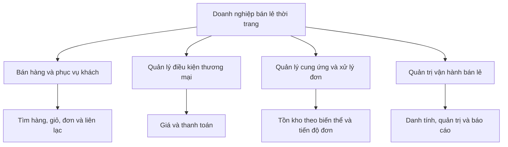

# Bản đồ năng lực nghiệp vụ

Năng lực trả lời câu hỏi **doanh nghiệp có thể làm gì**, không phải tên module phần mềm, nhóm triển khai hoặc đơn vị triển khai hạ tầng. Mọi mục bên dưới là **PROJECT-PROPOSED** cho doanh nghiệp giả định. Mã BREQ lấy từ [BRD](BRD.md); câu hỏi về người phụ trách và chính sách nằm trong [sổ nguồn](../00-project/source-and-assumption-register.md). [SRC-C-001, SRC-C-004]

## Phân cấp 1 và 2

Sơ đồ **đề xuất / To-Be** này phân nhóm trách nhiệm kinh doanh; mũi tên thể hiện phân cấp, không phải lời gọi giữa các dịch vụ. Product là mẫu/mặt hàng được giới thiệu; biến thể/SKU là lựa chọn có thể bán. Sản phẩm không có size vẫn có thể cần một biến thể bán được, chờ OPEN-SKU-001.

## Danh mục năng lực

Tất cả ở trạng thái Draft. Đầu vào/đầu ra là thông tin nghiệp vụ. “Cốt lõi” nghĩa là cần cho chín use case, **không** có nghĩa đã triển khai.

| Mã / nhóm cấp 1 | Định nghĩa; đầu vào → đầu ra nghiệp vụ | Vai trò phụ trách | BREQ liên quan | Ưu tiên / giá trị |
|---|---|---|---|---|
| CAP-IDENT-001 / Quản trị | Xác lập danh tính khách/nhân viên và quyền phù hợp; thông tin danh tính → ngữ cảnh được phép | Quản trị viên | BREQ-IDENT-001, BREQ-SEC-001 | Cốt lõi / bảo vệ truy cập |
| CAP-CAT-001 / Bán hàng | Quản lý và giới thiệu sản phẩm, biến thể, điều kiện có thể bán; thông tin hàng → đề nghị bán | Chủ danh mục | BREQ-CAT-001 | Cốt lõi / lựa chọn chính xác |
| CAP-DISC-001 / Bán hàng | Giúp khách tìm đề nghị bán phù hợp; ý định tìm → sản phẩm liên quan | Trưởng nhóm sản phẩm | BREQ-DISC-001, BREQ-CAP-001 | Cốt lõi / tìm hàng |
| CAP-CART-001 / Bán hàng | Giữ lựa chọn mua còn chỉnh được; biến thể/số lượng → giỏ | Trưởng nhóm sản phẩm | BREQ-CART-001, BREQ-CAP-001 | Cốt lõi / chuẩn bị mua |
| CAP-ORD-001 / Bán hàng | Quyết định và quản lý kết quả đơn; ý định đặt → đơn/mã hoặc từ chối | Vận hành | BREQ-SALES-001, BREQ-ORD-001, BREQ-TRACK-001 | Cốt lõi / giao dịch đáng tin |
| CAP-NOT-001 / Bán hàng | Thông báo khi đơn được nhận và khi có mốc trạng thái đơn/giao được phép công bố; theo dõi lỗi gửi | Vận hành | BREQ-NOT-001 | Cốt lõi / khách nắm tình hình |
| CAP-PRICE-001 / Thương mại | Quản lý giá cam kết; điều kiện giá → số tiền được chấp thuận | Chủ thương mại | BREQ-PRICE-001 | Cốt lõi / cam kết đúng |
| CAP-PAY-001 / Thương mại | Ghi lựa chọn và kết quả thu tiền riêng với đơn; lựa chọn/kết quả → trạng thái thanh toán | Chủ thương mại | BREQ-PAY-001 | Cốt lõi / minh bạch tiền |
| CAP-INV-001 / Cung ứng | Kiểm soát số có thể bán theo biến thể; hàng và cam kết → khả năng cung ứng | Vận hành | BREQ-INV-001 | Cốt lõi / không bán vượt |
| CAP-FUL-001 / Cung ứng | Điều phối tiến độ đơn và bàn giao xử lý; đơn đã nhận → mốc trạng thái | Vận hành | BREQ-TRACK-001 | Cốt lõi / theo dõi được |
| CAP-ADMIN-001 / Quản trị | Quản lý dữ liệu bán lẻ theo quyền và xử lý ngoại lệ; thao tác nhân viên → thay đổi có kiểm soát | Quản trị viên | BREQ-OPS-001, BREQ-REL-001 | Cốt lõi / vận hành có kiểm soát |
| CAP-REPORT-001 / Quản trị | Tổng hợp hoạt động và gián đoạn tối thiểu; dữ kiện đơn/trạng thái → báo cáo | Quản trị viên | BREQ-OPS-001, BREQ-REL-001 | Cốt lõi / nắm tình hình |
| CAP-PROMO-001 / Thương mại | Định nghĩa điều kiện bán theo chiến dịch nếu được duyệt; điều kiện chiến dịch → ưu đãi hợp lệ | Chủ thương mại | Chưa có, chờ OPEN-PROMO-001 | Tùy chọn / giá trị chiến dịch |
| CAP-RET-001 / Bán hàng | Xử lý yêu cầu đổi/trả nếu được duyệt; yêu cầu → quyết định | Vận hành | Chưa có, chờ OPEN-POLICY-001 | Tùy chọn / sau bán |

CAP-CAT sở hữu thông tin sản phẩm/biến thể; CAP-DISC dùng chúng để hỗ trợ tìm hàng. CAP-ORD quyết định kết quả đơn; CAP-PAY ghi trạng thái thanh toán; CAP-INV kiểm soát cung ứng; CAP-FUL theo dõi xử lý; CAP-NOT liên lạc. Một quy trình có thể dùng nhiều năng lực và một năng lực có thể phục vụ nhiều quy trình. Không năng lực nào mặc định phải là một microservice riêng.

## Độ phủ và rà soát

Mọi BREQ mức MUST trong BRD có ít nhất một năng lực cốt lõi. CAP-ADMIN/CAP-REPORT hỗ trợ nhận biết sự cố ở mức kinh doanh; mục tiêu định lượng về phát hiện, phục hồi và quản lý thay đổi chuyển sang NFR/vận hành sau. CAP-PROMO và CAP-RET vẫn tùy chọn, không có BREQ mức MUST. Người phụ trách mới là vai trò, chưa có người duyệt cụ thể. **Trạng thái rà soát: Draft.**

| Ngày | Phiên bản | Thay đổi |
|---|---|---|
| 2026-11-15 | 0.1.0 | Tạo phân cấp năng lực và danh mục liên kết BRD. |
