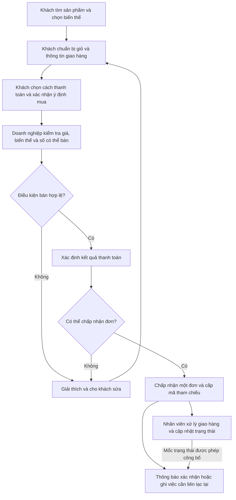
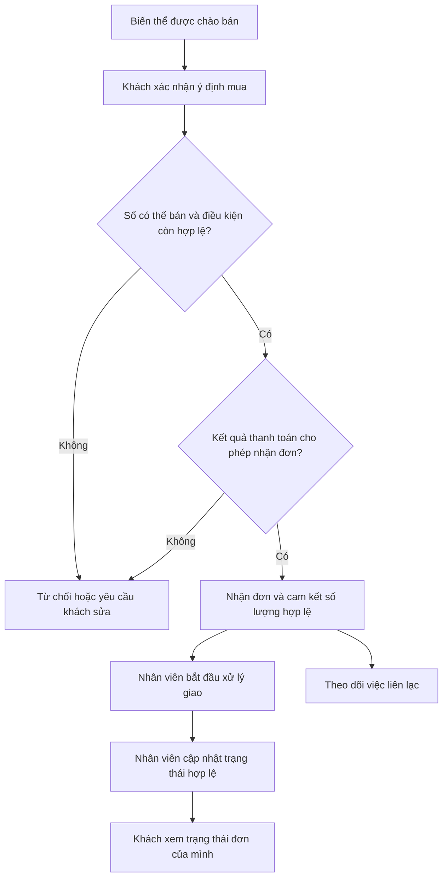

# Quy trình nghiệp vụ

Đây là các quy trình **đề xuất / To-Be** cho doanh nghiệp giả định. Tham chiếu có thể quan sát duy nhất là hành trình công khai trên SOMEHOW: chọn hàng → thông tin giao/thu tiền → xác nhận. Nguồn đó không xác minh quy trình nhận đơn hay giao hàng nội bộ của họ. [SRC-E-001, SRC-E-002, ASM-001]

## Danh mục quy trình

Mọi dòng có trạng thái Draft. Người phụ trách nghiệp vụ cần rà quy tắc chuyển trạng thái trước khi viết chi tiết SRS.

| Mã | Mục đích; kích hoạt và người tham gia | Tiền điều kiện → hậu điều kiện | BREQ / RULE |
|---|---|---|---|
| PROC-CAT-001 | Công bố/cập nhật đề nghị bán; người phụ trách danh mục thay đổi hàng | Có thông tin sản phẩm, biến thể và điều kiện → công bố hoặc giữ lại | BREQ-CAT-001, BREQ-PRICE-001; RULE-CAT-001, RULE-PRICE-001 |
| PROC-SALES-001 | Tìm/chọn biến thể; khách xem hoặc tìm | Có hàng để xem → chọn rõ biến thể hoặc không chọn được | BREQ-DISC-001, BREQ-CAT-001; RULE-CAT-001 |
| PROC-CART-001 | Chuẩn bị giỏ; khách thêm/sửa/xóa | Đã chọn biến thể → giỏ có thể chỉnh | BREQ-CART-001; RULE-CAT-001 |
| PROC-ORD-001 | Đặt hàng; khách xác nhận ý định, vận hành ghi nhận kết quả | Có giỏ và lựa chọn giao/thu tiền → đơn/mã được nhận hoặc từ chối | BREQ-SALES-001, BREQ-ORD-001; RULE-ORD-001, RULE-PRICE-001 |
| PROC-PAY-001 | Xử lý lựa chọn/kết quả thanh toán; khách và tác nhân thanh toán | Có lựa chọn hợp lệ → trạng thái thanh toán riêng | BREQ-PAY-001; RULE-PAY-001, RULE-PAY-002 |
| PROC-INV-001 | Xét/giữ/trả khả năng cung ứng; vận hành | Biết nguồn hàng theo biến thể → cam kết hợp lệ hoặc không cam kết | BREQ-INV-001; RULE-INV-001 |
| PROC-FUL-001 | Xử lý và theo dõi đơn; nhân viên và khách | Đơn được nhận → khách có quyền xem trạng thái hiện tại | BREQ-TRACK-001; RULE-FUL-001, RULE-ACCESS-001 |
| PROC-NOT-001 | Thông báo/theo dõi gửi lỗi; vận hành và khách | Đơn được nhận hoặc có mốc trạng thái đơn/giao đủ điều kiện → gửi được hoặc có việc cần xử lý | BREQ-NOT-001; RULE-NOT-001/002 |
| PROC-REPORT-001 | Xem hoạt động cơ bản; nhân viên có quyền | Có dữ kiện bán hàng → báo cáo và hướng xử lý ngoại lệ | BREQ-OPS-001, BREQ-REL-001; RULE-REPORT-001 |
| PROC-RET-001 | Xem yêu cầu đổi/trả nếu được duyệt | OPEN-POLICY-001 chưa giải quyết | Tùy chọn; RULE-RET-001 còn mở |
| PROC-PROMO-001 | Đặt điều kiện chiến dịch nếu được duyệt | OPEN-PROMO-001 chưa giải quyết | Tùy chọn; chưa có quy tắc chuẩn |

## Luồng đầu cuối của khách và vận hành

**Đề xuất / To-Be:** PROC-SALES-001 → PROC-CART-001 → PROC-ORD-001; PROC-PAY-001 và PROC-INV-001 tham gia tại ranh giới nhận đơn, sau đó là PROC-FUL-001 và PROC-NOT-001. Mũi tên là bàn giao nghiệp vụ, không phải kết nối mạng. Khi khách phải sửa thông tin, chưa có đơn được nhận cho tới lúc qua kiểm tra. Thông báo trạng thái chỉ phát sinh từ chuyển trạng thái hợp lệ và được duyệt công bố; bộ mốc cụ thể vẫn theo OPEN-USR-006/OPEN-FUL-001.

## Quyết định về đơn, nguồn hàng và xử lý giao

**Đề xuất / To-Be:** PROC-INV-001, PROC-PAY-001, PROC-ORD-001 và PROC-FUL-001 là bốn trách nhiệm khác nhau. Nhận đơn chưa đồng nghĩa đã thu tiền hay giao xong. Thời điểm giữ/trả hàng và bộ trạng thái còn ở OPEN-STOCK-001, OPEN-FUL-001.

## Luồng chính và ngoại lệ của quy trình cốt lõi

| Quy trình | Các bước nghiệp vụ chính | Nhánh khác / ngoại lệ và kết quả cần có |
|---|---|---|
| PROC-CAT-001 | Chủ danh mục xác định sản phẩm, biến thể, giá, điều kiện bán rồi công bố | Thiếu biến thể/giá hoặc SKU ngừng bán → không chào bán; hàng không có size → OPEN-SKU-001 |
| PROC-SALES-001 | Khách xem/tìm, đọc đề nghị bán và chọn biến thể | Không có kết quả → thông báo rõ; điều kiện bán thay đổi → kiểm lại khi mua |
| PROC-CART-001 | Khách chỉnh biến thể/số lượng và xem tổng dự kiến | Biến thể ngừng bán/hết hàng → sửa giỏ trước khi nhận đơn |
| PROC-ORD-001 | Khách xác nhận ý định; doanh nghiệp kiểm lại giá và hàng; nhận một đơn hoặc từ chối; trả kết quả/mã | Gửi lặp hoặc timeout → cùng kết quả đã biết hoặc xử lý tình trạng chưa rõ, không nhận thêm đơn ngoài ý muốn; đổi giá → OPEN-PRICE-001 |
| PROC-PAY-001 | Khách chọn COD hoặc mô phỏng; ghi trạng thái thanh toán tách với đơn | Mô phỏng lỗi → không báo đơn thành công; COD → chưa thu tiền; timeout → trạng thái chưa xác định, không đoán đã thu |
| PROC-INV-001 | Xác minh số có thể bán theo SKU; cam kết cho đơn đã nhận; trả hàng khi chính sách cho phép | Hai khách cùng mua món cuối → không cam kết vượt số có thể bán; hủy/trả hàng → OPEN-STOCK-001 |
| PROC-FUL-001 | Nhân viên nhận đơn, xử lý bàn giao hợp lệ và đổi trạng thái; khách xem đơn của mình | Chuyển trạng thái sai → từ chối và giữ trạng thái trước; xem đơn người khác → chặn; không mặc định tích hợp hãng vận chuyển |
| PROC-NOT-001 | Đơn được nhận hoặc trạng thái đơn/giao đủ điều kiện phát sinh nhu cầu thông báo; theo dõi kết quả gửi; nhân viên xử lý lỗi | Provider lỗi/gửi lặp hoặc trạng thái chưa được phép công bố → đơn/trạng thái không bị đổi, không gửi thông tin sai; mốc công bố theo OPEN-USR-006, kênh và mục tiêu gửi theo OPEN-USR-009 |
| PROC-REPORT-001 | Nhân viên có quyền xem tổng hợp đơn, thanh toán, giao và ngoại lệ | Chỉ số thiếu/mơ hồ → nêu giới hạn báo cáo; danh mục chỉ số OPEN-REPORT-001 |

Kiểm tra danh tính/quyền áp dụng với thao tác danh mục, xử lý đơn và báo cáo. Khách chỉ được xem đơn của mình; hành vi của khách mua không cần tài khoản chờ OPEN-GUEST-001. [BREQ-IDENT-001, BREQ-SEC-001, RULE-ACCESS-001]

## Tham chiếu As-Is và trạng thái rà soát

Điều kiện giao dịch công khai của SOMEHOW liệt kê chọn sản phẩm/size/màu vào giỏ, nhập thông tin giao và thanh toán, xác nhận đơn, có thể được nhân viên gọi xác nhận. Đây là nội dung trang công khai tại ngày 2026-11-15, **không** chứng minh thời gian xử lý, cách giữ hàng hay thiết kế hệ thống của họ. [SRC-E-002]

Không thể khẳng định As-Is thực tế cho doanh nghiệp giả định khi chưa phỏng vấn. Mọi sơ đồ To-Be và nhánh ngoại lệ đều cần người phụ trách nghiệp vụ/vận hành rà soát. **Trạng thái: Draft**; quyết định mở nằm trong [sổ nguồn](../00-project/source-and-assumption-register.md).

| Ngày | Phiên bản | Thay đổi |
|---|---|---|
| 2026-11-15 | 0.1.0 | Lập danh mục quy trình cốt lõi, hai luồng nghiệp vụ và bảng xử lý ngoại lệ. |
