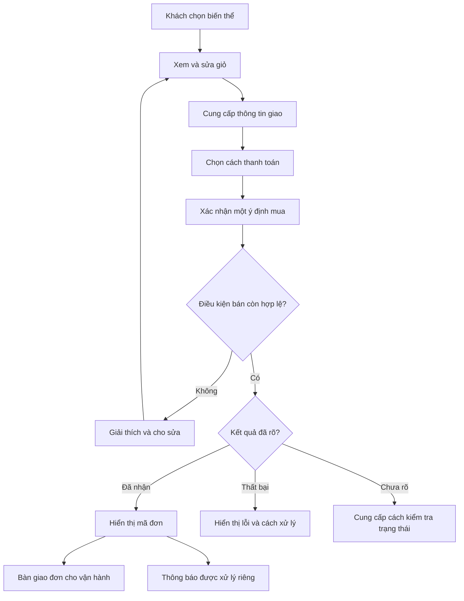
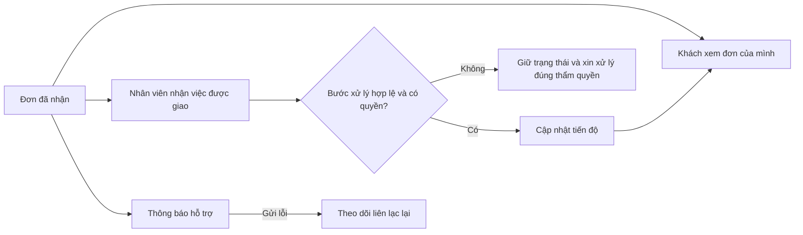

# Hành trình người dùng

**Trạng thái:** Draft — Business Baseline và quyền người dùng chưa được rà soát chính thức. J-01..J-04 giữ **đúng ý nghĩa** trong tài liệu phạm vi lịch sử `docs/02_Project_Scope_and_Assumptions.md` §2. Đây là hành trình **đề xuất / To-Be** cho doanh nghiệp giả định; không phải mô tả quy trình nội bộ của SOMEHOW hay kết quả thử nghiệm người dùng. [SRC-P-002, SRC-E-002]

## 1. Phương pháp và danh mục

Mỗi giai đoạn ghi **ý định → hành động của vai trò → phản hồi nghiệp vụ → thông tin cần hiểu/quyết định tiếp → rủi ro**. Điểm bắt đầu có thể trước khi vào kênh bán và điểm kết thúc có thể sau khi rời màn hình; mũi tên trong Mermaid là diễn biến/handoff nghiệp vụ, không phải thứ tự gọi API. **ALT** là nhánh hợp lệ khác; **EXC** là lỗi/bất thường và kết quả người dùng cần thấy. Actor/goal được định nghĩa trong [tài liệu vai trò](actors-and-user-goals.md); quy trình và quy tắc chuẩn ở [Business](../01-business/business-processes.md) và [Rules](../01-business/business-rules.md).

| Journey / nghĩa lịch sử | Actor và mục tiêu | Bắt đầu → kết thúc | Liên kết nghiệp vụ |
|---|---|---|---|
| J-01 Xem và chọn hàng | ACT-CUST; GOAL-CUST-001/002/006 | Nảy sinh nhu cầu mua → chọn biến thể hoặc tiếp tục tìm | BREQ-DISC-001, BREQ-CAT-001; PROC-SALES-001; RULE-CAT-001 |
| J-02 Đặt hàng | ACT-CUST; GOAL-CUST-003/004/005 | Có biến thể muốn mua → biết kết quả đặt đơn và cách xử lý tiếp | BREQ-CART-001, BREQ-SALES-001, BREQ-ORD-001, BREQ-PAY-001; PROC-CART-001/ORD-001/PAY-001/INV-001 |
| J-03 Sau khi đặt hàng | ACT-CUST, ACT-STAFF; GOAL-CUST-005/006, GOAL-STAFF-001/002 | Có đơn đã nhận → khách biết tiến độ, nhân viên xử lý đúng quyền | BREQ-TRACK-001, BREQ-NOT-001, BREQ-SEC-001; PROC-FUL-001/NOT-001; RULE-ACCESS-001/FUL-001 |
| J-04 Vận hành cửa hàng | ACT-ADMIN, ACT-STAFF theo quyền; GOAL-STAFF-003, GOAL-ADMIN-001/002/003 | Cần cập nhật hàng/đơn hoặc xem tình hình → thay đổi hợp lệ/báo cáo rõ | BREQ-CAT-001, BREQ-INV-001, BREQ-OPS-001; PROC-CAT-001/INV-001/REPORT-001 |

Khách chưa đăng nhập có thể xem đề nghị bán công khai; quyền giỏ, đặt và xem đơn chờ OPEN-USR-001/002. Việc hỗ trợ chọn size chỉ là thông tin hữu ích, mức ưu tiên chờ OPEN-USR-010. Không giả định nhân khẩu, thói quen mua hay tỷ lệ chuyển đổi.

## 2. J-01 — Xem và chọn hàng

**Điểm vào/điều kiện:** khách có nhu cầu mua nhưng có thể chưa biết mẫu nào; kênh có danh mục công khai. **Kết quả mong muốn:** xác định sản phẩm và biến thể có thể mua, hiểu giá/tình trạng bán; chưa phát sinh đơn. ACT-CUST có thể chưa đăng nhập. Liên quan BP-01/06, OBJ-01/05, CAP-DISC-001/CAT-001, PROC-SALES-001, RULE-CAT-001.

| Chặng | Ý định và hành động của khách | Phản hồi nghiệp vụ; thông tin cần thấy và quyết định | Rủi ro/câu hỏi |
|---|---|---|---|
| Trước khi xem | Tìm món phù hợp nhu cầu | Đề nghị bán công khai và cách bắt đầu tìm; chọn xem danh mục hay tìm từ khóa | Không suy đoán động lực hoặc tần suất mua |
| Khám phá | Xem danh mục/collection hoặc tìm | Kết quả liên quan, phân biệt không có kết quả; quyết định mở mặt hàng | Tìm kiếm và ảnh có thể thiếu thông tin |
| Xem sản phẩm | Đọc mô tả, ảnh, giá, thông tin size nếu có | Biết mẫu hàng là gì; quyết định có phù hợp không | Thông tin size chưa chốt MUST/SHOULD |
| Chọn biến thể | Chọn màu/size áp dụng | Thấy **đúng biến thể/SKU**, giá và khả năng mua của lựa chọn đó; quyết định tiếp tục hay đổi lựa chọn | Chọn mẫu nhưng chưa chọn biến thể |
| Kết thúc | Thêm lựa chọn vào giỏ hoặc quay lại tìm | Giỏ nhận đúng biến thể/số lượng, hoặc tiếp tục khám phá | Điều kiện bán có thể đổi trước checkout |

| Mã | Kích hoạt | Kết quả khách cần thấy; cơ sở |
|---|---|---|
| ALT-J01-001 | Khách chưa biết size phù hợp | Có thông tin chọn size nếu thuộc phạm vi; nếu chưa có, không hứa thông tin cá nhân hóa; OPEN-USR-010 |
| EXC-J01-001 | Tìm không ra sản phẩm | Nêu rõ không có kết quả và cho đường tiếp tục tìm; BREQ-DISC-001 |
| EXC-J01-002 | Biến thể ngừng bán hoặc hết khả năng cung ứng | Không gây hiểu nhầm còn hàng; cho chọn biến thể khác hoặc quay lại; RULE-CAT-001, RULE-INV-001 |
| EXC-J01-003 | Giá/tình trạng đổi trước khi mua | Trình bày điều kiện mới để khách quyết định lại, không cam kết sai giá cũ; RULE-PRICE-001, OPEN-PRICE-001 |

**Bàn giao:** biến thể và số lượng khách chọn chuyển sang J-02; giá và số có thể bán phải được kiểm lại khi quyết định nhận đơn. **Cần xác minh:** cách thể hiện biến thể không có size/màu, thông tin size tối thiểu, mức dễ hiểu khi không có kết quả. Không có dữ liệu thử khả dụng hay accessibility thực tế.

## 3. J-02 — Giỏ, checkout và kết quả đặt hàng

**Điểm vào/điều kiện:** khách đã chọn ít nhất một biến thể, muốn mua; quyền checkout của khách vãng lai chưa chốt. **Kết quả mong muốn:** một ý định mua cho ra kết quả **đã nhận / thất bại / chưa rõ**, có mã đơn nếu đã nhận. Nhận đơn, đã thu tiền và đã giao là ba trạng thái khác nhau. Liên quan BP-01/02/03, OBJ-01..04, CAP-CART-001/ORD-001/PAY-001/INV-001/NOT-001, PROC-CART-001/ORD-001/PAY-001/INV-001/NOT-001 và RULE-ORD-001/PAY-001/NOT-001.

| Chặng | Ý định và hành động của khách | Phản hồi nghiệp vụ; thông tin cần thấy và quyết định | Rủi ro/câu hỏi |
|---|---|---|---|
| Chuẩn bị | Thêm/sửa biến thể và số lượng, xem giỏ | Giỏ và tổng tiền **dự kiến** phản ánh lựa chọn; khách sửa hoặc tiếp tục | Giá/khả năng cung ứng còn có thể đổi |
| Thông tin giao | Cung cấp liên hệ, địa chỉ, cách giao hợp lệ | Biết thông tin nào cần sửa, phí/điều kiện giao nếu áp dụng | Thiếu địa chỉ; OPEN-PRICE-001 |
| Cách thanh toán | Chọn COD hoặc mô phỏng phù hợp phạm vi | Hiểu COD chưa phải đã thu; mô phỏng không chuyển tiền thật | OPEN-USR-007; không nhận tiền thật |
| Xác nhận ý định | Đối chiếu biến thể, số lượng, giá và điều kiện rồi xác nhận | Doanh nghiệp kiểm lại điều kiện bán và kết quả thanh toán cần thiết; khách không phải đoán đơn đã tồn tại | Hết hàng, giá đổi, gửi lặp, timeout |
| Kết quả | Nhận kết quả rõ ràng hoặc cách xác minh tình trạng chưa rõ | Nếu đã nhận, có mã đơn; nếu thất bại, không báo thành công; nếu chưa rõ, có đường kiểm tra trước khi thử lại | RULE-ORD-001, RULE-ORD-002 |
| Sau kết quả | Chuyển sang theo dõi đơn | Đơn đã nhận được bàn giao cho vận hành; thông báo là công việc riêng | Lỗi gửi không hủy đơn; RULE-NOT-001 |

| Mã | Kích hoạt | Kết quả người dùng cần thấy; liên kết |
|---|---|---|
| ALT-J02-001 | Đổi số lượng/biến thể trước khi đặt | Giỏ và tổng dự kiến cập nhật; khách xác nhận lựa chọn mới; BREQ-CART-001 |
| ALT-J02-002 | Chọn COD thay mô phỏng | Thấy phương thức và hiểu đơn được nhận chưa đồng nghĩa đã thu tiền; RULE-PAY-002 |
| EXC-J02-001 | Size/màu hết hàng khi checkout, kể cả hai khách mua món cuối | Không báo nhận đơn sai; chỉ rõ cần sửa giỏ; RULE-INV-001 |
| EXC-J02-002 | Gửi lặp cùng ý định mua hoặc thử lại sau timeout | Không có thêm đơn ngoài ý muốn; có cách xác minh kết quả cũ; RULE-ORD-001, OPEN-RETRY-001 |
| EXC-J02-003 | Mô phỏng thanh toán thất bại | Không hiện thành công giả; giải thích thất bại và đường sửa/thử lại hợp lệ; RULE-PAY-001, RULE-ORD-002 |
| EXC-J02-004 | Liên hệ/địa chỉ sai hoặc thiếu | Chỉ rõ trường cần sửa, giữ thông tin giỏ còn hợp lệ; BREQ-SALES-001 |
| EXC-J02-005 | Kết nối gián đoạn hoặc phản hồi chưa rõ | Cho cách kiểm tra tình trạng trước khi tạo ý định mới; không suy diễn đã nhận hay thất bại; OPEN-RETRY-001 |
| EXC-J02-006 | Gửi thông báo thất bại sau đơn hợp lệ | Kết quả đơn không đổi; vẫn có mã/trạng thái để tra; vận hành theo dõi liên lạc lại; RULE-NOT-001 |

**Chú thích:** Hành trình khách **đề xuất / To-Be**, không phải quy trình nội bộ SOMEHOW đã quan sát. Các bước là quyết định nghiệp vụ, không phải thứ tự gọi API. **Bàn giao:** đơn đã nhận sang J-03; thông báo phục vụ khách nhưng thất bại không sửa kết quả đơn. **Cần xác minh:** guest checkout, cách gọi trạng thái chưa rõ, thời điểm cam kết giá, quy tắc nhận diện cùng ý định mua và kênh thông báo.

## 4. J-03 — Sau đặt hàng: khách theo dõi, nhân viên xử lý

**Điểm vào/điều kiện:** có đơn được nhận hợp lệ. ACT-CUST muốn biết tiến độ và hành động cần làm; ACT-STAFF muốn biết đơn được giao và cập nhật bước xử lý được phép. **Kết quả:** trạng thái đơn có nghĩa, chỉ người có quyền thấy thông tin riêng. Không mặc định theo dõi GPS hoặc tích hợp hãng vận chuyển. Liên quan GOAL-CUST-005/006, GOAL-STAFF-001/002; BREQ-TRACK-001/NOT-001/SEC-001; CAP-FUL-001/NOT-001; PROC-FUL-001/NOT-001; RULE-ACCESS-001/FUL-001/NOT-001.

| Chặng | Ý định/hành động | Phản hồi và thông tin cần hiểu | Ngoại lệ có thể gặp |
|---|---|---|---|
| Sau nhận đơn | Khách lưu mã và xem tóm tắt đơn của mình | Thấy đơn đã nhận, trạng thái đơn và thanh toán được phân biệt | Thông báo chưa tới |
| Tiếp nhận xử lý | Nhân viên tìm đơn thuộc phần việc được giao | Biết đơn nào cần xử lý, điều kiện giao và thông tin tối thiểu cần thiết | Đơn ngoài quyền |
| Thực hiện | Nhân viên chuẩn bị/bàn giao theo chính sách và cập nhật trạng thái hợp lệ | Khách chỉ thấy mốc được phép công bố; không gọi “đã giao” khi chưa có căn cứ | Chuyển trạng thái sai |
| Theo dõi tiếp | Khách tự xem lại hoặc nhận thông báo nếu có | Biết trạng thái mới hoặc việc cần liên hệ; thông báo chỉ hỗ trợ | Kênh gửi lỗi/chậm |

| Mã | Kích hoạt | Xử lý mong đợi |
|---|---|---|
| ALT-J03-001 | Khách tra trạng thái qua kênh chính khi thông báo chậm | Vẫn xem được đơn của mình nếu đã được xác minh danh tính; GOAL-CUST-005 |
| EXC-J03-001 | Khách A yêu cầu xem đơn của khách B | Từ chối, không tiết lộ thông tin riêng; PERM-003, RULE-ACCESS-001 |
| EXC-J03-002 | Nhân viên thao tác ngoài phạm vi được giao | Không cho thực hiện; chuyển yêu cầu tới vai trò có thẩm quyền; OPEN-USR-003 |
| EXC-J03-003 | Không có sự kiện hợp lệ chứng minh đã giao | Không hiển thị “đã giao” như sự thật; RULE-FUL-001, OPEN-USR-006 |
| EXC-J03-004 | Thông báo chậm hoặc thất bại | Đơn giữ nguyên; khách dùng cách kiểm tra chính; vận hành biết việc cần theo dõi; RULE-NOT-001 |
| EXC-J03-005 | Khách hỏi hủy/đổi hàng | Ghi nhận yêu cầu và hướng đến chính sách nếu có; không tự thêm quy trình bắt buộc; OPEN-POLICY-001 |

**Chú thích:** Bàn giao To-Be giữa khách và nhân viên; không mô tả quy trình vận chuyển thực của SOMEHOW. **Cần xác minh:** bộ trạng thái, quyền nhân viên, cách tra đơn của guest và kênh thông báo.

## 5. J-04 — Vận hành danh mục, tồn kho, đơn và báo cáo

**Điểm vào/điều kiện:** người có quyền cần thay đổi đề nghị bán, kiểm tra nguồn hàng hoặc xem công việc/báo cáo. ACT-ADMIN là vai trò chính; ACT-STAFF chỉ thực hiện phần được giao. **Kết quả:** sản phẩm/biến thể/giá và số có thể bán được cập nhật hợp lệ; đơn được xử lý trong quyền; có báo cáo cơ bản. Liên quan GOAL-ADMIN-001/002/003, GOAL-STAFF-003; BREQ-CAT-001/PRICE-001/INV-001/OPS-001/SEC-001; CAP-CAT-001/INV-001/ADMIN-001/REPORT-001; PROC-CAT-001/INV-001/REPORT-001; RULE-CAT-001/PRICE-001/INV-001/REPORT-001.

| Chặng | Ý định/hành động của vai trò | Phản hồi nghiệp vụ và quyết định tiếp | Rủi ro/câu hỏi |
|---|---|---|---|
| Nhận biết công việc | Admin/Staff xem hàng hoặc đơn cần xử lý theo quyền | Phân biệt việc cần làm, việc ngoài phạm vi và dữ liệu thiếu | Quyền Staff chưa chốt |
| Chuẩn bị thay đổi | Xác định sản phẩm, biến thể, size/màu, giá, tình trạng bán và số có thể bán | Hiểu tác động tới khách đang xem/mua | Giá/hàng đổi khi checkout |
| Thực hiện | Người có quyền đề nghị thay đổi hoặc cập nhật trạng thái đơn | Điều kiện nghiệp vụ được kiểm; thay đổi hợp lệ được ghi nhận, sai bị từ chối | Bán vượt hoặc công bố hàng thiếu dữ liệu |
| Đối chiếu | Xem kết quả và báo cáo tối thiểu theo quyền | Thấy số liệu phân biệt đơn đặt/đã thu/đã giao/đã hủy; xử lý ngoại lệ | Định nghĩa chỉ số OPEN-REPORT-001 |

| Mã | Kích hoạt | Xử lý mong đợi |
|---|---|---|
| ALT-J04-001 | Staff chỉ có quyền báo thiếu hàng, không được chỉnh trực tiếp | Gửi việc cho người có quyền; không tự sửa nguồn cung; OPEN-USR-003 |
| EXC-J04-001 | Thiếu thông tin bắt buộc của biến thể | Không công bố như hàng có thể mua; RULE-CAT-001 |
| EXC-J04-002 | Nhân viên không có quyền đổi giá | Từ chối và chỉ đúng người xử lý; PERM-004 |
| EXC-J04-003 | Tồn kho đổi đồng thời với checkout | Không hứa bán vượt khả năng hợp lệ; RULE-INV-001; cách thực thi chuyển SRS/Data |
| EXC-J04-004 | Sản phẩm bị ngừng công bố | Không xuất hiện như đề nghị bán hợp lệ; khách ở J-01/J-02 được biết điều kiện thay đổi |
| EXC-J04-005 | Báo cáo không có dữ liệu hoặc người xem không có quyền | Phân biệt “chưa có dữ liệu” với “không được xem”; OPEN-USR-011 |

**Bàn giao:** cập nhật hợp lệ ở J-04 ảnh hưởng thông tin khách thấy trong J-01 và việc kiểm điều kiện ở J-02; kết quả xử lý đơn ở J-03 ảnh hưởng báo cáo J-04. **Cần xác minh:** phạm vi Staff/Admin, quyền đổi giá/tồn kho, quyền cấp nhân viên, chỉ số báo cáo, quyền xem dữ liệu khách.

## 6. Các điểm bàn giao và trạng thái nghiệp vụ

| Từ → đến | Thông tin/kết quả bàn giao | Điều không được suy diễn |
|---|---|---|
| J-01 → J-02 | Biến thể và số lượng khách định mua; giá dự kiến | Chưa có cam kết giá, hàng hoặc đơn |
| J-02 → J-03 | Một đơn đã nhận có mã và trạng thái thanh toán riêng; thông tin tối thiểu cho xử lý | Đơn được nhận không có nghĩa đã thu tiền/đã giao |
| J-02 → nhu cầu thông báo | Thông tin về đơn hợp lệ cần liên lạc; khách là người nhận | Lỗi gửi không thu hồi đơn; chưa chốt kênh |
| J-03 → J-04 | Tiến độ/hành động hợp lệ được tổng hợp cho vận hành | Không gọi đã giao khi không có căn cứ |
| J-04 → J-01/J-02 | Sản phẩm, biến thể, giá, nguồn hàng đã thay đổi | Không giữ giá/khả năng mua cũ nếu chưa được cam kết |

## 7. Độ phủ chín use case và truy vết

Mã UC dưới đây là **số thứ tự của đề bài**, không đồng nhất với UC-01..08 trong SRS lịch sử. Mã FR cũ chỉ làm đầu vào đối chiếu khi viết lại SRS, không phải xác nhận chức năng đã chạy.

| # / use case Topics trang 4 | Actor / bên tham gia | Goal → Journey / nhánh | BREQ, CAP, PROC hoặc RULE | FR cũ tham chiếu |
|---|---|---|---|---|
| 1 Đăng ký/đăng nhập | ACT-CUST | GOAL-CUST-006 → điểm vào J-01/J-02/J-03 | BREQ-IDENT-001; CAP-IDENT-001; PERM-002 | FR-AUTH-01..03 |
| 2 Danh mục/tìm kiếm | ACT-CUST | GOAL-CUST-001/002 → J-01 | BREQ-DISC-001/CAT-001; CAP-DISC-001; PROC-SALES-001 | FR-CAT-01..05 |
| 3 Giỏ hàng | ACT-CUST | GOAL-CUST-003 → J-02 | BREQ-CART-001; CAP-CART-001; PROC-CART-001 | FR-CART-01..04 |
| 4 Checkout/tạo đơn | ACT-CUST | GOAL-CUST-004 → J-02; EXC-J02-001/002/005 | BREQ-SALES-001/ORD-001; PROC-ORD-001; RULE-ORD-001 | FR-CHK-01..04 |
| 5 Mô phỏng/tích hợp thanh toán | ACT-CUST; bên thanh toán hỗ trợ nếu có | GOAL-CUST-004 → J-02; ALT-J02-002, EXC-J02-003 | BREQ-PAY-001; CAP-PAY-001; RULE-PAY-001/002 | FR-PAY-01..05 |
| 6 Cập nhật tồn kho | ACT-STAFF/ADMIN theo quyền; hệ thống xử lý cam kết | GOAL-STAFF-003, GOAL-ADMIN-002 → J-04; giao với J-02 | BREQ-INV-001; CAP-INV-001; PROC-INV-001; RULE-INV-001 | FR-INV-01..03 |
| 7 Theo dõi trạng thái đơn | ACT-CUST, ACT-STAFF | GOAL-CUST-005, GOAL-STAFF-002 → J-03 | BREQ-TRACK-001; CAP-FUL-001; RULE-FUL-001/ACCESS-001 | FR-ORD-01..03 |
| 8 Thông báo khách | ACT-SYSTEM gửi theo sự kiện; ACT-CUST nhận | GOAL-CUST-005 → J-02 sau nhận, J-03; EXC-J02-006/J03-004 | BREQ-NOT-001; CAP-NOT-001; PROC-NOT-001; RULE-NOT-001 | FR-NOT-01..03 |
| 9 Quản trị/báo cáo cơ bản | ACT-ADMIN; ACT-STAFF theo quyền | GOAL-ADMIN-001/003, GOAL-STAFF-001 → J-04/J-03 | BREQ-OPS-001; CAP-ADMIN-001/REPORT-001; PROC-REPORT-001 | FR-ADM-01/02 |

Ví dụ truy vết đầy đủ: BP-02 → OBJ-02 → BREQ-ORD-001 → CAP-ORD-001 → PROC-ORD-001 → RULE-ORD-001 → STK-001 → ACT-CUST → GOAL-CUST-004 → J-02/EXC-J02-002 → ứng viên SRS đối chiếu FR-PAY-03. Đây là **đường truy vết tài liệu Draft**, chưa phải kết quả nghiệm thu.

## 8. Đầu vào cho SRS và hồ sơ rà soát

| Nhóm đầu vào | Nội dung bàn giao; điểm còn thiếu |
|---|---|
| Actor/quyền | ACT-CUST/STAFF/ADMIN và ACT-SYSTEM hỗ trợ; PERM-001..005; guest và quyền Staff/Admin chờ OPEN-USR-001..004 |
| Goal/journey | 12 GOAL người dùng, J-01..04, ALT/EXC ở từng hành trình; cần đặc tả tiền/hậu điều kiện và kết quả khi lỗi |
| Use case/FR ứng viên | Chín dòng Topics ở bảng trên; đối chiếu mã FR cũ trước khi cấp mã mới, không sao chép cơ chế triển khai cũ |
| NFR ứng viên | Dễ hiểu size/giá/trạng thái; khả năng tiếp cận; cô lập dữ liệu khách; rõ lỗi; kết quả đơn/tồn kho nhất quán; xác định chỉ số đo ở giai đoạn Requirements |
| Việc cần xác minh | Guest checkout/tra đơn; quyền Staff/Admin; đổi/hủy; bộ trạng thái; cách nói về mô phỏng/COD; kênh thông báo; báo cáo tối thiểu; quyền tài sản |
| Nguồn và trạng thái | BRD-01, CAP-MAP-01, PROC-01, RULES-01 đều v0.1.0 Draft; Topics trang 4–5 và slide phương pháp đã đọc; Users Draft, chưa có sign-off |

**Rà soát U5/U6:** ba core actor có goal; J-01..04 có luồng chính và ngoại lệ; chín use case có đường nối; cô lập đơn giữa khách được nêu. Liên kết Markdown và cặp dấu khối mã đã được kiểm tra; **sơ đồ Mermaid chưa được render bằng công cụ chuyên dụng**, cần kiểm bằng trình hiển thị Markdown khi review. Chưa có người duyệt Business, người rà Users hoặc quyết định quyền/policy, nên **Users Baseline chưa được phê duyệt**. Khi họp, cần ghi tên/ngày, ý kiến, thay đổi, kết quả và liên kết bằng chứng; chưa có biên bản nào. Câu hỏi OPEN-USR cùng vai trò phụ trách và cách giải quyết ở [sổ nguồn](../00-project/source-and-assumption-register.md).

| Ngày | Phiên bản | Thay đổi |
|---|---|---|
| 2026-11-15 | 0.1.0 | Mở rộng bốn hành trình lịch sử, ngoại lệ, bàn giao, độ phủ đề bài và đầu vào SRS. |
