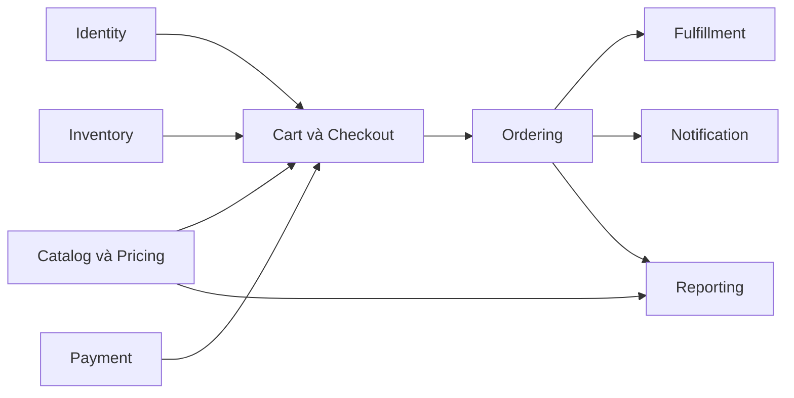
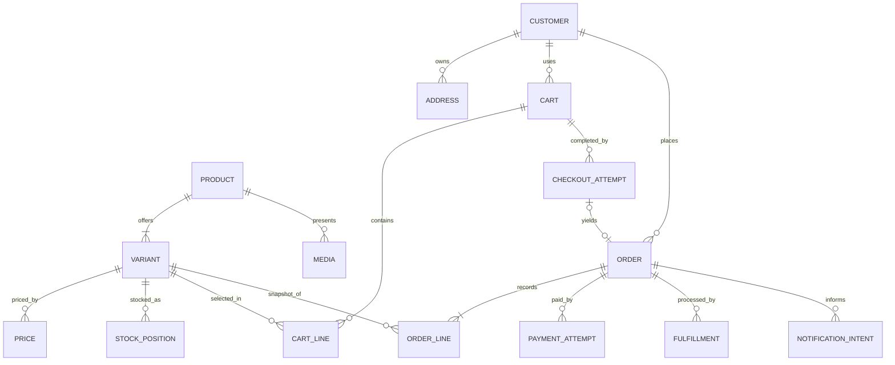

# Mô hình miền dữ liệu logic

Đây là mô hình khái niệm của doanh nghiệp bán lẻ giả định. [BRD](../01-business/BRD.md), [quy tắc](../01-business/business-rules.md), [SRS](../03-requirements/SRS.md), [workload](../04-workload/workload-analysis.md) là đầu vào; [từ điển](data-dictionary.md) và [quyền sở hữu](data-ownership-and-consistency.md) giải nghĩa chi tiết. Các ERD cũ trong `docs/erd/` phản ánh triển khai lịch sử, không là schema đích. Một miền không tương đương một service hay một cơ sở dữ liệu.

## 1. Ngôn ngữ chung và ranh giới

| Thuật ngữ | Nghĩa cấp nghiệp vụ |
|---|---|
| Product | Mẫu sản phẩm được giới thiệu; chưa định danh đơn vị hàng có thể bán. |
| Variant/SKU | Cấu hình có thể bán của Product, thường theo size/màu; SKU là mã kinh doanh, chính sách duy nhất còn mở. |
| Giá chào bán / giá áp dụng | Giá hiện tại theo điều kiện bán / giá được chấp nhận và lưu trong dòng đơn để không bị thay đổi hồi tố. |
| Tồn hiện có / đã cam kết / có thể bán | Lượng thực tế / lượng dành cho đơn / lượng còn có thể nhận; chính sách giữ/trả hàng chờ OPEN-STOCK-001. |
| Cart / CheckoutAttempt / Order | Lựa chọn còn sửa được / một ý định hoàn tất có thể được gửi lại / kết quả mua đã được nhận. Một lần gửi lại không tạo một ý định mới. |
| PaymentAttempt / PaymentState | Kết quả của một thử thanh toán; nhận COD hoặc đơn không tự chứng minh đã thu tiền. |
| Fulfillment / NotificationIntent | Tiến độ xử lý giao / việc liên lạc phát sinh sau đơn; lỗi liên lạc không vô hiệu đơn. |

Các miền logic: **Identity** giữ khách và quyền; **Catalog** giữ sản phẩm, biến thể và metadata ảnh; **Pricing** giữ giá đang áp dụng; **Cart/Checkout** giữ lựa chọn và định danh ý định; **Ordering** giữ kết quả đơn và snapshot; **Payment** giữ trạng thái tiền; **Inventory** giữ số có thể bán; **Fulfillment** giữ tiến độ; **Notification** giữ việc gửi; **Reporting** chỉ đọc dữ kiện theo quyền. Đổi/trả, loyalty, recommendation là mở rộng tùy chọn. [BREQ-CAT-001, BREQ-ORD-001, BREQ-SEC-001]

Sơ đồ là **To-Be đề xuất**, mũi tên là nhu cầu dữ liệu/điều phối, không là kết nối mạng hoặc quyền ghi trực tiếp.

## 2. Quan hệ thực thể khái niệm

**Giới hạn cardinality:** Product cần ít nhất một Variant để bán, nhưng sản phẩm đang soạn có thể chưa có; biểu đồ cho trạng thái công bố. Guest checkout nếu được duyệt có thể khiến `Customer → Order` trở thành quan hệ tùy chọn kèm cơ chế sở hữu riêng (`OPEN-USR-001/002`). `CheckoutAttempt → Order` tối đa một kết quả đơn cho **một ý định**, nhưng nhiều attempt kỹ thuật có thể cùng ý định; định danh và vòng đời chờ review. Một Order có thể có nhiều PaymentAttempt; số shipment/fulfillment tùy chính sách, chưa ép 1:1. STOCK_POSITION được định danh bởi SKU và vị trí logic; MVP giả định một kho mô phỏng, chưa mở nhiều địa điểm.

## 3. Vòng đời và bất biến đề xuất

| Bất biến | Nghĩa và nguồn | Kiểm chứng |
|---|---|
| INV-ORD-001 | Một ý định checkout cùng nội dung chỉ tạo tối đa một đơn được nhận; RULE-ORD-001, FR-PAY-03 | AT-03, đọc lại đơn và ý định |
| INV-INV-001 | Lượng cam kết đơn không vượt khả năng bán hợp lệ của SKU; RULE-INV-001, FR-INV-02 | AT-15, stock=1/2 khách |
| INV-PRICE-001 | Dòng đơn giữ biến thể, giá, tiền tệ, phí/thuế áp dụng tại lúc nhận; RULE-PRICE-001 | AT-01 và đổi giá sau đặt |
| INV-PAY-001 | Trạng thái đã thu chỉ sau bằng chứng thu tương ứng; COD không tự là đã thu; RULE-PAY-001/002 | AT-02,14 |
| INV-ACCESS-001 | Khách A không đọc/sửa đơn hoặc PII B; RULE-ACCESS-001 | AT-04 |
| INV-NOT-001 | Thất bại thông báo không vô hiệu đơn đã nhận; RULE-NOT-001 | AT-05 |

Trạng thái **đề xuất** cho đơn: `đang chuẩn bị → chờ quyết định → được nhận → đang xử lý → đã hoàn tất`, với nhánh `bị từ chối` trước nhận và `đã hủy` sau nhận nếu chính sách cho phép. Trạng thái thanh toán riêng: `chưa có kết quả / chờ / thất bại / đã chấp nhận nhưng chưa thu / đã thu`; hoàn tiền chỉ khi có chính sách và bằng chứng. Tồn chuyển qua `khả dụng → cam kết cho đơn → hoàn tất hoặc trả lại`; thao tác chuyển phải kiểm quyền và nguồn hàng. Fulfillment `chưa xử lý → đang xử lý → hoàn tất`, không được nhảy bước chưa được phép. Đây là từ vựng thiết kế, **không xác nhận** bộ trạng thái cuối; OPEN-FUL-001, OPEN-STOCK-001, OPEN-USR-003.

| Chuyển tiếp | Kích hoạt / guard | Tác dụng và lỗi |
|---|---|---|
| CheckoutAttempt → Order được nhận | Ý định hợp lệ, giá/tồn/tiền được kiểm, không trùng | Tạo snapshot và cam kết đúng; timeout tra kết quả trước khi làm lại |
| Order được nhận → đang xử lý | Staff có quyền và trạng thái trước hợp lệ | Lưu người/giờ/hành động; sai quyền/bước thì giữ trạng thái cũ |
| Payment chờ → thất bại/đã thu | Kết quả đáng tin theo phương án đã chọn | Không suy từ việc tạo đơn; callback lặp không nhân tác dụng |
| Stock cam kết → trả khả dụng | Hủy/không giao theo chính sách đã chốt | Chưa tự động trả khi policy OPEN; đối chiếu lại đơn và nguồn |
| Order được nhận → NotificationIntent | Có liên lạc hợp lệ | Tạo việc gửi; lỗi nhà cung cấp không quay ngược Order |

Các sự kiện nghiệp vụ khả dĩ: `OrderAccepted`, `PaymentOutcomeRecorded`, `OrderStatusChanged`, `NotificationOutcomeRecorded`; tên và payload cần chốt ở [thiết kế tích hợp](../06-architecture/integration-design.md). Command “nhận đơn” và sự kiện “đã nhận” khác nhau. Không giả định atomic xuyên nhà cung cấp thanh toán/thông báo.

## 4. Câu hỏi dữ liệu cần quyết định

`OPEN-DATA-001` định dạng/phạm vi duy nhất SKU và size/màu; `OPEN-DATA-002` snapshot phí/thuế/tiền tệ, đơn vị tiền nhỏ nhất; `OPEN-DATA-003` retention/ẩn danh PII và đơn; `OPEN-DATA-004` guest ownership; `OPEN-DATA-005` số địa điểm tồn/fulfillment; `OPEN-DATA-006` chính sách giá/tồn cache, search delay. Chủ tương ứng: danh mục, thương mại, bảo mật/nghiệp vụ, chủ sản phẩm, vận hành, chủ sản phẩm. Chưa có người phê duyệt; cổng D9 đạt bản nháp, chưa thành Data Baseline được duyệt.
