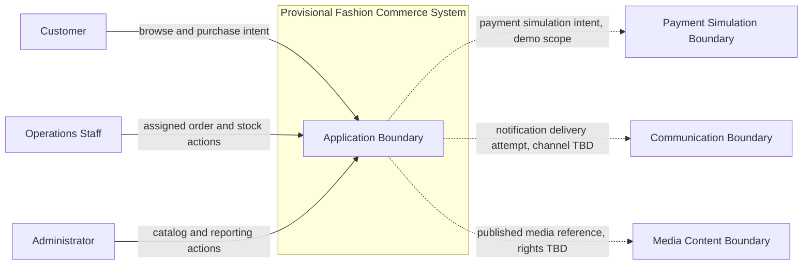
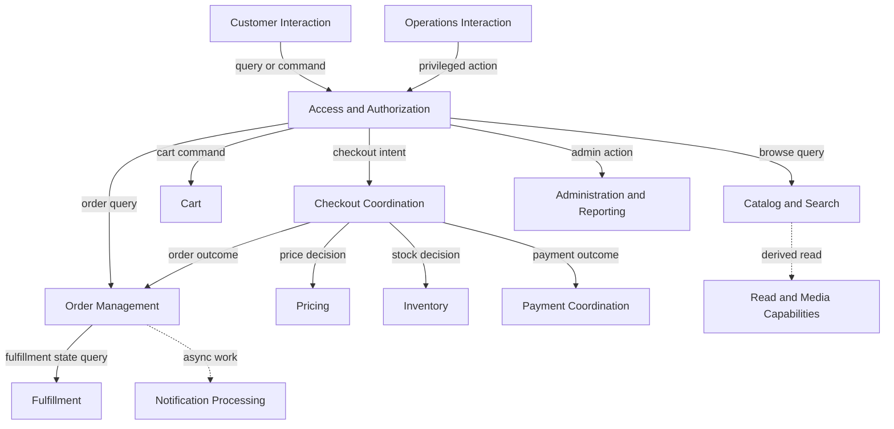
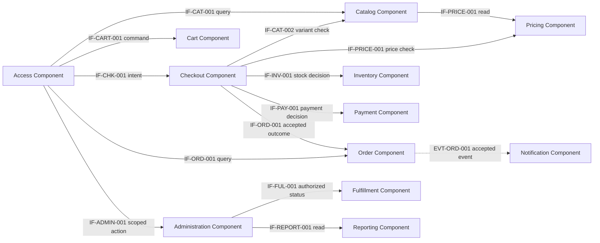
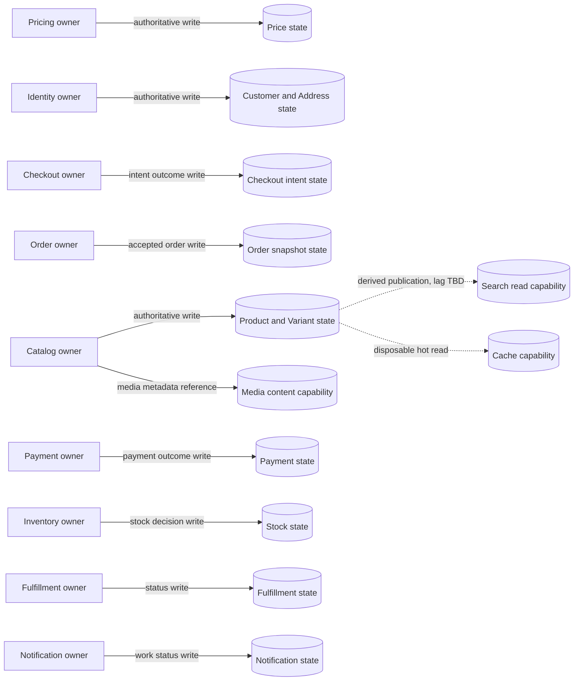
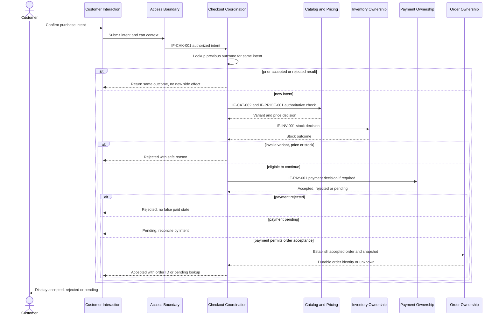
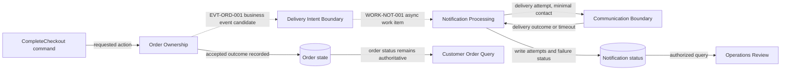
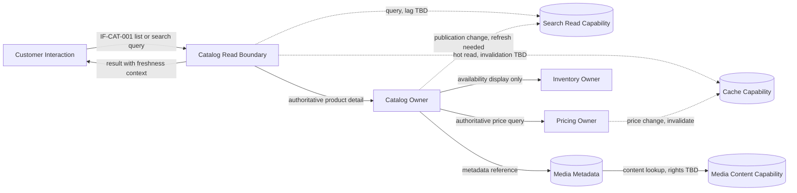
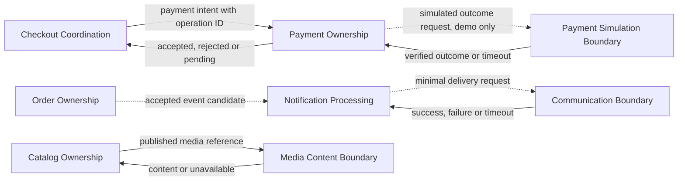
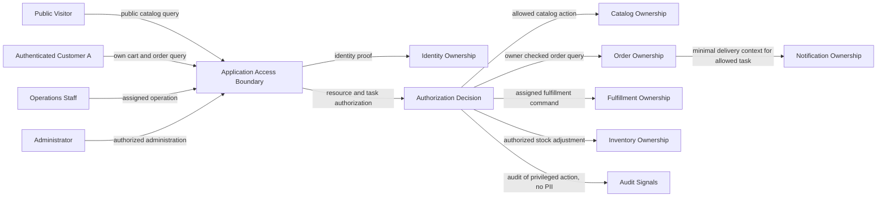
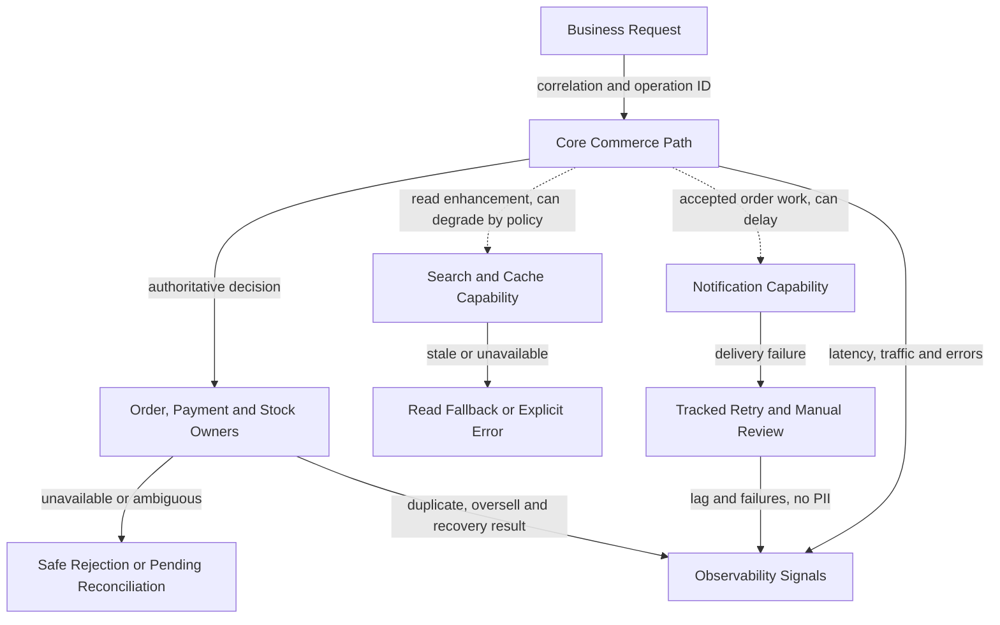

# Kiến trúc tổng thể logic — High-Level Design

## 1. Phạm vi, nguồn và cổng đầu vào

Đây là **thiết kế To-Be đề xuất** cho MVP Fashion B2C giả định, không mô tả hạ tầng hoặc công nghệ của SOMEHOW. Bộ sơ đồ HLD-01..10 nằm trong file này và là các **góc nhìn của cùng một hệ thống**, không phải mười dịch vụ triển khai. Nguồn nghĩa: [BRD](../01-business/BRD.md), [năng lực](../01-business/business-capability-map.md), [quy tắc](../01-business/business-rules.md), [actor/goal](../02-users/actors-and-user-goals.md), [journey](../02-users/user-journeys.md), [SRS](../03-requirements/SRS.md), [use case](../03-requirements/use-case-specifications.md), [QAS](../03-requirements/quality-attribute-scenarios.md), [workload](../04-workload/workload-analysis.md), [mô hình miền](../05-data/domain-model.md), [quyền sở hữu](../05-data/data-ownership-and-consistency.md) và [RTM](../03-requirements/requirements-traceability.md). Hợp đồng chi tiết thuộc [Interface Catalog](api-and-interface-contracts.md); event, đối tác và retry thuộc [Integration Design](integration-design.md).

| Nguồn | Phiên bản/tình trạng được kiểm | Hệ quả đối với HLD |
|---|---|---|
| `00-project/`, `01-business/`, `02-users/` | v0.1.0, Draft; chưa có review thực tế | Quyền, guest, trạng thái và chính sách là giả định có owner, không khóa thành baseline |
| `03-requirements/`, `04-workload/`, `05-data/` | v0.1.0, Draft; chỉ tiêu thử cũ là đề xuất, chưa đo | HLD diễn đạt bất biến/giới hạn, không hứa hiệu năng/khả dụng |
| `Cloud Application Development - Project Topics.pdf` | Có tại local; đọc lại trang 4–5, 24–25 ngày 2026-11-15 | Ba actor, 9 UC và năng lực search/cache/media/async/idempotency là ràng buộc học phần |
| Presentation 1–5 PDF | **Không còn tại đường dẫn `docs/` khi thực hiện HLD**; một số slide P1–P4 đã được đọc trực tiếp ở lượt trước trong cùng phiên, nhưng không kiểm lại được toàn bộ evidence map của plan; P5 chưa xác minh | Phải đối chiếu lại các slide liệt kê trong plan khi PDF được khôi phục; không gắn nhãn đã kiểm hết nguồn |
| Tài liệu SRS/kiến trúc cũ | Các file lịch sử đang bị xóa trong working tree; bản được Git theo dõi vẫn có trong `HEAD` | Không dùng làm thiết kế đích hoặc khẳng định hiện trạng code; không can thiệp các lệnh xóa local |

**Cổng G-HLD-0:** Có đủ input Draft để vẽ bản Provisional, nhưng không đủ nguồn và phê duyệt để gọi là Reviewed/Approved. Tên công nghệ lịch sử chỉ được nêu ở mục handoff cuối, không xuất hiện trong bất kỳ hình nào.

## 2. Architecture Driver Register và ký hiệu

| Driver / mức | Lý do, nguồn | Ràng buộc và cách kiểm tra đề xuất |
|---|---|---|
| DRV-01 / cao | Mua hàng đầu cuối; P1-UC02..08, BREQ-SALES-001 | Một ý định trả `accepted / rejected / pending`; AT-01/02/03 |
| DRV-02 / cao | Biến thể/SKU và tồn đúng; RULE-CAT-001, RULE-INV-001, INV-INV-001 | SKU cuối chỉ một cam kết hợp lệ; AT-15 |
| DRV-03 / cao | Gửi lại checkout/payment an toàn; FR-PAY-03, QAS-REL-001 | Cùng intent không sinh đơn/thu tiền thứ hai; AT-03 |
| DRV-04 / cao | Xem nhiều, peak khuyến mại; Topics trang 5, WL-CAT/SEARCH/MEDIA-001 | Read/search/cache/media có độ tươi rõ; load test AT-07, chưa có số đo |
| DRV-05 / cao | Thông báo nền; BREQ-NOT-001, INV-NOT-001 | Provider lỗi không hủy đơn; AT-05 |
| DRV-06 / cao | Khách A không đọc đơn B; RULE-ACCESS-001, QAS-SEC-001 | Quyền theo tài nguyên tại application boundary; AT-04 |
| DRV-07 / cao | Dependency lỗi/timeout; QAS-REL-003/005 | Không báo thành công giả; tra kết quả và đối soát; AT-02/06 |
| DRV-08 / cao | Quan sát và phục hồi; QAS-OBS-001, QAS-DR-001 | Có correlation, backlog, RPO/RTO đề xuất; AT-08/20 sau này |
| DRV-09 / trung bình | Có thể thay thành phần triển khai; QAS-MOD-001 | Giữ ngữ nghĩa IF và chủ dữ liệu, regression AT; không hứa thay công nghệ mà không sửa code |
| DRV-10 / trung bình | Nhóm 5–7, ngân sách TBD; Topics trang 25, QAS-COST-001 | Ưu tiên ranh giới mô đun rõ và vận hành vừa sức; ADR-001 còn Proposed |

**Chú giải chung:** hộp trong `subgraph` là ranh giới **logic/tin cậy**, không là process/container/network; mũi tên liền có nhãn là query, command hoặc outcome cần phản hồi; mũi tên đứt có nhãn là công việc bất đồng bộ, dữ liệu dẫn xuất hoặc tích hợp **có điều kiện**. `owner` là chủ quyền ghi trạng thái có thẩm quyền; `read` không trao quyền ghi. Hình trụ `[(...)]` là khả năng/trạng thái dữ liệu logic, không chỉ cơ sở dữ liệu vật lý. `pending` là kết quả chưa rõ cần tra/đối soát, **không** là xác nhận đơn. Mỗi hình nêu rõ ngoại lệ của ký hiệu nếu có.

## 3. Diagram Register

| Hình | Câu hỏi chính và nguồn | Tình trạng |
|---|---|---|
| HLD-01 | Ai tương tác, đâu là ranh giới hệ thống? ACT, P1-UC01..09 | Provisional |
| HLD-02 | Các trách nhiệm tạo thành hệ thống ra sao? CAP, FR, WL | Provisional |
| HLD-03 | Component cung cấp/tiêu thụ IF gì? CAP, FR, DATA-OWN | Provisional |
| HLD-04 | Ai giữ dữ liệu chuẩn và bản dẫn xuất? ENT, INV | Provisional |
| HLD-05 | Kết quả checkout an toàn trong thành công/lỗi? J-02, RULE, QAS | Provisional |
| HLD-06 | Đơn đã nhận tạo việc thông báo thế nào? BREQ-NOT, EVT | Provisional |
| HLD-07 | Đọc catalog/search/cache/media có độ tươi nào? WL-CAT/SEARCH/MEDIA | Provisional |
| HLD-08 | Đối tác bên ngoài lỗi thì ai xử lý? EXT, INT, QAS | Provisional |
| HLD-09 | Quyền Customer/Staff/Admin chặn ở đâu? ACT, PERM, QAS-SEC | Provisional |
| HLD-10 | Thành phần nào dừng an toàn/giảm cấp, đo ra sao? QAS, WL | Provisional |
| HLD-11 | x5/x10 làm lộ giả thuyết nghẽn nào? WL, QAS-SCALE | Bảng phân tích, chưa có benchmark |

### HLD-01 — Bối cảnh hệ thống và actor bên ngoài

**Mục đích/ranh giới:** Một hệ thống thương mại giả định và ba actor cốt lõi; luồng tới đối tác chỉ có điều kiện. **Nguồn:** ACT-CUST/STAFF/ADMIN, BREQ-IDENT/CAT/ORD/OPS-001, Topics trang 4. **Open:** guest và quyền Staff/Admin (`OPEN-USR-001/003/004`), kênh gửi (`OPEN-USR-009`). **Không thể hiện:** các component bên trong, hạ tầng hoặc hãng giao hàng chưa nằm trong scope. **Reviewer:** chủ sản phẩm và người rà bảo mật, chưa thực hiện.

Các mũi tên đứt là tương tác với năng lực/đối tác có điều kiện, không khẳng định đã tích hợp live. Không có kết nối trực tiếp actor → dữ liệu. Ranh giới công khai và đặc quyền được tách ở HLD-09.

### HLD-02 — Tổng quan logic một trang

**Mục đích/ranh giới:** Giải thích trách nhiệm chính và đường giao dịch so với đọc/việc nền, khoảng 14 nhóm khái niệm. **Nguồn:** CAP-CAT/CART/ORD/INV/PAY/NOT/ADMIN-001, FR-CAT/CART/CHK/PAY/INV/NOT/ADM, WL-01. **Open:** thời điểm cam kết tồn và payment (`OPEN-STOCK-001`), độ tươi (`OPEN-DATA-006`). **Không thể hiện:** một hộp = một tiến trình hoặc một kho dữ liệu. **Reviewer:** kiến trúc, QA, chủ dữ liệu, chưa thực hiện.

Chỉ `CHK → PR/INV/PAY/ORD` là các quyết định cần giải thích trước khi trả kết quả; `ORD → NOT` là nhu cầu việc nền. Hình bỏ qua các ranh giới lưu trạng thái để vẫn đọc được; HLD-04 bổ sung chúng. Mọi lối vào đơn/PII vẫn phải qua AX; thời điểm kết quả trả khách theo IF-CHK-001/002.

### HLD-03 — Trách nhiệm component và ranh giới IF

**Mục đích/ranh giới:** Ai cung cấp contract cho ai và ai điều phối, chỉ phần core. **Nguồn:** [capability map](../01-business/business-capability-map.md), [data owners](../05-data/data-ownership-and-consistency.md), IF-CHK/CAT/PRICE/INV/PAY/ORD-001. **Open:** thứ tự payment/reservation (`OPEN-STOCK-001`) và quyền điều chỉnh (`OPEN-USR-003`). **Không thể hiện:** bảng dữ liệu hoặc call mạng; module boundary **khác** deployment boundary. **Reviewer:** chủ dữ liệu và kiến trúc độc lập, chưa thực hiện.

**Component Catalog:** mỗi hàng ghi trách nhiệm, IF cung cấp/tiêu thụ, dữ liệu chủ, tác động lỗi. Các IF được định nghĩa chi tiết **một lần** tại [hợp đồng](api-and-interface-contracts.md), không tạo schema song song ở đây. Các luồng không vẽ trong hình (Identity, media) vẫn nằm trong bảng.

| CMP / CAP | Trách nhiệm; IF cung cấp → IF tiêu thụ | Chủ dữ liệu; lỗi và chất lượng |
|---|---|---|
| CMP-ACCESS-001 / CAP-IDENT-001 | Xác minh/quyền theo tài nguyên; IF-IDENT-001/IF-ACCESS-001 → IF-ORD-001 khi kiểm sở hữu | ENT-CUSTOMER/ADDRESS; quyền sai phải chặn trước PII; QAS-SEC-001 |
| CMP-CAT-001 / CAP-CAT-001/DISC-001 | Công bố/tìm/biến thể; IF-CAT-001/002, IF-MEDIA-001 → IF-PRICE-001 | ENT-PRODUCT/VARIANT/MEDIA metadata; search giảm cấp, không quyết định tồn lúc mua; WL-CAT/SEARCH |
| CMP-PRICE-001 / CAP-PRICE-001 | Giá có thẩm quyền; IF-PRICE-001 → không ghi chéo Order | ENT-PRICE; lỗi chặn nhận đơn, INV-PRICE-001 |
| CMP-CART-001 / CAP-CART-001 | Giỏ; IF-CART-001 → IF-CAT-002/PRICE-001 | ENT-CART/CART-LINE; giỏ lỗi không tạo đơn |
| CMP-CHK-001 / CAP-ORD-001 | Điều phối intent và kết quả; IF-CHK-001/002 → IF-CAT/PRICE/INV/PAY/ORD-001 | ENT-CHECKOUT-ATTEMPT; timeout phải tra kết quả, QAS-REL-001 |
| CMP-ORD-001 / CAP-ORD-001 | Nhận đơn/snapshot, đọc đơn; IF-ORD-001 → IF-NOT-001 qua kết quả đã nhận | ENT-ORDER/ORDER-LINE; không xác nhận giả, INV-ORD-001 |
| CMP-PAY-001 / CAP-PAY-001 | Trạng thái tiền; IF-PAY-001 → EXT-PAY-001 có điều kiện | ENT-PAYMENT-ATTEMPT; timeout đối soát, INV-PAY-001 |
| CMP-INV-001 / CAP-INV-001 | Quyết định hàng có thể bán; IF-INV-001 → không ghi Order | ENT-STOCK-POSITION; tranh SKU cuối, INV-INV-001 |
| CMP-FUL-001 / CAP-FUL-001 | Bước xử lý; IF-FUL-001 → IF-ORD-001 để đối chiếu | ENT-FULFILLMENT; sai bước/quyền thì từ chối |
| CMP-NOT-001 / CAP-NOT-001 | Việc gửi/kết quả; IF-NOT-001 → EXT-COMM-001 | ENT-NOTIFICATION-INTENT; provider lỗi không đổi đơn |
| CMP-ADMIN-001 / CAP-ADMIN-001 | Điều phối thao tác được giao; IF-ADMIN-001 → IF-CAT/INV/FUL-001 | Không sở hữu dữ liệu chủ miền; quyền/audit bắt buộc |
| CMP-REPORT-001 / CAP-REPORT-001 | Báo cáo cơ bản; IF-REPORT-001 → IF-ORD/CAT-001 dạng đọc | ENT-REPORT-SNAPSHOT; trễ được nếu nêu thời điểm, OPEN-REPORT-001 |

### HLD-04 — Chủ dữ liệu và luồng thông tin

**Mục đích/ranh giới:** Phân biệt dữ liệu có thẩm quyền với bản tìm kiếm/cache và nội dung ảnh. **Nguồn:** ENT/INV trong [domain model](../05-data/domain-model.md), [ownership matrix](../05-data/data-ownership-and-consistency.md), WL-CAT/CHK-001. **Open:** cache/search delay, retention, guest (`OPEN-DATA-003/004/006`). **Không thể hiện:** engine, số kho, schema/index hoặc topology sao lưu. **Reviewer:** chủ dữ liệu và bảo mật, chưa thực hiện.

Từng mũi tên `authoritative write` có đúng một chủ; `SEARCH/CACHE` là bản đọc có thể xây lại, không có quyền nhận đơn. `MEDIA` giữ binary, Catalog giữ metadata và quyền công bố. `Order snapshot` không bị sửa khi giá hiện hành đổi. Xem thêm ma trận reader/writer/PII ở Data Phase; không chép lại quyền ở đây. Checkout kiểm lại Catalog/Pricing/Inventory từ nguồn có thẩm quyền trước khi công bố `accepted`.

### HLD-05 — Luồng checkout trọng yếu và kết quả

**Mục đích/ranh giới:** Một intent mua đi qua quyền, biến thể, giá, tồn, tiền và đơn; sáu biến thể lỗi ở bảng sau. **Nguồn:** J-02, P1-UC04..06, RULE-ORD/INV/PAY-001, INV-ORD/INV/PRICE/PAY-001, FR-CHK-03, QAS-REL-001..003, WL-CHK-001. **Open:** thứ tự giữ hàng/thu tiền, cách bù trừ và pending (`OPEN-STOCK-001`, `OPEN-RETRY-001`). **Không thể hiện:** transaction phân tán, commit order hay SDK; thứ tự hỏi quyết định trong hình chỉ là storyboard cần review. **Reviewer:** chủ nghiệp vụ, dữ liệu và QA độc lập, chưa thực hiện.

| Biến thể / chủ | Kết quả khách thấy; bất biến và phép thử |
|---|---|
| Thành công / Checkout, Order | `accepted` kèm mã đơn chỉ sau kết quả bền; snapshot giá/SKU, tồn cam kết đúng; AT-01 |
| SKU sai/hết / Catalog, Inventory | `rejected` với lý do an toàn, không nhận đơn; stock=1/2 khách chỉ một cam kết; AT-13/15 |
| Payment thất bại / Payment | Không báo đã thu/đơn thành công; giỏ/giữ hàng theo policy OPEN-STOCK-001; AT-02/14 |
| Gửi lặp/double-click / Checkout | Cùng intent và nội dung trả cùng kết quả, khác nội dung từ chối; không thêm đơn/thu tiền; AT-03 |
| Client timeout sau commit / Checkout, Order | `pending` hoặc tra IF-CHK-002, không suy thất bại rồi gửi ý định mới; AT-03 |
| Notification lỗi sau nhận / Notification | Khách vẫn tra được đơn; việc gửi lỗi có thể xử lý, không đảo kết quả; AT-05 |

Hai khách độc lập cùng mua SKU cuối là tranh chấp giữa **hai intent khác nhau**; không thể giải bằng dedupe cùng intent. Nếu Inventory/Order không sẵn sàng, không xác nhận đơn giả; nếu external payment chưa rõ thì phải đối soát, không tuyên bố atomic xuyên đối tác. Thời điểm cam kết/hoàn hàng là quyết định nghiệp vụ chưa được duyệt, nên sơ đồ không chứng minh giao dịch đã nhất quán trong triển khai.

### HLD-06 — Thông báo bất đồng bộ: event khác work item

**Mục đích/ranh giới:** Kết quả đơn bền tạo nhu cầu liên lạc, công việc gửi và kết quả gửi riêng. **Nguồn:** BREQ-NOT-001, RULE-NOT-001, FR-NOT-01..03, INV-NOT-001, EVT-ORD-001/WORK-NOT-001 trong [Integration Design](integration-design.md). **Open:** kênh, retry cap, lag và cơ chế bảo đảm event không mất (`OPEN-USR-009`, `OPEN-ARCH-002`). **Không thể hiện:** broker/queue cụ thể, exactly-once hoặc cam kết email đã tới. **Reviewer:** vận hành và QA, chưa thực hiện.

`CMD-CHK-001` là yêu cầu làm; `EVT-ORD-001` chỉ được phát khi đơn đã được nhận; `WORK-NOT-001` là việc gửi. Mũi tên đứt thể hiện tách thời gian, **không** chứng minh event/work đã bền. Cần nhận diện `eventId/jobId`, dedupe khi lặp, retry hữu hạn, backoff, trạng thái thất bại cần xử lý và đối soát khi event bị mất; chi tiết thuộc [thiết kế tích hợp](integration-design.md). Hình không cho Notification ghi lại Order. AT-05 kiểm provider lỗi rồi hồi và đơn vẫn nguyên.

### HLD-07 — Đọc catalog, tìm kiếm, cache và media

**Mục đích/ranh giới:** Đường đọc nhiều vẫn phân biệt nguồn chuẩn với bản dẫn xuất. **Nguồn:** BREQ-CAT/DISC/PRICE-001, FR-CAT-01..05, FR-INT-01..03, WL-CAT/SEARCH/MEDIA-001, QAS-PERF-CAT-001. **Open:** độ trễ indexing, TTL/invalidations, size/ảnh và quyền ảnh (`OPEN-DATA-006`, `OPEN-ASSET-001`). **Không thể hiện:** engine search/cache, số máy, yêu cầu ranking không có nguồn. **Reviewer:** chủ catalog, QA và chủ dữ liệu, chưa thực hiện.

Catalog/Price/Inventory là chủ của Product/Variant, giá và stock; search/cache chỉ hỗ trợ đọc, có thể cũ. Giá và khả năng bán ở listing cần mức độ tươi do chủ sản phẩm chốt; checkout **luôn kiểm lại** từ chủ logic, nên cache hit không tạo quyền chấp nhận đơn. Metadata ảnh khác binary content. Nếu search/cache lỗi, chỉ fallback/bypass khi có contract được duyệt; nếu không trả lỗi có nghĩa. AT-06/07/11 kiểm độ đúng và lỗi phụ thuộc.

### HLD-08 — Ranh giới tích hợp và lỗi đối tác

**Mục đích/ranh giới:** Những tương tác ra ngoài cần trạng thái chờ, xác minh kết quả và PII tối thiểu. **Nguồn:** EXT-PAY/COMM/MEDIA-001, FR-PAY-02..04, QAS-REL-003/004, [Integration Design](integration-design.md). **Open:** chọn mô phỏng hay tích hợp thật, kênh thông báo, đối tác giao nhận (`OPEN-USR-007/009`, `OPEN-DATA-005`). **Không thể hiện:** giao thức, endpoint, sản phẩm hoặc một tích hợp giao hàng live chưa được duyệt. **Reviewer:** bảo mật, vận hành, chủ thương mại, chưa thực hiện.

Mũi tên đứt tới đối tác biểu thị ranh giới ngoài/có điều kiện, không khẳng định đang dùng sản phẩm nào. Payment timeout → `pending` và đối soát theo intent, không thử lại gây thu trùng; provider thông báo timeout → việc gửi chờ/đối soát, Order không đổi. Với media lỗi, hình ảnh thiếu không được thay bằng lời hứa hàng còn bán. Vận chuyển qua hãng là **OUT/TBD**, không vẽ. Bảng bên ngoài chi tiết, loại dữ liệu và retry ở [Integration Design](integration-design.md).

### HLD-09 — Ranh giới tin cậy, quyền tài nguyên và PII

**Mục đích/ranh giới:** Tách xác thực danh tính khỏi kiểm quyền mỗi tài nguyên và kiểm soát thao tác đặc quyền. **Nguồn:** ACT-CUST/STAFF/ADMIN, PERM-001..005, RULE-ACCESS-001, FR-AUTH-03/04, QAS-SEC-001/002. **Open:** quyền Staff/Admin và guest (`OPEN-USR-001..004`), retention (`OPEN-DATA-003`). **Không thể hiện:** mạng con, nhà cung cấp định danh, kỹ thuật mã hóa cụ thể. **Reviewer:** bảo mật độc lập và chủ dữ liệu, chưa thực hiện.

`Identity proof` không tự cho phép đọc Order B. `AUTH` phải đối chiếu owner của Order/Cart hoặc nhiệm vụ Staff/Admin trước khi dữ liệu ra khỏi application boundary; không dựa vào ẩn nút ở UI. Dữ liệu giao và liên hệ chỉ qua đường tối thiểu cần thiết, không vào log/event công khai. Thao tác thay giá/tồn/trạng thái có dấu vết người và kết quả; nếu policy quyền chưa chốt thì không tự cấp. AT-04/10 là phép kiểm tra phủ định; rủi ro giả mạo giá, leo quyền, phát lại thanh toán được bảo vệ ở IF-CHK/ACCESS/PAY.

### HLD-10 — Giảm cấp an toàn, phục hồi và tín hiệu quan sát

**Mục đích/ranh giới:** Phân biệt phụ thuộc thiết yếu và thứ có thể tạm chậm, kèm điểm đo. **Nguồn:** QAS-REL-001..005, QAS-OBS-001, QAS-DR-001, WL-CHK/NOT/CAT-001. **Open:** fallback search, ngưỡng cảnh báo, RPO/RTO và ngân sách đều chưa duyệt (`OPEN-DATA-006`, `OPEN-WL-005`). **Không thể hiện:** hạ tầng HA/backup tool, sản phẩm monitoring hoặc kết quả thử đã đạt. **Reviewer:** vận hành, QA và chủ nghiệp vụ, chưa thực hiện.

Các nhánh `fallback` là **ứng viên cần policy**, không mặc nhiên hoạt động. Khi state thiết yếu không sẵn sàng, kết quả an toàn là không xác nhận đơn; khi timeout sau commit, tra theo intent trước khi kết luận. Recovery cần đối chiếu đơn/tồn/tiền và đo RPO/RTO, không suy từ có bản sao lưu. [Failure Impact Matrix](#7-ma-trận-tác-động-lỗi) nêu hành vi và phép kiểm chứng cho từng lỗi.

## 4. Interface/Data Catalog và ranh giới chủ

| Nhóm hợp đồng | IF đã có, producer/consumer và ngữ nghĩa ở HLD | Quyền/dữ liệu chuẩn |
|---|---|---|
| Identity và Access | IF-IDENT-001, IF-ACCESS-001; mọi lối vào → Access → chủ tài nguyên | Customer A≠B, Staff/Admin theo nhiệm vụ; ENT-CUSTOMER/ADDRESS |
| Catalog/giá/media | IF-CAT-001/002, IF-PRICE-001, IF-MEDIA-001; đọc từ Catalog/Pricing/Media | Product/Variant/Price có chủ; cache/search không được ghi giá chuẩn |
| Giỏ/checkout/đơn | IF-CART-001, IF-CHK-001/002, IF-ORD-001; intent → kết quả đơn có thể đọc lại | ENT-CART/CHECKOUT-ATTEMPT/ORDER; INV-ORD/PRICE-001 |
| Tiền/tồn | IF-PAY-001, IF-INV-001; quyết định ở Payment/Inventory | ENT-PAYMENT-ATTEMPT/STOCK-POSITION; INV-PAY/INV-001 |
| Xử lý/thông báo/quản trị | IF-FUL-001, IF-NOT-001, IF-ADMIN-001, IF-REPORT-001; thao tác có quyền và việc nền | ENT-FULFILLMENT/NOTIFICATION-INTENT/REPORT-SNAPSHOT |

Định nghĩa đầy đủ input/output/error/idempotency/version và contract test chỉ tại [api-and-interface-contracts.md](api-and-interface-contracts.md). Chủ/reader/writer, PII, độ tươi và giữ dữ liệu chỉ tại [data-ownership-and-consistency.md](../05-data/data-ownership-and-consistency.md). Không có đường ghi chéo vào trạng thái của owner khác được cho phép bởi hình. `EVT-ORD-001` và `WORK-NOT-001` chỉ là hợp đồng logic đề xuất, chưa là bảo đảm phát bền.

## 5. Phương án cấu trúc và ADR logic

| Phương án | Lợi ích | Rủi ro/điều kiện xem lại |
|---|---|---|
| Một khối thiếu ranh giới | Ít quy ước ban đầu | Ghi chéo state, khó thử/đổi độc lập; không phù hợp INV và ownership |
| Khối mô đun có IF/owner rõ — **đề xuất** | Nhóm nhỏ dễ kiểm đường giao dịch và triển khai ban đầu | Deploy/scale chung; cần kiểm boundary bằng test và review; ADR-001 Proposed |
| Nhiều đơn vị vận hành độc lập | Có thể tách vòng đời/tải đã chứng minh | Lỗi mạng, nhất quán phân tán, quan sát/cost tăng; chưa có tải thật để biện minh |

[ADR-001](adr/ADR-001-application-boundary-style.md), [ADR-002](adr/ADR-002-sync-async-boundaries.md) và [ADR-003](adr/ADR-003-order-inventory-consistency.md) đều **Proposed**, chưa có người chấp thuận. Ranh giới module không quyết định số process hay cơ sở dữ liệu. Hình HLD-03/04 là phân chia trách nhiệm, không là cam kết không phải sửa code khi thay công nghệ. Dấu hiệu cần xem lại: hai kho, kênh thanh toán thật, search/media tải khác biệt được đo, thời gian phát hành độc lập hoặc chi phí vượt ngân sách đã chốt.

## 6. Độ phủ use case và thuộc tính chất lượng

| UC bắt buộc / nguồn | CMP và HLD giải thích | IF/AT để kiểm chứng |
|---|---|---|
| P1-UC01 đăng ký/đăng nhập; BREQ-IDENT-001, FR-AUTH-01..04 | CMP-ACCESS-001; HLD-01/02/03/09 | IF-IDENT/ACCESS-001; AT-04/09/10 |
| P1-UC02 danh mục/tìm kiếm; BREQ-CAT/DISC-001, FR-CAT-01..05 | CMP-CAT/PRICE-001; HLD-02/03/04/07 | IF-CAT/PRICE/MEDIA-001; AT-11 |
| P1-UC03 giỏ; BREQ-CART-001, FR-CART-01..04 | CMP-CART-001; HLD-02/03/05 | IF-CART-001; AT-12 |
| P1-UC04 checkout/đơn; BREQ-ORD-001, FR-CHK-01..04 | CMP-CHK/ORD-001; HLD-03/04/05/10 | IF-CHK-001/002, IF-ORD-001; AT-01/03/13/15 |
| P1-UC05 thanh toán; BREQ-PAY-001, FR-PAY-01..05 | CMP-PAY-001; HLD-05/08/10 | IF-PAY-001; AT-02/14 |
| P1-UC06 tồn kho; BREQ-INV-001, FR-INV-01..03 | CMP-INV-001; HLD-03/04/05 | IF-INV-001; AT-15/16 |
| P1-UC07 theo dõi đơn; BREQ-TRACK-001, FR-ORD-01..03 | CMP-ORD/FUL-001; HLD-03/04/09 | IF-ORD/FUL-001; AT-04/17 |
| P1-UC08 thông báo; BREQ-NOT-001, FR-NOT-01..03 | CMP-NOT-001; HLD-06/08/10 | IF-NOT-001, EVT-ORD-001; AT-05 |
| P1-UC09 quản trị/báo cáo; BREQ-OPS-001, FR-ADM-01/02 | CMP-ADMIN/REPORT-001; HLD-01/02/03/09 | IF-ADMIN/REPORT-001; AT-10/18 |

NFR-PERF-01/02 và WL-CAT/CHK-001 ràng buộc HLD-05/07; NFR-REL-01..05 HLD-04/05/06/10; NFR-SEC-01..05 HLD-01/08/09; NFR-OBS-01..03 HLD-10; NFR-COST-01/QAS-MOD-001 HLD-02/03/11. Các số 30 RPS/3 RPS, p95, RPO/RTO và 99,5% ở QAS vẫn là **mục tiêu đề xuất**, không được tô thành kết quả trong hình.

## 7. Ma trận tác động lỗi

| Lỗi / journey | Tác động khách và bất biến | Tín hiệu, giảm cấp/đối soát và phép thử |
|---|---|---|
| F-01 Order/Inventory state không sẵn; J-02 | Không xác nhận đơn giả; INV-ORD/INV-INV-001 | Lỗi giao dịch, saturation; trả lỗi/pending đúng ngữ cảnh, phục hồi/đọc lại; AT-01/15 |
| F-02 Payment thất bại/timeout; J-02 | Không false captured, không tự tạo intent mới; INV-PAY/ORD-001 | Payment pending/rejected count, correlation; tra/đối soát; AT-02/03/14 |
| F-03 Cùng intent gửi lặp; J-02 | Tối đa một đơn/tác dụng tiền; INV-ORD-001 | Duplicate-intent count và kết quả đọc lại; AT-03 |
| F-04 Search/cache cũ hoặc hỏng; J-01/02 | Xem hàng có thể giảm cấp; checkout vẫn kiểm chuẩn, INV-PRICE/INV-INV-001 | Miss/stale/errors; fallback chỉ nếu được duyệt, khác thì lỗi rõ; AT-06/11 |
| F-05 Media không sẵn; J-01 | Ảnh không hiện, không đổi giá/đơn | Media error/egress; placeholder có nghĩa nếu được duyệt; AT-11 |
| F-06 Communication down hoặc event mất/lặp; J-02/03 | Đơn còn hiệu lực, không phát thông báo trùng ngoài policy; INV-NOT-001 | Work lag, retry/failure/dedupe, so Order–Notification, manual review; AT-05 |
| F-07 Staff/Admin vượt quyền hoặc Customer A đọc B; J-03/04 | Không lộ PII, không thay đổi state; INV-ACCESS-001 | Denial/audit không chứa PII; AT-04/10 |
| F-08 Peak x5/x10 hoặc import cùng lúc; J-01/02 | Tăng độ trễ/từ chối an toàn, không phá bất biến | p95/p99, arrival/completion, backlog, CPU/kết nối/lock; AT-07 và stress P4 |
| F-09 Mất nguồn dữ liệu/restore; toàn bộ | Chưa có bằng chứng RPO/RTO; dữ liệu đơn/tiền/tồn phải đối chiếu | Backup age, restore duration, checksum/đối soát; AT-08 |

Nguồn chi tiết về failure/retry/event ở [integration-design.md](integration-design.md); các phép thử là **kế hoạch**, chưa chạy trong workstream HLD.

## 8. HLD-11 — Giả thuyết phát triển dưới tải x5/x10

Không vẽ thêm topology vật lý. Từ [WL](../04-workload/workload-analysis.md), x5/x10 chỉ là **biến thể stress của mục tiêu thử**, không là lượng khách đã quan sát hoặc năng lực đã đạt.

| Tăng tải giả định | Nút nghẽn logic cần đo | Hướng thay đổi cần bằng chứng, chi phí kèm theo |
|---|---|---|
| Catalog/search nhiều hơn | Query/read amplification, cache freshness, media egress | Rà bản đọc/cache, invalidation và băng thông; tăng complexity/cost |
| Checkout/stock SKU nóng | Lock/transaction contention, payment latency, kết nối | Giữ bất biến, bounded retry/backpressure; chỉ tách boundary khi không phá kết quả |
| Đơn kéo theo nhiều thông báo | Work arrival > service, backlog và provider limit | Điều tiết, retry hữu hạn/đối soát; không để ảnh hưởng core |
| Import/báo cáo song song | Tranh tài nguyên với giao dịch | Giới hạn cửa sổ/ưu tiên, bản báo cáo dẫn xuất nếu có nhu cầu thật |

AI/recommendation (HLD-12) **không vẽ** vì chưa có BREQ và evaluation plan được duyệt. Nếu sau này được chọn, nó chỉ đọc dữ liệu được phép và có thể lỗi mà checkout vẫn đúng. Không cho AI quyết định giá/tồn/đơn.

## 9. Architecture Question Log và review record

| Câu hỏi / tác động | Phương án/bằng chứng cần có | Owner đề xuất; gate |
|---|---|---|
| OPEN-USR-001/002 guest và sở hữu đơn | Chỉ login hoặc guest với xác minh sở hữu; quyết định nghiệp vụ/quyền | Chủ sản phẩm + bảo mật; trước baseline HLD |
| OPEN-USR-003/004 quyền Staff/Admin/PII | Bảng tác vụ được giao và audit, có người duyệt | Vận hành + bảo mật; trước baseline HLD |
| OPEN-STOCK-001, OPEN-RETRY-001, OPEN-PRICE-001 | Thứ tự cam kết/thu tiền, bù trừ, khóa intent, giá đổi | Chủ nghiệp vụ + dữ liệu + QA; trước duyệt HLD-05 |
| OPEN-FUL-001, OPEN-REPORT-001 | Bộ trạng thái và chỉ số báo cáo | Vận hành; trước baseline HLD |
| OPEN-ARCH-002 / Notification durability | Cách giữ OrderAccepted → work không mất, retry cap, đối soát | Kiến trúc + vận hành; trước duyệt HLD-06 |
| OPEN-DATA-006 / cache-search freshness | Độ trễ, invalidation và fallback cho read | Chủ sản phẩm + QA; trước duyệt HLD-07/10 |
| OPEN-USR-007/009, OPEN-ASSET-001 | Phạm vi simulator/kênh gửi/quyền ảnh | Chủ sản phẩm + pháp lý/tài sản; trước tích hợp thật |
| OPEN-WL-001..005, ngân sách và SLO | Analytics/dataset/run thật và chủ chỉ tiêu | Chủ nghiệp vụ + QA + vận hành; trước Capacity/Technology Evaluation |
| OPEN-TECH-DB | So sánh engine theo consistency, query, chi phí và vận hành | Chủ dữ liệu + kiến trúc; **phase 07**, sau review logic |

**Review report ngày 2026-11-15:** Người viết đã đối chiếu 9 UC, chủ dữ liệu, hợp đồng IF và trường hợp lỗi trong bản nháp; chưa có reviewer độc lập, cuộc họp hay chữ ký. Cả **10/10 khối Mermaid đã render thành công** bằng Mermaid CLI 12.0.0, xuất SVG trong `.tmp/hld-mermaid/`; HLD-02 và HLD-05 cũng được xem ở dạng PNG. Bản tổng quan có thể đọc, nhưng hình checkout nhiều nhánh nên cần xem SVG phóng lớn khi review. Kiểm tra tĩnh không thấy tên công nghệ trong diagram và liên kết Markdown vừa sửa không gãy. Gate G-HLD-1..3 **đạt mức bản vẽ Provisional**, chưa chứng minh implementation. G-HLD-0 chưa đủ vì 5 PDF Presentation thiếu và upstream Draft. G-HLD-4 vẫn chưa đạt vì chưa có quyết định chính sách/định lượng và chưa có review. Không gắn `REVIEWED` hoặc `APPROVED`. Nếu nguồn được khôi phục, kiểm lại slide evidence map và sửa hình trước review; mời BA, QA, Data, Security và Operations độc lập rà các HLD-05/06/09.

## 10. Handoff sang Technology Evaluation

Chỉ bàn giao ranh giới CMP/IF, bất biến INV, QAS/WL, failure matrix, ADR logic Proposed và các OPEN. `ADR-TECH-DB` phải so sánh PostgreSQL với NoSQL theo tính đúng đơn/tồn, quan hệ Product–Variant–Order, truy vấn/khả năng phục hồi, kỹ năng nhóm và chi phí; chưa chọn engine tại đây. Công nghệ cache/search/media/async, deployment, dự toán và hạ tầng vật lý cũng để phase 07; Assignment P2 phần Database Selection còn mở. Các file lịch sử trong Git chỉ là **Current Implementation Mapping** để đánh giá sau, không áp vào HLD logic.

| Ngày | Phiên bản | Thay đổi |
|---|---|---|
| 2026-11-15 | 0.1.0 | Bản sơ đồ và catalog logic ban đầu. |
| 2026-11-15 | 0.2.0 | Bổ sung 10 HLD views, driver/source/diagram registers, trace, failure/review và handoff. |
