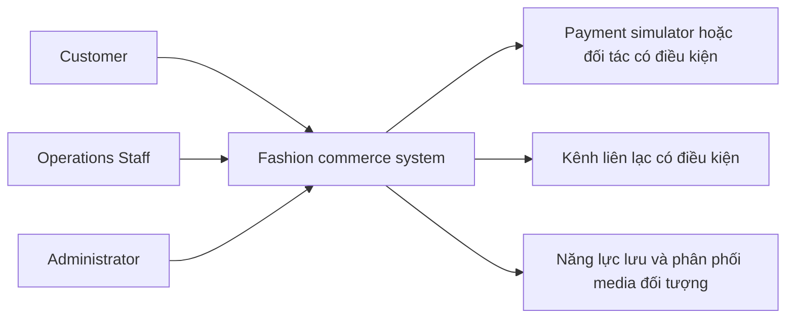
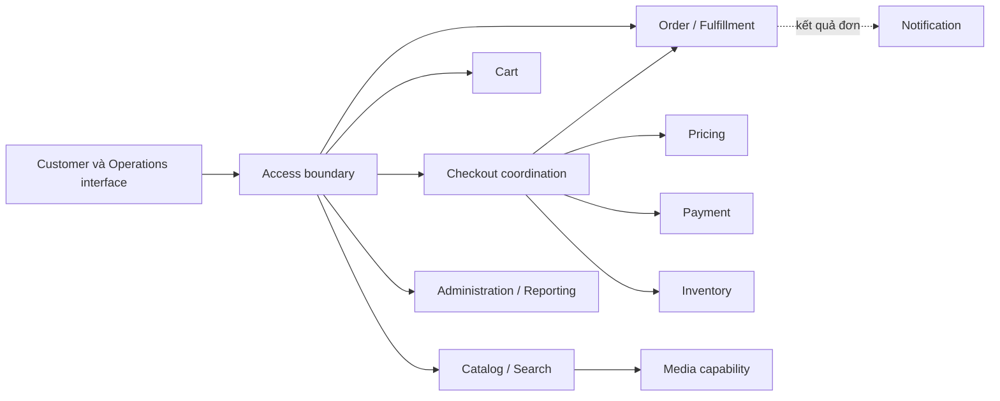
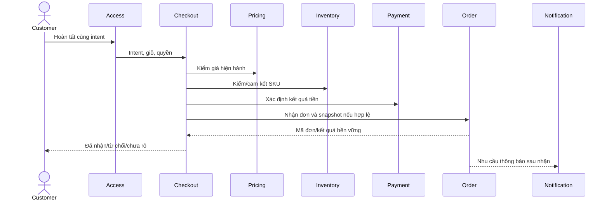

# Kiến trúc ứng dụng logic

## 1. Bối cảnh và căn cứ

Hệ thống phục vụ ba vai trò Customer, Store/Operations Staff, Administrator theo Topics trang 4, với một vertical slice xem/chọn → giỏ → checkout → đơn → theo dõi/thông báo. Nguồn: [năng lực](../01-business/business-capability-map.md), [SRS](../03-requirements/SRS.md), [QAS](../03-requirements/quality-attribute-scenarios.md), [tải](../04-workload/workload-analysis.md), [mô hình miền](../05-data/domain-model.md), [quyền sở hữu](../05-data/data-ownership-and-consistency.md). Mọi tài liệu đầu vào là Draft; sơ đồ là **To-Be đề xuất**, không là kiến trúc đã triển khai hoặc phê duyệt. Presentation 2 trang 5 yêu cầu mỗi component rõ trách nhiệm, giao diện, dữ liệu và phụ thuộc; trang 68 yêu cầu component, API, data ownership, integration và quyết định database. Quyết định engine/database được giữ cho `07-technology-evaluation/` theo thứ tự đã chốt.

Ranh giới tin cậy: người dùng bên ngoài phải được xác minh khi truy cập đơn/PII; Customer A≠B; Staff/Admin theo quyền được giao; đối tác thanh toán/liên lạc không được tin chỉ vì gửi callback; media công khai chỉ gồm tài sản được phép. Giao nhận ngoài phạm vi tích hợp hãng vận chuyển cho tới khi chủ nghiệp vụ quyết. Thanh toán mô phỏng chỉ ở thử nghiệm. Không truyền dữ liệu thẻ thật trong MVP.

## 2. Bản đồ năng lực → thành phần

| Thành phần / CAP, FR | Trách nhiệm và giao diện chính | Dữ liệu sở hữu; phụ thuộc / chất lượng |
|---|---|---|
| CMP-ACCESS-001 / CAP-IDENT-001, FR-AUTH-01..04 | Xác minh danh tính và kiểm quyền theo tài nguyên; IF-IDENT-001, IF-ACCESS-001 | ENT-CUSTOMER/ADDRESS; kiểm sở hữu cho Order/Cart; QAS-SEC-001 |
| CMP-CAT-001 / CAP-CAT-001/DISC-001, FR-CAT-01..05 | Chào bán, biến thể, tìm kiếm, metadata media; IF-CAT-001/002, IF-MEDIA-001 | ENT-PRODUCT/VARIANT/MEDIA; Price/Inventory chỉ đọc theo hợp đồng; WL-CAT/SEARCH/MEDIA |
| CMP-PRICE-001 / CAP-PRICE-001, FR-CAT-04 | Quyết định giá hiện hành và báo giá checkout; IF-PRICE-001 | ENT-PRICE; Order lưu snapshot; INV-PRICE-001 |
| CMP-CART-001 / CAP-CART-001, FR-CART-01..04 | Giỏ và dòng giỏ, chỉnh lựa chọn; IF-CART-001 | ENT-CART/CART-LINE; phụ thuộc Catalog/Price; WL-CART |
| CMP-CHK-001 / CAP-ORD-001, FR-CHK-01..04, FR-PAY-03 | Điều phối một ý định checkout, kiểm lại dữ liệu và trả kết quả/tra cứu; IF-CHK-001/002 | ENT-CHECKOUT-ATTEMPT; gọi Price, Inventory, Payment, Ordering; QAS-REL-001/002 |
| CMP-ORD-001 / CAP-ORD-001, FR-CHK-03, FR-ORD-01 | Ghi đơn được nhận, snapshot dòng/tiền và đọc đơn; IF-ORD-001 | ENT-ORDER/ORDER-LINE; Inventory/Payment theo hợp đồng; INV-ORD/PRICE-001 |
| CMP-PAY-001 / CAP-PAY-001, FR-PAY-01..05 | Ghi kết quả COD/mô phỏng/đối soát; IF-PAY-001 | ENT-PAYMENT-ATTEMPT; đối tác có điều kiện; INV-PAY-001 |
| CMP-INV-001 / CAP-INV-001, FR-INV-01..03 | Xác định/cam kết/trả khả năng bán theo SKU; IF-INV-001 | ENT-STOCK-POSITION; Catalog chỉ đọc, Checkout yêu cầu cam kết; INV-INV-001 |
| CMP-FUL-001 / CAP-FUL-001, FR-ORD-02/03 | Ghi bước xử lý đơn được phép và trạng thái khách xem; IF-FUL-001 | ENT-FULFILLMENT; Order/Access; OPEN-FUL-001 |
| CMP-NOT-001 / CAP-NOT-001, FR-NOT-01..03 | Nhận việc gửi, theo dõi và xử lý lỗi; IF-NOT-001 | ENT-NOTIFICATION-INTENT; kênh ngoài có điều kiện; QAS-REL-004 |
| CMP-ADMIN-001/CMP-REPORT-001 / CAP-ADMIN/REPORT-001, FR-ADM-01/02 | Giao diện thao tác được cấp quyền và đọc báo cáo cơ bản; IF-ADMIN-001/REPORT-001 | Không ghi trực tiếp dữ liệu chủ miền; nguồn Order/Catalog/Inventory qua hợp đồng; OPEN-REPORT-001 |

Các giao diện người dùng Customer và Operations là lớp tương tác, không chủ dữ liệu. Authorization, ghi dấu vết, quan sát, xử lý lỗi, phân trang, version hợp đồng là ràng buộc chung. Một component không mặc định là process riêng. Cache hot data, tìm kiếm và object media là **năng lực phụ trợ** theo Topics trang 5; nơi lưu/engine/triển khai chọn sau. [Hợp đồng chi tiết](api-and-interface-contracts.md) quy định kết quả thành công/từ chối/chưa rõ và quyền.

## 3. Kiểu cấu trúc và luồng quan trọng

| Phương án | Phù hợp và giá phải trả |
|---|---|
| Một khối thiếu ranh giới | Dễ chạy ban đầu nhưng nhiều bên ghi cùng dữ liệu, khó kiểm bất biến và thay đổi. |
| **Khối mô đun (đề xuất)** | Ranh giới chủ dữ liệu/hợp đồng rõ, một đơn vị triển khai ban đầu thuận cho nhóm 5–7 và giao dịch lõi; hạn chế scale/triển khai độc lập nếu tải tăng. |
| Nhiều dịch vụ độc lập | Có ích khi vòng đời/tải tách biệt được chứng minh; thêm lỗi mạng, giao dịch phân tán, vận hành/quan sát/cost. Chưa có dữ liệu chứng minh cần thiết. |

[ADR-001](adr/ADR-001-application-boundary-style.md) ghi lựa chọn đề xuất; chưa chọn framework. [ADR-002](adr/ADR-002-sync-async-boundaries.md) giữ kết quả checkout đồng bộ với người gọi và liên lạc bất đồng bộ. [ADR-003](adr/ADR-003-order-inventory-consistency.md) ghi bất biến đơn/tồn. Các quyết định còn phụ thuộc duyệt Business/Data và số đo tải.

Sơ đồ thể hiện **thứ tự trách nhiệm**, không khẳng định mỗi lời gọi là một network call hay có atomicity xuyên đối tác. Với payment thất bại: không báo thu/đơn thành công; trả/giữ tồn theo OPEN-STOCK-001. Với cùng intent gửi lại: tra kết quả cũ, từ chối nếu nội dung đổi. Hai khách tranh SKU cuối: Inventory chỉ cho cam kết hợp lệ trong giới hạn. Với timeout sau commit: trả trạng thái chưa rõ rồi tra theo intent, không tạo lần nhận mới. Với nguồn Order/Inventory không sẵn sàng: không xác nhận giả. Với provider thông báo hỏng: Order giữ nguyên, việc lỗi được theo dõi. Với Customer A xin Order B: Access từ chối trước trả dữ liệu. [AT-02..06, AT-15]

## 4. An toàn, vận hành, chi phí và khả năng phát triển

Mọi thao tác đơn/PII kiểm quyền theo bản ghi, không chỉ theo vai trò. Staff/Admin cần phạm vi nhiệm vụ, audit người/thời gian/hành động/kết quả; sự kiện/log dùng correlation ID thay vì dữ liệu riêng. Năng lực quan sát phải đo latency/traffic/errors/saturation, đơn lặp/bán vượt, lag và thất bại notification, kết quả backup/restore. Sự cố cache/search có thể giảm chất lượng xem hàng theo policy; không được ảnh hưởng tính đúng của bước nhận đơn. Tải x5/x10 là biến thể stress; không chứng minh cần tách service. Media egress, dữ liệu/bản sao, retry/job, tính sẵn sàng và quan sát là yếu tố chi phí; ngân sách vẫn TBD. [QAS-SEC-001, QAS-OBS-001, QAS-COST-001]

**Fitness checks khi review:** mỗi CMP có chủ dữ liệu/IF; không có writer ngoài chủ; tất cả đường nhận đơn giữ INV-ORD/INV-INV/INV-PAY; timeout/failure có kết quả có thể tra; người không có quyền không đọc PII; notification lặp không làm trùng liên lạc; cache không quyết định nhận đơn. Nếu có kho thứ hai, volume tìm kiếm lớn, provider mới hoặc team vận hành độc lập, review lại ranh giới trước khi thay kiểu triển khai.

## 5. Hiện trạng và handoff

Các tài liệu cũ mô tả Next.js, Medusa, PostgreSQL, Redis, Caddy, Docker Compose/worker; đó là **ảnh chụp lịch sử**, chưa được audit đầy đủ trong lượt tài liệu này và không là lý do chọn component. `ADR-TECH-DB` **chờ Technology Evaluation**: phải so sánh PostgreSQL với phương án NoSQL theo bất biến đơn/tồn, quan hệ Product–Variant–Order, truy vấn xem/tìm, khả năng phục hồi, thay đổi schema, kỹ năng nhóm, vận hành và tổng chi phí; ghi bằng chứng và trade-off trước khi chọn. Sản phẩm cache/search/media, kiểu triển khai, dự toán nhà cung cấp và kiến trúc vật lý cũng thuộc `07-technology-evaluation/` **chưa có plan riêng**. Assignment P2 trang 68 chưa hoàn thành phần Database Selection/Storage/Cache ở mức công nghệ. Các cổng Business/Users/Requirements/Data đều Draft; kiến trúc này chỉ là bản nháp cần review, không tự đánh dấu A11 approved.
