# KẾ HOẠCH TRIỂN KHAI ENTERPRISE E-COMMERCE PLATFORM — BẢN ĐIỀU CHỈNH

---

## 1. Tóm tắt điều chỉnh và đánh giá kế hoạch gốc

### 1.1. Nhận xét tổng thể

Kế hoạch gốc tổ chức hợp lý theo chuỗi **Architecture → Business Features → Transaction Correctness → Asynchronous Processing → Integration → Cloud → Security/Observability → NFR → Final Evidence**. Tuy nhiên, khi đối chiếu repository ngày 02/11/2026 có những điểm cần sửa:

1. **Tuần 4–6 đã có phần lớn code nền**: Medusa v2, Next.js storefront, auth, catalog, cart, shipping, checkout, order, ERD, tài liệu kiến trúc và integration tests. Không dành lại nhiều thời gian để xây mới; dùng các tuần này để hoàn thiện contract, test, tài liệu và bằng chứng.
2. **Tuần 7 phải ưu tiên correctness hơn thêm phương thức thanh toán**: custom Payment Simulator success/failure đã vào `main` qua PR #7, còn duplicate/retry, idempotency và concurrent inventory vẫn chưa có bằng chứng đầy đủ.
3. **Tuần 8 chưa hoàn tất chỉ vì đã bật Redis/Worker**: Medusa đã cấu hình Redis event bus/worker nhưng chưa có custom notification subscriber, email sandbox, retry/dedupe và notification E2E.
4. **Tuần 9–10 cần quyết định công nghệ theo yêu cầu và ngân sách**: search chuyên dụng, object storage và managed PostgreSQL không được mặc định xem là đang chạy. Chỉ bắt buộc triển khai nếu tiêu chí môn học hoặc nhu cầu demo xác nhận; nếu không, phải có ADR và giải pháp tối thiểu tương ứng.
5. **Tuần 11–12 phải tạo bằng chứng đo được**: Docker logs, health endpoint, k6 scripts và runbook đã có nhưng chưa đủ để tuyên bố đạt observability, cloud SLA, RPO/RTO hay performance.
6. **Recommendation không nên bắt đầu bằng GPU/LLM**: repo đã có ETL H&M và importer, tài liệu ghi nhận import thử **500 Products / 1.874 Variants / 1.874 Inventory Levels** ở development ngày 31/10. Chưa có model online, recommendation API hoặc full 5.000–10.000 Products. Cho phép triển khai **nhánh nghiên cứu song song có điều kiện**, nhưng không được chặn MVP bắt buộc.
7. **Cần quản trị branch và tài liệu**: `main` đã có ba tài liệu Project Definition, Scope & Assumptions, SRS. Nhánh `recommendation` có Playwright E2E chưa ở `main` và **đã diverge**; không merge thẳng mà không kiểm tra xung đột.

### 1.2. Nguyên tắc ưu tiên

| Mức | Ý nghĩa | Quy tắc |
|---|---|---|
| **P0 — Must** | Đúng luồng mua hàng, không sai dữ liệu, có staging cloud và evidence tối thiểu | Phải hoàn thành/ghi nhận blocker trước khi đóng milestone |
| **P1 — Should** | Cải thiện chất lượng và khả năng vận hành, hỗ trợ mục tiêu enterprise | Triển khai khi P0 của tuần không bị ảnh hưởng |
| **P2 — Optional** | Recommendation mở rộng, dedicated search, BI/dashboard nâng cao, scale-out | Chỉ nhận khi có nguồn lực, quyền dữ liệu và acceptance gate |

**Phân loại kết quả thực tế:** `VERIFIED` = có code **và bằng chứng test/run** trong repo; `IMPLEMENTED` = có code/cấu hình nhưng chưa đủ evidence; `PARTIAL` = một phần; `GAP` = chưa có triển khai/evidence; `PROPOSED` = công việc tương lai. **Không đồng nhất mức độ ưu tiên với trạng thái hoàn thành.**

---

## 2. Baseline thực tế trên GitHub (02/11/2026)

| Hạng mục | Bằng chứng/hiện trạng | Đánh giá |
|---|---|---|
| Runtime | `apps/backend` Medusa 2.21.2; `apps/storefront` Next.js; PostgreSQL 16, Redis 7; Docker Compose | IMPLEMENTED |
| Auth/catalog/search | Medusa Store API + Next.js, keyword `q`, phân trang và Product Detail | IMPLEMENTED; cần tiếp tục authz/negative tests |
| Cart/checkout/order | Checkout integration test tạo Order và đọc lại history/detail; cart/checkout UI | VERIFIED cho kịch bản đã test |
| Payment | Payment Simulator dev/test success/failure trong `main`; provider không phục vụ production | VERIFIED cho các nhánh được kiểm thử; chưa có payment thật |
| Inventory | Có report local **24/24** checks, reservation tăng đúng cho một checkout 2 sản phẩm | VERIFIED trong 1 kịch bản; **chưa chứng minh concurrency** |
| Playwright E2E | Có trên branch `recommendation`; tài liệu nhánh ghi **10/10 passed Chromium** | Chưa merge `main`; kết quả được báo cáo, chưa tái chạy trong audit này |
| H&M | `scripts/hm/prepare.py`, `build-popularity-candidates.py`, `import-hm-catalog.ts`; README ghi nhận import 500/1.874 | Pilot documented; chưa xác minh DB hiện tại và chưa đạt 5k/10k |
| Docs nền | `docs/01_Project_Definition.md`, `02_Project_Scope_and_Assumptions.md`, `03_Software_Requirements_Specification.md` đã có trên `main` | Có bản thảo; chưa có stakeholder approval/RTM đóng |
| CI | GitHub Actions CI và API tests có các lần thành công; API tests cho `main` `5c96a11` thành công tại lúc audit | VERIFIED theo workflow; trạng thái của CI run mới nhất cần kiểm lại khi chốt baseline |
| CD/Cloud | `.github/workflows/deploy.yml`, Caddy, Compose production, runbook | CONFIGURED; **chưa có evidence deploy cloud thành công** |
| Observability/Recovery | Logs/health và kế hoạch backup/restore có trong runbook | PARTIAL/GAP; thiếu dashboard, alerts, restore drill |
| Load | `load/catalog.js` 30 RPS, `load/checkout.js` 3 RPS | Kịch bản được viết; **chưa có benchmark report** |

**Căn cứ repository:** [Project Definition](https://github.com/kieuquy283/EnterpriseE-commercePlatform/blob/main/docs/01_Project_Definition.md), [Scope](https://github.com/kieuquy283/EnterpriseE-commercePlatform/blob/main/docs/02_Project_Scope_and_Assumptions.md), [SRS](https://github.com/kieuquy283/EnterpriseE-commercePlatform/blob/main/docs/03_Software_Requirements_Specification.md), [Checkout Test](https://github.com/kieuquy283/EnterpriseE-commercePlatform/blob/main/apps/backend/integration-tests/http/checkout-order.spec.ts), [Inventory Evidence](https://github.com/kieuquy283/EnterpriseE-commercePlatform/blob/main/docs/report/inventory-consistency-notes.md), [H&M README](https://github.com/kieuquy283/EnterpriseE-commercePlatform/blob/main/scripts/hm/README.md), [Deploy Runbook](https://github.com/kieuquy283/EnterpriseE-commercePlatform/blob/main/deploy/RUNBOOK.md), [E2E branch](https://github.com/kieuquy283/EnterpriseE-commercePlatform/blob/recommendation/docs/e2e-test-plan.md).

> **Giới hạn audit:** Đã đọc nguồn và trạng thái GitHub; không truy cập trực tiếp local PostgreSQL, cloud account hoặc chạy k6/Playwright trong phiên này. Các kết quả local lịch sử là **bằng chứng được repo ghi nhận**, không phải kiểm chứng tại thời điểm hiện tại.

---

## 3. Roadmap điều chỉnh — đúng 10 tuần (Tuần 4–13)

| Tuần | Chủ đề giữ theo kế hoạch gốc | Hiện trạng khi lập plan | Trọng tâm hoàn thiện | Milestone gate |
|---|---|---|---|---|
| **4** | Baseline Architecture & Project Setup | Nền có sẵn | Chốt architecture, scope, 3 tài liệu yêu cầu, RTM và branch strategy | Baseline & scope được review |
| **5** | Authentication, Catalog & Search | Phần lớn code có sẵn | Negative tests, authz, catalog acceptance, fit-gap/API doc | Browse/auth có evidence |
| **6** | Cart, Checkout & Order Creation | Luồng chính có test | E2E browser, transaction boundary, error cases | Full purchase flow pass |
| **7** | Payment, Idempotency & Inventory Consistency | Simulator và inventory sample có evidence | Duplicate/retry, concurrency, payment-state ADR | Không duplicate order/oversell trong test xác định |
| **8** | Async Processing, Notification & Order Tracking | Redis/Worker có, notification thiếu | Subscriber, sandbox email, retry/dedupe, tracking | Order không phụ thuộc thành công của email |
| **9** | Cache, Search & Object Storage Integration | Redis/search v1 có, S3 optional | Cache tests, search ADR, image/media proof, H&M catalog có điều kiện | Read path và media có evidence |
| **10** | Cloud Deployment & CI/CD | CI pass; CD/runbook chưa chạy cloud | Deploy staging HTTPS, migration, release/rollback rehearsal | Cloud E2E và deploy evidence |
| **11** | Security & Observability | Cơ chế nền có, metrics thiếu | Access review, logs/IDs, dashboard/alerts | Security + monitoring evidence |
| **12** | NFR, Load Testing, Reliability & FinOps | Có k6 scripts, chưa có kết quả | Benchmark, fault/recovery, backup/restore, cost | NFR matrix có số đo và giới hạn |
| **13** | Hardening, Final Evidence & Demo Preparation | Chưa đóng | Freeze, regression, reports, demo rehearsal | Submission package có traceability |

### TUẦN 4 — Baseline Architecture & Project Setup

**Mục tiêu:** Chốt một kiến trúc và scope có bằng chứng, tránh khác biệt giữa tài liệu dự kiến và code thực tế.

**Đã có:** Monorepo `apps/backend`, `apps/storefront`, `deploy`, `load`, `scripts`; [repository structure](https://github.com/kieuquy283/EnterpriseE-commercePlatform/blob/main/docs/repository-structure.md); [Storefront–Backend Boundary](https://github.com/kieuquy283/EnterpriseE-commercePlatform/blob/main/docs/architecture/storefront-backend-boundary.md); cloud architecture draft; ba tài liệu Project Definition / Scope / SRS đã lên `main`.

**Công việc tiếp theo:**
- **P0** Chốt project baseline SHA, dependency versions, môi trường dev/test, owner và review status của ba tài liệu; không đánh dấu stakeholder approval nếu chưa diễn ra.
- **P0** Lập **Requirement Traceability Matrix (RTM)**: `Requirement ID → tuần → code → test → evidence → gap/owner`.
- **P0** Kiểm tra `README.md`, `PLAN.md` cũ và tài liệu payment flow để loại tuyên bố lỗi thời; lấy Medusa hiện tại làm nguồn chuẩn, Fastify/Prisma chỉ là lịch sử.
- **P0** Chốt quy trình PR: nhánh feature từ `main` mới, CI required, review, tránh ghi đè nhánh của người khác. Kiểm tra cách mang Playwright E2E từ `recommendation` vào `main` mà không merge nguyên lịch sử đã diverge.
- **P1** Chốt Component/Runtime Diagram, data ownership, sync/async boundary, các ADR ban đầu (Medusa modular monolith; PostgreSQL source of truth; Redis event/cache; payment simulator non-prod).
- **P1** Rà checklist đối chiếu đề tài và khóa scope Must/Should/Optional.

**Output:** `docs/architecture/*`, bản cập nhật Project Definition/Scope/SRS, `docs/requirements/traceability-matrix.md` (đề xuất), `docs/report/baseline-gap-analysis.md` (đề xuất), ADR v1, 10-week project plan này.

**Exit gate:** Build + health + critical Store API xác nhận ở dev; RTM bao phủ Must-have; PR/branch strategy rõ ràng; không có hai tài liệu mô tả trái ngược về payment hoặc cloud status.

**Owner theo vai trò:** Tech Lead/BA + Backend/Frontend/DevOps cùng review.

### TUẦN 5 — Authentication, Catalog & Search

**Mục tiêu:** Nghiệm thu nền tảng quản lý danh mục và tài khoản, không xây lại Medusa Auth/Catalog.

**Đã có:** Register/Login, customer profile, product detail/variants, keyword search bằng Medusa Store API, seed ba products mẫu, product listing có pagination.

**Công việc tiếp theo:**
- **P0** Hoàn thiện test register/login/logout, invalid credentials, token hết hạn, truy cập order/profile khác customer; kiểm tra quyền phía Medusa chứ không chỉ ẩn UI.
- **P0** Kiểm thử catalog trên published/unpublished product, giá VND theo region, sales channel, variant unavailable, search không có kết quả, query dài và phân trang.
- **P0** Hoàn thiện **Medusa Fit-Gap v1** và API contract/route inventory (built-in Store API vs custom route); không mô tả query `q` là full-text search service.
- **P1** Rà category/filter/sort ở Next.js, sửa trường hợp không có category/collection.
- **P1** Nâng seed/fixture cho test; **không import millions of H&M transactions thành Medusa Orders**.
- **P2 — Track H&M song song:** Profiling `articles.csv`/`transactions_train.csv`, kiểm tra quyền Kaggle/ảnh. Lập tiêu chí chọn 5.000 Products (train-only popularity, category diversity, asset availability); không đẩy dữ liệu gốc/ảnh chưa có quyền lên public.

**Output:** Auth/Catalog Test Matrix, API Documentation v1, Medusa Fit-Gap, ERD catalog v1, sample fixtures, báo cáo data quality H&M sơ bộ nếu được phép.

**Exit gate:** Luồng register/login/search/product detail chạy và có test success+negative; API/price/variant không vượt ranh giới Medusa; H&M chỉ được đưa vào public nếu quyền đã được xác nhận.

**Owner:** Backend + Frontend + QA; track data do Data/Recommendation owner phụ trách.

### TUẦN 6 — Cart, Checkout & Order Creation

**Mục tiêu:** Đóng giao dịch core Browse → Cart → Checkout → Order, bao gồm UI và lỗi.

**Đã có:** Cart CRUD, address/shipping, Store API completion, order detail/history, checkout sequence, HTTP integration test. Branch `recommendation` có Playwright test suite (được báo cáo 10/10 pass local).

**Công việc tiếp theo:**
- **P0** Tách/chọn lọc PR đưa Playwright E2E lên `main`; sửa xung đột/fixtures, chạy lại trên phiên bản `main` mới và lưu artifacts. Không suy ra 10/10 test cũ vẫn pass trên `main`.
- **P0** Nghiệm thu happy path cho guest + authenticated customer, empty cart, invalid quantity, missing shipping/payment, API failure, confirmation/history authorization.
- **P0** Hoàn thiện **Checkout/Order Sequence Diagram** khớp code hiện tại, xác định boundaries: cart, payment collection/session, order creation, reservation; không tự suy diễn SQL transaction nội bộ Medusa.
- **P1** Cập nhật ERD v2 đúng schema Medusa (không tạo bảng `cart_item` tưởng tượng), trạng thái và source-of-truth.
- **P1** Test smoke bằng database test riêng; ghi Order ID từ execution. Không chạy E2E tạo order hàng loạt trên database demo có dữ liệu cần giữ.
- **P2 — H&M:** Xác minh lại pilot 500 Products/1.874 Variants trên đúng DB; thiết kế manifest v2, mapping ID, không ép import 5k trước khi checkout ổn.

**Output:** Browser E2E Suite v1 trên `main`, Checkout/Order Sequence, ERD v2, Transaction Boundary Notes, negative test report, video/screenshots demo.

**Exit gate:** Browser E2E trên đúng commit target pass; Store API tests pass; customer không đọc order của người khác; luồng checkout hoàn tất và xử lý lỗi mà không tạo confirmation giả.

**Owner:** Frontend + Backend + QA.

### TUẦN 7 — Payment, Idempotency & Inventory Consistency

**Mục tiêu:** Chứng minh đúng đắn giao dịch dưới duplicate/retry và cạnh tranh tồn kho.

**Đã có:** COD/manual provider; Payment Simulator `success/failure` (không dùng production), integration test failure trả 400 và không tạo Order/đổi inventory trong kịch bản test; inventory consistency report local 24/24 pass cho một lần checkout.

**Công việc tiếp theo:**
- **P0** Đối chiếu idempotency có sẵn của Medusa 2.21.2 **trước khi viết module mới**; test double-click, same cart duplicate requests đồng thời, retry sau timeout, payload mismatch và order readback.
- **P0** Test checkout cạnh tranh với stock thấp (hai carts/same variant, tổng nhu cầu vượt available) và xác nhận không tạo oversell/duplicate reservation; không dựa trên một lần mua thành công để kết luận concurrency-safe.
- **P0** Test payment simulator failure/success/retry, unauthorized attempt, COD regression; đối soát `authorized` khác `captured`/thu tiền thật.
- **P0** Kiểm thử cancel/fulfill theo workflow Medusa và reconciliation reservation; nếu vượt thời gian, ghi gap/risks và giới hạn được chứng minh.
- **P1** Viết ADR Payment & Idempotency, mô hình state Order/Payment/Inventory, ERD v3 cập nhật; tài liệu cho biết retry thuộc client/Medusa/workflow nào.
- **P2 — H&M:** Thêm importer `dry-run`, checkpoint/resume, per-batch logging, mapping atomic, re-run không trùng; giữ handle/SKU pilot cũ.

**Output:** Duplicate/Retry Test Report, Concurrent Inventory Test Report, Payment–Inventory Consistency Document, Payment ADR, State Model, ERD v3.

**Exit gate:** Với kịch bản đã định: mỗi cart chỉ có tối đa một Order hợp lệ, không oversell hoặc reservation bất thường, payment fail không bị xem là success; test có expected/actual và DB readback. Nếu phát hiện hành vi Medusa chưa đủ, tạo issue/blocker kèm quyết định sửa.

**Owner:** Backend + QA; Data/Recommendation hỗ trợ importer nếu còn nguồn lực.

### TUẦN 8 — Async Processing, Notification & Order Tracking

**Mục tiêu:** Hoàn thiện phần bất đồng bộ mà không đưa email failure vào transaction checkout.

**Đã có:** Redis caching/event/workflow/locking trong config, backend và Medusa worker dưới Compose; order history/detail UI.

**Công việc tiếp theo:**
- **P0** Chọn event nguồn Medusa đã hỗ trợ cho `Order Placed` / order status; ghi event name/payload thật, không đặt tên event tự suy diễn. Vẽ Event Flow.
- **P0** Implement Medusa subscriber/notification flow, dùng email sandbox/test adapter (không phát email công khai); tách xử lý khỏi HTTP checkout.
- **P0** Retry có giới hạn/backoff, dedupe theo event/notification, idempotent handler và log kết quả. Kiểm tra điều gì xảy ra khi Redis/worker/email provider tạm lỗi.
- **P0** Test rằng Order vẫn được tạo và customer tra cứu được khi email failure; không gửi lặp khi retry/restart.
- **P1** Bổ sung order status/tracking cơ bản dựa trên trạng thái thật của Medusa; không tự chế trạng thái payment/fulfillment trái workflow.
- **P1** Thực hiện E2E test ít nhất một case `checkout → order → event → worker → notification sandbox → order history`.
- **P2 — H&M:** Nếu P0 đạt và importer đã an toàn, chạy test tăng dần `500 → 1.000 → 5.000` Products trên development; log số Variants riêng, theo dõi DB connections; **10.000 là stretch**.

**Output:** Event Flow Diagram, Event Schema v1, Notification Adapter, Retry Strategy/ADR, tracking demo, Async E2E evidence.

**Exit gate:** Email/worker failure không rollback hoặc nhân đôi Order; retry/dedupe được kiểm tra; latency checkout không bị chặn bởi gửi email.

**Owner:** Backend + DevOps + QA.

### TUẦN 9 — Cache, Search & Object Storage Integration

**Mục tiêu:** Chốt giải pháp read-heavy catalog/media và chứng minh có thể vận hành trong giới hạn tài nguyên.

**Đã có:** Redis provider của Medusa, keyword search qua Store API, S3 File Provider cấu hình tùy chọn; chưa có search index sync/object storage production được kiểm chứng.

**Công việc tiếp theo:**
- **P0** Đo/query catalog trên dữ liệu đại diện; xác định dữ liệu/cache path thực tế. Viết cache key/TTL/invalidation/fallback strategy; test cache hit/miss và thay đổi giá/stock/product visibility.
- **P0** Ra **Search ADR**: giữ Medusa keyword query nếu đáp ứng workload, hoặc chỉ dùng search service khi có yêu cầu search nâng cao và công sức index/rebuild/sync được biện minh. **Không bắt buộc khởi động lại Meilisearch cũ chỉ để có thêm service.**
- **P0** Chốt media policy: product image URL/thumbnail hợp lệ, source/license rõ ràng, không lưu ảnh blob trong transaction DB. Nếu rubric yêu cầu object storage, tích hợp và kiểm chứng một S3-compatible bucket; nếu không, tài liệu hóa quyết định, placeholder và giới hạn.
- **P1** Hoàn thiện category/filter/sort và test search empty/error/invalidation.
- **P1** Cập nhật Architecture v2 và benchmark catalog 500 vs 5k; theo dõi PostgreSQL pool vì đã từng có `53300` trong môi trường local.
- **P2 — H&M/Recommendation:** Nếu đã xác nhận quyền và import đủ, chạy ETL interactions (pseudonymize customer), split theo thời gian, tạo **Popularity Baseline** và `article_id → variant/product ID` mapping; **chưa gọi đây là online recommendation**. Có thể tiếp tục 10k khi 5k qua gate.

**Output:** Cache Strategy, Search ADR, Media Flow + Storage Evidence/ADR, Search/Filter Test Report, Architecture v2, optional popularity artifact.

**Exit gate:** Catalogue có phân trang và ảnh/placeholder hợp lệ; cache không phục vụ stale price/stock trái điều kiện mua; search service nếu không triển khai thì có quyết định rõ và thử nghiệm phù hợp.

**Owner:** Backend + Frontend + DevOps; Data/Recommendation cho optional track.

### TUẦN 10 — Cloud Deployment & CI/CD

**Mục tiêu:** Chuyển hệ thống đã có từ môi trường local lên staging cloud có thể demo/kiểm chứng.

**Đã có:** Dockerfiles, Compose/production override, Caddy, migration path, CI, manual GitHub Actions deploy và runbook. Chưa có bằng chứng deployment workflow chạy với cloud host.

**Công việc tiếp theo:**
- **P0** Chọn cloud provider/VM profile theo budget và rubric; dựng **ít nhất một staging environment** với HTTPS, domain và tách secrets, PostgreSQL/Redis không public.
- **P0** Chạy migration/release từ reviewed commit, seed chỉ khi cần; giữ database volume và backup, **không dùng lệnh xóa volume để sửa lỗi**.
- **P0** Kết nối GitHub Actions deployment hoặc vận hành runbook release có log, artifact commit/image, readiness gate và approval phù hợp.
- **P0** Cloud E2E `browse → cart → checkout → order`, negative payment, kiểm tra DB/Redis/worker và health/readiness.
- **P0** Tập rollback code/config sang image/commit cũ tương thích migration; backup trước thay đổi schema.
- **P1** Quyết định **managed PostgreSQL** dựa trên yêu cầu môn học/cost: nếu bắt buộc thì dùng; nếu không, single-VM DB là giới hạn demo cần nêu rõ, không tự gọi HA/managed.
- **P1** Viết Cloud Architecture Diagram, cost estimate, environment/secrets runbook.
- **P2 — Recommendation:** Chỉ publish demo H&M catalog/candidates lên staging sau khi đã rõ quyền sử dụng ảnh/dataset; nếu chưa, dùng demo assets hợp pháp và tiếp tục offline.

**Output:** Staging HTTPS URL, deployment logs, CI/CD evidence, migration/rollback proof, Cloud Diagram v1, Cloud E2E Test Report.

**Exit gate:** Người ngoài máy phát triển truy cập staging được; CI của release commit pass; migration + smoke + rollback rehearsal có bằng chứng; server không public DB/Redis.

**Owner:** DevOps + Backend + Frontend + QA.

### TUẦN 11 — Security & Observability

**Mục tiêu:** Chứng minh hệ thống có thể được vận hành và phát hiện lỗi, không chỉ trả HTTP 200.

**Đã có:** Medusa auth, httpOnly cookies ở storefront, secret env config, logs Docker, CI; chưa có dashboard/alert/access matrix đầy đủ.

**Công việc tiếp theo:**
- **P0** Security review: customer IDOR/order access, Staff/Admin roles do Medusa hỗ trợ, session/cookie/CORS, auth negative cases, input validation, rate limits, secret scanning và database least privilege.
- **P0** Không lộ password, token, customer raw ID trong logs/evidence. Phân loại dữ liệu dự án và H&M theo provenance/retention; không mặc định được phép công khai ảnh H&M.
- **P0** Thu thập request count, 4xx/5xx, p50/p95/p99, CPU/RAM, DB connections, Redis/worker health, notification failure.
- **P0** Thiết lập tối thiểu một dashboard và cảnh báo thực sự chạy được; thử kích hoạt một alert bằng lỗi được kiểm soát.
- **P1** Correlation/request IDs (không chứa PII), business event/Order correlation trong logs; không log secret.
- **P1** Cập nhật Security Checklist, Access Control Matrix, Observability Guide, Architecture v3.
- **P2 — Recommendation:** Với API recommendation nếu kịp triển khai, chỉ dùng sản phẩm published, price/stock/region hợp lệ; fallback và timeout không chặn checkout.

**Output:** Security Review, Access Matrix, structured logs/metrics, dashboard screenshot, alert test evidence, Observability Guide.

**Exit gate:** Negative access tests không lộ đơn hàng của người khác; dashboard có số đo thật; alert được xác nhận; phát hiện được lỗi kết nối DB/worker.

**Owner:** Backend + DevOps + QA.

### TUẦN 12 — NFR, Load Testing, Reliability & FinOps

**Mục tiêu:** Nghiệm thu định lượng theo workload và ghi rõ những điều không đạt.

**Đã có:** `load/catalog.js` với 30 RPS/10 phút và `p95<600ms`, `error<1%`; `load/checkout.js` với 3 RPS/5 phút và `p95<1500ms` cho bước complete. Đây chỉ là **threshold trong script**, chưa phải kết quả.

**Công việc tiếp theo:**
- **P0** Chốt workload assumptions thực tế (catalog size, user mix, cache warm/cold, RAM/CPU, PostgreSQL `max_connections`, region, dataset).
- **P0** Chạy baseline k6 catalog/search và checkout trong **staging/test database biệt lập**. Checkout load tạo Order/Reservation, không chạy trực tiếp trên database demo có dữ liệu cần giữ.
- **P0** Ghi p50/p95/p99, throughput, error rate, CPU/RAM, DB connections, Redis hit/miss; so sánh với ngưỡng và giải thích các failure.
- **P0** Tối ưu bottleneck có evidence (query, index, connection pool, cache); rerun cùng kịch bản để so trước/sau.
- **P0** Fault/restart test: Redis tạm lỗi, worker dừng, backend restart, PostgreSQL unavailable trong giới hạn an toàn; kiểm tra không làm sai data.
- **P0** Backup PostgreSQL và **restore vào database/staging test riêng**; đo recovery, đối chiếu target runbook **RPO ≤60 phút / RTO ≤120 phút** (mục tiêu đề xuất, chưa đạt cho đến khi đo).
- **P1** Peak/spike hoặc 5× baseline chỉ khi tài nguyên cho phép; không ép 5× checkout rate nếu sẽ phá dữ liệu test/hệ thống.
- **P1** Tổng hợp VM, disk, log, storage, network/egress và chi phí/tháng; nêu trade-off managed vs self-hosted.
- **P2 — Recommendation:** Có thể thêm benchmark riêng recommendation endpoint chỉ nếu API đã tồn tại; không thay NFR core bằng offline MAP@12.

**Output:** Workload Model, NFR Matrix, k6 CSV/JSON/report, Bottleneck/Optimization Report, Failure/Recovery Evidence, Restore Evidence, FinOps Report.

**Exit gate:** Có số đo lặp lại được trên cấu hình xác định; backup/restore thực sự thử; NFR nào không đạt phải được đánh dấu **NOT MET / ACCEPTED RISK** với biện pháp giảm thiểu.

**Owner:** QA/Performance + DevOps + Backend.

### TUẦN 13 — Hardening, Final Evidence & Demo Preparation

**Mục tiêu:** Khóa scope và bàn giao một production-oriented MVP có khả năng bảo vệ bằng evidence.

**Đã có:** Nhiều phần tài liệu/ERD, GitHub Actions, scripts và commerce baseline; final evidence package chưa hoàn chỉnh.

**Công việc tiếp theo:**
- **P0** Freeze feature set; chỉ sửa P0 defects và sai lệch tài liệu, không mở thêm hệ thống lớn.
- **P0** Rerun regression: auth, catalog, cart, COD, simulator failure, duplicate/retry, inventory, async notification, order tracking trên staging.
- **P0** Rerun cloud E2E và một baseline k6 sau tối ưu; thu commit SHA, dashboard, logs, screenshot và kết quả.
- **P0** Xác nhận CI/CD, rollback, security checklist, backup/restore và các NFR đã được review.
- **P0** Chốt Project Definition, Scope, SRS, **RTM** và Gap Analysis với trạng thái `MET / PARTIAL / NOT MET / DEFERRED`; không tự coi các yêu cầu chưa test là hoàn thành.
- **P0** Hoàn thiện báo cáo, các sơ đồ kiến trúc/ERD đúng code, slide, video/screenshot, demo script và rehearsal.
- **P1** Chuẩn bị demo lỗi có kiểm soát (payment failure và recovery) thay vì chỉ trình diễn happy path.
- **P2 — Recommendation:** Chỉ đưa **Popularity/Similar Products MVP** vào demo nếu đã có API/UI, dữ liệu hợp lệ và không làm giảm độ ổn định core. Nếu chưa, báo cáo là *research/roadmap* và trình bày offline results rõ ràng.

**Output:** Final Report, Slides, Final Architecture/ERD/ADR, Requirement Traceability Matrix, Test/NFR/Security/FinOps Evidence, Runbook, Demo Script, Submission Checklist.

**Exit gate:** Mỗi requirement Must-have có status và evidence hoặc accepted gap được ghi nhận; demo staging có thể chạy lại; nhóm giải thích được giới hạn single-VM, COD chưa thu tiền và Recommendation chưa hoàn thành (nếu có).

**Owner:** Toàn nhóm; Tech Lead/BA chốt hồ sơ nộp.

---

## 4. Dependencies, critical path và track Recommendation song song

### 4.1. Critical path bắt buộc

```mermaid
flowchart LR
  A["W4 Baseline & requirements"] --> B["W5 Auth/Catalog verification"]
  B --> C["W6 Checkout E2E"]
  C --> D["W7 Payment/Inventory correctness"]
  D --> E["W8 Async notification"]
  E --> F["W9 Cache/Search/Media decisions"]
  F --> G["W10 Cloud staging"]
  G --> H["W11 Security/Observability"]
  H --> I["W12 NFR/Recovery/FinOps"]
  I --> J["W13 Final evidence"]
```

Theo kế hoạch học phần, thứ tự tuần giữ nguyên. Về kỹ thuật, có thể **làm song song** các việc độc lập (chuẩn bị cloud từ Tuần 8, bắt đầu dashboard trước Tuần 11, viết RTM từ Tuần 4), nhưng **không đóng milestone** nếu exit gate chưa có evidence.

### 4.2. Recommendation track — phụ, có gate

| Giai đoạn | Tuần dự kiến | Công việc | Gate / trạng thái |
|---|---:|---|---|
| R0 | 5 | Xác minh nguồn gốc/quyền H&M; profiling CSV, thống kê category/transactions | Không public raw data/ảnh khi chưa được phép |
| R1 | 6–7 | Cải thiện selection 5k Products; train-only statistics, taxonomy, manifest; importer dry-run/resume | Giữ `article_id → variant_id → product_id`, re-run không trùng |
| R2 | 8–9 | Tăng dần pilot 500 → 1k → 5k; 10k chỉ khi tài nguyên đáp ứng | Cart/PDP/price/stock đúng, Postgres không nghẽn |
| R3 | 9–11 | Temporal split; Popularity, Content-Based baseline; mapping candidate | Có MAP@12/Recall/Coverage đo thực tế và provenance |
| R4 | 11–12 | Nếu core ổn: Medusa recommendation endpoint, Redis/Postgres candidates, homepage/PDP fallback | API không can thiệp checkout, chỉ trả purchasable products |
| R5 | 13 | Quyết định có/không demo Recommendation; khóa scope | Không thay evidence Cloud/NFR bằng ML demo |

**Lưu ý:** Dataset H&M thiếu order ID, current inventory, current VND selling price và lịch sử view/click. Không suy ra “Frequently Bought Together” ở cấp đơn hàng; không tự biến historical transactions thành Medusa orders. Giá/tồn kho demo phải gắn provenance synthetic. Mốc 5k/10k **là mục tiêu mở rộng**, không phải bằng chứng đã import.

---

## 5. Cross-cutting quality gates và Evidence Package

| Gate | Điều kiện nghiệm thu | Bằng chứng cần lưu |
|---|---|---|
| G1 — Source baseline | Commit SHA, branch, dependencies, môi trường xác định | Commit link + manifest |
| G2 — Code quality | CI lint/typecheck/build/tests pass trên release commit | GitHub Actions URL |
| G3 — Business correctness | Auth/cart/checkout/payment/inventory positive + negative | Test report, Order readback |
| G4 — Concurrency/retry | Duplicate order và oversell được kiểm thử với expected/actual | Test logs + DB readback |
| G5 — Async | Notification retry/dedupe, email fail không rollback Order | Event/worker evidence |
| G6 — Cloud | HTTPS staging, migration, readiness, deploy/revert | URL, release logs, rollback rehearsal |
| G7 — Security | Authz negative cases, secrets không lộ, roles reviewed | Access matrix, security report |
| G8 — NFR | k6 results có cấu hình + latency/error/CPU/RAM/DB | Raw report + charts |
| G9 — Recovery | Backup/restore thử trên môi trường riêng, đo RTO/RPO | Restore log + verification |
| G10 — Final | RTM đủ Must-have, gaps giải thích rõ, demo lặp lại | Final evidence index |

### Quy tắc lưu bằng chứng

- Mỗi evidence record nên có: `run_id`, `date`, `commit_sha`, `environment`, `dataset_size`, `test_input`, `expected`, `actual`, `pass/fail`, `artifact_link`, `limitations`.
- **Không commit** `.env`, token, mật khẩu, raw customer IDs/H&M data, email thật, keys hoặc backup DB.
- `checkout-load` và `test orders` phải dùng môi trường có vòng đời test rõ ràng, tránh tăng reservation trên DB demo.
- Đánh giá một yêu cầu `MET` chỉ khi có bằng chứng phù hợp trên phạm vi đã khai báo; nếu chỉ có code hoặc config, gắn `PARTIAL`.
- NFR không đạt không được sửa số liệu; báo nguyên nhân, biện pháp tối ưu, phần rủi ro được chấp nhận.

---

## 6. Điều chỉnh phạm vi để kịp đồ án

| Quyết định | Khuyến nghị |
|---|---|
| Kiến trúc | Giữ **Medusa modular monolith + Next.js + PostgreSQL + Redis**, không tự tách thêm microservices |
| Payment | COD/manual + Simulator non-production; không xử lý tiền thật |
| Notification | Một luồng order confirmation email sandbox có retry/dedupe là đủ MVP |
| Search | Giữ Medusa keyword search nếu đáp ứng; Meilisearch cần ADR + tests mới thêm |
| Storage | S3-compatible nếu yêu cầu media/giảng viên; dùng demo assets có quyền |
| Cloud | Một staging VM + Compose/Caddy và backup là phương án tối thiểu; managed services nếu rubric/budget cần |
| Monitoring | Một dashboard đủ metrics chính + alert test; không cần xây platform observability quá lớn |
| Recommendation | Offline baseline + optional PDP/home UI sau khi core ổn định; không dùng GPU/LLM mặc định |

---

## 7. Hành động ngay sau khi chốt kế hoạch

1. **Review/approve tài liệu yêu cầu:** ba file `docs/01_Project_Definition.md`, `docs/02_Project_Scope_and_Assumptions.md`, `docs/03_Software_Requirements_Specification.md` đã tồn tại; cập nhật trạng thái review, requirement IDs và ownership. Tạo RTM.
2. **Xử lý branch `recommendation`:** lấy `main` mới làm nền PR, chọn lọc thay đổi Playwright E2E, tránh ghi đè config/payment simulator đã merge. Chạy lại trên `main`.
3. **Hoàn thành gap Tuần 7:** lên test matrix duplicate payment/order, timeout retry, stock race; viết ADR dựa trên hành vi Medusa thực tế.
4. **Chuẩn bị Tuần 8 và 10 song song:** định nghĩa event notification sandbox, lập checklist staging/cloud/secrets và yêu cầu cloud provider.
5. **Đặt lịch thử nghiệm riêng:** staging test database, k6, backup/restore; không chờ tới cuối Tuần 12 mới chuẩn bị hạ tầng đo.

---

## 8. Điều kiện chốt scope và báo cáo cuối

**Đồ án đạt mục tiêu production-oriented MVP khi:** luồng mua hàng được kiểm thử đầy đủ; payment/inventory đúng trong các kịch bản đã công bố; background notification tách khỏi checkout; hệ thống chạy cloud staging qua HTTPS; CI/CD và migration/rollback có evidence; có metrics, alert, load-test, backup/restore và báo cáo giới hạn thực tế.

**Không cần tuyên bố:** giao dịch thanh toán thực, high availability đa vùng, hàng chục nghìn concurrent users, SLA sản xuất, mô hình Recommendation tốt hơn baseline nếu chưa đo, hay catalog H&M đã hoàn tất 10.000 Products nếu chưa kiểm đếm trong Medusa.

### Nguồn tham chiếu
- Kế hoạch Tuần 4–13 do nhóm cung cấp trong cuộc hội thoại (nguồn chính của cấu trúc tuần).
- [Repository `main`](https://github.com/kieuquy283/EnterpriseE-commercePlatform/tree/main) và [branch `recommendation`](https://github.com/kieuquy283/EnterpriseE-commercePlatform/tree/recommendation), trạng thái kiểm tra 02/11/2026.
- [Project Definition](https://github.com/kieuquy283/EnterpriseE-commercePlatform/blob/main/docs/01_Project_Definition.md) · [Scope](https://github.com/kieuquy283/EnterpriseE-commercePlatform/blob/main/docs/02_Project_Scope_and_Assumptions.md) · [SRS](https://github.com/kieuquy283/EnterpriseE-commercePlatform/blob/main/docs/03_Software_Requirements_Specification.md).
- [Inventory Evidence](https://github.com/kieuquy283/EnterpriseE-commercePlatform/blob/main/docs/report/inventory-consistency-notes.md) · [H&M Pilot](https://github.com/kieuquy283/EnterpriseE-commercePlatform/blob/main/scripts/hm/README.md) · [Cloud Runbook](https://github.com/kieuquy283/EnterpriseE-commercePlatform/blob/main/deploy/RUNBOOK.md).
