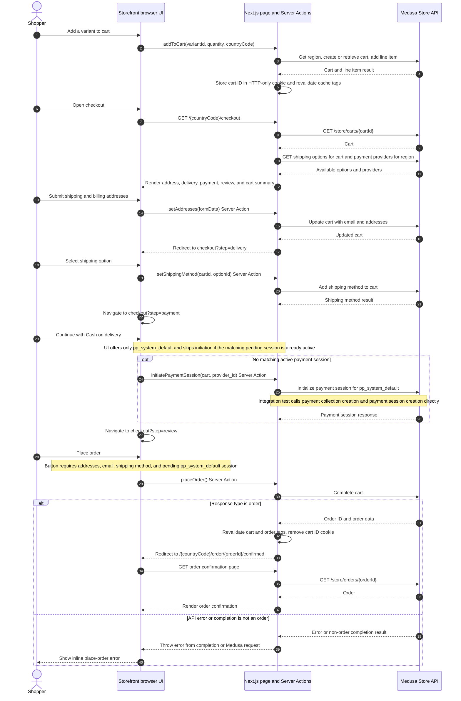

# Checkout to order sequence

This describes the checkout path implemented in the Next.js storefront on `main` at `6da9252`. Solid arrows to Medusa represent Store API calls made by the storefront's server-side Medusa SDK. The backend integration test calls the corresponding Store API endpoints directly; the SDK's internal HTTP implementation is outside this repository.

## Responsibilities and evidence

| Owner | Observed responsibility |
| --- | --- |
| Storefront browser UI | Presents checkout steps, collects address and option selections, displays returned cart and order data, enables Place order only when the cart has the required fields and a pending `pp_system_default` session, and displays action errors. The payment UI labels this provider “Cash on delivery.” |
| Next.js storefront | Server-side data functions call the Medusa SDK with the publishable key and available auth header. Server Actions update the cart, select shipping, initiate the payment session, and complete the cart. It stores the cart ID in an HTTP-only cookie, revalidates presentation cache tags, redirects on success, and fetches the order for the confirmation page. |
| Medusa Store API | Receives cart, shipping, payment, completion, and order requests and returns the commerce objects used by the storefront. The integration test confirms a seeded cart can be completed with `pp_system_default`, returns `type: "order"` with an order ID and item, and can then be retrieved by ID and listed in authenticated customer history. |

The flow follows the [storefront/backend boundary](storefront-backend-boundary.md): Medusa is the commerce authority; the storefront renders and submits inputs through the Store API. The checkout route returns a 404 when no cart is retrievable. Address submission returns an inline error without navigating on failure; shipping and payment selection display inline errors. If cart completion fails or returns a non-order result, `placeOrder` throws, and the button displays the message. The cart ID is removed only after an order response. If the confirmation page cannot retrieve the order, it returns a 404.

## Source references

- [Cart Server Actions](../../apps/storefront/src/lib/data/cart.ts): cart creation and line items, address updates, shipping selection, payment session initiation, cart completion, cache invalidation, cart cookie removal, and redirect.
- [Payment data](../../apps/storefront/src/lib/data/payment.ts): payment providers for the cart's region.
- [Order data](../../apps/storefront/src/lib/data/orders.ts): order retrieval and customer order list.
- [Checkout components](../../apps/storefront/src/modules/checkout/): address, shipping, payment, review, and Place order UI behavior.
- [Checkout page](../../apps/storefront/src/app/%5BcountryCode%5D/%28checkout%29/checkout/page.tsx) and [confirmation page](../../apps/storefront/src/app/%5BcountryCode%5D/%28main%29/order/%5Bid%5D/confirmed/page.tsx): initial cart load and confirmation order fetch.
- [Shipping data](../../apps/storefront/src/lib/data/fulfillment.ts), [SDK configuration](../../apps/storefront/src/lib/config.ts), [cookies](../../apps/storefront/src/lib/data/cookies.ts), and [payment label](../../apps/storefront/src/lib/constants.tsx): supporting request and presentation behavior.
- [Checkout/order integration test](../../apps/backend/integration-tests/http/checkout-order.spec.ts): direct Store API request sequence and asserted order result, detail, and customer history.

## Known limits

- The integration test bypasses Next.js and does not verify Server Action redirects, cookies, UI error states, or the confirmation page. It covers one seeded, authenticated, one-item path and does not exercise checkout failure responses.
- The repository calls Medusa's SDK and Store API; it does not show the internal payment provider, inventory transaction, notification, or idempotency behavior during cart completion. The diagram stops at the observed API response and does not imply those internal steps occurred in any particular order.
- “Cash on delivery” is the storefront's label for Medusa's manual `pp_system_default` provider. The files reviewed do not implement a separate COD collection or settlement flow.
- There is no explicit idempotency key or retry handling in the reviewed `placeOrder` action. The document makes no claim about Medusa's internal duplicate-order safeguards.
