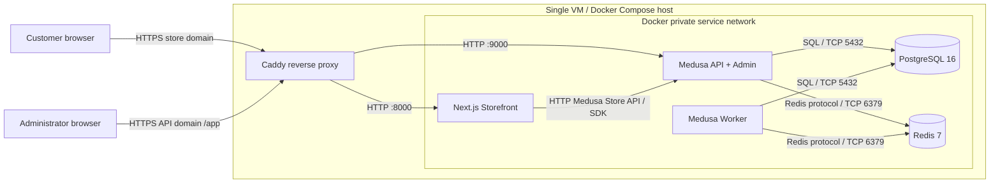
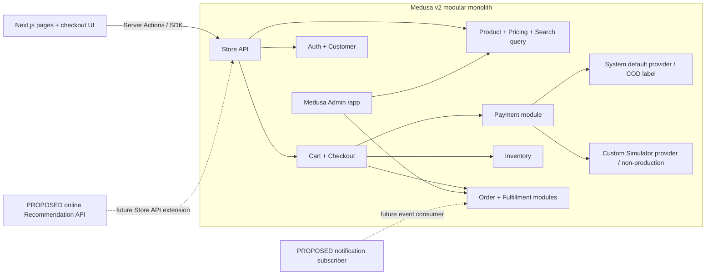
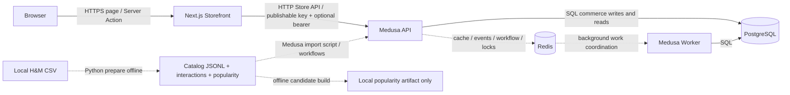
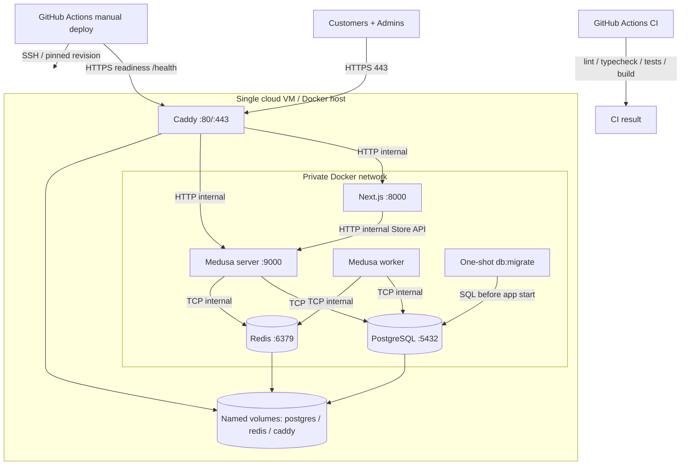
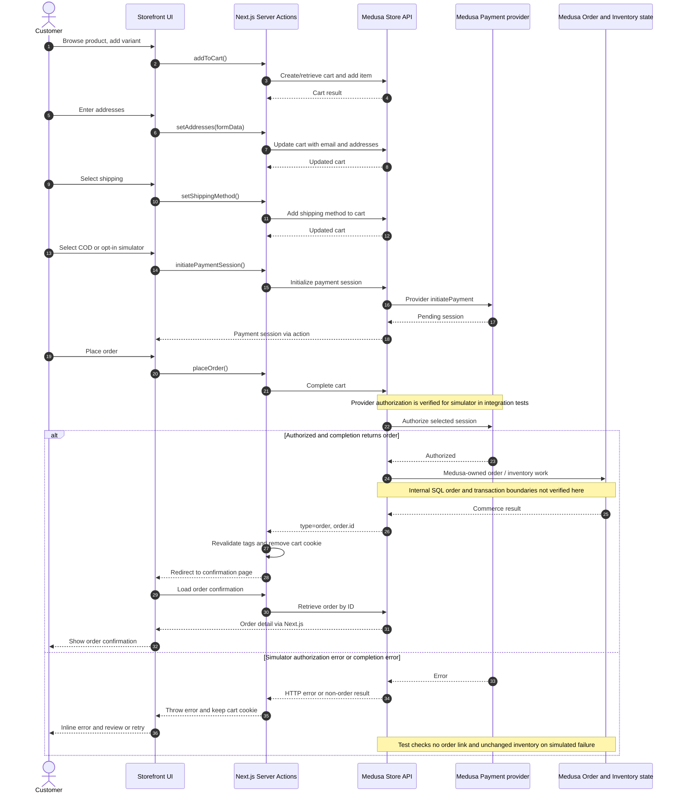

# Cloud System Architecture — Enterprise E-commerce Platform

**Phạm vi audit:** `main` tại `d0bf45a` (02/11/2026). **Quy ước:** **[VERIFIED]** có bằng chứng trong source/config/test; **[CONFIGURED]** đã có cấu hình nhưng chưa chứng minh được đang chạy trên cloud; **[PROPOSED]** chưa triển khai. Sơ đồ mô tả code và cấu hình trong repository, không phải chứng nhận production đã vận hành. Khi README/PLAN cũ khác source, trạng thái As-Is theo source.

## 1. Executive Summary

**[VERIFIED]** Hệ thống dùng Next.js storefront và một Medusa v2 modular monolith. Next.js gọi Medusa Store API bằng SDK; Medusa quản lý commerce và lưu dữ liệu vào PostgreSQL. Cấu hình có Redis cho cache, event bus, workflow engine và locking. Docker Compose tách Medusa API (`server`) và worker (`worker`), có PostgreSQL, Redis, storefront, bước migrate và k6 profile. Caddy và workflow deploy single VM đã được cấu hình, nhưng repository không chứa bằng chứng triển khai cloud thành công. [Medusa config](../../apps/backend/medusa-config.ts), [SDK config](../../apps/storefront/src/lib/config.ts), [Compose](../../docker-compose.yml), [production override](../../deploy/compose.prod.yml), [deploy workflow](../../.github/workflows/deploy.yml).

**[VERIFIED]** COD sử dụng provider Medusa `pp_system_default`. Payment Simulator tùy chỉnh **đã có trong source mới**, chạy ở non-production và cần storefront opt-in; Compose production không đăng ký provider này. H&M mới có importer catalog mẫu và artifact popularity offline, chưa có online Recommendation API. [Payment provider](../../apps/backend/src/modules/payment-simulator/provider.ts), [Medusa config](../../apps/backend/medusa-config.ts), [checkout payment flags](../../apps/storefront/src/lib/util/checkout-payment.ts), [H&M pipeline](../../scripts/hm/README.md).

## 2. Current Architecture — As-Is

| Thành phần | Trạng thái xác minh | Bằng chứng / giới hạn |
| --- | --- | --- |
| Storefront | **[VERIFIED]** Next.js/TypeScript, trang store, account, cart, checkout, order; Server Actions gọi Store API. | [Store page](../../apps/storefront/src/modules/store/templates/index.tsx), [cart actions](../../apps/storefront/src/lib/data/cart.ts), [boundary](storefront-backend-boundary.md). |
| Commerce backend | **[VERIFIED]** Medusa v2 modular monolith; không có Fastify/Prisma runtime song song trên `main`. | [backend package](../../apps/backend/package.json), [Medusa config](../../apps/backend/medusa-config.ts), [root package](../../package.json). |
| PostgreSQL và Redis | **[CONFIGURED]** Postgres 16, Redis 7 với AOF, named volumes, health checks; Redis providers được kích hoạt khi có `REDIS_URL`. | [Compose](../../docker-compose.yml), [Medusa config](../../apps/backend/medusa-config.ts). ERD là khảo sát 24 bảng chọn lọc trên local, không phải toàn schema hiện tại: [schema survey](../erd/medusa-erd-v2-schema-survey.md). |
| API/worker | **[CONFIGURED]** Hai process Medusa chung image, DB/Redis; `WORKER_MODE=server` và `worker`, Admin tắt trên worker. Local dev mặc định `shared` nếu không đặt mode. | [Compose](../../docker-compose.yml), [Medusa config](../../apps/backend/medusa-config.ts). Chưa có custom job/subscriber cho thông báo: [jobs](../../apps/backend/src/jobs/README.md), [subscribers](../../apps/backend/src/subscribers/README.md). |
| Catalog/search | **[VERIFIED]** Storefront hỏi `/store/products` với `q`, region, pagination; có custom catalog route. Không có dedicated search engine trong Compose hiện tại. | [store template](../../apps/storefront/src/modules/store/templates/index.tsx), [products data](../../apps/storefront/src/lib/data/products.ts), [catalog route](../../apps/backend/src/api/store/catalog/route.ts), [Compose](../../docker-compose.yml). |
| Payment | **[VERIFIED]** COD `pp_system_default`; Simulator provider có `simulated_outcome: boolean`, `authorizePayment` trả `authorized`/`error`. Chỉ đăng ký khi `NODE_ENV !== production`; UI chỉ hiển thị khi env opt-in và provider được region trả về. Không có cổng thu tiền thật. | [provider](../../apps/backend/src/modules/payment-simulator/provider.ts), [seed](../../apps/backend/src/scripts/seed-commerce.ts), [UI flag](../../apps/storefront/src/lib/util/checkout-payment.ts), [checkout UI](../../apps/storefront/src/modules/checkout/components/payment/index.tsx). |
| H&M/recommendation | **[VERIFIED]** Script chuẩn bị CSV, import Medusa catalog và tạo popularity candidates offline. Sample local đã được báo cáo 500 products/1.874 variants; đây là báo cáo local có ngày, không chứng minh mọi môi trường. Chưa có API/model serving recommendation. | [H&M README](../../scripts/hm/README.md), [importer](../../apps/backend/src/scripts/import-hm-catalog.ts), [homepage](../../apps/storefront/src/modules/home/components/featured-products/index.tsx). |
| Cloud/CI/load | **[CONFIGURED]** Caddy HTTPS reverse proxy, Compose single VM, manual GitHub Actions deploy, CI và k6 scripts. Chưa thấy bằng chứng cloud uptime, kết quả benchmark hay backup tự động. | [Caddy](../../deploy/Caddyfile), [deploy](../../.github/workflows/deploy.yml), [CI](../../.github/workflows/ci.yml), [k6 catalog](../../load/catalog.js), [k6 checkout](../../load/checkout.js), [runbook](../../deploy/RUNBOOK.md). |

`PLAN.md` ghi lại audit **nhánh Medusa cũ** có `apps/api` Fastify/Prisma và các mục tiêu lúc đó. Đây là lịch sử lựa chọn kiến trúc, không phải cấu hình đang chạy trên `main`. README và [payment-simulator-flow.md](payment-simulator-flow.md) còn nói simulator chưa có; source tại commit audit đã có provider và integration test. [PLAN](../../PLAN.md), [README](../../README.md), [integration test](../../apps/backend/integration-tests/http/checkout-order.spec.ts).

## 3. High-Level System Architecture Diagram

**As-Is theo production Compose; mũi tên HTTPS là truy cập công khai dự kiến khi Caddy và DNS được cấu hình.** Admin UI do Medusa backend phục vụ tại `/app`; Storefront gọi Store API từ server side qua SDK. Docker host ports 8000/9000/5432/6379 chỉ bind `127.0.0.1`. [Compose](../../docker-compose.yml), [Caddy](../../deploy/Caddyfile), [SDK](../../apps/storefront/src/lib/config.ts).

**[CONFIGURED, optional]** S3-compatible File Provider chỉ được đăng ký nếu đủ `S3_BUCKET`, `S3_ACCESS_KEY_ID`, `S3_SECRET_ACCESS_KEY`, `S3_FILE_URL`; Compose không cấp các biến này nên không vẽ S3 vào As-Is. [Medusa config](../../apps/backend/medusa-config.ts).

## 4. Application Component Diagram

**Các hộp Medusa dưới đây là module/khả năng trong cùng backend, không phải microservice.** Hộp nét đứt là extension chưa có online implementation. Việc Medusa cung cấp module không đồng nghĩa dự án đã triển khai mọi nghiệp vụ fulfillment, notification hay capture. [Medusa config](../../apps/backend/medusa-config.ts), [checkout actions](../../apps/storefront/src/lib/data/cart.ts), [payment provider](../../apps/backend/src/modules/payment-simulator/provider.ts).

`Search query` là `q` trên Store API, không phải một engine riêng. `Inventory` và `Order` biểu thị Medusa commerce ownership; thứ tự thao tác nội bộ không thể khẳng định từ source dự án. `Fulfillment` có cấu hình shipping option và Admin, nhưng không thấy carrier integration. [Store page](../../apps/storefront/src/modules/store/templates/index.tsx), [seed shipping](../../apps/backend/src/scripts/seed-commerce.ts), [boundary](storefront-backend-boundary.md).

## 5. Data & Integration Diagram

**Luồng liền** là synchronous HTTP/SDK hoặc database access; **luồng nét đứt** là cơ chế Redis/background hay offline preparation. Không thể suy ra Redis là nơi lưu toàn bộ commerce state. Medusa/PostgreSQL sở hữu Order, Cart, Payment và Inventory; Next.js chỉ giữ auth/cart cookie và presentation cache. [boundary](storefront-backend-boundary.md), [cookies](../../apps/storefront/src/lib/data/cookies.ts), [Medusa config](../../apps/backend/medusa-config.ts).

**[VERIFIED]** H&M importer dùng Medusa product/inventory workflows, synthetic VND price/stock; historical transactions không biến thành Medusa Orders. Artifact popularity chưa publish ra API/cache online. [H&M README](../../scripts/hm/README.md), [prepare](../../scripts/hm/prepare.py), [importer](../../apps/backend/src/scripts/import-hm-catalog.ts). Payment state và inventory reservations được Medusa/test truy vấn trong PostgreSQL, nhưng repo không cho phép xác nhận ranh giới transaction hoặc thứ tự SQL nội bộ. [ERD](../erd/medusa-erd-v2-schema-survey.md), [inventory audit](../../apps/backend/src/scripts/check-inventory-order.ts), [integration test](../../apps/backend/integration-tests/http/checkout-order.spec.ts).

## 6. Cloud Deployment Diagram

Đây là **deployment topology được cấu hình**, không phải xác nhận VM đang online. `deploy.yml` là workflow thủ công qua SSH, checkout commit, build, migrate, `up -d`, rồi gọi HTTPS `/health`; không tự động rollback. Caddy dùng hai domain cho storefront và API/Admin. [deploy workflow](../../.github/workflows/deploy.yml), [production override](../../deploy/compose.prod.yml), [runbook](../../deploy/RUNBOOK.md).

TLS endpoint và Caddy persistence có trong config; certificate issuance, secret rotation, firewall, restore và thực tế uptime cần kiểm chứng trên VM. PostgreSQL/Redis/backend/storefront host ports bind loopback; chỉ Caddy công bố 80/443 trong override. [Compose](../../docker-compose.yml), [Caddy](../../deploy/Caddyfile). Không có Kubernetes, load balancer hay Multi-AZ trong cấu hình này.

## 7. Checkout & Payment Sequence Diagram

Sơ đồ theo Storefront actions, Store API và test hiện tại. `Payment` là Medusa payment module + provider, không phải cổng thanh toán thực. `authorizePayment` của Simulator có thể trả `error`; COD `pp_system_default` là manual provider được UI gắn nhãn Cash on delivery. **Authorized không chứng minh đã capture tiền, đặc biệt với COD.** [cart actions](../../apps/storefront/src/lib/data/cart.ts), [payment UI](../../apps/storefront/src/modules/checkout/components/payment/index.tsx), [payment button](../../apps/storefront/src/modules/checkout/components/payment-button/index.tsx), [provider](../../apps/backend/src/modules/payment-simulator/provider.ts).

Integration test gọi các Store API trực tiếp, không chạy Next.js E2E. Test xác nhận simulator success trả Order và order history; failure trả HTTP 400, không có `order_cart` link và inventory snapshot không đổi. Không suy ra compensation, payment idempotency, notification hay capture nội bộ từ test này. UI cho chọn lại demo outcome và khởi tạo lại session khi bấm Continue; chưa có retry/backoff hay idempotency key tường minh trong `placeOrder`. [checkout integration test](../../apps/backend/integration-tests/http/checkout-order.spec.ts), [payment UI](../../apps/storefront/src/modules/checkout/components/payment/index.tsx), [checkout-order note](checkout-order-sequence.md). Sơ đồ payment riêng [payment-simulator-flow.md](payment-simulator-flow.md) được viết trước backend provider và có status/contract cũ; phải đọc cùng source mới.

## 8. Security & Reliability Architecture

| Chủ đề | As-Is / bằng chứng | Gap hoặc kiểm chứng cần làm |
| --- | --- | --- |
| Auth/authorization | **[VERIFIED]** Medusa auth token trong HTTP-only, Secure ở production, SameSite Lax cookie; Storefront gửi bearer token, publishable key. Admin do Medusa phục vụ. [cookies](../../apps/storefront/src/lib/data/cookies.ts), [SDK](../../apps/storefront/src/lib/config.ts). | **[PROPOSED]** kiểm tra role/access audit và rate limiting ở edge/API. Publishable key không phải secret. |
| TLS/network | **[CONFIGURED]** Caddy 80/443, CORS theo domain; DB/Redis bind loopback. [Caddy](../../deploy/Caddyfile), [Compose](../../docker-compose.yml), [prod override](../../deploy/compose.prod.yml). | Xác nhận DNS, TLS cấp phát, firewall và không expose Docker daemon/SSH ngoài chính sách. |
| Secrets | **[CONFIGURED]** CI deploy dùng GitHub environment SSH secrets; app lấy JWT/cookie/DB secrets qua env. [deploy workflow](../../.github/workflows/deploy.yml), [Compose](../../docker-compose.yml). | Compose có fallback local passwords/secrets; **[PROPOSED]** fail-fast nếu production thiếu secret mạnh, rotation và secret store. |
| Consistency/payment | **[VERIFIED]** Storefront chỉ gọi complete-cart, test failure kiểm order link/inventory; Simulator bị chặn ở production. [cart actions](../../apps/storefront/src/lib/data/cart.ts), [test](../../apps/backend/integration-tests/http/checkout-order.spec.ts), [provider](../../apps/backend/src/modules/payment-simulator/provider.ts). | Không khẳng định transaction internals hoặc idempotency; cần test duplicate submit, retry, reconciliation và COD settlement riêng trước production. |
| Cache/async | **[VERIFIED]** Next.js revalidate tags cho cart/order; Redis Medusa cache/event/workflow/lock khi cấu hình. [cart actions](../../apps/storefront/src/lib/data/cart.ts), [Medusa config](../../apps/backend/medusa-config.ts). | Chưa chứng minh cache invalidation end-to-end, Redis outage behavior, dead letter và job retry; test failure trên staging. |
| CI/health | **[CONFIGURED]** CI chạy tests/lint/typecheck/build, image build; `npm audit` high có `continue-on-error`; Compose health checks PG/Redis/backend và deploy `/health`. [CI](../../.github/workflows/ci.yml), [Compose](../../docker-compose.yml), [deploy](../../.github/workflows/deploy.yml). | `/health` chưa thay thế kiểm tra checkout, worker, backup; audit hiện không là gate. |
| Backup/observability | **[CONFIGURED]** runbook yêu cầu offsite backup, restore staging, theo dõi HTTP 5xx/worker/DB. [runbook](../../deploy/RUNBOOK.md). | **[PROPOSED]** automation backup+restore drill, metrics/tracing/alert; không thấy code hoặc IaC để khẳng định đã chạy. |

## 9. Architecture Decision Records (ADR)

| ADR | Quyết định và lý do | Trade-off, NFR, ngưỡng xem lại |
| --- | --- | --- |
| ADR-01 Commerce authority | **[VERIFIED]** Dùng Medusa v2 thay Fastify/Prisma tự viết, giữ catalog/cart/order/payment/inventory trong commerce workflows. Giảm số business rules tự duy trì. [PLAN](../../PLAN.md), [backend config](../../apps/backend/medusa-config.ts), [boundary](storefront-backend-boundary.md). | Phụ thuộc API/workflow và upgrade Medusa; khi cần custom rule, thêm Medusa module/workflow thay sửa core. |
| ADR-02 Modular monolith | **[VERIFIED]** Một codebase backend, API và worker tách process theo `WORKER_MODE`. Giảm network hops và vận hành so với microservices. [Compose](../../docker-compose.yml). | Chung DB/Redis và release coupling; tách service chỉ khi tải/ownership hoặc isolation được đo rõ, với contract/event và data ownership riêng. |
| ADR-03 PostgreSQL | **[VERIFIED]** System of record cho commerce, có schema/module links của Medusa. [Compose](../../docker-compose.yml), [ERD](../erd/medusa-erd-v2-schema-survey.md). | Single-node DB là SPOF; theo dõi connection, query latency, backup/restore trước HA. |
| ADR-04 Redis | **[VERIFIED]** Medusa cache, event bus, workflow engine, locking dùng Redis khi `REDIS_URL`; worker phù hợp việc không cần nằm trên HTTP path. [Medusa config](../../apps/backend/medusa-config.ts). | Single Redis là SPOF cho các chức năng này; đo memory/lag và test outage. Chưa cần Kafka. |
| ADR-05 Single VM Compose + Caddy | **[CONFIGURED]** Ít chi phí và dễ demo, Caddy làm HTTPS ingress. [Compose](../../docker-compose.yml), [prod override](../../deploy/compose.prod.yml). | VM/storage/network là SPOF, scale theo chiều dọc trước; scale-out chỉ sau benchmark và yêu cầu availability thực tế. |
| ADR-06 Payment demo | **[VERIFIED]** COD mặc định, Simulator chỉ non-production. Tách lựa chọn demo khỏi thu tiền thật. [provider](../../apps/backend/src/modules/payment-simulator/provider.ts), [config](../../apps/backend/medusa-config.ts). | Không có settlement/capture thật; muốn thanh toán production phải tích hợp provider phù hợp và kiểm reconciliation/webhook. |

## 10. Current vs Proposed Architecture

| Domain | As-Is | [PROPOSED] khi có yêu cầu và số liệu |
| --- | --- | --- |
| Search | `/store/products?q=...` và custom catalog route; chưa có search service. [store page](../../apps/storefront/src/modules/store/templates/index.tsx), [catalog route](../../apps/backend/src/api/store/catalog/route.ts). | Indexer/search engine riêng nếu relevance/latency hiện tại không đạt SLO; giữ Medusa là catalog authority. |
| Recommendation | H&M CSV → importer Medusa và popularity artifact offline; homepage hiện là collection rail. [H&M README](../../scripts/hm/README.md), [featured products](../../apps/storefront/src/modules/home/components/featured-products/index.tsx). | Candidate store/API stateless, filtering qua Medusa availability/region, event tracking và offline evaluation trước khi gọi personalized. |
| Notification | Không có custom subscriber hoặc delivery adapter trong app. [subscribers](../../apps/backend/src/subscribers/README.md). | Subscriber/notification provider bất đồng bộ, retry/dedupe; không chặn checkout. |
| Media | S3 provider conditional nhưng không cấp env trong Compose. [Medusa config](../../apps/backend/medusa-config.ts), [Compose](../../docker-compose.yml). | Object storage khi có quyền dùng ảnh và nhu cầu lưu media; giữ config/secrets riêng. |
| Scale/availability | Một VM, một PostgreSQL, một Redis, API/worker mỗi loại một container theo config. [Compose](../../docker-compose.yml). | Nhiều API replicas, managed/HA DB+Redis, load balancer, backups và observability sau khi có benchmark/cost budget. |

## 11. Gaps & Recommendations

1. **P0 — Sửa drift tài liệu.** README, `payment-simulator-flow.md`, `storefront-backend-boundary.md` còn nhận định simulator chưa tồn tại; đồng bộ với provider, test và điều kiện non-production. [README](../../README.md), [payment note](payment-simulator-flow.md), [provider](../../apps/backend/src/modules/payment-simulator/provider.ts).
2. **P0 — Chạy staging deployment drill.** Xác nhận DNS/TLS, `/health`, login, catalog, COD checkout, worker, backup/restore và rollback migration-compatible; workflow hiện mới có cấu hình. [deploy workflow](../../.github/workflows/deploy.yml), [runbook](../../deploy/RUNBOOK.md).
3. **P0 — Bảo vệ production secrets.** Loại khả năng dùng Compose fallback local mặc định khi production, kiểm tra biến bắt buộc và quy trình rotation. [Compose](../../docker-compose.yml), [Medusa config](../../apps/backend/medusa-config.ts).
4. **P1 — Thêm kiểm chứng checkout concurrency/idempotency.** Test duplicate submit, mất phản hồi, Redis outage, inventory race, COD settlement; không suy ra Medusa internals từ một happy path. [cart actions](../../apps/storefront/src/lib/data/cart.ts), [HTTP test](../../apps/backend/integration-tests/http/checkout-order.spec.ts).
5. **P1 — Đo NFR thay vì báo cáo target như kết quả.** k6 scripts có target catalog/checkout nhưng chưa có benchmark report được liên kết ở đây; thu p50/p95/p99, error rate, DB/Redis/worker metrics, CPU/RAM và chi phí. [k6 catalog](../../load/catalog.js), [k6 checkout](../../load/checkout.js).
6. **P2 — Mở rộng có kiểm soát.** Recommendation API, event tracking, notification và search engine riêng chỉ sau khi mapping dữ liệu, privacy/license, evaluation và nhu cầu tải được xác nhận. [H&M README](../../scripts/hm/README.md), [recommendation plan](hm-recommendation-implementation-plan.md).

**Giới hạn audit:** Chỉ đọc repository/config/test và tài liệu chứng cứ đã commit. Không truy cập cloud VM, không chạy checkout live hay kiểm chứng trạng thái database hiện tại. Mọi hành vi bên trong Medusa package như transaction boundary, idempotency, exact reservation ordering, webhook/capture và retry chưa được xác nhận từ source dự án.
