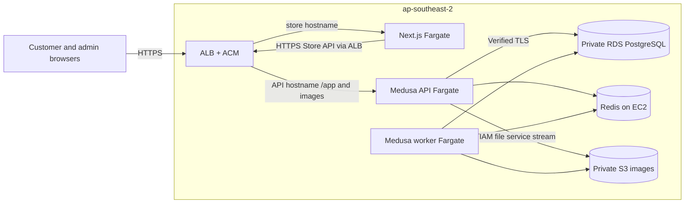
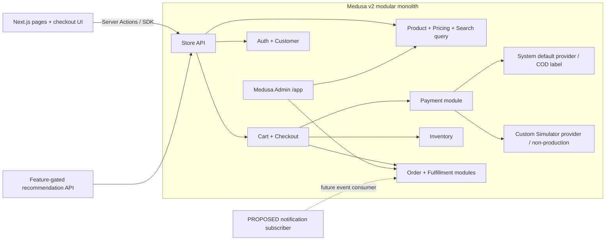
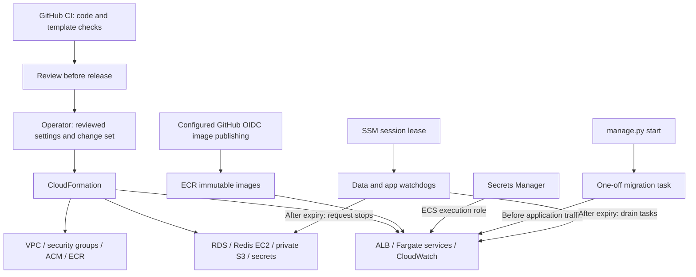
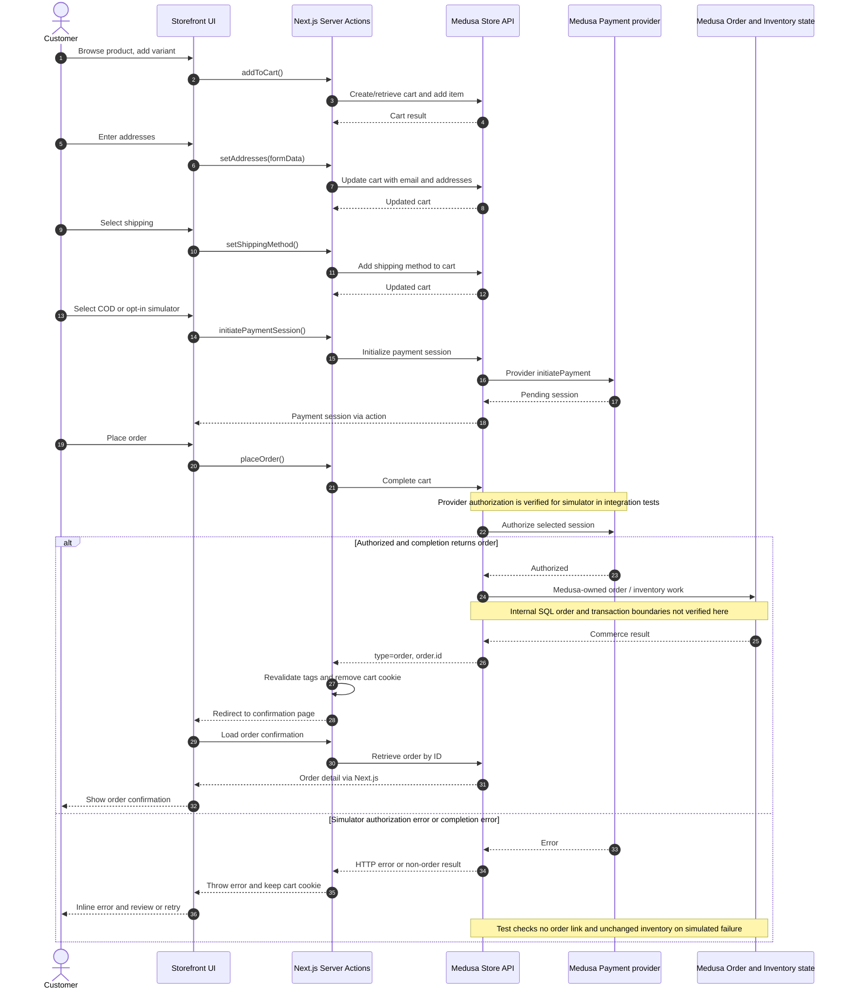

# Kiến trúc hệ thống cloud — Enterprise E-commerce Platform

## Cloud target decision — 2026-11-08

The course target is the full AWS architecture: ALB/ACM, separate ECS Fargate storefront/API/worker services, private RDS PostgreSQL, Redis on EC2, private S3 images, CloudWatch and CloudFormation. Product images are delivered through the backend proxy instead of CloudFront because distribution creation is blocked by AWS verification. The successful single-EC2 Compose/Caddy rehearsal remains the fallback. The retained resources were recovered and the full stack was publicly verified on November 9: three ECS services running, healthy ALB targets and 14/14 public checks. See the [deployment record](../report/aws-fargate-deployment-2026-11-08.md). The accepted [cloud ADR](adr/0001-aws-cloud-stack.md) supersedes the old single-VM primary deployment. See the [AWS deployment design and image-delivery decision](../../deploy/cloudformation/README.md).

## 1. Tóm tắt

Khách dùng website Next.js trên ECS Fargate. ALB/ACM nhận HTTPS và phân tuyến hai hostname tới storefront hoặc Medusa API/Admin; worker chạy ở service riêng. Medusa lưu dữ liệu trong RDS PostgreSQL và phối hợp công việc qua Redis trên EC2. Ảnh sản phẩm nằm trong S3 private và được backend stream bằng IAM task role. CloudFormation quản lý hạ tầng; CloudWatch và hai watchdog theo dõi phiên demo có thời hạn. Ngày 09/11/2026, ba ECS service và 14/14 public checks đã được xác minh; đây là bằng chứng tại thời điểm thử, không phải cam kết uptime. [Báo cáo AWS](../report/aws-fargate-deployment-2026-11-08.md), [runbook](../../deploy/RUNBOOK.md), [templates](../../deploy/cloudformation/).

Docker Compose dành cho local. Bản EC2/Compose/Caddy ngày 06/11 là rehearsal/fallback đã kiểm tra một đơn COD qua API; không còn là kiến trúc cloud chính. [Báo cáo EC2](../report/aws-ec2-deployment-2026-11-06.md). GitHub image publishing được cấu hình nhưng chưa được thực thi trong báo cáo triển khai.

 Khách có thể chọn trả tiền khi nhận hàng (COD) qua phương thức Medusa có mã `pp_system_default`. Công cụ thanh toán mô phỏng **đã có trong mã nguồn**, nhưng chỉ dành cho môi trường thử nghiệm và phải bật riêng trên website; cấu hình production không đăng ký nó. Với dữ liệu H&M, dự án đã có cách nhập một tập sản phẩm mẫu và tạo danh sách sản phẩm phổ biến trên máy cá nhân. Sau khi đồng bộ `main` tại `389e855`, API recommendation/personalization và UI opt-in đã có trong mã nguồn. Cloud giữ feature flags ở mặc định tắt; không import hoặc public H&M artifacts trong lần phát hành này. [Công cụ thanh toán mô phỏng](../../apps/backend/src/modules/payment-simulator/provider.ts), [cấu hình Medusa](../../apps/backend/medusa-config.ts), [điều kiện hiển thị](../../apps/storefront/src/lib/util/checkout-payment.ts), [dữ liệu H&M](../../scripts/hm/README.md).

## 2. Hệ thống hiện có

| Thành phần | Hiện có gì | Bằng chứng và giới hạn |
| --- | --- | --- |
| Website khách hàng | **[VERIFIED]** Có trang sản phẩm, tài khoản, giỏ hàng, đặt hàng và xem đơn. Website gọi Medusa để lấy và cập nhật dữ liệu. | [Trang sản phẩm](../../apps/storefront/src/modules/store/templates/index.tsx), [xử lý giỏ](../../apps/storefront/src/lib/data/cart.ts), [phân công trách nhiệm](storefront-backend-boundary.md). |
| Phần quản lý bán hàng | **[VERIFIED]** Medusa v2 xử lý các chức năng bán hàng trong cùng một ứng dụng. Fastify/Prisma trong kế hoạch cũ không chạy song song trên `main`. | [Gói backend](../../apps/backend/package.json), [cấu hình Medusa](../../apps/backend/medusa-config.ts), [gói dự án](../../package.json). |
| PostgreSQL và Redis | **[VERIFIED trong phiên AWS]** RDS PostgreSQL 16 Single-AZ, private; Redis 7 trên EC2 riêng, ingress chỉ từ application security group. Local dùng container Compose. | [Data template](../../deploy/cloudformation/data.yaml), [runtime](../report/evidence/fargate-2026-11-08/runtime.json). Chưa diễn tập restore hoặc failover. |
| Medusa phục vụ và xử lý nền | **[VERIFIED: service startup]** API/Admin và worker dùng chung image Medusa nhưng chạy ở hai ECS service; Admin tắt ở worker. | [App template](../../deploy/cloudformation/app.yaml), [cấu hình](../../apps/backend/medusa-config.ts). Chưa chứng minh một background business job hoàn tất. |
| Sản phẩm và tìm kiếm | **[VERIFIED]** Website gửi từ khóa (`q`) tới `/store/products`, có chia trang. Backend còn có đường dẫn catalog riêng. Compose chưa có công cụ tìm kiếm độc lập. | [Trang sản phẩm](../../apps/storefront/src/modules/store/templates/index.tsx), [lấy dữ liệu sản phẩm](../../apps/storefront/src/lib/data/products.ts), [đường dẫn catalog](../../apps/backend/src/api/store/catalog/route.ts), [Compose](../../docker-compose.yml). |
| Thanh toán | **[VERIFIED]** COD dùng mã `pp_system_default`. Công cụ mô phỏng nhận lựa chọn thành công/thất bại và chỉ được đăng ký ngoài production; website phải bật riêng và Medusa phải cho phép phương thức này ở khu vực bán. Không có cổng nhận tiền thật. | [Công cụ mô phỏng](../../apps/backend/src/modules/payment-simulator/provider.ts), [dữ liệu khởi tạo](../../apps/backend/src/scripts/seed-commerce.ts), [điều kiện hiển thị](../../apps/storefront/src/lib/util/checkout-payment.ts), [giao diện thanh toán](../../apps/storefront/src/modules/checkout/components/payment/index.tsx). |
| H&M và gợi ý sản phẩm | **[IMPLEMENTED / private validation]** `main` có recommendation/personalization modules, API và UI có feature flags. Cloud chưa bật các flags hoặc import candidates. | [Đặc tả](../recommendation/spec.md), [quyền dữ liệu](../recommendation/dataset-rights-decision.md), [V2 freeze](../recommendation/personalization/v2-freeze.md). Không suy bằng chứng private thành public promotion. |
| Cloud và kiểm thử tải | **[VERIFIED: 14 public checks ngày 09/11/2026]** ALB/ACM, ba Fargate service, RDS/Redis và private S3 proxy đã chạy. | [Báo cáo](../report/aws-fargate-deployment-2026-11-08.md). GitHub publishing, load-driven autoscaling, browser checkout và restore vẫn chưa được thử. |

`PLAN.md` mô tả một nhánh cũ từng dùng Fastify/Prisma và các mục tiêu đặt ra khi đó. Đó là lịch sử dự án, không phải trạng thái đang chạy của `main`. [Tài liệu Payment Simulator cũ](payment-simulator-flow.md) còn nói công cụ mô phỏng chưa có; mã nguồn tại thời điểm kiểm tra đã có công cụ này và bài kiểm thử. [Kế hoạch cũ](../../PLAN.md), [README](../../README.md), [bài kiểm thử](../../apps/backend/integration-tests/http/checkout-order.spec.ts).

## 3. Sơ đồ tổng quan: khách truy cập hệ thống như thế nào

Cloudflare DNS-only CNAME đưa hai hostname tới ALB; ACM kết thúc TLS. ALB gọi application tasks qua HTTP trong security-group boundary. Next.js gọi Store API qua hostname HTTPS của API. S3 không public; trình duyệt lấy ảnh qua backend. [Templates](../../deploy/cloudformation/), [public verification](../report/evidence/fargate-2026-11-08/public-verification.json).

Ứng dụng dùng `S3_AUTHENTICATION_METHOD=s3-iam-role`, ACL tắt và URL base của backend proxy. Chỉ raster images trong `public-images/` được public qua proxy; SVG, private-prefix và missing-image trả 404. Local không bắt buộc dùng S3. [File configuration](../../apps/backend/medusa-config.ts), [decision](adr/0001-aws-cloud-stack.md).

## 4. Sơ đồ chức năng: mỗi phần làm gì

**Cách đọc sơ đồ:** Các chức năng bên trong khung Medusa thuộc cùng một ứng dụng; mỗi ô không phải một máy chủ riêng. Đường nét đứt dẫn tới phần **[PROPOSED]** là việc mới dự kiến làm. Medusa có sẵn chức năng quản lý giao hàng và thanh toán, nhưng dự án chưa chứng minh đã triển khai mọi bước giao hàng, gửi thông báo hay thu tiền. [Cấu hình Medusa](../../apps/backend/medusa-config.ts), [xử lý giỏ](../../apps/storefront/src/lib/data/cart.ts), [công cụ thanh toán](../../apps/backend/src/modules/payment-simulator/provider.ts).

Tìm kiếm hiện dùng tham số `q` của Store API, chưa có công cụ tìm kiếm riêng. Medusa chịu trách nhiệm về tồn kho và đơn hàng, nhưng mã nguồn dự án không cho biết chính xác thứ tự xử lý bên trong Medusa. Dự án có lựa chọn giao hàng mẫu và giao diện quản trị; chưa thấy kết nối với hãng vận chuyển. [Trang sản phẩm](../../apps/storefront/src/modules/store/templates/index.tsx), [dữ liệu giao hàng mẫu](../../apps/backend/src/scripts/seed-commerce.ts), [phân công trách nhiệm](storefront-backend-boundary.md).

## 5. Sơ đồ dữ liệu: thông tin đi đâu và được lưu ở đâu

**Cách đọc sơ đồ:** Đường liền là yêu cầu được gửi và trả lời ngay, hoặc thao tác đọc/ghi cơ sở dữ liệu. Đường nét đứt là việc hỗ trợ chạy nền hoặc chuẩn bị dữ liệu trước. Đơn hàng, giỏ, thanh toán và tồn kho được Medusa quản lý trong PostgreSQL. Redis không thay PostgreSQL làm nơi lưu các dữ liệu bán hàng này. Website chỉ giữ cookie đăng nhập, mã giỏ hàng và dữ liệu tạm để hiển thị. [Phân công trách nhiệm](storefront-backend-boundary.md), [cookie](../../apps/storefront/src/lib/data/cookies.ts), [cấu hình Medusa](../../apps/backend/medusa-config.ts).

**[VERIFIED]** Công cụ nhập H&M dùng quy trình Medusa để tạo sản phẩm và tồn kho. Giá VND và số hàng tồn trong bản demo là dữ liệu được tạo ra, không phải giá và tồn kho thật của H&M. Lịch sử mua H&M không được biến thành đơn hàng của dự án. Danh sách sản phẩm phổ biến mới là tệp offline, chưa được website sử dụng. [Hướng dẫn H&M](../../scripts/hm/README.md), [chuẩn bị dữ liệu](../../scripts/hm/prepare.py), [công cụ nhập](../../apps/backend/src/scripts/import-hm-catalog.ts). Bài kiểm thử có đọc trạng thái thanh toán và số hàng giữ cho đơn từ PostgreSQL, nhưng không chứng minh được Medusa thực hiện mọi câu lệnh dữ liệu theo thứ tự nào. [Khảo sát dữ liệu](../erd/medusa-erd-v2-schema-survey.md), [kiểm tra tồn kho](../../apps/backend/src/scripts/check-inventory-order.ts), [bài kiểm thử](../../apps/backend/integration-tests/http/checkout-order.spec.ts).

## 6. Sơ đồ triển khai: hạ tầng, phát hành và vòng đời

CloudFormation tách foundation, data và app. Backend/storefront dùng immutable image digest trong ECR. ECS execution role inject secrets; app task role cấp quyền S3. [Runbook](../../deploy/RUNBOOK.md), [app template](../../deploy/cloudformation/app.yaml).

Live deployment dùng Docker build và AWS CLI, không chứng minh workflow GitHub đã được thực thi. `start` drain tasks và chạy migrations trước khi bật traffic; không phải zero-downtime release. `pause` giữ ALB và dữ liệu; `hibernate` xóa app stack nhưng giữ data/watchdog. DNS phải cập nhật nếu ALB được tạo lại. Không xóa data/foundation stacks hoặc volumes như cách shutdown thông thường.

Application ENIs có public IPv4 để outbound nhưng ingress chỉ từ ALB security group. RDS nằm trong private subnets; Redis cho ingress từ application group và không mở SSH. Không có NAT Gateway, Kubernetes hay triển khai đa Region. Redis transport chưa có TLS. RDS Single-AZ và Redis một host là các điểm lỗi đơn; cấu hình scaling và watchdog không tự chứng minh HA hoặc hard spending cap.

## 7. Sơ đồ từng bước đặt hàng và thanh toán

**Đọc nhanh:** Khách chọn hàng → nhập địa chỉ → chọn giao hàng → chọn cách thanh toán → bấm đặt hàng. Website chuyển từng yêu cầu tới Medusa. Chỉ khi Medusa trả về mã đơn, website mới hiện trang xác nhận và xóa mã giỏ hàng khỏi cookie. Nếu thanh toán mô phỏng báo lỗi, website hiện thông báo và giữ giỏ để khách thử lại. Ở đây `Payment` là phần thanh toán của Medusa, không phải ngân hàng hay cổng thu tiền thật. COD dùng mã `pp_system_default` và có nghĩa là trả tiền khi nhận hàng. **Trạng thái `authorized` không có nghĩa tiền đã được thu.** [Xử lý giỏ](../../apps/storefront/src/lib/data/cart.ts), [giao diện thanh toán](../../apps/storefront/src/modules/checkout/components/payment/index.tsx), [nút đặt hàng](../../apps/storefront/src/modules/checkout/components/payment-button/index.tsx), [công cụ mô phỏng](../../apps/backend/src/modules/payment-simulator/provider.ts).

Bài kiểm thử gửi yêu cầu trực tiếp tới Medusa, chưa kiểm tra toàn bộ thao tác trên website. Nó xác nhận rằng trường hợp mô phỏng thành công tạo đơn có thể xem lại; trường hợp thất bại trả lỗi HTTP 400, không gắn đơn với giỏ và không đổi số tồn kho đã chụp trước đó. Bài test này chưa chứng minh Medusa xử lý các bước nội bộ như chống gửi trùng, hoàn tác, gửi thông báo hoặc thu tiền ra sao. Website cho chọn lại kết quả mô phỏng và tạo lại phiên thanh toán khi bấm Continue, nhưng chưa có cơ chế tự thử lại sau thời gian chờ hoặc mã chống gửi trùng được viết rõ trong `placeOrder`. [Bài kiểm thử](../../apps/backend/integration-tests/http/checkout-order.spec.ts), [giao diện thanh toán](../../apps/storefront/src/modules/checkout/components/payment/index.tsx), [tài liệu checkout](checkout-order-sequence.md). [Tài liệu Payment Simulator cũ](payment-simulator-flow.md) được viết trước mã nguồn mới nên có chỗ không còn đúng.

## 8. Bảo mật và cách xử lý sự cố

| Chủ đề | Hiện có | Cần kiểm tra hoặc làm thêm |
| --- | --- | --- |
| Đăng nhập và quyền | **[VERIFIED]** Website giữ mã đăng nhập trong cookie chỉ máy chủ đọc được, có chế độ bảo vệ khi chạy production. Medusa quyết định người dùng được xem gì. [Cookie](../../apps/storefront/src/lib/data/cookies.ts), [kết nối API](../../apps/storefront/src/lib/config.ts). | **[PROPOSED]** kiểm tra thêm quyền từng vai trò và giới hạn số yêu cầu để chống lạm dụng. Mã publishable key dùng cho Store API không phải mật khẩu bí mật. |
| Kết nối an toàn | **[VERIFIED trong phiên AWS]** HTTPS/redirect tại ALB/ACM; RDS private; Redis/RDS ingress giới hạn application security group; unsigned S3 bị từ chối. | [Templates](../../deploy/cloudformation/), [public checks](../report/evidence/fargate-2026-11-08/public-verification.json). Redis nội bộ chưa dùng TLS; chưa có bài kiểm thử xâm nhập. |
| Thông tin bí mật | ECS execution role lấy DB/JWT/cookie từ Secrets Manager; app task role đọc/ghi bucket private, không dùng static S3 keys. | [App template](../../deploy/cloudformation/app.yaml), [entrypoint](../../deploy/cloudformation/runtime/backend-entrypoint.cjs). Chưa triển khai rotation tự động; Compose/fallback có quy tắc riêng. |
| Đơn hàng và thanh toán | **[VERIFIED]** Website yêu cầu Medusa hoàn tất giỏ; test kiểm tra thanh toán mô phỏng thất bại không tạo đơn và không đổi tồn kho. Simulator bị chặn ở production. [Xử lý giỏ](../../apps/storefront/src/lib/data/cart.ts), [bài kiểm thử](../../apps/backend/integration-tests/http/checkout-order.spec.ts), [công cụ mô phỏng](../../apps/backend/src/modules/payment-simulator/provider.ts). | Chưa biết hết cách Medusa xử lý bên trong. Cần thử bấm đặt hàng lặp, mất kết nối, đối chiếu tiền và quy trình thu COD. |
| Dữ liệu tạm và việc nền | **[VERIFIED]** Website làm mới dữ liệu giỏ/đơn sau khi thay đổi; Redis hỗ trợ lưu tạm và phối hợp xử lý nền khi được cấu hình. [Xử lý giỏ](../../apps/storefront/src/lib/data/cart.ts), [cấu hình Medusa](../../apps/backend/medusa-config.ts). | Cần thử việc cập nhật dữ liệu có xuất hiện kịp thời không, và hệ thống xử lý thế nào khi Redis hoặc một việc nền bị lỗi. |
| Kiểm tra phiên bản mới | CI kiểm tra code và CloudFormation; workflow AWS images dùng OIDC để publish ECR, operator review change set rồi chạy migrations/start. | [CI](../../.github/workflows/ci.yml), [image workflow](../../.github/workflows/aws-images.yml), [runbook](../../deploy/RUNBOOK.md). GitHub publishing chưa được live report thực thi; health không thay cho checkout/readiness nghiệp vụ. |
| Sao lưu và theo dõi lỗi | RDS có backup retention, S3 versioning, CloudWatch logs/dashboard/alarms và hai lease watchdog. | [Data](../../deploy/cloudformation/data.yaml), [app](../../deploy/cloudformation/app.yaml). Cần xác nhận email SNS, kiểm tra cảnh báo và diễn tập restore; watchdog không phải spending cap. |

## 9. Các quyết định thiết kế và lý do (ADR)

| Mã | Vì sao chọn cách này | Điểm hạn chế và khi nào cần xem lại |
| --- | --- | --- |
| ADR-01 Medusa quản lý bán hàng | **[VERIFIED]** Dùng Medusa v2 thay cho việc tự viết toàn bộ phần bán hàng bằng Fastify/Prisma. Nhóm bớt phải tự xử lý sản phẩm, giỏ, đơn, thanh toán và tồn kho. [Kế hoạch](../../PLAN.md), [cấu hình Medusa](../../apps/backend/medusa-config.ts), [phân công trách nhiệm](storefront-backend-boundary.md). | Phụ thuộc vào cách Medusa hoạt động và việc nâng cấp phiên bản. Nếu cần quy tắc riêng, thêm phần mở rộng theo cách Medusa hỗ trợ thay vì sửa lõi. |
| ADR-02 Một ứng dụng backend | **[VERIFIED]** Các chức năng bán hàng ở cùng một ứng dụng; phần trả lời khách và phần xử lý nền có thể chạy thành hai tiến trình. API và worker chạy ở hai ECS service, còn nghiệp vụ vẫn là modular monolith. [App template](../../deploy/cloudformation/app.yaml). | Các tiến trình dùng chung dữ liệu và thường phát hành cùng nhau. Chỉ tách thành dịch vụ riêng khi số liệu tải hoặc yêu cầu vận hành cho thấy lợi ích rõ ràng. |
| ADR-03 PostgreSQL | **[VERIFIED]** RDS PostgreSQL là nơi lưu commerce trên AWS; local/fallback dùng PostgreSQL container. [Data template](../../deploy/cloudformation/data.yaml). | Single-AZ còn là điểm lỗi đơn; cần đo truy vấn, kết nối và restore trước khi tuyên bố HA/RPO/RTO. |
| ADR-04 Redis | **[VERIFIED]** Medusa dùng Redis để tăng tốc, phối hợp việc nền và tránh các thao tác xung đột khi có cấu hình `REDIS_URL`. [Cấu hình Medusa](../../apps/backend/medusa-config.ts). | Một Redis cũng có thể thành điểm gây gián đoạn. Cần đo mức sử dụng và thử khi Redis lỗi; chưa có lý do thêm hệ thống truyền tin phức tạp hơn. |
| ADR-05 Một máy chủ và Caddy | **[SUPERSEDED cho cloud chính]** Rehearsal EC2 ngày 06/11 đã thành công; giữ Compose/Caddy cho local và fallback. [Báo cáo](../report/aws-ec2-deployment-2026-11-06.md). | ADR-07 thay thế vai trò kiến trúc cloud chính; không tự chuyển DNS đang dùng ALB về EC2. |
| ADR-06 Thanh toán demo | **[VERIFIED]** COD là lựa chọn mặc định; công cụ mô phỏng chỉ chạy ở môi trường thử nghiệm. [Công cụ mô phỏng](../../apps/backend/src/modules/payment-simulator/provider.ts), [cấu hình](../../apps/backend/medusa-config.ts). | Không thu hoặc hoàn tiền thật. Muốn bán hàng thực tế cần tích hợp đơn vị thanh toán và quy trình đối chiếu tiền. |
| ADR-07 AWS course stack | **[ACCEPTED / VERIFIED smoke]** ALB/ACM, ba Fargate service, RDS, Redis EC2, private S3 proxy và CloudFormation là cloud baseline. [ADR](adr/0001-aws-cloud-stack.md). | Thể hiện networking, managed DB, service lifecycle và IaC; load, HA và restore vẫn cần bằng chứng riêng. |
| ADR-08 Private S3 qua backend | **[VERIFIED]** Thay CloudFront bằng IAM-role proxy do AWS verification chặn tạo distribution. [ADR](adr/0001-aws-cloud-stack.md). | Không có edge cache; đo thêm image traffic và giữ private documents ngoài public-image boundary. |

## 10. Hiện có và hướng mở rộng

| Phần việc | Hiện có | [PROPOSED] Chỉ làm khi có nhu cầu và số liệu |
| --- | --- | --- |
| Tìm kiếm | Website gửi từ khóa qua `/store/products?q=...`; chưa có công cụ tìm kiếm riêng. [Trang sản phẩm](../../apps/storefront/src/modules/store/templates/index.tsx), [đường dẫn catalog](../../apps/backend/src/api/store/catalog/route.ts). | Chỉ thêm công cụ tìm kiếm nếu kết quả hoặc tốc độ hiện tại không đạt yêu cầu đã đo. Medusa vẫn quản lý danh sách sản phẩm chính. |
| Gợi ý sản phẩm | Có API/modules và UI có flags trên `main` tại `389e855`; chưa bật trong cloud. [Đặc tả](../recommendation/spec.md). | Hoàn thành quyền dữ liệu, release gates và review trước khi publish artifacts hoặc bật flags; giữ V2 freeze. |
| Thông báo | Chưa có phần gửi thông báo riêng của dự án. [Bộ nhận sự kiện](../../apps/backend/src/subscribers/README.md). | Gửi thông báo ở bước xử lý nền, có thử lại và chống gửi trùng; lỗi email không cản đặt hàng. |
| Ảnh sản phẩm | **[VERIFIED]** Private S3, IAM role và public raster-image proxy đã qua upload/read và public HTTP checks. [Proxy](../../apps/backend/src/api/product-images/[prefix]/[key]/route.ts), [cấu hình](../../apps/backend/medusa-config.ts). | Không có edge CDN; private documents không được đặt trong public-image prefix. Quyền ảnh H&M vẫn cần xác nhận riêng. |
| Chịu tải và hoạt động liên tục | Fargate tách ba service; API cấu hình 1–2 task, worker/storefront một task; RDS Single-AZ và Redis một host. [App](../../deploy/cloudformation/app.yaml). | Chưa có benchmark, scaling/failover/restore drill; không gọi đây là hệ thống HA chỉ vì có ALB/Fargate. |

## 11. Việc cần làm tiếp

1. **P0 — Cập nhật tài liệu cũ.** Các tài liệu thanh toán/ranh giới website–Medusa còn nói công cụ mô phỏng chưa có; cần sửa theo mã nguồn và điều kiện chỉ dùng khi thử nghiệm. [README](../../README.md), [tài liệu cũ](payment-simulator-flow.md), [mã nguồn](../../apps/backend/src/modules/payment-simulator/provider.ts).
2. **P0 — Hoàn thiện nghiệm thu sau smoke.** AWS đã qua 14 public checks. Cần browser checkout, một business job của worker, restore và release rollback drill; xác nhận SNS email. [Báo cáo](../report/aws-fargate-deployment-2026-11-08.md), [runbook](../../deploy/RUNBOOK.md).
3. **P0 — Vận hành secrets và backup.** AWS dùng Secrets Manager và task roles; local/fallback vẫn phải tránh mật khẩu mẫu khi public. Cần rotation, backup/restore drill và kiểm tra quyền. [App template](../../deploy/cloudformation/app.yaml), [runbook](../../deploy/RUNBOOK.md).
4. **P1 — Thử những tình huống đặt hàng khó.** Kiểm tra bấm đặt hàng nhiều lần, mất phản hồi, Redis lỗi, nhiều khách tranh cùng số hàng cuối và quy trình thu COD. Một bài test đặt hàng thành công chưa chứng minh các trường hợp này. [Xử lý giỏ](../../apps/storefront/src/lib/data/cart.ts), [bài kiểm thử](../../apps/backend/integration-tests/http/checkout-order.spec.ts).
5. **P1 — Đo kết quả thật.** k6 đã có kịch bản và mức mục tiêu nhưng chưa có báo cáo đo được liên kết tại đây. Cần lưu thời gian phản hồi, tỷ lệ lỗi, mức dùng CPU/RAM, tải cơ sở dữ liệu và chi phí. [Kịch bản xem sản phẩm](../../load/catalog.js), [kịch bản đặt hàng](../../load/checkout.js).
6. **P2 — Chỉ mở rộng khi đủ điều kiện.** Gợi ý sản phẩm, thông báo và công cụ tìm kiếm riêng cần dữ liệu hợp lệ, quyền sử dụng rõ ràng, kết quả đánh giá và nhu cầu thực tế. [H&M](../../scripts/hm/README.md), [đặc tả gợi ý](../recommendation/spec.md) và [báo cáo triển khai](../recommendation/reports/final_implementation_report.md).

**Giới hạn kiểm tra:** Báo cáo AWS ngày 09/11 ghi nhận ba ECS service, ALB targets healthy và 14 public checks; đó là snapshot, không phải bằng chứng uptime hiện tại. Browser checkout, một background business job, autoscaling under load và restore trên Fargate chưa được kiểm chứng. [Bằng chứng AWS](../report/aws-fargate-deployment-2026-11-08.md). Tài liệu này cũng dựa trên mã nguồn và báo cáo rehearsal trước đó. Phiên EC2 ngày 06/11/2026 đã kiểm tra HTTPS, PostgreSQL, Redis, kết nối ứng dụng và tạo một đơn COD qua API; [báo cáo](../report/aws-ec2-deployment-2026-11-06.md) ghi phạm vi cụ thể. Chưa thực hiện checkout bằng trình duyệt, kiểm thử tải hay diễn tập khôi phục trên EC2. Mã nguồn dự án cũng không cho biết đầy đủ Medusa xử lý giao dịch nội bộ, chống gửi trùng, giữ hàng, nhận thông báo thanh toán và thử lại theo thứ tự nào.
