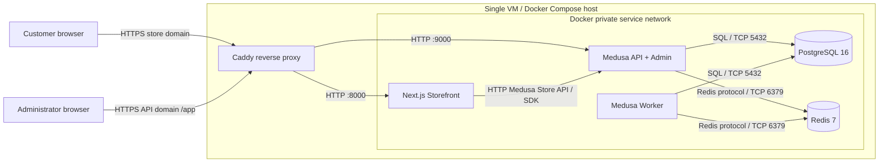
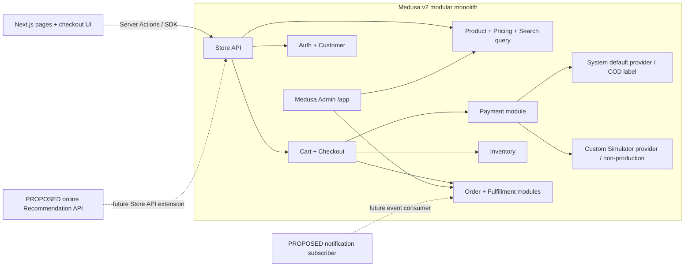
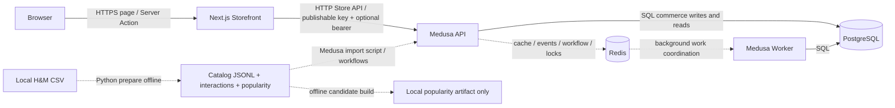
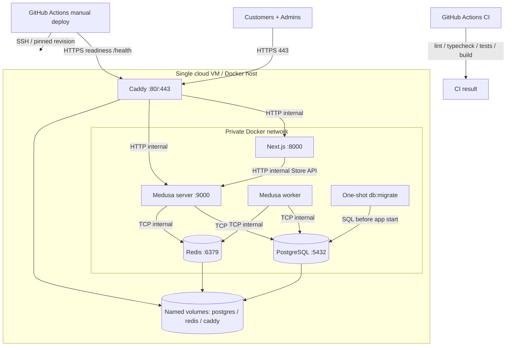
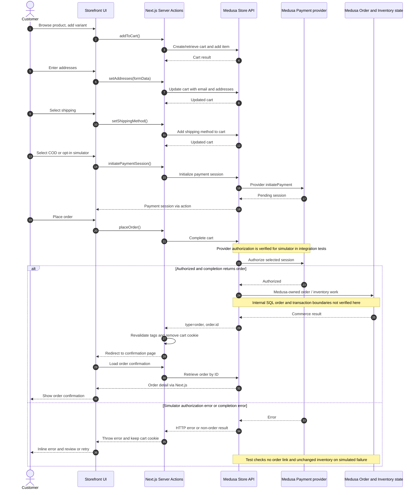

# Kiến trúc hệ thống cloud — Enterprise E-commerce Platform

## 1. Tóm tắt

 Khách dùng website Next.js. Medusa v2 xử lý việc bán hàng và lưu dữ liệu vào PostgreSQL. Website gửi yêu cầu đến Medusa qua API. Redis hỗ trợ lưu tạm dữ liệu và phối hợp các việc xử lý nền. Docker Compose cấu hình tiến trình Medusa phục vụ yêu cầu và tiến trình xử lý nền riêng, cùng PostgreSQL và Redis. Caddy được cấu hình để nhận truy cập HTTPS trên một máy chủ cloud. Dự án có quy trình đưa bản mới lên máy chủ, nhưng chưa có bằng chứng trong repository rằng lần triển khai cloud đã thành công. [Cấu hình Medusa](../../apps/backend/medusa-config.ts), [kết nối API](../../apps/storefront/src/lib/config.ts), [Compose](../../docker-compose.yml), [cấu hình production](../../deploy/compose.prod.yml), [quy trình triển khai](../../.github/workflows/deploy.yml).

 Khách có thể chọn trả tiền khi nhận hàng (COD) qua phương thức Medusa có mã `pp_system_default`. Công cụ thanh toán mô phỏng **đã có trong mã nguồn**, nhưng chỉ dành cho môi trường thử nghiệm và phải bật riêng trên website; cấu hình production không đăng ký nó. Với dữ liệu H&M, dự án đã có cách nhập một tập sản phẩm mẫu và tạo danh sách sản phẩm phổ biến trên máy cá nhân. Website chưa có API gợi ý sản phẩm trực tuyến. [Công cụ thanh toán mô phỏng](../../apps/backend/src/modules/payment-simulator/provider.ts), [cấu hình Medusa](../../apps/backend/medusa-config.ts), [điều kiện hiển thị](../../apps/storefront/src/lib/util/checkout-payment.ts), [dữ liệu H&M](../../scripts/hm/README.md).

## 2. Hệ thống hiện có

| Thành phần | Hiện có gì | Bằng chứng và giới hạn |
| --- | --- | --- |
| Website khách hàng | **[VERIFIED]** Có trang sản phẩm, tài khoản, giỏ hàng, đặt hàng và xem đơn. Website gọi Medusa để lấy và cập nhật dữ liệu. | [Trang sản phẩm](../../apps/storefront/src/modules/store/templates/index.tsx), [xử lý giỏ](../../apps/storefront/src/lib/data/cart.ts), [phân công trách nhiệm](storefront-backend-boundary.md). |
| Phần quản lý bán hàng | **[VERIFIED]** Medusa v2 xử lý các chức năng bán hàng trong cùng một ứng dụng. Fastify/Prisma trong kế hoạch cũ không chạy song song trên `main`. | [Gói backend](../../apps/backend/package.json), [cấu hình Medusa](../../apps/backend/medusa-config.ts), [gói dự án](../../package.json). |
| PostgreSQL và Redis | **[CONFIGURED]** PostgreSQL 16 lưu dữ liệu; Redis 7 hỗ trợ tăng tốc và việc nền. Có nơi lưu dữ liệu lâu dài và kiểm tra tiến trình còn hoạt động. Redis chỉ được Medusa sử dụng khi có `REDIS_URL`. | [Compose](../../docker-compose.yml), [cấu hình Medusa](../../apps/backend/medusa-config.ts). Khảo sát cơ sở dữ liệu chỉ kiểm 24 bảng chọn lọc trên máy cá nhân: [báo cáo](../erd/medusa-erd-v2-schema-survey.md). |
| Medusa phục vụ và xử lý nền | **[CONFIGURED]** Hai tiến trình Medusa dùng chung mã nguồn, PostgreSQL và Redis. Một tiến trình trả lời API, một tiến trình làm việc nền; giao diện Admin tắt ở tiến trình nền. Khi chạy local không chọn mode riêng, Medusa dùng chế độ chung. | [Compose](../../docker-compose.yml), [cấu hình Medusa](../../apps/backend/medusa-config.ts). Chưa có chức năng riêng của dự án để gửi thông báo: [công việc nền](../../apps/backend/src/jobs/README.md), [bộ nhận sự kiện](../../apps/backend/src/subscribers/README.md). |
| Sản phẩm và tìm kiếm | **[VERIFIED]** Website gửi từ khóa (`q`) tới `/store/products`, có chia trang. Backend còn có đường dẫn catalog riêng. Compose chưa có công cụ tìm kiếm độc lập. | [Trang sản phẩm](../../apps/storefront/src/modules/store/templates/index.tsx), [lấy dữ liệu sản phẩm](../../apps/storefront/src/lib/data/products.ts), [đường dẫn catalog](../../apps/backend/src/api/store/catalog/route.ts), [Compose](../../docker-compose.yml). |
| Thanh toán | **[VERIFIED]** COD dùng mã `pp_system_default`. Công cụ mô phỏng nhận lựa chọn thành công/thất bại và chỉ được đăng ký ngoài production; website phải bật riêng và Medusa phải cho phép phương thức này ở khu vực bán. Không có cổng nhận tiền thật. | [Công cụ mô phỏng](../../apps/backend/src/modules/payment-simulator/provider.ts), [dữ liệu khởi tạo](../../apps/backend/src/scripts/seed-commerce.ts), [điều kiện hiển thị](../../apps/storefront/src/lib/util/checkout-payment.ts), [giao diện thanh toán](../../apps/storefront/src/modules/checkout/components/payment/index.tsx). |
| H&M và gợi ý sản phẩm | **[VERIFIED]** Có công cụ chuẩn bị dữ liệu CSV, đưa sản phẩm vào Medusa và tính danh sách sản phẩm phổ biến để dùng offline. Báo cáo local ghi 500 sản phẩm và 1.874 phiên bản; chưa kiểm lại ở mọi môi trường. Chưa có API trả gợi ý cho website. | [Hướng dẫn H&M](../../scripts/hm/README.md), [công cụ nhập](../../apps/backend/src/scripts/import-hm-catalog.ts), [trang chủ](../../apps/storefront/src/modules/home/components/featured-products/index.tsx). |
| Cloud và kiểm thử tải | **[CONFIGURED]** Caddy nhận HTTPS trên một máy chủ; GitHub Actions có bước kiểm tra và triển khai thủ công; k6 có kịch bản đo tải. Chưa thấy bằng chứng về thời gian hệ thống cloud đã hoạt động, kết quả đo tải hoặc sao lưu tự động. | [Caddy](../../deploy/Caddyfile), [triển khai](../../.github/workflows/deploy.yml), [kiểm tra mã nguồn](../../.github/workflows/ci.yml), [k6 sản phẩm](../../load/catalog.js), [k6 đặt hàng](../../load/checkout.js), [hướng dẫn](../../deploy/RUNBOOK.md). |

`PLAN.md` mô tả một nhánh cũ từng dùng Fastify/Prisma và các mục tiêu đặt ra khi đó. Đó là lịch sử dự án, không phải trạng thái đang chạy của `main`. README và [tài liệu Payment Simulator cũ](payment-simulator-flow.md) còn nói công cụ mô phỏng chưa có; mã nguồn tại thời điểm kiểm tra đã có công cụ này và bài kiểm thử. [Kế hoạch cũ](../../PLAN.md), [README](../../README.md), [bài kiểm thử](../../apps/backend/integration-tests/http/checkout-order.spec.ts).

## 3. Sơ đồ tổng quan: khách truy cập hệ thống như thế nào

**Cách đọc sơ đồ:** Khách và quản trị viên vào hệ thống qua HTTPS. Caddy chuyển khách tới website và quản trị viên tới Medusa Admin tại `/app`. Website gửi yêu cầu mua hàng đến Medusa; Medusa đọc/ghi PostgreSQL và dùng Redis cho các việc hỗ trợ. Đây là cấu hình dự kiến khi triển khai; các cổng 8000/9000/5432/6379 trên máy chủ chỉ mở cho chính máy đó, không công khai ra Internet. [Compose](../../docker-compose.yml), [Caddy](../../deploy/Caddyfile), [kết nối API](../../apps/storefront/src/lib/config.ts).

**[CONFIGURED, tùy chọn]** Có thể dùng dịch vụ lưu tệp tương thích S3 nếu cung cấp đủ các biến cấu hình `S3_BUCKET`, `S3_ACCESS_KEY_ID`, `S3_SECRET_ACCESS_KEY`, `S3_FILE_URL`. Compose hiện không cung cấp chúng, nên S3 không nằm trong sơ đồ hệ thống hiện có. [Cấu hình Medusa](../../apps/backend/medusa-config.ts).

## 4. Sơ đồ chức năng: mỗi phần làm gì

**Cách đọc sơ đồ:** Các chức năng bên trong khung Medusa thuộc cùng một ứng dụng; mỗi ô không phải một máy chủ riêng. Đường nét đứt dẫn tới phần **[PROPOSED]** là việc mới dự kiến làm. Medusa có sẵn chức năng quản lý giao hàng và thanh toán, nhưng dự án chưa chứng minh đã triển khai mọi bước giao hàng, gửi thông báo hay thu tiền. [Cấu hình Medusa](../../apps/backend/medusa-config.ts), [xử lý giỏ](../../apps/storefront/src/lib/data/cart.ts), [công cụ thanh toán](../../apps/backend/src/modules/payment-simulator/provider.ts).

Tìm kiếm hiện dùng tham số `q` của Store API, chưa có công cụ tìm kiếm riêng. Medusa chịu trách nhiệm về tồn kho và đơn hàng, nhưng mã nguồn dự án không cho biết chính xác thứ tự xử lý bên trong Medusa. Dự án có lựa chọn giao hàng mẫu và giao diện quản trị; chưa thấy kết nối với hãng vận chuyển. [Trang sản phẩm](../../apps/storefront/src/modules/store/templates/index.tsx), [dữ liệu giao hàng mẫu](../../apps/backend/src/scripts/seed-commerce.ts), [phân công trách nhiệm](storefront-backend-boundary.md).

## 5. Sơ đồ dữ liệu: thông tin đi đâu và được lưu ở đâu

**Cách đọc sơ đồ:** Đường liền là yêu cầu được gửi và trả lời ngay, hoặc thao tác đọc/ghi cơ sở dữ liệu. Đường nét đứt là việc hỗ trợ chạy nền hoặc chuẩn bị dữ liệu trước. Đơn hàng, giỏ, thanh toán và tồn kho được Medusa quản lý trong PostgreSQL. Redis không thay PostgreSQL làm nơi lưu các dữ liệu bán hàng này. Website chỉ giữ cookie đăng nhập, mã giỏ hàng và dữ liệu tạm để hiển thị. [Phân công trách nhiệm](storefront-backend-boundary.md), [cookie](../../apps/storefront/src/lib/data/cookies.ts), [cấu hình Medusa](../../apps/backend/medusa-config.ts).

**[VERIFIED]** Công cụ nhập H&M dùng quy trình Medusa để tạo sản phẩm và tồn kho. Giá VND và số hàng tồn trong bản demo là dữ liệu được tạo ra, không phải giá và tồn kho thật của H&M. Lịch sử mua H&M không được biến thành đơn hàng của dự án. Danh sách sản phẩm phổ biến mới là tệp offline, chưa được website sử dụng. [Hướng dẫn H&M](../../scripts/hm/README.md), [chuẩn bị dữ liệu](../../scripts/hm/prepare.py), [công cụ nhập](../../apps/backend/src/scripts/import-hm-catalog.ts). Bài kiểm thử có đọc trạng thái thanh toán và số hàng giữ cho đơn từ PostgreSQL, nhưng không chứng minh được Medusa thực hiện mọi câu lệnh dữ liệu theo thứ tự nào. [Khảo sát dữ liệu](../erd/medusa-erd-v2-schema-survey.md), [kiểm tra tồn kho](../../apps/backend/src/scripts/check-inventory-order.ts), [bài kiểm thử](../../apps/backend/integration-tests/http/checkout-order.spec.ts).

## 6. Sơ đồ triển khai: các thành phần chạy trên máy chủ nào

Sơ đồ này cho biết **cấu hình dự kiến trên một máy chủ cloud**, không chứng minh máy chủ đang hoạt động. Tệp `deploy.yml` cho phép người vận hành bắt đầu quy trình triển khai: kết nối máy chủ qua SSH, lấy đúng bản mã nguồn, xây dựng ứng dụng, cập nhật cấu trúc dữ liệu, khởi động các phần rồi kiểm tra đường dẫn `/health` qua HTTPS. Quy trình chưa tự đưa hệ thống về bản cũ khi có lỗi. Caddy dùng hai tên miền: một cho website, một cho Medusa API/Admin. [Quy trình triển khai](../../.github/workflows/deploy.yml), [cấu hình production](../../deploy/compose.prod.yml), [hướng dẫn vận hành](../../deploy/RUNBOOK.md).

Cấu hình đã dành chỗ lưu dữ liệu của Caddy và dùng HTTPS, nhưng cần kiểm tra trên máy chủ thật việc cấp chứng chỉ, thay thông tin bí mật, tường lửa, khôi phục dữ liệu và thời gian hoạt động. Các cổng của PostgreSQL, Redis, Medusa và website chỉ mở trong máy chủ; Caddy mở cổng 80/443 ra ngoài. [Compose](../../docker-compose.yml), [Caddy](../../deploy/Caddyfile). Cấu hình này không có nhiều máy chủ dự phòng hay hệ thống tự phân tải.

## 7. Sơ đồ từng bước đặt hàng và thanh toán

**Đọc nhanh:** Khách chọn hàng → nhập địa chỉ → chọn giao hàng → chọn cách thanh toán → bấm đặt hàng. Website chuyển từng yêu cầu tới Medusa. Chỉ khi Medusa trả về mã đơn, website mới hiện trang xác nhận và xóa mã giỏ hàng khỏi cookie. Nếu thanh toán mô phỏng báo lỗi, website hiện thông báo và giữ giỏ để khách thử lại. Ở đây `Payment` là phần thanh toán của Medusa, không phải ngân hàng hay cổng thu tiền thật. COD dùng mã `pp_system_default` và có nghĩa là trả tiền khi nhận hàng. **Trạng thái `authorized` không có nghĩa tiền đã được thu.** [Xử lý giỏ](../../apps/storefront/src/lib/data/cart.ts), [giao diện thanh toán](../../apps/storefront/src/modules/checkout/components/payment/index.tsx), [nút đặt hàng](../../apps/storefront/src/modules/checkout/components/payment-button/index.tsx), [công cụ mô phỏng](../../apps/backend/src/modules/payment-simulator/provider.ts).

Bài kiểm thử gửi yêu cầu trực tiếp tới Medusa, chưa kiểm tra toàn bộ thao tác trên website. Nó xác nhận rằng trường hợp mô phỏng thành công tạo đơn có thể xem lại; trường hợp thất bại trả lỗi HTTP 400, không gắn đơn với giỏ và không đổi số tồn kho đã chụp trước đó. Bài test này chưa chứng minh Medusa xử lý các bước nội bộ như chống gửi trùng, hoàn tác, gửi thông báo hoặc thu tiền ra sao. Website cho chọn lại kết quả mô phỏng và tạo lại phiên thanh toán khi bấm Continue, nhưng chưa có cơ chế tự thử lại sau thời gian chờ hoặc mã chống gửi trùng được viết rõ trong `placeOrder`. [Bài kiểm thử](../../apps/backend/integration-tests/http/checkout-order.spec.ts), [giao diện thanh toán](../../apps/storefront/src/modules/checkout/components/payment/index.tsx), [tài liệu checkout](checkout-order-sequence.md). [Tài liệu Payment Simulator cũ](payment-simulator-flow.md) được viết trước mã nguồn mới nên có chỗ không còn đúng.

## 8. Bảo mật và cách xử lý sự cố

| Chủ đề | Hiện có | Cần kiểm tra hoặc làm thêm |
| --- | --- | --- |
| Đăng nhập và quyền | **[VERIFIED]** Website giữ mã đăng nhập trong cookie chỉ máy chủ đọc được, có chế độ bảo vệ khi chạy production. Medusa quyết định người dùng được xem gì. [Cookie](../../apps/storefront/src/lib/data/cookies.ts), [kết nối API](../../apps/storefront/src/lib/config.ts). | **[PROPOSED]** kiểm tra thêm quyền từng vai trò và giới hạn số yêu cầu để chống lạm dụng. Mã publishable key dùng cho Store API không phải mật khẩu bí mật. |
| Kết nối an toàn | **[CONFIGURED]** Caddy nhận HTTPS; Medusa giới hạn tên miền được phép gọi API. PostgreSQL và Redis không mở cổng công khai. [Caddy](../../deploy/Caddyfile), [Compose](../../docker-compose.yml), [cấu hình production](../../deploy/compose.prod.yml). | Kiểm tra tên miền, chứng chỉ HTTPS và tường lửa trên máy chủ thật; bảo vệ cổng quản trị SSH. |
| Thông tin bí mật | **[CONFIGURED]** Quy trình triển khai lấy khóa SSH từ GitHub và ứng dụng đọc mật khẩu/khóa qua biến môi trường. [Quy trình triển khai](../../.github/workflows/deploy.yml), [Compose](../../docker-compose.yml). | Compose còn có mật khẩu mặc định dành cho local; **[PROPOSED]** chặn khởi động production nếu thiếu mật khẩu mạnh và có cách thay khóa định kỳ. |
| Đơn hàng và thanh toán | **[VERIFIED]** Website yêu cầu Medusa hoàn tất giỏ; test kiểm tra thanh toán mô phỏng thất bại không tạo đơn và không đổi tồn kho. Simulator bị chặn ở production. [Xử lý giỏ](../../apps/storefront/src/lib/data/cart.ts), [bài kiểm thử](../../apps/backend/integration-tests/http/checkout-order.spec.ts), [công cụ mô phỏng](../../apps/backend/src/modules/payment-simulator/provider.ts). | Chưa biết hết cách Medusa xử lý bên trong. Cần thử bấm đặt hàng lặp, mất kết nối, đối chiếu tiền và quy trình thu COD. |
| Dữ liệu tạm và việc nền | **[VERIFIED]** Website làm mới dữ liệu giỏ/đơn sau khi thay đổi; Redis hỗ trợ lưu tạm và phối hợp xử lý nền khi được cấu hình. [Xử lý giỏ](../../apps/storefront/src/lib/data/cart.ts), [cấu hình Medusa](../../apps/backend/medusa-config.ts). | Cần thử việc cập nhật dữ liệu có xuất hiện kịp thời không, và hệ thống xử lý thế nào khi Redis hoặc một việc nền bị lỗi. |
| Kiểm tra phiên bản mới | **[CONFIGURED]** GitHub Actions chạy kiểm thử, kiểm tra kiểu/lỗi mã nguồn và xây dựng ứng dụng; Compose kiểm tra các tiến trình có hoạt động. Bước kiểm tra thư viện có lỗ hổng hiện chưa chặn bản phát hành nếu thất bại. [CI](../../.github/workflows/ci.yml), [Compose](../../docker-compose.yml), [triển khai](../../.github/workflows/deploy.yml). | Đường dẫn `/health` chỉ cho biết một phần hệ thống còn trả lời; cần thử cả đặt hàng, việc nền và bản sao lưu. |
| Sao lưu và theo dõi lỗi | **[CONFIGURED]** Hướng dẫn vận hành yêu cầu sao lưu ngoài máy chủ, thử khôi phục trên môi trường thử nghiệm và theo dõi lỗi website, tiến trình nền, cơ sở dữ liệu. [Hướng dẫn](../../deploy/RUNBOOK.md). | **[PROPOSED]** tự động hóa sao lưu, diễn tập khôi phục, thu số liệu và cảnh báo; chưa có bằng chứng các việc này đang chạy. |

## 9. Các quyết định thiết kế và lý do (ADR)

| Mã | Vì sao chọn cách này | Điểm hạn chế và khi nào cần xem lại |
| --- | --- | --- |
| ADR-01 Medusa quản lý bán hàng | **[VERIFIED]** Dùng Medusa v2 thay cho việc tự viết toàn bộ phần bán hàng bằng Fastify/Prisma. Nhóm bớt phải tự xử lý sản phẩm, giỏ, đơn, thanh toán và tồn kho. [Kế hoạch](../../PLAN.md), [cấu hình Medusa](../../apps/backend/medusa-config.ts), [phân công trách nhiệm](storefront-backend-boundary.md). | Phụ thuộc vào cách Medusa hoạt động và việc nâng cấp phiên bản. Nếu cần quy tắc riêng, thêm phần mở rộng theo cách Medusa hỗ trợ thay vì sửa lõi. |
| ADR-02 Một ứng dụng backend | **[VERIFIED]** Các chức năng bán hàng ở cùng một ứng dụng; phần trả lời khách và phần xử lý nền có thể chạy thành hai tiến trình. Cách này ít phần cần vận hành. [Compose](../../docker-compose.yml). | Các tiến trình dùng chung dữ liệu và thường phát hành cùng nhau. Chỉ tách thành dịch vụ riêng khi số liệu tải hoặc yêu cầu vận hành cho thấy lợi ích rõ ràng. |
| ADR-03 PostgreSQL | **[VERIFIED]** Là nơi lưu dữ liệu bán hàng chính. [Compose](../../docker-compose.yml), [khảo sát dữ liệu](../erd/medusa-erd-v2-schema-survey.md). | Một máy chủ cơ sở dữ liệu là điểm dễ gây gián đoạn nếu hỏng. Cần theo dõi tốc độ truy vấn, số kết nối và thử sao lưu/khôi phục trước khi đầu tư hệ thống dự phòng. |
| ADR-04 Redis | **[VERIFIED]** Medusa dùng Redis để tăng tốc, phối hợp việc nền và tránh các thao tác xung đột khi có cấu hình `REDIS_URL`. [Cấu hình Medusa](../../apps/backend/medusa-config.ts). | Một Redis cũng có thể thành điểm gây gián đoạn. Cần đo mức sử dụng và thử khi Redis lỗi; chưa có lý do thêm hệ thống truyền tin phức tạp hơn. |
| ADR-05 Một máy chủ và Caddy | **[CONFIGURED]** Dễ trình diễn và tiết kiệm; Caddy nhận kết nối HTTPS rồi chuyển vào ứng dụng. [Compose](../../docker-compose.yml), [cấu hình production](../../deploy/compose.prod.yml). | Nếu máy chủ hỏng, toàn hệ thống có thể ngừng. Chỉ thêm máy chủ sau khi có số liệu tải, yêu cầu thời gian hoạt động và ngân sách. |
| ADR-06 Thanh toán demo | **[VERIFIED]** COD là lựa chọn mặc định; công cụ mô phỏng chỉ chạy ở môi trường thử nghiệm. [Công cụ mô phỏng](../../apps/backend/src/modules/payment-simulator/provider.ts), [cấu hình](../../apps/backend/medusa-config.ts). | Không thu hoặc hoàn tiền thật. Muốn bán hàng thực tế cần tích hợp đơn vị thanh toán và quy trình đối chiếu tiền. |

## 10. Hiện có và hướng mở rộng

| Phần việc | Hiện có | [PROPOSED] Chỉ làm khi có nhu cầu và số liệu |
| --- | --- | --- |
| Tìm kiếm | Website gửi từ khóa qua `/store/products?q=...`; chưa có công cụ tìm kiếm riêng. [Trang sản phẩm](../../apps/storefront/src/modules/store/templates/index.tsx), [đường dẫn catalog](../../apps/backend/src/api/store/catalog/route.ts). | Chỉ thêm công cụ tìm kiếm nếu kết quả hoặc tốc độ hiện tại không đạt yêu cầu đã đo. Medusa vẫn quản lý danh sách sản phẩm chính. |
| Gợi ý sản phẩm | Có dữ liệu H&M đã chuẩn bị và danh sách sản phẩm phổ biến offline; trang chủ hiện hiển thị nhóm sản phẩm theo bộ sưu tập. [H&M](../../scripts/hm/README.md), [trang chủ](../../apps/storefront/src/modules/home/components/featured-products/index.tsx). | Xây API gợi ý, chỉ trả sản phẩm đang bán và đo chất lượng trước khi gọi đó là gợi ý cá nhân hóa. |
| Thông báo | Chưa có phần gửi thông báo riêng của dự án. [Bộ nhận sự kiện](../../apps/backend/src/subscribers/README.md). | Gửi thông báo ở bước xử lý nền, có thử lại và chống gửi trùng; lỗi email không cản đặt hàng. |
| Ảnh sản phẩm | Có thể cấu hình lưu tệp qua S3 nhưng Compose chưa bật. [Cấu hình Medusa](../../apps/backend/medusa-config.ts), [Compose](../../docker-compose.yml). | Chọn nơi lưu ảnh sau khi xác nhận quyền dùng ảnh và cách bảo vệ dữ liệu truy cập. |
| Chịu tải và hoạt động liên tục | Cấu hình dùng một máy chủ, một PostgreSQL, một Redis, một tiến trình API và một tiến trình nền. [Compose](../../docker-compose.yml). | Thêm tiến trình/máy chủ và dịch vụ dữ liệu dự phòng sau khi đo tải, chi phí và nhu cầu thực tế. |

## 11. Việc cần làm tiếp

1. **P0 — Cập nhật tài liệu cũ.** README và hai tài liệu thanh toán/ranh giới website–Medusa còn nói công cụ mô phỏng chưa có; cần sửa theo mã nguồn và điều kiện chỉ dùng khi thử nghiệm. [README](../../README.md), [tài liệu cũ](payment-simulator-flow.md), [mã nguồn](../../apps/backend/src/modules/payment-simulator/provider.ts).
2. **P0 — Diễn tập triển khai trên môi trường thử nghiệm.** Kiểm tra HTTPS, đăng nhập, sản phẩm, COD, tiến trình nền, sao lưu/khôi phục và cách quay lại phiên bản trước. Hiện mới có cấu hình. [Quy trình](../../.github/workflows/deploy.yml), [hướng dẫn](../../deploy/RUNBOOK.md).
3. **P0 — Bảo vệ mật khẩu và khóa ở production.** Không cho production dùng mật khẩu mẫu dành cho local; kiểm tra đủ thông tin bí mật trước khi khởi động và có cách thay chúng định kỳ. [Compose](../../docker-compose.yml), [cấu hình Medusa](../../apps/backend/medusa-config.ts).
4. **P1 — Thử những tình huống đặt hàng khó.** Kiểm tra bấm đặt hàng nhiều lần, mất phản hồi, Redis lỗi, nhiều khách tranh cùng số hàng cuối và quy trình thu COD. Một bài test đặt hàng thành công chưa chứng minh các trường hợp này. [Xử lý giỏ](../../apps/storefront/src/lib/data/cart.ts), [bài kiểm thử](../../apps/backend/integration-tests/http/checkout-order.spec.ts).
5. **P1 — Đo kết quả thật.** k6 đã có kịch bản và mức mục tiêu nhưng chưa có báo cáo đo được liên kết tại đây. Cần lưu thời gian phản hồi, tỷ lệ lỗi, mức dùng CPU/RAM, tải cơ sở dữ liệu và chi phí. [Kịch bản xem sản phẩm](../../load/catalog.js), [kịch bản đặt hàng](../../load/checkout.js).
6. **P2 — Chỉ mở rộng khi đủ điều kiện.** Gợi ý sản phẩm, thông báo và công cụ tìm kiếm riêng cần dữ liệu hợp lệ, quyền sử dụng rõ ràng, kết quả đánh giá và nhu cầu thực tế. [H&M](../../scripts/hm/README.md), [kế hoạch gợi ý](hm-recommendation-implementation-plan.md).

**Giới hạn kiểm tra:** Tài liệu này dựa trên mã nguồn, cấu hình, bài kiểm thử và báo cáo đã lưu trong Git. Nhóm chưa truy cập máy chủ cloud, chưa thử đặt hàng trực tiếp ở đó và chưa kiểm tra cơ sở dữ liệu đang chạy hiện nay. Mã nguồn dự án cũng không cho biết đầy đủ Medusa xử lý giao dịch nội bộ, chống gửi trùng, giữ hàng, nhận thông báo thanh toán và thử lại theo thứ tự nào.
