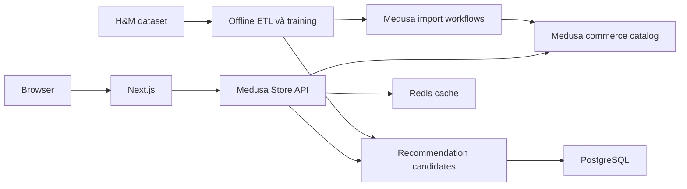
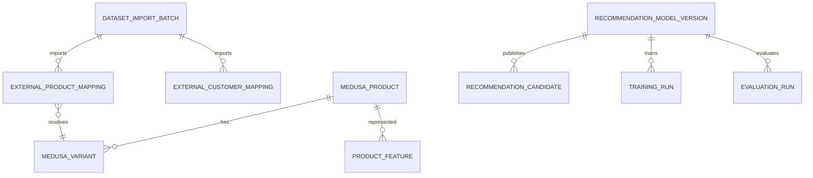
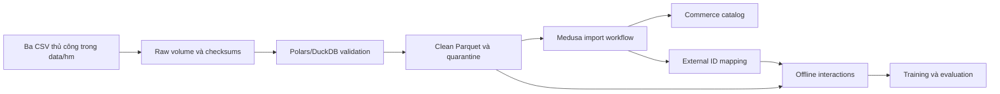
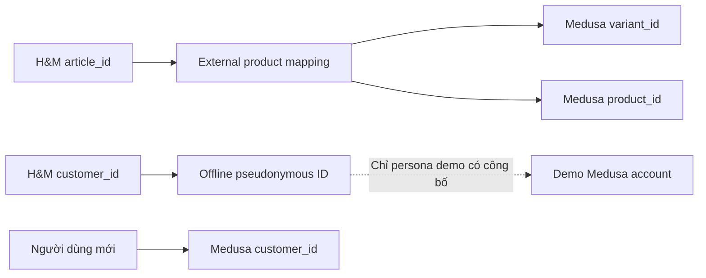
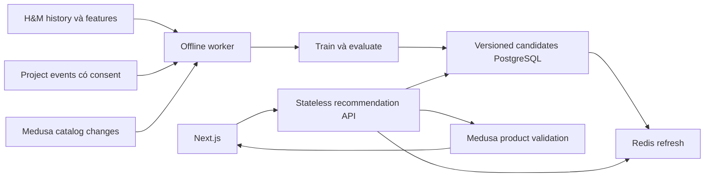
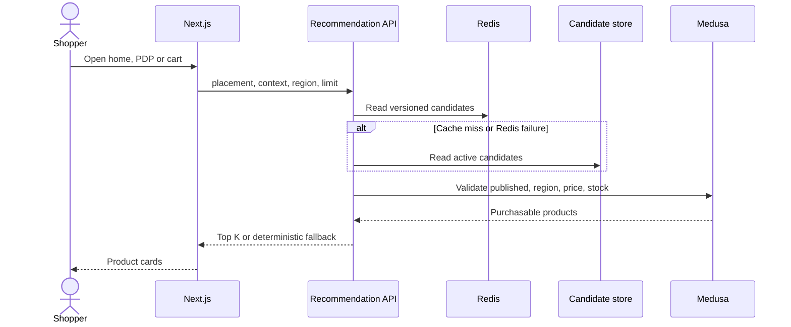
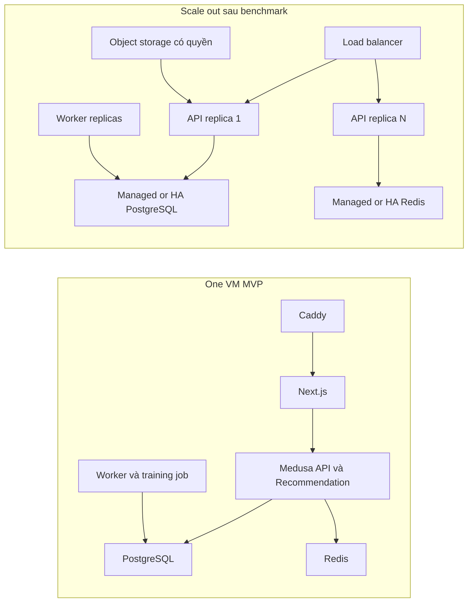

# Kế hoạch tích hợp H&M Dataset và Recommendation Engine

**Trạng thái:** kế hoạch và tiến độ ban đầu. Audit nền tại `main` commit `9b8d352`. Ba CSV H&M đã được giải nén thủ công tại `data/hm/`. Ngày 2026-10-31, importer đã tạo **500 published products, 1.874 variants và 1.874 inventory levels** trong PostgreSQL development; lần chạy lại tạo 0 products và thấy 500 products đã tồn tại. Chưa import toàn bộ catalog, huấn luyện model, triển khai Recommendation API hoặc xác nhận cloud/benchmark.

**Quy ước:** **[VERIFIED]** có bằng chứng từ repo/nguồn liên kết; **[PROPOSED]** thiết kế; **[ASSUMPTION]** cần kiểm chứng; **[BLOCKER]** chặn triển khai; **[OPTIONAL]** giai đoạn sau. Các đường dẫn mới dưới đây là đề xuất, cần kiểm tra convention Medusa hiện hành trước khi viết code.

## 1. Executive Summary

**[PROPOSED]** Medusa tiếp tục là nguồn chuẩn cho product, variant, price, inventory, customer, cart và order. Python/Polars hoặc DuckDB xử lý dataset và huấn luyện offline. Custom Medusa module giữ mapping, features, model versions và precomputed candidates trong PostgreSQL; Redis cache kết quả. Next.js gọi một Store API recommendation, chỉ hiển thị sản phẩm đã được Medusa xác nhận có thể bán. Checkout không phụ thuộc Recommendation.

**[BLOCKER]** CSV đã có tại `data/hm/`, nhưng chưa xác minh ai đã chấp nhận [Kaggle competition rules](https://www.kaggle.com/competitions/h-and-m-personalized-fashion-recommendations/rules), nguồn gốc tải và quyền sử dụng. Rules giới hạn dữ liệu vào mục đích phi thương mại/nghiên cứu và hạn chế phân phối cho bên chưa tham gia. Quyền phục vụ ảnh/dữ liệu H&M trên public demo chưa được xác minh; không public asset gốc trước khi giải quyết quyền sử dụng.



## 2. Repository Audit Findings

**[VERIFIED]** Repo dùng npm workspaces, Medusa `2.21.2`, Next.js `15.5.24`, PostgreSQL 16 và Redis 7 trong Compose. `main` sạch khi audit. Có branch `main`, `master`, `Medusa`. [PR #5](https://github.com/kieuquy283/EnterpriseE-commercePlatform/pull/5) đang mở, thay seed, workflows, tests và ERD; phải rà trước Phase 2. `PLAN.md` nói về nhánh `Medusa`/Fastify-Prisma cũ nên không dùng làm bằng chứng hiện trạng `main`.

| Component | Current State | Missing Features | Required Changes | Priority |
|---|---|---|---|---|
| Medusa commerce | **Already implemented:** [`medusa-config.ts`](../../apps/backend/medusa-config.ts) cấu hình Redis cache/event/workflow/locking, S3 tùy chọn; [`seed-commerce.ts`](../../apps/backend/src/scripts/seed-commerce.ts) tạo Vietnam/VND, sales channel, kho, shipping, COD `pp_system_default`, 3 products | Chưa có H&M import/mapping | Importer riêng qua module/workflow; không nhồi vào seed | P0 |
| Catalog | **Partially implemented:** [`catalog/route.ts`](../../apps/backend/src/api/store/catalog/route.ts) đọc published products, `q`, limit tối đa 100; Store API product chuẩn | Recommendation/ranking | Endpoint mới, không thay commerce API | P1 |
| Storefront | **Already implemented:** [`products.ts`](../../apps/storefront/src/lib/data/products.ts) đọc `/store/products` theo region; store template có query search; cart/checkout/order dùng Medusa | Home/PDP/cart personalized sections | Data helper và UI độc lập | P1 |
| Related/home/cart | **Partially implemented:** [`related-products`](../../apps/storefront/src/modules/products/components/related-products/index.tsx) dùng product listing; [`featured-products`](../../apps/storefront/src/modules/home/components/featured-products/index.tsx) dùng collection; [`cart/templates`](../../apps/storefront/src/modules/cart/templates/index.tsx) chưa có cross-sell | Không có model candidates/fallback | Reuse ProductPreview, thêm placements | P1 |
| Recommendation/ETL | **Not implemented:** không thấy custom module, migrations, training scripts, H&M import hay tracking | Toàn pipeline | Modules, jobs, Python, tests | P0–P2 |
| Infrastructure | **Already implemented:** [`docker-compose.yml`](../../docker-compose.yml), [`deploy/`](../../deploy/) với Caddy/VM, worker, PostgreSQL/Redis | Chưa có training job, rec monitoring | Compose job/resource limits, metrics | P2 |
| Tests/CI | **Already implemented:** checkout HTTP test, [`load/catalog.js`](../../load/catalog.js) 30 RPS, [`load/checkout.js`](../../load/checkout.js) 3 RPS, GitHub Actions | Rec quality/perf/failure tests | Test suite và k6 riêng | P1–P3 |

Audit là đọc source và remote PR, không chạy integration tests cần database. README mô tả checkout/COD; [checkout sequence](checkout-order-sequence.md) xác định luồng hiện tại. Chưa có bằng chứng service hiện chạy trên cloud.

## 3. Dataset Suitability & Limitations

**[VERIFIED tại repository]** `data/hm/` hiện chứa `articles.csv` (36.127.865 bytes), `customers.csv` (207.135.859 bytes) và `transactions_train.csv` (3.488.002.253 bytes). Đã đọc headers và quét `articles.csv`; chưa quét toàn bộ hai CSV còn lại hoặc import vào Medusa. **Không có `images/` trong thư mục được kiểm tra.** `.gitignore` loại `data/hm/` khỏi Git.

**[VERIFIED từ nguồn chính]** [Trang Kaggle](https://www.kaggle.com/competitions/h-and-m-personalized-fashion-recommendations/data) mô tả cả `images/`; ảnh xếp theo ba chữ số đầu `article_id` và có article thiếu ảnh. Giao dịch là purchases theo ngày; duplicate rows có thể là nhiều lần mua cùng item. Trang hiển thị 34,56 GB, 105.104 files và license “Subject to Competition Rules”. Con số tổng này bao gồm ảnh và các asset khác, không phải dung lượng ba CSV hiện có.

**[VERIFIED — header đọc trực tiếp từ ba CSV; kiểu dữ liệu và số dòng của customer/transaction vẫn cần kiểm tra]**:

| File | Header được công bố | Quan hệ dự kiến |
|---|---|---|
| `articles.csv` | `article_id`, `product_code`, `prod_name`, `product_type_no`, `product_type_name`, `product_group_name`, `graphical_appearance_no`, `graphical_appearance_name`, `colour_group_code`, `colour_group_name`, `perceived_colour_value_id`, `perceived_colour_value_name`, `perceived_colour_master_id`, `perceived_colour_master_name`, `department_no`, `department_name`, `index_code`, `index_name`, `index_group_no`, `index_group_name`, `section_no`, `section_name`, `garment_group_no`, `garment_group_name`, `detail_desc` | `article_id` dự kiến duy nhất; nhiều article có thể chung `product_code` |
| `customers.csv` | `customer_id`, `FN`, `Active`, `club_member_status`, `fashion_news_frequency`, `age`, `postal_code` | `customer_id` duy nhất |
| `transactions_train.csv` | `t_dat`, `customer_id`, `article_id`, `price`, `sales_channel_id` | Nhiều dòng/khách/article/ngày; không có `order_id` |
| `images/` | JPEG path theo `article_id` | Có thể thiếu ảnh |

**[VERIFIED]** Script `scripts/hm/prepare.py` đã đọc `articles.csv` giải nén: 105.542 article IDs không trùng và 48.012 nhóm sau khi tách theo `product_code` + type/group/department/section. Mẫu 500 nhóm gồm 1.874 articles; manifest/catalog được tạo dưới `data/hm/processed/` và bị Git bỏ qua. **[ASSUMPTION]** [Mô tả thứ cấp](https://huggingface.co/datasets/einrafh/hnm-fashion-recommendations-data) nêu 1.371.980 customers và 31.788.324 transaction rows; chưa quét xác minh hai file này. Phase tiếp theo phải đo types, nulls, orphan rates, date range và checksums. Phải xác minh quyền sử dụng/nguồn gốc trước khi dùng dữ liệu cho demo công khai.

Dataset không có tồn kho, shipping address, payment transaction, full cart history, product view, recommendation click hoặc login credentials. Giá H&M không phải giá VND để bán. History cũ, sparse, thiên về sản phẩm phổ biến, nhiều cold users/items và không chứng minh product còn bán. Không biến hàng triệu purchases thành Medusa orders khi thiếu thông tin đơn hàng.

## 4. Dataset-to-Medusa Mapping Matrix

| H&M | Medusa / Recommendation | Quy tắc **[PROPOSED]** |
|---|---|---|
| `product_code` | Product grouping key | Gom nhiều articles sau khi kiểm tên/type nhất quán; nhóm xung đột vào quarantine |
| `article_id` | Variant SKU + external mapping | Giữ dạng string, không mất số 0; SKU `HM-{article_id}`; unique per source |
| `prod_name`, `detail_desc` | Product title/description | Chọn đại diện, giữ raw provenance/hash |
| `product_group_name`, `index_group_name`, `section_name` | Category hierarchy | Chuẩn hóa taxonomy, tránh duplicate |
| `product_type_name`, `department_name`, `garment_group_name` | Category/tag/metadata/features | Category chỉ khi hữu ích cho điều hướng; giữ raw metadata |
| `colour_group_name` | Variant Color option | Nếu nhiều article cùng màu trong product, option phụ `Article` để bảo đảm tổ hợp unique; không bịa size |
| Graphical/perceived color fields | Metadata/features | Giữ mã và tên |
| `images/{prefix}/{article_id}.jpg` | Product/variant image | Chỉ phục vụ khi quyền rõ; thiếu ảnh dùng placeholder hợp lệ |
| Transaction `price` | Offline feature thận trọng | Không coi là giá bán VND |
| `customer_id`, `t_dat`, `sales_channel_id` | Offline interactions | Pseudonymize, giữ thời gian/channel cho temporal split |

**[PROPOSED]** Giá VND demo theo policy versioned của category/type, làm tròn và ghi `synthetic_price=true`. Inventory demo theo seed xác định, qua Medusa inventory workflows. Medusa vẫn tính giá, khả năng mua, cart và checkout. Chỉ publish khi product có region, sales channel, price, shipping profile, inventory policy và image policy hợp lệ.

## 5. Data Model / ERD Proposal

Các bảng thuộc custom ingestion/recommendation modules; không sửa trực tiếp Medusa core. Cross-module ID được kiểm bằng service/module links phù hợp, không mặc định tạo SQL FK xuyên module.

| Entity/owner | Cột, khóa, index | Cardinality / pattern / retention |
|---|---|---|
| `dataset_import_batch`/ingestion | `id uuid PK`, `dataset_version text`, `manifest_sha256 char(64)`, `mode text`, `status text`, `started_at/finished_at timestamptz`, `counts jsonb`, `error_uri text`; unique `(dataset_version,mode,manifest_sha256)` | Vài chục–trăm; ghi mỗi run, audit read; giữ lâu dài |
| `external_product_mapping`/ingestion | `id uuid PK`, `source`, `article_id varchar(32)`, `product_code varchar(32)`, `medusa_product_id`, `medusa_variant_id`, `batch_id uuid FK`, `source_hash`, `status`; unique `(source,article_id)` và `(source,medusa_variant_id)`; index product code/IDs | Tới số articles; batch upsert, serving/training lookup; giữ khi catalog còn dùng |
| `external_customer_mapping`/ingestion | `id uuid PK`, `source_customer_hash char(64)`, `demo_customer_id nullable`, `persona_id nullable`, `consent_scope`, `batch_id FK`; unique source hash | Chỉ selected personas; không map real accounts; retention theo privacy policy |
| `product_feature`/recommendation | `(medusa_product_id,feature_version) PK`, `features jsonb`, `source_hash`, `updated_at`; index version/category | Mỗi product/version; batch write; giữ active + rollback |
| `recommendation_model_version`/recommendation | `id uuid PK`, `strategy`, `config_hash`, `artifact_uri`, `dataset_version`, `status`, `created_at`; unique `(strategy,config_hash,dataset_version)` | Ít; atomic active pointer; audit retention |
| `recommendation_candidate`/recommendation | `(model_version_id,placement,context_key,rank) PK`, `medusa_product_id`, `score numeric`, `reason_code`, `computed_at`; index `(placement,context_key,model_version_id)`; unique candidate/context | Có thể hàng triệu; batch write, top-100 read; active + 1 rollback |
| `training_run`, `evaluation_run`/recommendation | `id uuid PK`, `model_version_id FK`, `split_at`, `seed`, `config jsonb`, `metrics jsonb`, `artifact_uri`, `status`, timestamps | Ít; audit và benchmark; giữ lâu dài |
| `recommendation_event`/recommendation | `event_id uuid PK`, `event_type`, `session_hash`, `customer_id nullable`, `product_id`, `placement`, `request_id`, `model_version_id`, `occurred_at`, `source`, `consent`; index time/type và customer/time, unique dedupe key | Append-heavy; partition/thời hạn ví dụ 90 ngày raw, aggregate theo policy |

Raw transactions nằm trong Parquet/DuckDB offline, không trong Medusa order tables. FK nội bộ custom module dùng nơi phù hợp; Medusa IDs được xác nhận qua APIs/module service.



## 6. Data Ingestion Architecture

**[VERIFIED/PROPOSED]** Input hiện tại là ba CSV giải nén trong `data/hm/`; `scripts/hm/prepare.py` đọc catalog, tạo manifest và subset 500 nhóm. Không tải lại tự động. Script dùng Python stdlib để stream transaction khi được yêu cầu; Polars/DuckDB/Parquet là nâng cấp sau cho training lớn. TypeScript Medusa script ghi commerce qua workflows. Batch import thực tế hiện là từng product; cần đo throughput rồi thêm checkpoint/quarantine theo batch. Không nạp toàn bộ transaction CSV vào RAM.

Importer hiện so `source_hash`: skip unchanged, **dừng khi source thay đổi** để tránh ghi đè sai; update/reconciliation workflow là việc còn lại. Nó ghi mapping sau khi xác minh Medusa IDs. Optional interaction export chỉ chọn article trong subset; kiểm tra customer FK/orphans, batch checkpoint/quarantine và rollback có kiểm soát vẫn cần triển khai. Không xóa sản phẩm có quan hệ commerce chỉ để rollback.

| Mode | Quy mô mục tiêu đầu **[ASSUMPTION]** | Mục đích |
|---|---:|---|
| Development | 100–500 variants | Test nhanh local |
| Demo | 5.000–10.000 variants | Storefront và personas |
| Load-test | Tới 100.000 variants | Benchmark sau khi xác minh resources |

Không commit CSV, Parquet, ảnh, model artifact, generated datasets/log có customer IDs, secrets hay `.env` vào GitHub.





## 7. Overall E-commerce Architecture

**[VERIFIED]** Seed đã tạo Vietnam/VND, stock location, manual fulfillment, COD provider, sales channel và demo inventory. Storefront SDK dùng Store API; checkout/order theo [flow hiện có](checkout-order-sequence.md). Recommendation không được thay Medusa pricing, inventory hoặc order workflows.

**[PROPOSED]** Chọn 10–20 historical customer keys có sở thích khác nhau từ **train-only**; tạo demo accounts riêng, liên kết có nhãn “persona tổng hợp mô phỏng từ lịch sử H&M”. Không tự gắn lịch sử H&M vào người đăng ký thật. Demo order history tạo vài đơn synthetic qua Medusa checkout với địa chỉ/giá/inventory giả lập; không nhập historical transactions thành millions of orders. Phân loại provenance `hm_historical`, `synthetic_demo`, `project_real` trong mọi bảng/report.

## 8. Recommendation Architecture

Offline job xuất top 100 candidates cho global/category/item/persona, lưu score và version; publish active pointer nguyên tử. API stateless đọc Redis rồi PostgreSQL, xác nhận sản phẩm qua Medusa, lọc/rerank nhẹ, trả top K. Không training trên HTTP path; có thể tách thành service về sau bằng cùng API contract.



## 9. Recommendation Algorithms & Trade-offs

| Strategy | Tín hiệu/placement | Lợi ích và giới hạn |
|---|---|---|
| Popularity baseline | Train-only counts, global/category, recency; anonymous/cold | Rẻ, làm chuẩn; popularity bias |
| Content baseline | Category/type/color/department/description; demo price nếu có ích | Cold item/PDP tốt; không biết complementary |
| Item-to-item CF | Customer co-occurrence, sparse matrix, cosine/Jaccard + shrinkage | Hợp purchase history; sparse/cold yếu |
| Hybrid | Hợp CF/content/popularity, normalize scores, weight theo placement/history density, diversity/fallback | Mạnh hơn nếu đo được; tuning phức tạp |
| ALS/BPR | **[OPTIONAL]** Sau baseline nếu metrics và VM biện minh | Tốn train/ops; không mặc định LLM/vector DB/GPU |

Cart dùng cross-sell. Chỉ gọi “Frequently Bought Together” khi có basket/order grouping tin cậy; H&M transactions không có order ID nên cùng ngày không chứng minh cùng giỏ. Search giữ query relevance; personalized reranking ở phase sau.

## 10. Offline Training and Evaluation Design

Extract → clean → filter customers/items → temporal split → fit features **chỉ trên train** → popularity/content → CF/hybrid → candidate generation → evaluation → model selection → atomic publication → cache refresh. Chọn `T1/T2` sau khi xác minh date range; train `<T1`, validation `[T1,T2)`, test `[T2,T3)`. Không random-split giao dịch; không tính popularity/normalizer bằng future data. Đánh giá warm/cold users và items riêng; candidate universe chỉ gồm items có thể biết tại thời điểm dự đoán và có mapping import. Sản phẩm không có trong train dùng content/popularity fallback.

Metrics offline từ purchases: MAP@12, Recall/Precision/NDCG@K, catalog coverage, diversity proxy và cold-start slices. Serving latency đo trên hệ thống thật. CTR/conversion cần impressions/clicks/orders của dự án sau tracking; **không suy từ H&M transactions**. Mỗi report có dataset checksum, split timestamps, config/code hash, seed, artifact/model version, candidate universe và baseline comparison. Retrain ban đầu theo lịch tuần hoặc khi đủ dữ liệu; rollback bằng active version trước.

```mermaid
flowchart LR
  A[Mapped purchases] --> B[Temporal split]
  B --> C[Train-only features]
  C --> D[Popularity/content/CF/hybrid]
  D --> E[Validation candidates]
  E --> F[MAP@12, Recall, NDCG, coverage]
  F --> G{Vượt baseline và latency?}
  G -- Có --> H[Atomic publish]
  G -- Không --> I[Giữ version cũ]
  H --> J[Cache refresh]
```

## 11. Online Serving, Caching & Scalability

**[PROPOSED]** `GET /store/recommendations?placement=product_detail&product_id=...&region_id=...&limit=6` hoặc `placement=home&region_id=...&limit=12`. `placement ∈ {home,product_detail,cart}`; product ID bắt buộc với PDP; cart context lấy qua cart/session đã xác minh. Limit default theo placement, hard cap 24. Không nhận arbitrary `customer_id`; backend lấy identity từ Medusa auth. Dùng publishable key, auth/authorization/rate limit theo Store API.

Output `{request_id,placement,strategy,model_version,fallback_reason?,products:[validated StoreProduct payload]}`. `400` input sai, `401/403` auth/context, `429` rate limit, `503` chỉ khi cả candidate store và fallback hỏng; `200` + [] nếu không còn sản phẩm hợp lệ. MVP top-K không cần pagination; nếu mở rộng, cursor versioned. Không trả raw H&M ID hoặc private scores.

Pool 100 là số candidates **trước** lọc published, sales channel, region, price, purchasability, inventory, current/cart items và duplicates. Display K là số card UI (PDP mặc định 6); thiếu hợp lệ thì nối deterministic fallback, dedupe và diversity. Cache key chứa placement, context hash, region/currency/sales channel, model version, filter policy version, cart hash khi cần. TTL ngắn cho inventory-sensitive, invalidate khi catalog/stock đổi và validate lại trước trả. Single-flight chống stampede; timeout/circuit breaker, Redis lỗi → DB; worker lỗi → active version cũ; job idempotent, retry/backoff/concurrency và DB pools giới hạn. Checkout không gọi API recommendation.



## 12. Frontend Integration

**[PROPOSED]** Tạo `apps/storefront/src/lib/data/recommendations.ts` cho server fetch/timeout/fallback. Thêm `modules/home/components/recommended-products/` với anonymous/personalized/skeleton/empty state. Nâng `modules/products/components/related-products/index.tsx`, reuse `product-preview`, top 6 configurable và respect region/pricing. Thêm `modules/cart/components/recommendations/` vào `modules/cart/templates/index.tsx`; không sửa cart mutations/checkout. Giữ `modules/store/templates/index.tsx` và `lib/data/products.ts` cho relevance search; Medusa Search Module/personalized rerank là **[OPTIONAL]**. SSR lấy products; client chỉ phát impression khi card vào viewport, click khi thực sự click. Network failure không làm hỏng trang.

## 13. Security, Privacy, Dataset License

**[BLOCKER]** Dù CSV đã ở `data/hm/`, vẫn cần xác minh nguồn gốc tải/chấp nhận rules. [Kaggle data page](https://www.kaggle.com/competitions/h-and-m-personalized-fashion-recommendations/data) yêu cầu chấp nhận rules; [rules mục 7](https://www.kaggle.com/competitions/h-and-m-personalized-fashion-recommendations/rules) cho non-commercial/academic use và hạn chế truyền/đăng/phân phối dữ liệu cho người chưa tham gia. Trang không cấp phép riêng rõ ràng cho ảnh trong public demo. Không dùng mirror để né rules. Public demo/commercial deployment dùng dữ liệu/ảnh gốc cần quyền xác nhận; nếu không, dùng placeholder/asset có giấy phép phù hợp.

Pseudonymize H&M customer IDs; không lưu age/postal code nếu không cần. Raw volume access theo vai trò, encryption/backup phù hợp. Tracking project cần notice/consent, retention, deletion path, session identity và authenticated customer identity. `recommendation_event` có `event_id`, dedupe key, timestamp, placement, request ID, model/strategy version, product ID, source và consent. `product_view`, impression/click/add_to_cart từ UI với server validation; `order_placed` từ Medusa workflow/subscriber, **không đồng nghĩa đã thanh toán COD**. H&M history và synthetic demo events không trộn với project-real online metrics. Chỉ retrain từ project events khi đạt ngưỡng mẫu và quality gate đã định, không dùng vài click đầu tiên làm bằng chứng cải thiện.

## 14. DevOps, Observability & Cost

MVP trên một VM: Caddy, Next.js, Medusa API, Medusa worker, PostgreSQL, Redis và training container/job giới hạn CPU/RAM. Dùng hạ tầng Redis/worker hiện có trước khi thêm Kafka/Kubernetes. Training nặng tách job khỏi HTTP worker. Scale-out khi số đo yêu cầu: LB, API/worker replicas, managed/HA PostgreSQL/Redis, object storage sau khi quyền ảnh rõ, backups và monitoring.

**[ASSUMPTION]** Khởi đầu khảo sát VM 4–8 vCPU, 16–32 GB RAM cho demo 5k–10k variants. Nếu giữ toàn bộ raw 34,56 GB + ảnh + intermediates + backups, cần ít nhất khoảng 2–3 lần raw size **cộng** DB/logs; đo thực tế trước provisioning. Chi phí chính là disk/ảnh/ETL, không tự động cần GPU. NFR mục tiêu thử nghiệm: cache-warm p95 <250 ms, cold p95 <800 ms, p99 <1,5 s, error <1%, cache hit >80% ở workload lặp, candidate freshness <24h, loại sản phẩm không bán <5 phút, availability demo window 99,5%. Chưa có bằng chứng đạt các số này. Theo dõi p50/p95/p99, throughput, DB query, pools, CPU/RAM, worker duration, retrain duration, freshness và cost/request.



## 15. Detailed Phase-by-Phase Roadmap

Ước lượng ngày công kỹ thuật, chưa gồm thời gian chờ quyền dataset. Mỗi phase có PR/test evidence riêng khi **bắt đầu triển khai sau kế hoạch này**.

| Phase | Objective, tasks, exact files, dependency, estimate | Risks, tests, acceptance, deliverables, rollback, DoD |
|---|---|---|
| 0 Audit/ADR | Rà PR #5, quyền dataset, resources, CSV schema trực tiếp; `docs/architecture/recommendation-*.md`, `docs/adr/*.md`; 1–3d | Quyền là blocker; ADR và evidence duyệt xong mới DoD; docs-only rollback |
| 1 ETL | Tiếp tục từ `scripts/hm/prepare.py`: xác nhận quyền, customer/transaction validation, subset, checkpoint/quarantine; sau 0; 4–7d | Checksum/count/re-run giống nhau; rollback output run riêng, giữ manifest |
| 2 Catalog | Module/migration mới, grouping/import workflow, pricing/inventory/images; `apps/backend/src/modules/hm-import/*`, `src/workflows/hm-import/*`, `src/scripts/import-hm.ts`; sau 1; 6–10d | Test 500→5k, 2 runs không duplicate, cart/checkout; risk grouping; rollback unpublish batch/snapshot; DoD mapping và commerce smoke |
| 3 Demo commerce | Personas, synthetic orders; `src/scripts/seed-demo-personas.ts`, integration test; sau 2; 3–5d | 10–20 personas có provenance, checkout Medusa; rollback disable demo accounts trên demo DB; DoD demo A–C |
| 4 Baselines | Temporal split, popularity/content; `ml/split.py`, `train_popularity.py`, `train_content.py`, `evaluate.py`; sau 1–2; 4–6d | Leakage assertions, metrics tái lập; rollback active model cũ; DoD report |
| 5 CF/hybrid | Sparse item CF, hybrid, ablation; `ml/train_item_cf.py`, `train_hybrid.py`; sau 4; 5–8d | Warm/cold slices, vượt quality gate mới publish; rollback version; DoD comparison |
| 6 API/UI | Backend recommendation service/route, home/PDP/cart; `src/api/store/recommendations/route.ts`, `src/modules/recommendation/*`, storefront helper/components; sau 2,4; 5–8d | Auth/limits/filter/fallback/SSR tests; rollback feature flag; DoD UI placements |
| 7 Async/cache/events | Jobs, Redis, event ingest/retention; `src/jobs/*`, subscribers/workflows, module migration; sau 6; 5–8d | Retry/dedupe, Redis/worker fault tests; rollback flag và active version; DoD no checkout dependency |
| 8 Scale | k6, monitoring, CI/Compose/runbook; `load/recommendations.js`, `.github/workflows/*`, `deploy/*`; sau 6–7; 4–7d | Load/stress/spike/endurance evidence; rollback config/replicas; DoD report |
| 9 Docs/demo | Diagrams, benchmarks, scenarios; `docs/report/*`, demo scripts; sau 3,5,8; 2–4d | Demo A–D tái lập; không claim chất lượng chưa đo; rollback docs/demo artifacts; DoD evidence package |

Song song: sau 0, data schema audit và API/UI design mock; sau 2, persona demo và baselines. Phase 5 cần 4; Phase 6 cần 2 và ít nhất 4; Phase 8 cần serving ổn. Không bắt đầu import trước quyền dataset.

## 16. File-by-File Implementation Checklist / Backlog

Mỗi hàng đủ nhỏ cho một prompt Codex. Tên file mới là **[PROPOSED]**.

| ID | Phase | Task | Files | Dependencies | Priority | Estimate | Acceptance Criteria |
|---|---:|---|---|---|---|---|---|
| R00 | 0 | Rà PR #5, chốt seed ownership | PR #5, `seed-commerce.ts`, ADR | — | P0 | 0,5d | Không sửa chồng PR |
| R01 | 0 | Xác nhận rights/public demo | `docs/adr/dataset-rights.md` | — | P0 | 1d+ | Quyết định dẫn nguồn |
| R02 | 1 | Xác nhận quyền/nguồn gốc, hoàn thiện manifest/checksum cho ba CSV hiện có | `scripts/hm/prepare.py` | R01 | P0 | 1d | Chỉ đọc `data/hm/`; raw ngoài Git |
| R03 | 1 | Audit headers/counts/null/orphans | `data_pipeline/validate.py`, tests | R02 | P0 | 1–2d | Báo cáo checksum |
| R04 | 1 | Dev/Demo/Load subsets ổn định | `data_pipeline/subset.py` | R03 | P0 | 1d | Seed tái lập |
| R05 | 2 | Import module + migration mới | `apps/backend/src/modules/hm-import/*` | R03 | P0 | 2d | Unique mapping |
| R06 | 2 | Product/variant grouping workflow | `apps/backend/src/workflows/hm-import/*` | R05 | P0 | 2–3d | Re-run không duplicate |
| R07 | 2 | Price/inventory/image policy | Workflow + tests | R06,R01 | P0 | 2d | Checkout catalog demo |
| R08 | 2 | Batch resume/quarantine/rollback | `src/scripts/import-hm.ts` | R06 | P0 | 1–2d | Resume sau lỗi |
| R09 | 3 | 10–20 demo personas | `src/scripts/seed-demo-personas.ts` | R08 | P1 | 1–2d | Provenance rõ |
| R10 | 3 | Demo orders qua Medusa | Script + HTTP test | R09 | P1 | 2d | Không biến transactions thành orders |
| R11 | 4 | Temporal split/evaluation harness | `ml/split.py`, `evaluate.py` | R03 | P0 | 2d | Không leakage |
| R12 | 4 | Popularity/content baselines | `ml/train_popularity.py`, `train_content.py` | R11 | P1 | 2–3d | Metrics tái lập |
| R13 | 5 | Item CF/hybrid | `ml/train_item_cf.py`, `train_hybrid.py` | R12 | P1 | 3–5d | Baseline/cold comparison |
| R14 | 5 | Atomic publish/rollback | `src/modules/recommendation/*` | R13 | P1 | 2d | Active version ổn định |
| R15 | 6 | API schema/auth | `src/api/store/recommendations/route.ts` | R14 | P1 | 2d | Cấm arbitrary customer_id |
| R16 | 6 | Medusa validation/top-K/fallback | Service + HTTP tests | R15 | P1 | 2d | Status/region/stock đúng |
| R17 | 6 | Home + PDP UI | `lib/data/recommendations.ts`, home, related-products | R16 | P1 | 2d | 2 personas khác, PDP top 6 |
| R18 | 6 | Cart cross-sell | `modules/cart/components/recommendations/*`, template | R16 | P2 | 1d | Checkout không đổi |
| R19 | 7 | Redis cache/job retry | `src/jobs/*`, service tests | R16 | P1 | 2d | Failure fallback |
| R20 | 7 | Event schema/UI tracking | Module migration/API/components | R16 | P1 | 3d | Dedupe, consent |
| R21 | 8 | k6 30/150/300 RPS | `load/recommendations.js` | R19 | P1 | 2d | Cold/warm, 1/N replicas report |
| R22 | 8 | CI/metrics/runbook | `.github/workflows/*`, `deploy/*` | R21 | P1 | 2d | Gates và rollback documented |
| R23 | 9 | Demo A–D/report | `docs/report/*`, demo scripts | R10,R17,R21 | P1 | 2d | Evidence, không claim chưa đo |

## 17. Testing and Acceptance Matrix

| Layer | Test/gate |
|---|---|
| ETL | Header/type/unique/FK, missing images, orphans, crash/retry, checksum; không duplicate |
| Medusa | Workflow unit/integration, re-import, price/inventory/cart/checkout; Medusa là commerce authority |
| Offline ML | Temporal leakage assertions, MAP@12/Recall/Precision/NDCG@K/coverage/diversity, warm/cold, baseline report |
| API | Schema/auth/arbitrary ID rejection, region/channel/price/stock/limit, cache/fallback |
| UI | Anonymous, 2 personas, PDP, cart, loading/empty/network failure; checkout độc lập |
| Load | k6 baseline 1k catalog/30 RPS, 5× 10k/150 RPS, 10× 100k/300 RPS: **test targets, chưa đạt được xác nhận** |
| Resilience | Load, stress, spike, endurance, Redis/worker failure, DB bottleneck, cold/warm cache, 1/N replicas; báo p50/p95/p99, error, CPU/RAM, hit ratio, fallback |

Demo A: anonymous duyệt/search/PDP Similar. Demo B/C: 2 personas khác lịch sử, recommendations khác và giải thích được nguồn. Demo D: benchmark 30/150/300 RPS, cache/latency/errors/resources và Redis/worker fallback. Không claim personalized tốt nếu evaluation không đạt.

## 18. Risks and Mitigation

| Risk | Mitigation |
|---|---|
| Quyền dataset/ảnh **[BLOCKER]** | Chặn public assets, xin xác nhận quyền hoặc dùng placeholder được cấp phép |
| Sai grouping `product_code` | Profile conflicts, quarantine, immutable article mapping |
| Disk/RAM ETL | Subset, stream/Parquet, quota, cleanup theo manifest |
| Sparsity/cold start | Popularity/content fallback, metrics riêng |
| Catalog-candidate lệch | Mapping/version + Medusa validation khi serve |
| Synthetic bị hiểu là real | Provenance trên UI/report/events |
| DB nghẽn | Index/pool/profile, scale sau benchmark |
| PR #5 thay seed/workflow | Rà/merge hoặc tách scope trước Phase 2 |
| History cũ | Không diễn giải offline metrics thành conversion hiện tại |

## 19. Architecture Decision Records

| Decision | Alternatives | Why chosen; trade-off; future migration |
|---|---|---|
| Medusa commerce authority | Catalog riêng trong rec | Một ID/giá/tồn kho chuẩn; serve phải validate; giữ API contract khi tách service |
| Python offline + TypeScript import | Toàn Python/TS | Python hợp CSV/sparse ML, TS hợp Medusa workflows; thêm manifest boundary; container hóa job sau |
| PostgreSQL candidates + Redis cache | Redis-only/vector DB | Bền vững, rollback, hạ tầng sẵn; DB có thể lớn; tách candidate store khi profiling yêu cầu |
| Baseline → CF → hybrid | ALS/BPR/LLM ngay | Đo được, rẻ, giải thích; có thể thấp chất lượng ban đầu; thử model phức tạp bằng cùng harness |
| Custom Medusa module/API | Microservice ngay | Ít vận hành, dùng auth/catalog; cần tách training khỏi API; tách service khi contract ổn |
| Synthetic demo accounts/orders | Import history thành orders | Đúng workflows/provenance; demo nhỏ hơn; dùng project events thật sau consent |

## 20. Prioritized Next Actions for Codex

1. Phase 0: rà PR #5, chốt quyền dataset/ảnh/public demo, resources và ADR. Đây là gate trước import.
2. Phase 1: khi xác minh được quyền, audit **read-only** ba CSV trong `data/hm/`, hoàn thiện counts/types/null/orphans/checksums và ghi rõ `images/` chưa có; thay các **[ASSUMPTION]** bằng evidence.
3. Phase 2: importer idempotent trên 100–500 variants, chứng minh re-run và checkout Medusa trước khi tăng quy mô.
4. Phase 4 rồi 6: popularity/content baseline qua API lên home/PDP trước CF/hybrid.
5. Phase 8: chỉ công bố quality/scale sau benchmark tái lập trên cấu hình hạ tầng được ghi rõ.

`AGENTS.md` khuyến nghị Medusa agentic skills và Medusa MCP, nhưng chúng không có trong bộ công cụ được liệt kê khi audit. Khi triển khai code Medusa, cài các công cụ đó sẽ giúp đối chiếu workflow/API theo đúng phiên bản framework.
