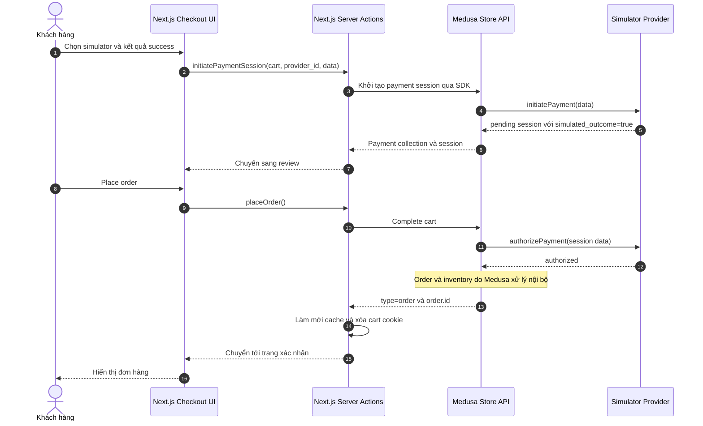
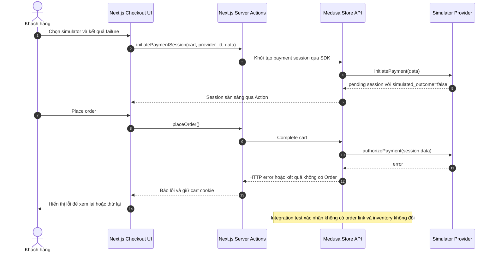

# Payment Simulator: luồng thành công và thất bại

## Trạng thái và phạm vi

Tài liệu này mô tả mã nguồn sau khi nhập `main` vào `recommendation`. **Đã triển khai:** Medusa Payment Module Provider `simulator`, giao diện lựa chọn kết quả thử nghiệm và backend integration tests cho cả thành công lẫn thất bại. **Chỉ dùng ngoài production:** `medusa-config.ts` không đăng ký provider khi `NODE_ENV=production`, và chính provider cũng từ chối khởi tạo trong môi trường đó. Docker Compose chạy backend ở production nên không bật simulator. COD vẫn dùng `pp_system_default`. [Provider](../../apps/backend/src/modules/payment-simulator/provider.ts), [Medusa config](../../apps/backend/medusa-config.ts), [Compose](../../docker-compose.yml), [seed region](../../apps/backend/src/scripts/seed-commerce.ts).

Simulator không thu tiền thật, không nhận thông tin thẻ và không chứng minh một đơn đã được thanh toán hoặc capture. Medusa là bên quản lý Cart, Payment, Order và Inventory; Next.js chỉ gửi yêu cầu qua Store API và hiển thị kết quả. [Ranh giới Storefront–Backend](storefront-backend-boundary.md), [Cart Server Actions](../../apps/storefront/src/lib/data/cart.ts).

## Payment Success

Giao diện luôn khởi tạo lại session simulator khi khách bấm Continue, kể cả khi vẫn chọn cùng provider, để dùng lựa chọn thành công/thất bại mới nhất. `placeOrder` chỉ coi `type === "order"` là thành công; sau đó xóa cookie giỏ và chuyển đến trang xác nhận. [Payment UI](../../apps/storefront/src/modules/checkout/components/payment/index.tsx), [cart actions](../../apps/storefront/src/lib/data/cart.ts).

## Payment Failure

Backend integration test hiện xác nhận nhánh thất bại trả HTTP 400, không có liên kết `order_cart` cho giỏ và inventory snapshot không đổi. Test gọi Store API trực tiếp, chưa kiểm chứng mọi bước giao diện Next.js hoặc các tình huống mất mạng. Lỗi khởi tạo session cũng được Payment UI bắt và hiển thị. Không có cơ chế tự thử lại hay idempotency key tường minh trong `placeOrder`; không suy ra cách Medusa xử lý transaction, compensation hoặc duplicate request ở bên trong. [Checkout integration test](../../apps/backend/integration-tests/http/checkout-order.spec.ts), [Payment UI](../../apps/storefront/src/modules/checkout/components/payment/index.tsx), [PaymentButton](../../apps/storefront/src/modules/checkout/components/payment-button/index.tsx), [cart actions](../../apps/storefront/src/lib/data/cart.ts).

## API contract và trách nhiệm

| Bước | Contract đã dùng | Trách nhiệm |
| --- | --- | --- |
| Lấy phương thức thanh toán | `GET /store/payment-providers?region_id=...` | Medusa trả phương thức của region; UI chỉ hiển thị COD và simulator hợp lệ. [Payment data](../../apps/storefront/src/lib/data/payment.ts), [UI filter](../../apps/storefront/src/lib/util/checkout-payment.ts). |
| Tạo session | Storefront gọi `sdk.store.payment.initiatePaymentSession(cart, { provider_id, data })`. Test backend gọi trực tiếp `POST /store/payment-collections` và `POST /store/payment-collections/{id}/payment-sessions`. | Simulator nhận `data.simulated_outcome: boolean`, mặc định `true` nếu không cung cấp, trả session `pending`. [Cart action](../../apps/storefront/src/lib/data/cart.ts), [provider](../../apps/backend/src/modules/payment-simulator/provider.ts), [test](../../apps/backend/integration-tests/http/checkout-order.spec.ts). |
| Hoàn tất cart | `POST /store/carts/{id}/complete` qua Medusa SDK. | Medusa gọi provider để authorize; Storefront chỉ xác nhận thành công khi nhận `type=order`. [Cart action](../../apps/storefront/src/lib/data/cart.ts), [test](../../apps/backend/integration-tests/http/checkout-order.spec.ts). |
| Xem đơn | `GET /store/orders/{id}` và danh sách đơn của khách. | Medusa trả dữ liệu đơn; trang xác nhận và lịch sử chỉ hiển thị kết quả. [Orders data](../../apps/storefront/src/lib/data/orders.ts), [test](../../apps/backend/integration-tests/http/checkout-order.spec.ts). |

UI chỉ bật simulator khi `NEXT_PUBLIC_PAYMENT_SIMULATOR_ENABLED=true`, `NEXT_PUBLIC_PAYMENT_SIMULATOR_PROVIDER_ID` là ID khác COD và provider đó được Medusa trả về cho region. Giá trị ở `NEXT_PUBLIC_*` được đưa vào bản build Next.js, nên cần build lại sau khi đổi. Trong mã hiện tại, ID backend là `pp_simulator_simulator`; integration test dùng đúng ID này. [Checkout flags](../../apps/storefront/src/lib/util/checkout-payment.ts), [constants](../../apps/backend/src/modules/payment-simulator/constants.ts), [test](../../apps/backend/integration-tests/http/checkout-order.spec.ts).

## Giới hạn cần kiểm thử tiếp

- Kiểm thử trình duyệt cho cả hai lựa chọn, đổi kết quả sau khi quay lại bước payment và lỗi khi tạo session.
- Gửi complete-cart trùng hoặc mất phản hồi mạng rồi thử lại; đọc lại trạng thái giỏ/đơn trước khi kết luận chưa có đơn.
- Đối chiếu việc giữ hàng, thu tiền COD và các trạng thái authorized/captured/refunded trên môi trường mục tiêu. Simulator chỉ mô phỏng authorization và các hàm capture/refund hiện trả dữ liệu mà không kết nối cổng thanh toán. [Provider](../../apps/backend/src/modules/payment-simulator/provider.ts).
