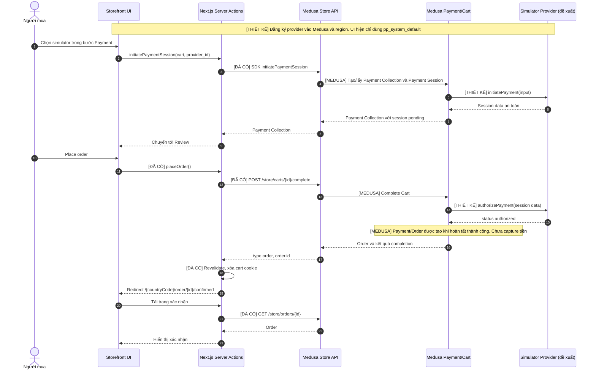
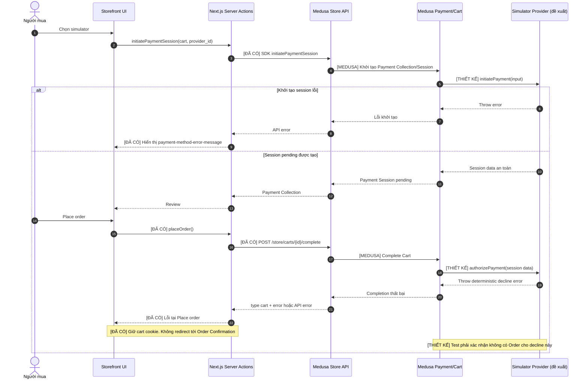

# Payment Success/Failure Flow (Medusa v2)

## Mục đích và trạng thái

Tài liệu này thiết kế **Payment Simulator** cho môi trường demo/test. Simulator **chưa được triển khai** trong repository. Luồng hiện chạy là Cash on Delivery (COD): storefront hiển thị nhãn này cho Medusa Manual System Payment Provider `pp_system_default`. Mọi thao tác commerce tiếp tục đi qua Medusa Store API; simulator đề xuất là một **Medusa Payment Module Provider**, không phải một HTTP API công khai mới.

Nhãn dùng trong tài liệu:

- **[ĐÃ CÓ]** Code hoặc test trong repository ở `origin/main` tại `71d2b6d`.
- **[MEDUSA]** Hành vi mô tả trong tài liệu chính thức của Medusa; chi tiết thực thi nội bộ của bản `2.21.2` chưa được chứng minh bằng test failure trong repo.
- **[THIẾT KẾ]** Việc cần triển khai và xác minh sau PR tài liệu này.

## Hiện trạng có thể kiểm chứng

| Thành phần | Bằng chứng | Giới hạn |
| --- | --- | --- |
| Region Vietnam | [`seed-commerce.ts`](../../apps/backend/src/scripts/seed-commerce.ts) bật `pp_system_default`. | Chưa đăng ký provider simulator. |
| Chọn phương thức | [`payment.ts`](../../apps/storefront/src/lib/data/payment.ts) gọi `GET /store/payment-providers?region_id=...`; [`Payment`](../../apps/storefront/src/modules/checkout/components/payment/index.tsx) lọc chỉ `pp_system_default`, gọi `initiatePaymentSession(cart, { provider_id })` và chuyển sang review. | UI hiện không chọn được provider khác. |
| Session và đặt hàng | [`cart.ts`](../../apps/storefront/src/lib/data/cart.ts) dùng Medusa SDK để khởi tạo session và complete cart. [`Review`](../../apps/storefront/src/modules/checkout/components/review/index.tsx) cùng [`PaymentButton`](../../apps/storefront/src/modules/checkout/components/payment-button/index.tsx) yêu cầu session `pending` của `pp_system_default` trước Place order. | Storefront không gọi một endpoint authorization riêng. |
| Success | [`checkout-order.spec.ts`](../../apps/backend/integration-tests/http/checkout-order.spec.ts) tạo payment collection/session qua Store API, complete cart và assert `type: "order"`, order detail/history. [`check-inventory-order.ts`](../../apps/backend/src/scripts/check-inventory-order.ts) và [`validation.ts`](../../apps/backend/src/scripts/inventory-order/validation.ts) có ca kiểm chứng trạng thái authorized, Payment gắn session/collection, chưa capture/refund. | Integration test chính chỉ assert order; script inventory/order chỉ kiểm chứng fixture thành công và không đại diện cho simulator. |
| Failure UI | `placeOrder` ném lỗi nếu complete cart trả kết quả khác order hoặc API lỗi; [`PaymentButton`](../../apps/storefront/src/modules/checkout/components/payment-button/index.tsx) hiển thị lỗi. Cookie cart chỉ bị xóa sau response `type: "order"`. | Chưa có backend test ép authorization fail; không suy ra trạng thái cuối của mọi kiểu lỗi/network timeout. |

Medusa [mô tả Payment Collection](https://docs.medusajs.com/resources/commerce-modules/payment/payment-collection), [Payment Session](https://docs.medusajs.com/resources/commerce-modules/payment/payment-session) và [Payment Module Provider](https://docs.medusajs.com/resources/references/payment/provider). Tài liệu Medusa đang công bố phiên bản mới hơn `2.21.2`; contract mới chỉ được áp dụng sau khi kiểm tra tương thích với bản đang pin. Đặc biệt, **Update Payment Session Client Data chỉ có từ v2.22.1**, nên thiết kế này không phụ thuộc route đó.

## Payment Success — thiết kế simulator

Các cuộc gọi từ browser/Next.js tới Store API dùng đường đi đã có; các bước với `Simulator` và việc chọn provider mới là thiết kế. `authorizePayment` là phương thức provider được Medusa [mô tả](https://docs.medusajs.com/resources/references/payment/provider) là chạy trong quá trình complete cart, không phải API mà storefront gọi trực tiếp.

`authorized` trong simulator chỉ là kết quả mô phỏng authorization. Nó **không chứng minh tiền đã được thu**. Ca COD hiện tại cũng chỉ cho biết “thu tiền khi giao hàng”; không gọi order creation là payment capture.

## Payment Failure — thiết kế simulator

Kịch bản chính là provider từ chối authorization **đồng bộ** bằng cách ném lỗi trong `authorizePayment`. Không dùng `pending_authorization` cho ca thất bại: Medusa cho phép tạo order đang chờ thanh toán với trạng thái đó. Phân nhánh dưới đây còn thể hiện lỗi khởi tạo session. Kết quả `type: "cart"` kèm `error` là contract Medusa [mô tả cho complete cart](https://docs.medusajs.com/resources/storefront-development/checkout/complete-cart); code storefront hiện cũng xử lý API error bằng cách ném lỗi.

Lỗi mạng sau khi gửi complete cart có thể khiến client không biết server đã tạo order hay chưa. Khi đó **không tự động gửi lại** hoặc hứa “không có order”; cần đọc lại trạng thái cart/order bằng quyền phù hợp trước khi cho phép retry. Tài liệu Medusa có [mô tả việc đảo payment nếu complete cart thất bại sau authorization](https://docs.medusajs.com/resources/storefront-development/checkout/complete-cart), nhưng repo chưa kiểm chứng nhánh đó trên `2.21.2` hoặc với simulator; phải có integration test trước khi dựa vào nó.

## API contract và ranh giới trách nhiệm

| Contract | Trạng thái | Request/response quan trọng | Chủ sở hữu |
| --- | --- | --- | --- |
| `GET /store/payment-providers?region_id={id}` | [ĐÃ CÓ] | Trả `payment_providers[]`; chỉ hiển thị provider Medusa cho region. | Medusa Store API; Next.js đọc qua `payment.ts`. |
| `POST /store/payment-collections` | [ĐÃ CÓ trong integration test] | Body `{ "cart_id": "cart_..." }`, trả `payment_collection`. SDK `initiatePaymentSession` của storefront gom bước này với khởi tạo session khi cần. | Medusa Store API. |
| `POST /store/payment-collections/{id}/payment-sessions` | [ĐÃ CÓ trong integration test] | Body `{ "provider_id": "pp_system_default" }` cho COD hiện tại; simulator dùng ID thực tế sau đăng ký, chưa biết trước. | Medusa Store API. |
| `POST /store/carts/{id}/complete` | [ĐÃ CÓ] | Body `{}`; success `type: "order"` + `order.id`; failure có thể `type: "cart"` + `error` hoặc HTTP/API error. Chỉ xóa cart cookie khi `type: "order"`. | Medusa Store API; `placeOrder` xử lý kết quả. |
| `GET /store/orders/{id}` | [ĐÃ CÓ] | Đọc Order cho trang confirmed; không suy trạng thái đã thu tiền từ riêng order ID. | Medusa Store API. |
| `initiatePayment`, `authorizePayment`, `getPaymentStatus` | [THIẾT KẾ] | Phương thức **nội bộ Payment Module Provider** theo Medusa; không có `/store/payment-simulator/*` trong repo. Success trả `authorized`; decline ném lỗi được kiểm soát. | Simulator provider dưới backend, gọi bởi Medusa. |

Storefront không tự tạo Payment/Order, không tính lại số tiền và không chọn kết quả success/failure bằng query parameter do người mua cung cấp. Để test ổn định, simulator cần cấu hình outcome ở phía server hoặc fixture test có quyền, gắn với session của lần chạy; không lưu bí mật trong `PaymentSession.data` vì [dữ liệu đó có thể đọc từ storefront](https://docs.medusajs.com/resources/commerce-modules/payment/payment-session). Không thiết kế webhook hoặc giao dịch ngân hàng vì simulator đồng bộ và không có bên thứ ba.

## Việc cần triển khai sau tài liệu này

1. Tạo Payment Module Provider trong `apps/backend/src/modules/` theo interface tương thích chính xác với Medusa `2.21.2`; đăng ký ở `apps/backend/medusa-config.ts`, thêm provider ID thực tế vào region qua workflow/migration dữ liệu có thể chạy lại. Không sửa Medusa core.
2. Mở rộng `apps/storefront/src/modules/checkout/components/payment/`, `review/`, `payment-button/` và `apps/storefront/src/lib/constants.tsx` để hiển thị simulator khi Medusa trả provider đó, giữ COD hoạt động. Dùng lại `initiatePaymentSession` và `placeOrder` trong `cart.ts`.
3. Bổ sung backend integration tests: success phải trả một order và session/payment authorized; deterministic decline phải hiển thị completion failure, kiểm tra cart/order readback và khả năng retry an toàn. Thêm browser E2E cho lỗi UI, mất mạng và quay lại checkout. Không khẳng định cơ chế rollback/idempotency trước khi có kết quả test.

## Nguồn

- Repository: [checkout/order sequence](checkout-order-sequence.md), [storefront/backend boundary](storefront-backend-boundary.md), [backend checkout test](../../apps/backend/integration-tests/http/checkout-order.spec.ts), [inventory/order validation](../../apps/backend/src/scripts/inventory-order/validation.ts), [seed region](../../apps/backend/src/scripts/seed-commerce.ts).
- Medusa documentation: [Payment step](https://docs.medusajs.com/resources/storefront-development/checkout/payment), [Complete cart](https://docs.medusajs.com/resources/storefront-development/checkout/complete-cart), [Payment provider interface](https://docs.medusajs.com/resources/references/payment/provider), [Payment session states](https://docs.medusajs.com/resources/commerce-modules/payment/payment-session).
