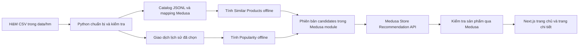

# Kế hoạch MVP gợi ý sản phẩm H&M: Phổ biến và Sản phẩm tương tự

**Trạng thái:** Kế hoạch, chưa triển khai Recommendation API hoặc giao diện mới. **Nhánh khảo sát:** `recommendation` sau khi nhập `main` tại merge commit `024bf27`. **Phạm vi:** hai vị trí hiển thị: sản phẩm phổ biến trên trang chủ và tối đa 6 sản phẩm tương tự trên trang chi tiết. Chưa làm gợi ý theo từng khách, gợi ý giỏ hàng, tìm kiếm cá nhân hóa, collaborative filtering hoặc huấn luyện mô hình phức tạp.

## 1. Vì sao làm và điều kiện bắt đầu

[Project Definition](../01_Project_Definition.md) và [Project Scope](../02_Project_Scope_and_Assumptions.md) xếp H&M và Recommendation vào phần **có thể làm thêm** (O-01/O-02), sau khi luồng mua hàng chính ổn định. [SRS](../03_Software_Requirements_Specification.md) ghi FR-REC-01/02 là yêu cầu tùy chọn: gợi ý chỉ được trỏ tới sản phẩm đang bán trong Medusa, không biến lịch sử H&M thành đơn hàng thật. [Cloud architecture](cloud-system-architecture.md) xác nhận Medusa/PostgreSQL là nguồn dữ liệu bán hàng chính và hiện chưa có Recommendation API. Kế hoạch này là bước nhỏ để đáp ứng hai vị trí gợi ý, không thay các điều kiện nghiệm thu của luồng mua hàng.

**Điều kiện trước khi dùng trong demo công khai:** xác nhận điều khoản Kaggle và quyền dùng dữ liệu/ảnh H&M cho cách trình bày dự kiến. Thư mục hiện tại không có `images/`; dùng ảnh thay thế có quyền sử dụng nếu cần. Không commit CSV, customer hash, dữ liệu đã xử lý hoặc ảnh H&M vào Git. [Hướng dẫn H&M](../../scripts/hm/README.md), [.gitignore](../../.gitignore), [Project Scope](../02_Project_Scope_and_Assumptions.md).

## 2. Hiện trạng đã kiểm tra

| Phần | Đã có | Còn thiếu cho MVP này |
| --- | --- | --- |
| Dữ liệu H&M | `data/hm/` có `articles.csv`, `customers.csv`, `transactions_train.csv`; header được đọc trực tiếp. `articles.csv` có thuộc tính loại, nhóm, màu, bộ phận, mô tả; giao dịch có ngày, mã khách, mã bài hàng và giá lịch sử. [prepare.py](../../scripts/hm/prepare.py). | Chưa xác nhận quyền cho demo công khai. `customers.csv` không cần cho hai thuật toán này. Giá giao dịch H&M không phải giá VND hiện hành. |
| Catalog đã chuẩn bị | `data/hm/processed/manifest.json` ghi 105.542 bài hàng nguồn, 500 nhóm sản phẩm được chọn và 1.874 article IDs; `catalog.jsonl` có 500 dòng, `medusa-mapping.jsonl` có 1.874 dòng. Importer dùng Medusa workflows, tạo giá/tồn kho demo và mapping article → product/variant. [Importer](../../apps/backend/src/scripts/import-hm-catalog.ts). | Tệp mapping là bằng chứng local và được gitignore, chưa xác minh lại những ID đó trong DB đang chạy. Importer chưa tạo category/collection hoặc nhập ảnh. |
| Dữ liệu mua để tính phổ biến | [prepare.py](../../scripts/hm/prepare.py) có `--with-interactions` để đọc CSV giao dịch theo luồng, che mã khách bằng HMAC và tạo `interactions.csv`, `popularity.json`. [build-popularity-candidates.py](../../scripts/hm/build-popularity-candidates.py) có thể cộng số lần mua của nhiều article thành một Medusa product. | Tại thời điểm khảo sát chưa có ba tệp `interactions.csv`, `popularity.json`, `popularity-medusa-products.json` trong `data/hm/processed/`; chưa có số đo độ phủ giao dịch trên 500 sản phẩm. |
| Website | Trang chủ đang hiện các bộ sưu tập; trang chi tiết có `RelatedProducts` chọn theo collection/tag và bỏ sản phẩm hiện tại; `ProductPreview` đã có placeholder khi thiếu ảnh. [Home](../../apps/storefront/src/app/%5BcountryCode%5D/%28main%29/page.tsx), [related](../../apps/storefront/src/modules/products/components/related-products/index.tsx), [preview](../../apps/storefront/src/modules/products/components/product-preview/index.tsx). | Chưa có rail Popular Products lấy từ H&M và chưa có Similar Products dựa trên thuộc tính H&M. |
| Backend/serving | Medusa có Store API, PostgreSQL và Redis theo cấu hình. [Medusa config](../../apps/backend/medusa-config.ts). | Chưa có route `/store/recommendations`, candidate store, version đang hoạt động hoặc cache riêng cho gợi ý. |

Việc chọn 500 nhóm hiện dựa trên thứ tự `product_key`, **không phải mẫu đại diện theo lịch sử mua**. Không dự đoán độ chính xác hoặc lượng giao dịch khớp cho đến khi chạy báo cáo thống kê. Việc nhóm nhiều article thành một product dùng `product_code` cộng loại/nhóm/bộ phận/section để tránh gộp nhầm các thuộc tính xung đột. [prepare.py](../../scripts/hm/prepare.py), [H&M README](../../scripts/hm/README.md).

## 3. Hai chiến lược MVP

### A. Popularity-Based: trang chủ

1. Đọc `transactions_train.csv` bằng luồng; chỉ giữ giao dịch có `article_id` nằm trong tập sản phẩm đã import. Dùng `medusa-mapping.jsonl` để đổi article ID sang **Medusa product ID**; cộng các variant cùng product trước khi xếp hạng. Giữ nguồn là `hm_historical`, không ghi thành Medusa Orders.
2. Để **đánh giá offline**, xếp hạng chỉ từ số lần mua trong tập train, không nhìn vào phần lịch sử được giữ lại làm bài kiểm tra. Sau khi chốt kết quả đánh giá, có thể tính lại bản gợi ý dùng để demo từ toàn bộ lịch sử H&M được phép dùng, nhưng không dùng bản này để báo cáo điểm của bài kiểm tra cũ. Hòa điểm theo product ID để lần chạy sau cho cùng kết quả. Nếu có đủ dữ liệu, thêm danh sách theo `product_group` làm fallback; không dùng ngày/giá H&M để giả định xu hướng mua hiện nay hoặc giá VND.
3. Ở trang chủ, lấy một pool tối đa 100 ứng viên rồi chọn 12 sản phẩm hợp lệ để hiển thị. Nếu không đủ lịch sử, dùng danh sách sản phẩm Medusa đang bán theo quy tắc cố định (ví dụ thứ tự ID/created_at đã chốt), gắn nhãn “Sản phẩm nổi bật” thay vì tuyên bố “phổ biến theo khách hiện tại”.

### B. Similar Products: trang chi tiết

1. Dùng thuộc tính sẵn có của **cùng Medusa catalog**: `product_type`, `product_group`, `section`, `department`, `garment_group`, `index_group`, mô tả và tập màu lấy từ các variants trong `catalog.jsonl`. Không tạo catalog thứ hai. Không lấy `product_code` đơn lẻ làm bằng chứng hai sản phẩm tương tự, vì cùng mã nguồn từng có thuộc tính xung đột.
2. Tính điểm offline cho mỗi cặp product khác nhau. Trọng số khởi đầu **đề xuất, cần đánh giá**: cùng `product_type` 30%, `product_group` 20%, `section` 15%, `department` 10%, `garment_group` 10%, màu giao nhau 5%, từ mô tả giao nhau 10%. Chuẩn hóa trường thiếu; dùng token tiếng Anh đơn giản cho mô tả. `index_group` dùng làm rào chắn/ưu tiên cùng nhóm người mặc, không cộng điểm hai lần với `section` trước khi thử chất lượng.
3. Lưu top 100 ứng viên cho mỗi product; khi hiển thị bỏ chính product đang xem, các variant của cùng product và product ID trùng. Chọn 6 sản phẩm. Nếu ít hơn 6, bù bằng Popularity trong cùng nhóm sản phẩm rồi toàn catalog, vẫn lọc theo Medusa.

**Không dùng “Frequently Bought Together”**: H&M CSV không có order/basket ID, nên hai giao dịch cùng ngày không chứng minh cùng giỏ. “Similar Products” ở MVP là tương tự theo thuộc tính, chưa phải sở thích cá nhân hay tỷ lệ khách mua cùng nhau.

## 4. Dòng dữ liệu và ranh giới trách nhiệm

Python chỉ chuẩn bị/đánh giá dữ liệu ngoài đường HTTP. Medusa sở hữu product IDs, trạng thái bán, giá VND, sales channel và tồn kho; route gợi ý không sửa Cart, Order hay Payment. Next.js chỉ lấy kết quả, hiển thị bằng `ProductPreview` và có fallback khi API lỗi. Checkout hoàn toàn không phụ thuộc Recommendation. [Ranh giới Storefront–Backend](storefront-backend-boundary.md), [Cloud architecture](cloud-system-architecture.md).

**Lưu trữ đề xuất:** một Medusa custom module có `recommendation_run` (version, loại chiến lược, checksum dữ liệu, ngày tạo, trạng thái active) và `recommendation_candidate` (version, placement, `context_key`, `target_product_id`, score, rank). `context_key` luôn có giá trị: `home` cho trang chủ, `product:<Medusa product ID>` cho trang chi tiết. Khóa duy nhất `(version, placement, context_key, target_product_id)` và index `(version, placement, context_key, rank)` giúp nhập lại không nhân đôi và đọc theo thứ tự. Các Medusa product IDs là tham chiếu logic qua module, không tự thêm foreign key vào bảng lõi. Publish một run hoàn chỉnh rồi đổi active version; nếu lỗi, giữ version cũ. Redis chỉ là cache, PostgreSQL giữ bản đã công bố. Thiết kế model/migration/API cụ thể phải đối chiếu Medusa 2.21.2 trước khi viết code.

**API đề xuất:** `GET /store/recommendations?placement=home&region_id=...&limit=12` và `GET /store/recommendations?placement=product_detail&product_id=...&region_id=...&limit=6`. Chỉ nhận `home` hoặc `product_detail`; limit mặc định 12/6, tối đa 24; product ID bắt buộc cho trang chi tiết. Trả `{ placement, strategy, version, fallback_reason?, products: [...] }`, trong đó `products` là dữ liệu sản phẩm đã được Medusa kiểm tra trạng thái bán, sales channel, region, giá và khả năng mua ngay lúc phục vụ. API đọc tối đa 100 ứng viên để đủ chỗ bù khi một sản phẩm không hợp lệ, rồi chỉ trả tối đa `limit` sản phẩm. Next.js dùng sản phẩm và giá trong phản hồi để vẽ `ProductPreview`. API không nhận `customer_id` và không trả raw H&M IDs. Cần đối chiếu cách Medusa 2.21.2 đọc StoreProduct theo region/publishable key trước khi chốt mã triển khai.

## 5. Kiểm tra chất lượng và giới hạn kết luận

- **Trước khi tính điểm:** báo cáo số giao dịch khớp 1.874 article IDs, số product có ít nhất một lần mua, số product không có lịch sử, phân bố theo nhóm, số mapping trùng/thiếu và orphan transactions. Nếu độ phủ quá thấp, mở rộng một tập catalog **cân bằng có chủ đích**, import thêm vào Medusa rồi tạo lại mapping; không gợi ý sản phẩm chưa import.
- **Popularity:** chia giao dịch theo thời gian (train trước validation/test), không tính số mua của tương lai vào danh sách dùng để đánh giá quá khứ. Báo cáo Recall@K/MAP@12 nếu đủ lịch sử, catalog coverage và phân bố nhóm; so với thứ tự mặc định/deterministic baseline. Không báo số đo khi chưa chạy.
- **Similar Products:** kiểm thử thuộc tính bằng ví dụ có nhãn do nhóm tự xem (cùng loại/nhóm/màu, có mô tả liên quan), kiểm top 6 không lặp, không trả chính sản phẩm hiện tại; ghi coverage và diversity. Nếu dùng giao dịch H&M làm proxy đánh giá hành vi, phải mô tả rõ hạn chế: nó không chứng minh hai món “trông giống nhau”.
- **Không suy ra CTR/conversion của website** từ giao dịch H&M. Dataset không có impression/click của dự án. Chỉ công bố số lượt click/chuyển đổi sau khi có tracking và đủ dữ liệu thật, được phép thu thập.
- **Kiểm tra phục vụ:** API trả `400` với placement/limit sai; không rò product đã ngừng bán, giá sai khu vực hoặc sản phẩm không đủ điều kiện mua; Redis lỗi thì đọc PostgreSQL, candidate store lỗi thì fallback Medusa; trang chủ/PDP vẫn tải được. Đo p50/p95 và cache hit/miss bằng k6; mục tiêu ban đầu có thể dùng p95 warm <250 ms, cold <800 ms ở 30 RPS, **chỉ là mục tiêu thử nghiệm**, cần đo trên VM thực tế.

## 6. Các bước giao Codex triển khai

| Bước | Việc làm, file dự kiến | Điều kiện trước | Kiểm tra xong khi | Ước lượng |
| --- | --- | --- | --- | --- |
| R-01 | Xác nhận quyền dùng CSV/ảnh, ghi quyết định trong `docs/architecture/hm-dataset-rights.md`. | Trước demo công khai. | Có nguồn điều khoản và quyết định phạm vi sử dụng; chưa rõ quyền thì không công khai dữ liệu/ảnh gốc. | 0,5–1 ngày + thời gian chờ quyền |
| R-02 | Kiểm tra thống kê tập 500 product và giao dịch; bổ sung `scripts/hm/profile-interactions.py` và test nhỏ. | CSV local, `manifest.json`, mapping. | Báo cáo số khớp/missing/zero-history, checksum, không in customer IDs. | 1 ngày |
| R-03 | Tạo `interactions.csv` và `popularity.json` bằng chế độ `--with-interactions`; chạy `build-popularity-candidates.py`, bổ sung test cộng nhiều article vào một product. Bổ sung cách tính train-only counts phục vụ đánh giá; không dùng `popularity.json` toàn lịch sử để đo trên tập test. Chỉ lưu trong `data/hm/processed/`. | R-01 cho phạm vi sử dụng, R-02; khóa HMAC giữ bí mật. | Chạy lại cho cùng kết quả/checksum, mọi candidate map tới Medusa product ID và không rò dữ liệu tương lai vào bài đánh giá. | 1–2 ngày |
| R-04 | Tạo `scripts/hm/build-similar-candidates.py` và tests cho trọng số, trường thiếu, hòa điểm, top 100, không tự gợi ý chính product. | Catalog/mapping đã kiểm tra. | Chạy lại cho cùng kết quả; file versioned có score và nguồn dữ liệu. | 1–2 ngày |
| R-05 | Tạo Medusa module và migration mới tại `apps/backend/src/modules/recommendation/`, workflow publish tại `src/workflows/recommendation/`, script nhập candidates tại `src/scripts/publish-hm-recommendations.ts`. | R-03, R-04; đối chiếu Medusa 2.21.2. | Import chạy lại không nhân đôi, active version đổi an toàn; rollback về version cũ. | 2–3 ngày |
| R-06 | Tạo `apps/backend/src/api/store/recommendations/route.ts` và HTTP tests trong `apps/backend/integration-tests/http/recommendations.spec.ts`. | R-05. | API kiểm input, lọc bằng Medusa, bù fallback, không cần customer ID, không ảnh hưởng checkout. | 2 ngày |
| R-07 | Tạo `apps/storefront/src/lib/data/recommendations.ts`, `src/modules/home/components/popular-products/`; thêm section vào trang chủ. | R-06. | Hiện 12 sản phẩm hợp lệ, đúng giá/region, có loading/empty/error fallback, không cần đăng nhập. | 1 ngày |
| R-08 | Nâng `apps/storefront/src/modules/products/components/related-products/index.tsx` thành Similar Products, giữ `ProductPreview` và skeleton hiện có. | R-06. | Top 6, không trùng product hiện tại, có fallback khi API lỗi/thiếu ứng viên. | 1 ngày |
| R-09 | Đánh giá offline và k6: `scripts/hm/evaluate-baselines.py`, `load/recommendations.js`, báo cáo trong `docs/report/`. | R-03 đến R-08. | Có split thời gian, checksum, cấu hình máy, quality/latency report, không tuyên bố CTR/conversion. | 1–2 ngày |

**Thứ tự:** R-01/R-02 có thể làm song song; R-04 dùng catalog có thể làm song song với R-03; R-05 chỉ sau cả hai; R-07/R-08 sau API có thể làm song song; R-09 chốt sau khi UI/API chạy. Mỗi bước là một thay đổi nhỏ có test và tài liệu. **Quay lại khi lỗi:** tắt section gợi ý bằng cờ cấu hình, giữ trang chủ/PDP hiện có; đổi active version về bản trước; không xóa sản phẩm/đơn Medusa hoặc dữ liệu H&M gốc.

## 7. Các rủi ro còn mở

1. Chưa xác nhận quyền công khai dataset/ảnh H&M; đây là điều kiện của demo, không phải bằng chứng đã được cấp quyền. [Project Scope](../02_Project_Scope_and_Assumptions.md).
2. Tập 500 product theo thứ tự khóa có thể thiên lệch và nhiều product không có giao dịch; cần R-02 trước khi chọn cách mở rộng.
3. Mapping local có thể không khớp DB hiện tại; kiểm tra product/variant IDs trước khi publish, không dùng tệp local làm bằng chứng DB production.
4. Không có ảnh H&M trong `data/hm/`; placeholder giúp UI không vỡ nhưng khó đánh giá Similar Products bằng cảm nhận thị giác.
5. Metadata của importer chưa tạo category/collection; thuật toán tương tự dùng trường H&M trong metadata/artifact hiện có, không giả định Medusa đã có taxonomy hoàn chỉnh.

Tài liệu này thu hẹp [kế hoạch Recommendation tổng thể](hm-recommendation-implementation-plan.md) thành MVP có thể giao từng bước. Các phần persona, collaborative filtering, cart recommendation và event tracking được để sau khi hai baseline này có kết quả kiểm chứng.
