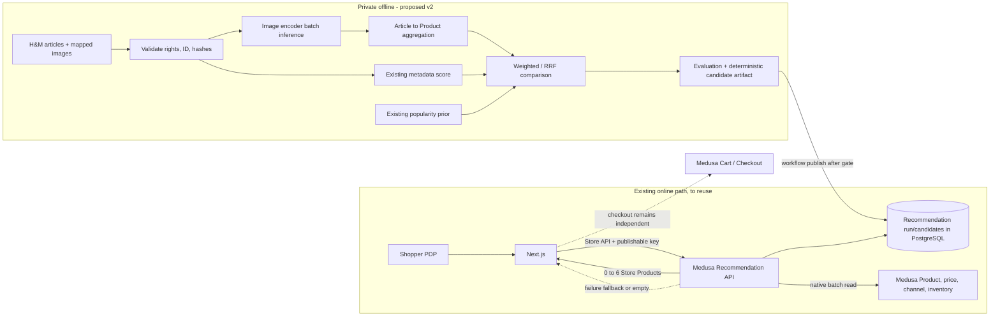

# Kế hoạch Hybrid Recommendation v2

**Loại:** kế hoạch, chưa triển khai. **Ngày audit:** 07/11/2026 (Asia/Saigon). **Nhánh/HEAD:** `recommendation-pdp` / `cf16e0ba2e2af3519f79f5d1b516708d64a28605`. Remote heads được kiểm bằng `git ls-remote`: `main` `034ced7`, `recommendation` `6f3c8d9`, `recommendation-pdp` `cf16e0b`. Working tree ban đầu có ZIP chưa tracked `docs/HM_Similar_Products_PDP_Plan_Docs.zip`; không đụng tới. Local `main` ở `f4845ba` là bản cũ hơn remote. Không đổi branch trong lượt này.

## 1. Tóm tắt dễ hiểu

Trang chi tiết hiện gợi ý sản phẩm dựa trên mô tả, loại và màu. V2 đề xuất dùng thêm hình ảnh để nhận biết các sản phẩm trông giống nhau, đồng thời dùng độ phổ biến ở mức nhẹ. Việc so sánh ảnh và xếp hạng được làm trước trên máy xử lý dữ liệu. Khi khách mở trang, Medusa kiểm tra lại sản phẩm nào đang bán được và giá hiện hành; website chỉ hiển thị tối đa 6 món. Nếu ảnh hoặc chức năng gợi ý gặp lỗi, trang mua hàng vẫn hoạt động.

Đây là phần mở rộng tùy chọn theo [Scope](../../02_Project_Scope_and_Assumptions.md) và [SRS](../../03_Software_Requirements_Specification.md). Chưa có bằng chứng Hybrid tốt hơn baseline. Đánh giá người thật, quyền công khai ảnh/dữ liệu và hiệu năng PDP là ba cổng nghiệm thu chưa đạt.

## 2. Audit hiện trạng và Evidence Matrix

**Mã hiện tại ưu tiên hơn tài liệu cũ.** Tài liệu Project/SRS ghi các SHA từ 02/11; bảng dưới được đối chiếu với HEAD của lượt audit. `VERIFIED` = có source và bằng chứng cụ thể tại repo/local; `CODE_ONLY` = chỉ thấy code, chưa chạy lại; `PARTIAL` = có bằng chứng nhưng thiếu gate; `GAP` = chưa thấy triển khai; `UNKNOWN` = không thể xác minh ở lượt planning. Các kết quả test lịch sử không được gọi là test mới.

| Capability | Existing implementation | Source path | Test evidence | Status | Risk |
|---|---|---|---|---|---|
| H&M pilot catalog/mapping | `prepare.py` nhóm product_code+type+group+department+section, importer và mapping JSONL | `scripts/hm/prepare.py`, `apps/backend/src/scripts/import-hm-catalog.ts` | Local manifest ghi 500 groups/1.874 articles; PDP report ghi test DB readback 1.874, chưa đọc DB trong lượt này | PARTIAL | Mapping phải so với DB đích hiện hành; pilot chọn lexicographic |
| Home Popularity | Python candidates, `home` API, Home component | `scripts/hm/build-mvp-candidates.py`, `apps/backend/src/api/store/recommendations/route.ts`, `apps/storefront/src/modules/home/components/popular-products/` | `docs/recommendation/reports/final_implementation_report.md`, CI mới `cf16e0b` thành công theo lượt kiểm tra trước | VERIFIED | V2 publisher bắt buộc có Home rows; phải giữ hành vi |
| PDP metadata similarity | Same-index-group scoring, min 0.70, max100/context, API cap6 | `scripts/hm/build-mvp-candidates.py`, `apps/backend/src/api/store/recommendations/route.ts` | PDP final report: 3.198 rows, 167/500 contexts có ≥6, 77 zero; metrics lịch sử, chưa chạy lại | PARTIAL | Human relevance NOT_RUN; 500 pilot ít ứng viên |
| Versioned publication | Custom run/candidate/active models, workflow, rollback bằng active pointer | `apps/backend/src/modules/recommendation/`, `apps/backend/src/workflows/recommendation/publish.ts` | `apps/backend/integration-tests/http/recommendations.spec.ts`; PDP report có publish/rollback test lịch sử | VERIFIED | Validator chỉ cho `hm_metadata_similarity`; phải sửa có kiểm soát |
| Native commerce filtering | Route dùng Medusa Store Product resolver, region, saleable variants, 100 pool, fallback | `apps/backend/src/modules/recommendation/store-products.ts`, `apps/backend/src/api/store/recommendations/route.ts` | HTTP tests + PDP report; performance PDP lịch sử fail target | PARTIAL | Native adapter import internal Medusa 2.21.2 exports; cần retest khi nâng version; query cost cao |
| PDP/Home UI | Server fetch `no-store`, 6 PDP/12 Home, legacy fallback | `apps/storefront/src/lib/data/recommendations.ts`, `related-products/index.tsx`, `product-preview/` | Playwright files và historical PDP report; chưa chạy trong audit | CODE_ONLY | Label hiện chỉ gọi `hm_metadata_similarity` là Similar; v2 strategy cần cập nhật |
| Image pipeline | Manifest, selective download, validation, optimization, guarded test importer | `scripts/hm/image_pipeline.py`, `download-images.py`, `apps/backend/src/scripts/import-hm-images.ts` | Local aggregate: 496 valid/1.874, 496/500 Products có ảnh; report 06/11 ghi import test DB; main `commerce` 0/500 thumbnails lúc đó | PARTIAL | Ảnh local không đồng nghĩa public/production có ảnh; 4 Products thiếu |
| Image visual encoder/embedding | Chưa thấy Python model/inference/feature store | `scripts/hm/` inventory | Không có test/artifact v2 | GAP | License, CPU/RAM, dimension chưa đo |
| Hybrid scoring/evaluator | Chưa thấy weighted/RRF hay human labels | `scripts/hm/` inventory, `similarity-review-protocol.md` | Agent review chỉ diagnostic; human NOT_RUN | GAP | Không được claim cải thiện relevance |
| PDP performance | k6 mixed product contexts và concurrency cap hiện hữu | `load/recommendations.js` | `docs/recommendation/pdp/reports/system_test_report.md`: final 1 replica 30RPS p95 732.81ms, HTTP error 48.83%, 0 dropped; target FAIL | PARTIAL | p95 tổng che 503 nhanh; phải đo successful-only và error |
| Rights/public release | Local/private decision; chưa có permission public | `docs/recommendation/dataset-rights-decision.md`, `docs/recommendation/images/reports/real_hm_images_2026-11-06.md` | Public NO-GO trong reports | PARTIAL | Kaggle account/download không cấp quyền redistrib |
| Session events/personalization | Không thuộc MVP hiện tại | Recommendation module/API hiện tại không nhận customer_id | Không có bằng chứng tracking hợp lệ | GAP | Scope/privacy nếu tự mở rộng |

`docs/recommendation/plan.md` và `phase_*.md` cũ **không còn ở HEAD** (đã xóa tại `62beb45`); `spec.md`, runbook, reports/evidence còn. Không tái tạo/chỉnh sửa tài liệu cũ. Module Medusa và UI có trên branch `recommendation-pdp`, chưa có bằng chứng đã merge `main`; PR #9 là draft theo PDP report. Khi đưa v2 về main: cập nhật main trong một nhánh review riêng rồi port/rebase có chọn lọc, chạy lại migration/test; không merge trong lượt này.

## 3. Phạm vi và quyền dữ liệu

**In scope:** audit baseline; image readiness; article-level image vectors và Product aggregation; so weighted fusion với RRF; candidates offline; versioned Medusa publish; PDP tối đa 6; QA/NFR; private release decision. **Optional/after v2:** session view/click/cart events và cá nhân hóa khi có notice/consent, data volume và quyết định riêng. **Out of scope:** CF/ALS/BPR, LLM, deep online ranking, vector DB, GPU service HTTP, sửa Home algorithm, đổi checkout, production A/B.

Raw H&M CSV/JPEG và derived embeddings nằm trong `data/hm/` gitignored. `article_id` là string 10 số, một Product có nhiều Variant/article. Medusa là nguồn chuẩn cho published status, channel, region, giá VND và stock; giá/stock pilot là **synthetic**. Private processing có thể nghiên cứu; **PUBLIC NO-GO** cho tới khi chủ dữ liệu kiểm chứng Kaggle/ảnh/derived artifacts và ghi quyền cụ thể. Không đọc customer identity cho v2.

## 4. Luồng đề xuất

Serving lọc purchasability **sau** candidate ranking vì stock/giá thay đổi. Pool 100 để có đủ ứng viên sau lọc; display K vẫn tối đa 6. Không dùng một ảnh/variant thay cho Product khác. Khi Product có nhiều ảnh, so representative baseline với pooling có kiểm soát trong Phase 03.

## 5. Roadmap và phụ thuộc

Ước lượng là **person-days giả định** cho một người quen repo, chưa tính chờ quyền dữ liệu/human review/hạ tầng. Chi tiết task, Given/When/Then và rollback ở từng [phase](README.md).

| ID | Mục tiêu một câu | Input | Dependencies | Tasks chính | Deliverables | Owner role | Estimate | Exit gate | Risks |
|---|---|---|---|---|---|---|---:|---|---|
| 00 | Khóa baseline Git/DB/quyền và môi trường test | HEAD, docs, DB identity | không | source inventory, rights, test isolation | audit report mới | Tech Lead | 1–2 | source/rights/DB rõ hoặc BLOCKED | stale main, shared DB |
| 01 | Đo Simple baseline công bằng | 500 pilot, current candidates | 00 | eligible universe, coverage, diversity, human protocol, PDP load baseline | baseline report/artifacts private | ML+QA | 2–3 | metrics tái lập; human ghi NOT_RUN nếu thiếu | baseline bias |
| 02 | Chốt ảnh và mapping đủ để học | manifest, 496 local valid | 00 | rights, DB readback, image coverage, bad/missing list | readiness manifest/report | Data Eng | 2–3 | mapping 1.874 đối chiếu; ảnh chỉ đúng Product | missing/public rights |
| 03 | Tạo image vectors offline | validated JPEGs | 02 | model/license/resource benchmark, preprocess, batch/cache, product pooling | private vectors + manifest | ML Eng | 3–5 | deterministic finite vectors, fallback missing | RAM/model license |
| 04 | So Hybrid với baseline và chọn rank | 01+03 | 01,03 | weighted/RRF, normalization, tuning, human review | candidate version + evaluation | ML+QA | 3–5 | không thua baseline theo gate đã chốt; human evidence | popularity bias |
| 05 | Publish và phục vụ qua Medusa | 04 + isolated DB | 04 | strategy ADR, validator, publisher, route/native tests | ready run/API | Backend | 2–4 | idempotent/rollback, Home giữ nguyên, saleability | API version coupling/DB load |
| 06 | Hiển thị PDP đáng tin cậy | API ready run | 05 | label/image/price/fallback/flag/mobile | PDP UI + Playwright | Frontend+QA | 1–3 | 0–6 đúng sản phẩm; API fail không chặn | image origin |
| 07 | Kiểm thử hệ thống và quyết định release | 05+06 | 06 | unit/HTTP/E2E/commerce/k6/fault/security/rights | system report, decision | QA+DevOps | 3–5 | mọi P0 pass ở test stack; public gate riêng | 30RPS fail |
| 08 OPTIONAL | Thu thập sự kiện phiên cho tương lai | v2 private release | sau 07, quyết định riêng | privacy design, schema, retention, instrumentation | future design/experiment | Product+Privacy | 3–6 | không là v2 GO gate | consent, sparse data |

**Critical path:** 00 → 02 → 03 → 04 → 05 → 06 → 07; Phase 01 chạy song song 02/03 sau 00, nhưng phải xong trước 04. Rights review có thể chạy song song, nhưng chặn public release. Nếu ảnh/embedding không đủ hoặc hybrid không hơn metadata theo rubric đã chốt, dừng v2 scope ở metadata-only; không thêm model/service để cứu kết quả. Session tracking không kéo vào critical path.

## 6. Rủi ro và giải pháp

| Risk | Xác suất / tác động (ước lượng) | Giảm thiểu | Owner |
|---|---|---|---|
| Public rights không rõ | Cao / Cao | Private-only; legal/owner record Kaggle + image + derived-asset decision, public flag OFF | Product/Data owner |
| Ảnh thiếu hoặc sai Product | Cao / Cao | Mapping article→Variant→Product, checksum, visual spot check, metadata-only fallback | Data Eng |
| Encoder không phù hợp VM/license | Trung / Cao | Pilot nhỏ, đo CPU/RAM/VRAM/disk và license, lựa chọn CPU-compatible | ML Eng |
| Candidate coverage thấp | Cao / Trung | Báo distribution 0..6, taxonomy blocking có kiểm soát, chấp nhận <6 | ML Eng |
| Popularity lấn át Similarity | Trung / Trung | Normalize within universe, cap prior, ablation/weight sweep, human pairwise | ML+QA |
| Offline-online skew | Cao / Cao | Publish ID validation, active version, native saleability mỗi request, spot readback | Backend |
| DB pool/latency | Cao / Cao | Benchmark trước, batch native reads, concurrency cap, query/connection profile | Backend+DevOps |
| Medusa internal export đổi | Trung / Cao | Pin 2.21.2 hiện tại; upgrade test contract adapter trước release | Backend |
| Source branch chưa vào main | Trung / Cao | Review PR #9 và CI, rebase/cherry-pick có chọn lọc trên main mới, không auto merge | Tech Lead |
| Human labels thiếu | Cao / Trung | Kỹ thuật private chỉ; không claim relevance improvement/public GO | QA/Product |

## 7. Release và rollback

Private GO cần mapping/rights private rõ, P0 fixtures + backend HTTP + Playwright + commerce regression pass, human relevance có người chấm nếu claim cải thiện, performance đạt ngưỡng được chốt sau baseline. Nếu performance vẫn như PDP report (48.83% HTTP errors), **NO-GO cho 30RPS** dù p95 tổng <800ms. Public GO cần quyền ảnh/dataset/derived artifact và model license, review bảo mật/giá/stock, theo dõi vận hành. Không tự bật production flag.

Rollback: tắt `NEXT_PUBLIC_ENABLE_RECOMMENDATIONS` và rebuild frontend khi cần; tắt backend `ENABLE_RECOMMENDATIONS`; chuyển active pointer về ready metadata run cũ bằng workflow đã test; không xóa run, Products, Orders hay DB volumes. V2 candidate version mới phải immutable; giữ previous ready run cho rollback. Commerce vẫn dùng Medusa.

## 8. Decision log và câu hỏi mở

| Decision / phương án | Lý do, trade-off, đường chuyển |
|---|---|
| Dùng existing Python offline + Medusa PostgreSQL serving | Reuse code/versioning, không thêm service online. Trade-off: batch job và DB candidate load cần profile; nếu vượt tài nguyên mới tách worker/service. |
| So weighted fusion và RRF, chưa chọn winner | Weighted dễ giải thích nhưng cần score calibration; RRF chịu khác scale nhưng mất khoảng cách score. Chọn bằng cùng validation/human protocol, không mặc định 0.40/0.45/0.15. |
| Representative image trước, pooling là thí nghiệm | 496 ảnh cho 500 Products nhưng chỉ một phần 1.874 articles; representative rẻ, có thể bỏ sót màu/variant. Pooling sau khi đo coverage/cost. |
| Giữ Medusa saleability và no-store hiện tại | Tránh stale price/stock; có chi phí native hydration. Chỉ cache candidate IDs khi đo và có invalidation/version key. |
| Không thêm vector DB/GPU HTTP/CF | 500 Product pilot và offline top100 chưa biện minh; chuyển khi NFR và cost đo chứng minh cần. |

**Open questions:** quyền public cho ảnh/metadata/embeddings; model weights/license và khả năng chạy CPU trên VM; DB nào là đích private v2; cần bao nhiêu ảnh/variant để pooling có ích; ngưỡng human relevance tối thiểu; capacity/connection limit thật của staging; nguồn publishable key và image URL trong public deployment. Mặc định an toàn: private-only, metadata fallback, production flag OFF, không viết DB trước Phase 00 gate.

## 9. Lệnh kiểm tra đã xác minh / tham khảo

`python -m unittest discover -s scripts/hm/tests -v`, `npm run test:unit --workspace=@dtc/backend`, `npm run test:integration:http --workspace=@dtc/backend`, `npm run typecheck --workspace=@dtc/storefront`, `npm run test:e2e --workspace=@dtc/storefront -- e2e/pdp-similar-products.spec.ts`, và `load/recommendations.js` tồn tại trong source/CI. **Chưa chạy các suite này trong lượt planning**; integration/E2E/k6 chỉ chạy ở test stack sau khi xác minh DB isolation. Xem [spec](spec.md), [audit report](reports/planning_audit_report.md), [MVP final](../reports/final_implementation_report.md), [PDP final](../pdp/reports/final_implementation_report.md), [image real-data report](../images/reports/real_hm_images_2026-11-06.md), [runbook](../runbook.md).
