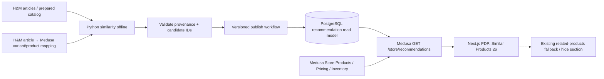

# Implementation Plan — H&M Similar Products trên Product Detail

> **ID:** REC-PDP-PLAN · **Version:** 1.0 · **Ngày soạn:** 2026-11-04
> **Trạng thái:** Kế hoạch triển khai/đối soát, **không phải báo cáo đã chạy**.
> **Phạm vi:** Chỉ `product_detail` — tối đa **6 sản phẩm tương tự**, không cá nhân hóa.
> **Vị trí tài liệu:** `docs/recommendation/pdp/` — tách khỏi master plan hiện có ở `docs/recommendation/plan.md`.
> **Spec bắt buộc:** [spec.md](spec.md) · **Parent:** [Recommendation Master Plan](../plan.md), [SRS](../../03_Software_Requirements_Specification.md).

## 1. Mục tiêu dễ hiểu

Khi khách mở trang chi tiết một sản phẩm (PDP), website hiển thị tối đa 6 sản phẩm tương tự lấy từ **cùng catalog Medusa**. Dữ liệu H&M đã được ETL/import; thuật toán offline xếp hạng theo loại sản phẩm, nhóm, bộ phận, màu và mô tả. Medusa API xác nhận ứng viên còn được bán, đúng region/channel và có giá/khả năng mua hợp lệ; Next.js chỉ hiển thị thẻ sản phẩm. Nếu Recommendation lỗi, **PDP, giỏ và checkout vẫn hoạt động**.

**Không làm:** Popular Products section mới trên Homepage, personalized/CF/LLM, recommendation giỏ hàng, click tracking/A-B test, cập nhật Medusa commerce core, nhập lại toàn bộ dataset hoặc đưa H&M raw data ra public.

## 2. Baseline code thực tế — phải đọc trước coding

Đọc remote GitHub tại **2026-11-04**:

| Nhánh | SHA được kiểm tra | Ý nghĩa |
|---|---|---|
| `main` | `f4845ba6e240288c2ed7dbe8d3156ac5cbfc7f12` | Chưa có Recommendation API/Module/PDP H&M |
| `recommendation` | `6f3c8d99cac44d94f296dbe912ed82d820ac6584` | **Đi trước main 5 commit, chậm 0 commit**; đã có implementation private pilot |

**Quan trọng:** Không viết lại code đã có chỉ để khớp kế hoạch. Bắt đầu bằng audit/reuse/verify; nếu mục tiêu là `main`, chuyển qua PR được review và kiểm tra lại trên main mới nhất. Tài liệu ghi các mã SHA làm mốc quan sát, **không bảo đảm branch giữ nguyên sau thời điểm này**.

| Thành phần trên `recommendation` | Hiện trạng trong source/evidence | Việc còn lại |
|---|---|---|
| `scripts/hm/build-mvp-candidates.py` | Sinh similarity offline, chặn theo `index_group`, ngưỡng mặc định 0.70, top 100/context, tests | Đối soát mapping/catalog đã chọn, đánh giá human relevance |
| `apps/backend/src/modules/recommendation/` + migrations | Run/candidate/active version đã có | Kiểm tra module ở commit thực thi, rollback và nâng cấp version |
| `apps/backend/src/scripts/publish-hm-recommendations.ts` | Publisher đã có; hỗ trợ activate ready version | Dùng DB test riêng, không publish đè không kiểm soát |
| `apps/backend/src/api/store/recommendations/route.ts` | Đã có `placement=product_detail`, product filtering/fallback | Hardening contract và thử riêng tải PDP, kiểm thử trạng thái lỗi |
| `apps/storefront/src/lib/data/recommendations.ts` | Server-side SDK, flags, 6s timeout | Verify flag/config trên runtime đúng |
| `apps/storefront/src/modules/products/components/related-products/index.tsx` | Đã hiển thị Similar Products/fallback | Review user experience, accessibility, E2E trên các PDP đại diện |
| `apps/storefront/e2e/recommendations.spec.ts` | Có browser tests Home/PDP | Bổ sung kịch bản PDP-specific, flag-off/error/empty và core regression |
| `docs/recommendation/reports/system_test_report.md` | Báo cáo private pilot: 7 Python, 30 backend unit, 4 backend HTTP, 11 browser tests pass | Đây là **bằng chứng cũ theo môi trường ghi trong report**, cần chạy lại trên target commit |
| `docs/recommendation/evidence/load-verification.json` | Benchmark **Home**, 30 RPS/60s, 1 replica p95 ~166 ms | **Không được suy p95 PDP từ Home**; cần benchmark `product_detail` đa context |
| `docs/recommendation/dataset-rights-decision.md` | Chỉ cho phép tiếp tục private pilot, public NO-GO | Quyết định rõ điều kiện demo/public; human relevance NOT_RUN |

**Dữ liệu local được report, không tự xác nhận mới:** 500 H&M Medusa Products, 1.874 Variants; 979.342 purchase events khớp subset; 3.198 Similar candidate rows; 167/500 contexts có ít nhất 6 ứng viên ở score >=0.70. Chỉ số có hạn chế do chọn mẫu 500 nhóm đầu theo thứ tự khóa. Những số này phải được reverify trên DB mục tiêu và artifact nguồn trước khi ghi là actual của lần triển khai mới.

## 3. Kiến trúc mục tiêu — đơn giản, không thêm server mới

- **Không có Python realtime inference.** Offline generator và publisher chạy riêng, không nằm trên đường checkout.
- **Medusa là source of truth** về product publication, sales channel, price, region và purchasability; candidate rank chỉ là gợi ý.
- **Backend module dùng lại** code trong `recommendation` nếu audit pass; thay vì tạo một bảng mới khác.
- **Frontend dùng lại** `ProductPreview` và `RelatedProducts`, không dựng product data/price riêng.
- **Flag độc lập:** `ENABLE_RECOMMENDATIONS` ở backend và `NEXT_PUBLIC_ENABLE_RECOMMENDATIONS` ở frontend (build time).

## 4. Các phase và dependency (07 phase)

| Phase | Tài liệu | Mô tả một câu | Phụ thuộc | Exit gate |
|---|---|---|---|---|
| **00 — Audit & Safety** | [phase_00_audit_and_safety.md](phase_00_audit_and_safety.md) | Xác nhận branch, source, quyền dữ liệu, DB test và code có sẵn. | Không | Baseline/rights/test isolation rõ ràng |
| **01 — Data & Mapping** | [phase_01_data_and_mapping.md](phase_01_data_and_mapping.md) | Đối soát catalog H&M, candidate metadata và Medusa IDs. | 00 | Mapping/candidate coverage có evidence |
| **02 — Similarity Candidates** | [phase_02_similarity_candidates.md](phase_02_similarity_candidates.md) | Xác minh/hoàn thiện thuật toán offline và top 100 mỗi PDP. | 01 | Deterministic tests, no self/duplicate, quality report |
| **03 — Backend API** | [phase_03_backend_api.md](phase_03_backend_api.md) | Tái sử dụng/hardening publisher, module và API `product_detail`. | 02 | HTTP tests, pricing/channel/stock/fallback, rollback |
| **04 — PDP Integration** | [phase_04_product_detail_ui.md](phase_04_product_detail_ui.md) | Hiển thị tối đa 6 thẻ tương tự bằng Next.js, hỗ trợ lỗi/flag. | 03 | PDP browser/mobile/accessibility checks |
| **05 — E2E & Performance** | [phase_05_system_verification.md](phase_05_system_verification.md) | Test toàn đường đi, lỗi dịch vụ, hồi quy commerce và benchmark PDP. | 04 | System test matrix và số đo có thật |
| **06 — Release & Reporting** | [phase_06_release_reporting.md](phase_06_release_reporting.md) | Review, quyết định private/public GO, bàn giao runbook và báo cáo. | 05 | Final report, traceability, rollback/PR |

Phase **01–02 có thể chạy offline mà không cần khởi động storefront**; phase **03–05 bắt buộc có test DB tách biệt**. Không tự tuyên bố phase pass chỉ vì implementation có sẵn.

## 5. Cross-phase rules

1. **Scope:** Chỉ `product_detail` được tính vào nghiệm thu. Có thể dùng Home popularity candidates **đã có** làm fallback, nhưng **không làm lại tính năng Homepage**.
2. **Re-use first:** Audit code trước; chỉ sửa nếu có test fail, contract gap hoặc requirement thay đổi. Không tạo recommendation module thứ hai.
3. **Dataset permissions:** Tiếp tục private dev/test khi phù hợp; public NO-GO cho tới khi có rights decision hợp lệ, bao gồm ảnh/metadata/derived assets. Không upload H&M CSV hoặc customer hashes vào Git.
4. **Mapping:** H&M article IDs là chuỗi **10 chữ số trong dataset đã kiểm**, không ép thành integer; một Medusa Product chứa nhiều H&M article Variants. Không đổi grouping mà không có migration rõ ràng.
5. **Data consistency:** Không viết trực tiếp vào bảng core commerce; candidate importer/versioning qua module. Không biến H&M purchase transactions thành Medusa Orders.
6. **Safety:** Không `docker compose down -v` trên dữ liệu cần giữ, không migrate-down DB dùng chung, không force-push. Fault/load tests chỉ ở môi trường test biệt lập.
7. **Reporting:** Sau mỗi phase tạo một report **nếu phase thực sự được triển khai** tại `docs/recommendation/pdp/reports/phase_NN_report.md`, kèm run command, SHA, environment, expected/actual, PASS/FAIL/BLOCKED, evidence.
8. **Quality:** `spec.md` là requirement contract; source và tests là bằng chứng. Không hạ threshold/xóa assertion để tạo PASS; đánh dấu NOT_RUN nếu không chạy được.
9. **Review:** Backend/Frontend/QA review, riêng human relevance phải do người review mẫu có nhãn, không đánh tráo bằng agent self-review.

## 6. Nghiệm thu tổng thể (Definition of Done)

- PDP gọi API với `placement=product_detail`, ID sản phẩm hiện tại và region đúng; **không cần `customer_id`**.
- Có tối đa **6 sản phẩm khác product hiện tại**, không duplicate, giữ đúng thứ tự ứng viên sau lọc và fallback.
- Sản phẩm hiển thị dùng Medusa Product/Variant, giá theo region/channel và tính mua được; không rò source IDs, H&M customer IDs, private score/metadata.
- Missing/invalid params → 4xx rõ; stale candidates / Redis unavailable → fallback hợp lệ; backend/DB lỗi → trả lỗi/ẩn section, **không phá PDP/checkout**.
- Test offline, backend, PDP E2E, flag-off và commerce regression chạy lại trên **target commit**; benchmark **random/multiple PDP contexts**, không lấy Home numbers làm KPI PDP.
- Có tài liệu rollback bằng flags/ready version, rights decision, human relevance status, report mỗi phase và final GO/NO-GO.
- Nếu chuyển sang `main`, PR phải được review và CI/E2E pass trên commit ứng viên merge; không tự xem kết quả private branch là đã merge.

## 7. Giao việc theo PR (đề xuất)

| PR | Phạm vi | Không đụng tới |
|---|---|---|
| PR-PDP-1 | Audit/data reconciliation, offline candidate validator + tests | Cart/Checkout/Payment |
| PR-PDP-2 | Module/publisher/API reuse, regression/edge cases | Medusa core tables |
| PR-PDP-3 | PDP component + SDK helper + Playwright tests | Homepage business logic |
| PR-PDP-4 | k6 PDP, E2E, docs/evidence/release | Raw H&M dataset vào repo |

Nếu `recommendation` đã chứa cả 4 phần và tests đạt, thực hiện **một PR tích hợp có kiểm soát**, không ép tạo PR giả để khớp bảng.

## 8. Nguồn code/doc trong repository

- [Recommendation private runbook](../runbook.md) · [Candidate generator](../../../scripts/hm/build-mvp-candidates.py) · [API](../../../apps/backend/src/api/store/recommendations/route.ts).
- [PDP component](../../../apps/storefront/src/modules/products/components/related-products/index.tsx) · [Next data helper](../../../apps/storefront/src/lib/data/recommendations.ts).
- [PDP E2E](../../../apps/storefront/e2e/recommendations.spec.ts) · [Old system report](../reports/system_test_report.md).
- [Rights decision](../dataset-rights-decision.md) · [SRS](../../03_Software_Requirements_Specification.md).

> Các link relative ở trên được tính từ `docs/recommendation/pdp/`; các đường dẫn tới code là **đường dẫn repository**, không phải tệp có trong gói tài liệu phát hành.
