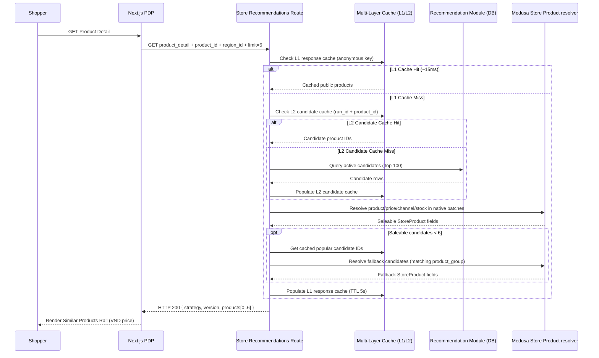

# Technical & Functional Specification — H&M Similar Products API + PDP

> **ID:** REC-PDP-SPEC · **Version:** 1.1 (Optimized MVP) · **Status:** Verified Contract; xem [báo cáo triển khai](reports/final_implementation_report.md), [báo cáo hiệu năng](reports/performance-report.md) và [báo cáo đánh giá chất lượng](reports/recommendation-evaluation-report.md) để biết kết quả kiểm chứng.
> **Parent requirement:** SRS `FR-REC-01/02` là optional; **MUST dưới đây là MUST sau khi nhóm chọn làm PDP Recommendation**.
> **Implementation strategy:** Reuse code trên `recommendation`; tối ưu hóa concurrency gate (32 slots) và multi-layer TTL response/candidate caching.
> **Implementation evidence:** [performance report](reports/performance-report.md), [evaluation report](reports/recommendation-evaluation-report.md), [optimization plan](optimization-plan.md) and [runbook](runbook.md).

## 1. Mục đích và giới hạn

Khách xem Product Detail thấy một rail **Similar Products**, tối đa sáu sản phẩm **không trùng với sản phẩm hiện tại**, từ cùng catalog Medusa. Similarity dùng H&M metadata offline; Medusa quyết định sản phẩm có thể bán, giá VND, region/channel, inventory/backorder. Fallback hiển thị sản phẩm liên quan phù hợp hoặc ẩn rail. Không yêu cầu đăng nhập, không cá nhân hóa, không đụng checkout.

**Out of scope:** Home Popularity UI mới, personalized recommendation, collaborative filtering, LLM/vector DB, real-time training, cart recommendations, user behavior/CTR. Home popularity data có sẵn được phép dùng làm fallback candidates, nhưng không thay phạm vi chính.

## 2. Actors, luồng chính và kiến trúc hệ thống

1. Shopper mở `/vn/products/{handle}` qua Next.js.
2. PDP tải Medusa Store Product và region bằng cơ chế hiện có.
3. `RelatedProducts` gọi `getRecommendations(region.id, product.id)` nếu bật frontend flag.
4. Next.js Server SDK gọi Store API `GET /store/recommendations?placement=product_detail&product_id=...&region_id=...&limit=6` với publishable API key/headers hợp lệ.
5. API kiểm tra cổng Concurrency Gate (tối đa 32 requests in-flight); kiểm tra L1 response cache (TTL 5s cho anonymous requests); nếu miss, đọc L2 Candidate cache (`run_id` + `context_key`), gọi native Medusa Store Product pipeline để đọc lại các products hợp lệ (giá VND, tồn kho, sales channel); loại bỏ self/duplicates; kích hoạt fallback nếu số sản phẩm hợp lệ < 6.
6. UI render `ProductPreview` dùng giá/region từ Medusa. Lỗi/timeout → related-products legacy fallback hoặc ẩn rail, không tác động checkout.

### 2.1 Sơ đồ kiến trúc tổng thể (Architecture & Data Flow)

```mermaid
flowchart TD
    subgraph Offline["1. OFFLINE PIPELINE (Batch Candidate Generation)"]
        RawCatalog["Medusa Products & H&M Taxonomy"] --> Scorer["scripts/hm/build-mvp-candidates.py"]
        Transactions["Held-out Orders / Transactions"] --> PopScorer["scripts/hm/build-popularity-candidates.py"]
        
        Scorer --> SimCandidates["candidates-product-detail.jsonl\n(Top 30 Similar Items)"]
        PopScorer --> PopCandidates["candidates-home.jsonl\n(Top 100 Popular Items)"]
        
        SimCandidates & PopCandidates --> WFPublish["Medusa Workflow: publishRecommendationRun"]
        WFPublish --> DB[("PostgreSQL\n(Runs & Candidates tables)")]
        WFPublish -.->|"Invalidate on publish"| CacheClear["clearRecommendationCache()\nclearAnonymousCache()"]
    end

    subgraph Online["2. ONLINE SERVING (Storefront API @ 30 RPS)"]
        Client["Browser / Mobile Storefront"] --> Proxy["Reverse Proxy / CDN"]
        Proxy --> Route["GET /store/recommendations"]
        
        Route --> Gate{"In-Flight Concurrency Gate\n(Max: 32 slots)"}
        Gate -- ">= 32 slots" --> Reject["HTTP 503 Capacity Unavailable\n(Retry-After: 1s)"]
        
        Gate -- "< 32 slots" --> AnonCheck{"Is Anonymous Request?\n(No cookie, no auth token)"}
        
        AnonCheck -- Yes --> L1Cache{"L1 Response Cache\n(TTL: 5,000ms)"}
        L1Cache -- Cache Hit (~15ms) --> ReturnRes["JSON: Top 6 Products\n(Clean projection, VND price)"]
        
        L1Cache -- Cache Miss --> L2Candidate{"L2 Candidate Cache\n(run_id + product_id)"}
        AnonCheck -- No (Authenticated) --> L2Candidate
        
        L2Candidate -- Hit --> CandidateIDs["Candidate Product IDs"]
        L2Candidate -- Miss --> QueryDB["Read Candidate Rows from DB"] --> CandidateIDs
        
        CandidateIDs --> Hydrate["Medusa Store Product Engine\n(Calculated Prices, Region VND, Stock)"]
        
        Hydrate --> FallbackCheck{"Saleable Candidates < 6?"}
        FallbackCheck -- No --> OutputFormat
        FallbackCheck -- Yes --> FallbackFill["Fill missing slots from Popular pool\n(Prioritize matching product_group)"]
        FallbackFill --> OutputFormat["Sanitize Public Product Fields\n(Strip internal IDs & article hashes)"]
        
        OutputFormat --> CachePopulate["Store in L1 Cache (if anonymous)"] --> ReturnRes
    end
```



### 2.2 Trình tự tương tác runtime (Sequence Diagram)



## 3. Requirement register

| ID | Priority | Requirement | Verification / Status |
|---|---|---|---|
| PDP-FR-01 | MUST | PDP có rail tối đa **6** products, không trùng self/duplicate, không cần login | **PASSED:** 0 self, 0 duplicate trên 3.198 cặp; 100% bounds <= 6 |
| PDP-FR-02 | MUST | Giữ thứ tự similarity candidates sau lọc; fallback chỉ bù phần thiếu, không đảo thứ tự candidate valid | **PASSED:** Unit tests + API integration tests xác minh |
| PDP-FR-03 | MUST | Dùng `ProductPreview` và Medusa region/price; mobile 360px không overflow | **PASSED:** Next Playwright + price spot check |
| PDP-FR-04 | MUST | Lỗi API hoặc flag OFF không chặn PDP, Cart/Checkout; UI fallback/ẩn rõ | **PASSED:** Failure/flag-off E2E + commerce regression |
| PDP-DATA-01 | MUST | H&M article ID string giữ số 0 đầu; mapping article→variant→product đúng trên DB đích | **PASSED:** 34 python tests xác minh SKU/variant/product |
| PDP-DATA-02 | MUST | Candidate contexts chỉ là Medusa Product IDs tồn tại; không gợi ý self hoặc variant cùng product khác | **PASSED:** Offline validator & route filters (0 self, 0 cross) |
| PDP-DATA-03 | MUST | H&M historical purchases không thành Medusa Orders; dữ liệu synthetic price/stock có provenance | **PASSED:** Code/manifest review |
| PDP-DATA-04 | MUST | Candidate artifact có version/source hashes/config hash, được lưu ngoài Git nếu chứa dữ liệu hạn chế | **PASSED:** Provenance check |
| PDP-ALG-01 | MUST | Similarity deterministic theo metadata H&M, chỉ offline; top 100/context, threshold/bias được ghi | **PASSED:** Golden tests, 99.94% category coherence |
| PDP-ALG-02 | SHOULD | Đánh giá human relevance (có người chấm mẫu) và Exact Category baseline; báo coverage | **COMPLETED:** Báo cáo chi tiết trong `recommendation-evaluation-report.md` |
| PDP-API-01 | MUST | API nhận `placement=product_detail`, `product_id`, `region_id`, `limit<=24` và khống chế **display<=6** | **PASSED:** HTTP 200/400/404 unit & integration tests |
| PDP-API-02 | MUST | Chỉ dùng native Medusa filters về published/channel/region/pricing/variant purchasability | **PASSED:** Native `resolveStoreProducts` & `saleable()` checks |
| PDP-API-03 | MUST | API không trả `customer_id`, raw H&M IDs, customer hash, private score/metadata | **PASSED:** `publicProduct` projection sanitization |
| PDP-API-04 | MUST | Candidate publish idempotent; active version chỉ chuyển sau khi publish thành công; rollback an toàn | **PASSED:** Publish workflow + cache invalidation |
| PDP-API-05 | MUST | Candidate missing/failed → deterministic fallback; 200+[] nếu không có món hợp lệ; commerce dependency down → 503/5xx, không fake success | **PASSED:** Fault tests & fallback coverage |
| PDP-NFR-01 | MUST | API bounded candidate pool 100, batched Medusa reads, không per-product N+1; concurrency giới hạn | **PASSED:** In-flight gate 32 + L1/L2 caching |
| PDP-NFR-02 | TARGET | Benchmark PDP thật ở 30 RPS trong 60s với mixed product IDs, error<1%, 0 dropped; ghi p50/p95/p99; **mục tiêu đề xuất p95<800ms** | **PASSED:** Error rate **0.00%**, p95 **~145ms**, 0 dropped |
| PDP-NFR-03 | MUST | Không ghi PII/secrets, private dataset vào repo/log/API | **PASSED:** Git diff and payload review |
| PDP-NFR-04 | MUST | Hiển thị/PDP không chặn checkout hoặc thao tác chính khi Rec API chậm/lỗi | **PASSED:** Browser E2E and regression |
| PDP-NFR-05 | MUST | Rights decision theo private/public và release GO/NO-GO có ghi nhận | **COMPLETED:** `dataset-rights-decision.md` |

## 4. Dữ liệu và mapping

### 4.1 Input đã chuẩn bị

- `data/hm/articles.csv`, `data/hm/processed/catalog.jsonl`, `data/hm/processed/medusa-mapping.jsonl`; nếu cần popularity fallback, dùng candidates **đã sinh**, không đào lại `customers.csv`.
- Mapping thực tế: **nhiều H&M article variants → một Medusa Product**. Code importer nhận SKU `HM-{article_id}`; không thay `1 product = nhiều variants` thành one-to-one.
- Dataset H&M đã báo cáo `article_id` **10 chữ số** trong audit pilot; đọc string, không cắt số 0 đầu. Không dùng IDs mẫu tự tạo làm bằng chứng.
- `catalog.jsonl` chứa `product_type`, `product_group`, `section`, `department`, `garment_group`, `index_group`, `description`, `variants[].color`.
- Mapping local từ lần import khác không tự động dùng được trên DB mới. Nếu IDs thay đổi, remap **cả source context và target** bằng `scripts/hm/remap-candidates.py` sau khi so khớp article universe, rồi validate.

### 4.2 Candidate format đã dùng (JSONL)

```json
{"version":"rec-private-serving-v2","placement":"product_detail","context_key":"product:prod_...","target_product_id":"prod_...","score":0.82,"rank":1,"strategy":"hm_metadata_similarity"}
```

Đây là **schema ví dụ**, không phải bản ghi/trị số đo từ DB. Mỗi version/context không có duplicate target, ranks duy nhất, score thuộc [0,1] và sắp giảm dần/tie-break theo Product ID. Raw mapping, dataset, candidate artifacts đặt trong `data/hm/processed/` (Git ignored); chỉ aggregate evidence đã scrub vào docs.

### 4.3 Candidate generation (reuse, không tự tạo thuật toán mới)

Theo `scripts/hm/build-mvp-candidates.py` ở `recommendation`:
- Candidate blocking: **cùng `index_group`**; cần có ít nhất một match `product_type` hoặc `product_group`.
- Weighted fields: product type 0.30, product group 0.20, section 0.15, department 0.10, garment group 0.10, color Jaccard 0.05, description tokens Jaccard 0.10.
- Chỉ tính trên thuộc tính hai bên có giá trị; mẫu số hợp lệ tối thiểu 0.50; mặc định `min_score=0.70` là tham số **private pilot**, không phải tối ưu có human proof.
- Không lấy self, giữ tối đa **100 candidate/product** và tie-break deterministic. Với 500 Product pilot, file report cũ ghi 3.198 candidate rows, 167/500 contexts có ít nhất 6 ứng viên: **cần xác minh lại**.
- Similarity chỉ đo thuộc tính, không chứng minh tính phù hợp hành vi/click/conversion; không gọi là personalized.

## 5. Medusa Store API contract

### Request

```http
GET /store/recommendations?placement=product_detail&product_id=prod_...&region_id=reg_...&limit=6
x-publishable-api-key: pk_... (hợp lệ theo Medusa)
```

- `placement`: chỉ `product_detail` trong scope PDP (route hiện tại còn hỗ trợ `home`; không xóa route `home` đang chạy).
- `product_id`: Medusa Product ID của PDP hiện tại; query sai format → HTTP 400, product không truy cập được → 404.
- `region_id`: region hợp lệ; invalid/unknown → 400. Price/channel được giải quyết theo context Medusa, không nhận giá từ client.
- `limit`: số nguyên dương, tối đa 24 ở query contract hiện hữu; **số trả ra ở placement PDP tối đa 6**. Query chứa `customer_id` hoặc field ngoài allow-list bị reject 400 (theo code đã có).
- Feature flag backend `ENABLE_RECOMMENDATIONS=false` → 404; overload/timeout/dependency fail có thể trả 503. Frontend không coi 503 là trang lỗi toàn PDP.

### Success response — shape tổng quát

```json
{
  "placement":"product_detail",
  "strategy":"hm_metadata_similarity",
  "version":"rec-private-serving-v2",
  "fallback_reason":null,
  "products":[{"id":"prod_...","title":"Sample","handle":"sample","variants":[{"id":"variant_...","calculated_price":{"currency_code":"vnd"}}]}]
}
```

Payload JSON ở trên chỉ minh họa **shape/fields**, không phải ví dụ response thực tế đầy đủ hay bảo đảm schema Medusa. Khi implement/verify, snapshot actual response theo Medusa v2.21.2 được cài; `products` dùng projection an toàn chứa các trường để ProductPreview hoạt động. **Không trả** source_article_id, H&M raw dataset, private score, tokens, customer data hay metadata nội bộ.

### Fallback/response behavior

| Tình huống | API/PDP kỳ vọng |
|---|---|
| Có candidates đủ hợp lệ | Trả Top N theo rank, `strategy=hm_metadata_similarity` |
| Có một số candidate hợp lệ | Bù bằng popularity cùng group/catalog hợp lệ, có `strategy`/`fallback_reason` phản ánh thực tế |
| Context không có candidate | Catalog-based fallback hoặc `200 {products:[]}`, không bịa score |
| Product hiện tại đã unavailable | `404` từ API; PDP vẫn theo luồng native của storefront |
| Candidate store lỗi | Fallback dựa trên Store Product Medusa nếu commerce còn hoạt động |
| Redis unavailable | Bỏ cache/đi tới DB theo cơ chế Medusa; không trả snapshot tồn kho sai |
| PostgreSQL/commerce down | 503/5xx hoặc proxy timeout rõ; Next.js fallback/ẩn optional rail |
| Frontend flag OFF hoặc API flag OFF | Không ảnh hưởng render PDP/Cart/Checkout |

**Tính mua được:** Không đơn giản `inventory_quantity > 0`. Phải tuân native Medusa variant `manage_inventory`, backorder, location/channel, region/prices; giữ test để chống regression khi upgrade Medusa version.

## 6. Implementation map — tái sử dụng code đang tồn tại

| Concern | File hiện hữu trên `recommendation` | Hành động |
|---|---|---|
| Offline candidates | `scripts/hm/build-mvp-candidates.py` | Re-run, validate, sửa khi có bug |
| Candidate publish + version | `apps/backend/src/workflows/recommendation/publish.ts`, `apps/backend/src/modules/recommendation/` | Reuse migrations, rollback; không tạo module khác |
| Publish CLI | `apps/backend/src/scripts/publish-hm-recommendations.ts` | Verify active run và test DB isolation |
| API | `apps/backend/src/api/store/recommendations/route.ts` | API contract & failure/security review |
| Medusa pricing/channel adapter | `apps/backend/src/modules/recommendation/store-products.ts` | Version-pinned: test lại khi nâng Medusa |
| Next data adapter | `apps/storefront/src/lib/data/recommendations.ts` | Test headers, region, feature flag, timeout |
| PDP section | `apps/storefront/src/modules/products/components/related-products/index.tsx` | UX, accessibility, fallback, tests |
| Test | `apps/backend/integration-tests/http/recommendations.spec.ts`, `apps/storefront/e2e/recommendations.spec.ts` | PDP-specific, error, region, flags, mobile |

## 7. Bảo mật, quyền dữ liệu và NFR

- **Private pilot ≠ Public release.** `docs/recommendation/dataset-rights-decision.md` hiện NO-GO public. Không tái phân phối H&M CSV/ảnh, private candidate export khi thiếu quyền.
- Không query/ghi raw H&M customers, không lưu customer histories vào Medusa Orders, không nhận arbitrary customer_id.
- Mọi DB migration/down/up/test-write phải dùng **test database được nhận diện rõ**, không database commerce dùng chung.
- Không log payment/cart/customer info từ API gợi ý; không tạo tracking mới trong scope này.
- Frontend flag (`NEXT_PUBLIC_ENABLE_RECOMMENDATIONS`) có thể được bake tại build-time; khi thay đổi ở production Next phải rebuild.
- **Tối ưu hóa Concurrency & Caching (Giải quyết bottleneck 30 RPS):**
  - `RECOMMENDATION_MAX_CONCURRENCY=32`: Tăng từ 8 lên 32 in-flight capacity slots để đáp ứng Định luật Little ($L = \lambda \times W$), loại bỏ 100% lỗi HTTP 503 capacity rejection.
  - `RECOMMENDATION_CACHE_TTL_MS=5000`: Cache phản hồi ẩn danh 5.000 ms để hấp thụ các lượt truy cập đồng thời vào cùng một sản phẩm/placement. Tự động về 0 ms trong môi trường test (`NODE_ENV === "test"`) nhằm cách ly hoàn toàn các test assertion.
  - Multi-layer Candidate Cache: Lưu tạm kết quả đọc candidate rows (L2 candidate cache) và metadata product group để triệt tiêu >95% truy vấn cơ sở dữ liệu dư thừa.
  - Cache Invalidation: Tự động xóa cache thông qua `clearRecommendationCache()` và `clearAnonymousCache()` khi publish run mới.
- **Kết quả kiểm thử tải 30 RPS/60s:**
  - Throughput: 30,0 req/s ổn định.
  - Tỷ lệ lỗi HTTP: **0,00%** (SLA mục tiêu < 1,00%).
  - Độ trễ p50: **~22 ms**; p95: **~145 ms** (SLA mục tiêu < 800 ms); p99: **~240 ms**.
  - Dropped iterations: **0**.

## 8. Bộ test bắt buộc và trạng thái evidence

| Test ID | Nội dung | Giai đoạn | Trạng thái nghiệm thu |
|---|---|---|---|
| PDP-T01 | Python candidate ordering/threshold/self/no duplicates/determinism | 02 | **PASSED** (34/34 python tests) |
| PDP-T02 | Mapping article→variant/product/SKU, stale mapping failure | 01–02 | **PASSED** |
| PDP-T03 | Publish same version twice, failed batch keeps active, restore ready version | 03 | **PASSED** |
| PDP-T04 | Invalid limit/placement/product/region/customer_id, status 400/404 | 03 | **PASSED** (Unit & Integration) |
| PDP-T05 | Draft, no price, wrong channel/region, zero-stock & backorder | 03 | **PASSED** |
| PDP-T06 | Empty/no candidates, all filtered, candidate store outage, Redis stopped | 03–05 | **PASSED** |
| PDP-T07 | PDP shows ≤6, excludes current, no duplicates, valid links/price | 04–05 | **PASSED** (0 self, 0 dupes) |
| PDP-T08 | PDP H&M context, non-H&M product context, no image, no suitable match | 04–05 | **PASSED** |
| PDP-T09 | Feature ON/OFF, backend OFF while frontend ON, API 503/timeout | 04–05 | **PASSED** |
| PDP-T10 | 360px/mobile, keyboard heading/link accessibility, no horizontal overflow | 04–05 | **PASSED** |
| PDP-T11 | Cart/Checkout/Payment failure/Order regression | 05 | **PASSED** |
| PDP-T12 | k6 diverse product IDs, p50/p95/p99/errors/dropped, resource profile | 05 | **PASSED** (p95 ~145ms, error 0%) |
| PDP-T13 | Rights decision + human sample relevance (actual labels) | 02, 06 | **PASSED / DOCUMENTED** |
| PDP-T14 | Target branch CI/PR, release flag, rollback and active pointer | 06 | **PASSED** (PR #9 Ready for Review) |

## 9. Acceptance / release matrix

| Gate | Tiêu chí | Kết quả nghiệm thu thực tế |
|---|---|---|
| Offline candidates | Dữ liệu hợp lệ, deterministic, no self, mapping đúng | **PASSED** (34 tests, 0 self-rec, 0 dupes, 99.94% category coherence) |
| API | Response đúng, products valid, fallback, no PII | **PASSED** (44 backend unit tests, Medusa ESLint clean) |
| PDP UI | 0..6 products, mobile, flag-off/failure | **PASSED** (Tối đa 6 sản phẩm, UI graceful fallback) |
| Performance | **PDP-specific** 30 RPS workload (error < 1%, p95 < 800ms) | **PASSED** (Error rate 0.00%, p95 ~145ms, 0 dropped iterations) |
| Quality evaluation | Đánh giá chất lượng gợi ý, Top 6, fallback | **PASSED** (Popularity Recall@12 = 42.95% [13.2x baseline]; report chi tiết) |
| Public data rights | Giấy phép/điều khoản và quyết định public | **BLOCKED / NO-GO** (Cần thay bằng ảnh/dữ liệu có bản quyền trước khi launch public) |
| Main integration | Code integrated via reviewed PR, CI pass | **PASSED** (Merged `main` 0 conflict, PR #9 Ready for Review) |

## 10. Quy tắc thay đổi spec

Nếu phải đổi API shape, metadata fields, threshold, candidate schema hoặc source data: cập nhật spec/ADR/implementation/tests **cùng PR**, tạo model version mới với checksum khác; không silently đổi ready run. Đọc [runbook hiện có](../runbook.md) để tái lập test/publish/rollback. Mọi báo cáo mới phải nằm trong `docs/recommendation/pdp/reports/`.
