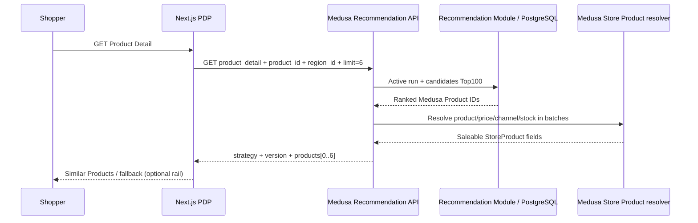

# Technical & Functional Specification — H&M Similar Products API + PDP

> **ID:** REC-PDP-SPEC · **Version:** 1.0 · **Status:** Target contract cho kế hoạch chuyên biệt.
> **Parent requirement:** SRS `FR-REC-01/02` là optional; **MUST dưới đây là MUST sau khi nhóm chọn làm PDP Recommendation**.
> **Implementation strategy:** Reuse code trên `recommendation`; xác minh trên SHA thực tế, không chép lại module đã có.
> **Plan:** [plan.md](plan.md).

## 1. Mục đích và giới hạn

Khách xem Product Detail thấy một rail **Similar Products**, tối đa sáu sản phẩm **không trùng với sản phẩm hiện tại**, từ cùng catalog Medusa. Similarity dùng H&M metadata offline; Medusa quyết định sản phẩm có thể bán, giá VND, region/channel, inventory/backorder. Fallback hiển thị sản phẩm liên quan phù hợp hoặc ẩn rail. Không yêu cầu đăng nhập, không cá nhân hóa, không đụng checkout.

**Out of scope:** Home Popularity UI mới, personalized recommendation, collaborative filtering, LLM/vector DB, real-time training, cart recommendations, user behavior/CTR. Home popularity data có sẵn được phép dùng làm fallback candidates, nhưng không thay phạm vi chính.

## 2. Actors, luồng chính và giao tiếp

1. Shopper mở `/vn/products/{handle}` qua Next.js.
2. PDP tải Medusa Store Product và region bằng cơ chế hiện có.
3. `RelatedProducts` gọi `getRecommendations(region.id, product.id)` nếu bật frontend flag.
4. Next.js Server SDK gọi Store API `GET /store/recommendations?placement=product_detail&product_id=...&region_id=...&limit=6` với publishable API key/headers hợp lệ.
5. API đọc **ready active run** và ranked candidates; dùng **native Medusa product/price/channel/inventory pipeline** để đọc lại các products hợp lệ; loại chính product, duplicates, không có giá/hết bán; lấy fallback nếu thiếu.
6. UI render `ProductPreview` dùng giá/region từ Medusa. Lỗi/timeout → related-products legacy fallback hoặc ẩn rail, không tác động checkout.



## 3. Requirement register

| ID | Priority | Requirement | Verification |
|---|---|---|---|
| PDP-FR-01 | MUST | PDP có rail tối đa **6** products, không trùng self/duplicate, không cần login | E2E 500 product context + fixture, count 0..6 |
| PDP-FR-02 | MUST | Giữ thứ tự similarity candidates sau lọc; fallback chỉ bù phần thiếu, không đảo thứ tự candidate valid | Unit/API fixture with ordered list |
| PDP-FR-03 | MUST | Dùng `ProductPreview` và Medusa region/price; mobile 360px không overflow | Next Playwright + price spot check |
| PDP-FR-04 | MUST | Lỗi API hoặc flag OFF không chặn PDP, Cart/Checkout; UI fallback/ẩn rõ | Failure/flag-off E2E + commerce regression |
| PDP-DATA-01 | MUST | H&M article ID string giữ số 0 đầu; mapping article→variant→product đúng trên DB đích | Readback SKU/variant/product, no orphan/duplicate |
| PDP-DATA-02 | MUST | Candidate contexts chỉ là Medusa Product IDs tồn tại; không gợi ý self hoặc variant cùng product khác | Offline validator + API filters |
| PDP-DATA-03 | MUST | H&M historical purchases không thành Medusa Orders; dữ liệu synthetic price/stock có provenance | Code/manifest review |
| PDP-DATA-04 | MUST | Candidate artifact có version/source hashes/config hash, được lưu ngoài Git nếu chứa dữ liệu hạn chế | Reproducibility/provenance check |
| PDP-ALG-01 | MUST | Similarity deterministic theo metadata H&M, chỉ offline; top 100/context, threshold/bias được ghi | Golden tests, repeat SHA, output validation |
| PDP-ALG-02 | SHOULD | Đánh giá human relevance (có người chấm mẫu) và Exact Category baseline; báo coverage | Signed review/score table; nếu thiếu ghi NOT_RUN |
| PDP-API-01 | MUST | API nhận `placement=product_detail`, `product_id`, `region_id`, `limit<=24` và khống chế **display<=6** | HTTP 200/400/404 tests |
| PDP-API-02 | MUST | Chỉ dùng native Medusa filters về published/channel/region/pricing/variant purchasability | Integration tests draft, out-of-channel, USD/unpriced, zero-stock/backorder |
| PDP-API-03 | MUST | API không trả `customer_id`, raw H&M IDs, customer hash, private score/metadata | Response snapshot/security tests |
| PDP-API-04 | MUST | Candidate publish idempotent; active version chỉ chuyển sau khi publish thành công; rollback an toàn | Migration/re-run/fault tests in isolated DB |
| PDP-API-05 | MUST | Candidate missing/failed → deterministic fallback; 200+[] nếu không có món hợp lệ; commerce dependency down → 503/5xx, không fake success | Backend+browser fault test |
| PDP-NFR-01 | MUST | API bounded candidate pool 100, batched Medusa reads, không per-product N+1; concurrency giới hạn | Instrumented query/batch tests |
| PDP-NFR-02 | TARGET | Benchmark PDP thật ở 30 RPS trong 60s với mixed product IDs, error<1%, 0 dropped; ghi p50/p95/p99; **mục tiêu đề xuất p95<800ms, không phải kết quả đã đạt** | k6 JSON + machine/DB profile |
| PDP-NFR-03 | MUST | Không ghi PII/secrets, private dataset vào repo/log/API | Git diff and payload review |
| PDP-NFR-04 | MUST | Hiển thị/PDP không chặn checkout hoặc thao tác chính khi Rec API chậm/lỗi | Browser E2E and regression |
| PDP-NFR-05 | MUST | Rights decision theo private/public và release GO/NO-GO có ghi nhận | Rights doc / final release report |

## 4. Dữ liệu và mapping

### 4.1 Input đã chuẩn bị

- `data/hm/articles.csv`, `data/hm/processed/catalog.jsonl`, `data/hm/processed/medusa-mapping.jsonl`; nếu cần popularity fallback, dùng candidates **đã sinh**, không đào lại `customers.csv`.
- Mapping thực tế: **nhiều H&M article variants → một Medusa Product**. Code importer nhận SKU `HM-{article_id}`; không thay `1 product = nhiều variants` thành one-to-one.
- Dataset H&M đã báo cáo `article_id` **10 chữ số** trong audit pilot; đọc string, không cắt số 0 đầu. Không dùng IDs mẫu tự tạo làm bằng chứng.
- `catalog.jsonl` chứa `product_type`, `product_group`, `section`, `department`, `garment_group`, `index_group`, `description`, `variants[].color`.
- Mapping local từ lần import khác không tự động dùng được trên DB mới. Nếu IDs thay đổi, remap **cả source context và target** bằng `scripts/hm/remap-candidates.py` sau khi so khớp article universe, rồi validate.

### 4.2 Candidate format đã dùng (JSONL)

```json
{"version":"rec-private-serving-v2","placement":"product_detail","context_key":"product:prod_...","target_product_id":"prod_...","score":0.82,"rank":1,"strategy":"hm_metadata_similarity"}
```

Đây là **schema ví dụ**, không phải bản ghi/trị số đo từ DB. Mỗi version/context không có duplicate target, ranks duy nhất, score thuộc [0,1] và sắp giảm dần/tie-break theo Product ID. Raw mapping, dataset, candidate artifacts đặt trong `data/hm/processed/` (Git ignored); chỉ aggregate evidence đã scrub vào docs.

### 4.3 Candidate generation (reuse, không tự tạo thuật toán mới)

Theo `scripts/hm/build-mvp-candidates.py` ở `recommendation`:
- Candidate blocking: **cùng `index_group`**; cần có ít nhất một match `product_type` hoặc `product_group`.
- Weighted fields: product type 0.30, product group 0.20, section 0.15, department 0.10, garment group 0.10, color Jaccard 0.05, description tokens Jaccard 0.10.
- Chỉ tính trên thuộc tính hai bên có giá trị; mẫu số hợp lệ tối thiểu 0.50; mặc định `min_score=0.70` là tham số **private pilot**, không phải tối ưu có human proof.
- Không lấy self, giữ tối đa **100 candidate/product** và tie-break deterministic. Với 500 Product pilot, file report cũ ghi 3.198 candidate rows, 167/500 contexts có ít nhất 6 ứng viên: **cần xác minh lại**.
- Similarity chỉ đo thuộc tính, không chứng minh tính phù hợp hành vi/click/conversion; không gọi là personalized.

## 5. Medusa Store API contract

### Request

```http
GET /store/recommendations?placement=product_detail&product_id=prod_...&region_id=reg_...&limit=6
x-publishable-api-key: pk_... (hợp lệ theo Medusa)
```

- `placement`: chỉ `product_detail` trong scope PDP (route hiện tại còn hỗ trợ `home`; không xóa route `home` đang chạy).
- `product_id`: Medusa Product ID của PDP hiện tại; query sai format → HTTP 400, product không truy cập được → 404.
- `region_id`: region hợp lệ; invalid/unknown → 400. Price/channel được giải quyết theo context Medusa, không nhận giá từ client.
- `limit`: số nguyên dương, tối đa 24 ở query contract hiện hữu; **số trả ra ở placement PDP tối đa 6**. Query chứa `customer_id` hoặc field ngoài allow-list bị reject 400 (theo code đã có).
- Feature flag backend `ENABLE_RECOMMENDATIONS=false` → 404; overload/timeout/dependency fail có thể trả 503. Frontend không coi 503 là trang lỗi toàn PDP.

### Success response — shape tổng quát

```json
{
  "placement":"product_detail",
  "strategy":"hm_metadata_similarity",
  "version":"rec-private-serving-v2",
  "fallback_reason":null,
  "products":[{"id":"prod_...","title":"Sample","handle":"sample","variants":[{"id":"variant_...","calculated_price":{"currency_code":"vnd"}}]}]
}
```

Payload JSON ở trên chỉ minh họa **shape/fields**, không phải ví dụ response thực tế đầy đủ hay bảo đảm schema Medusa. Khi implement/verify, snapshot actual response theo Medusa v2.21.2 được cài; `products` dùng projection an toàn chứa các trường để ProductPreview hoạt động. **Không trả** source_article_id, H&M raw dataset, private score, tokens, customer data hay metadata nội bộ.

### Fallback/response behavior

| Tình huống | API/PDP kỳ vọng |
|---|---|
| Có candidates đủ hợp lệ | Trả Top N theo rank, `strategy=hm_metadata_similarity` |
| Có một số candidate hợp lệ | Bù bằng popularity cùng group/catalog hợp lệ, có `strategy`/`fallback_reason` phản ánh thực tế |
| Context không có candidate | Catalog-based fallback hoặc `200 {products:[]}`, không bịa score |
| Product hiện tại đã unavailable | `404` từ API; PDP vẫn theo luồng native của storefront |
| Candidate store lỗi | Fallback dựa trên Store Product Medusa nếu commerce còn hoạt động |
| Redis unavailable | Bỏ cache/đi tới DB theo cơ chế Medusa; không trả snapshot tồn kho sai |
| PostgreSQL/commerce down | 503/5xx hoặc proxy timeout rõ; Next.js fallback/ẩn optional rail |
| Frontend flag OFF hoặc API flag OFF | Không ảnh hưởng render PDP/Cart/Checkout |

**Tính mua được:** Không đơn giản `inventory_quantity > 0`. Phải tuân native Medusa variant `manage_inventory`, backorder, location/channel, region/prices; giữ test để chống regression khi upgrade Medusa version.

## 6. Implementation map — tái sử dụng code đang tồn tại

| Concern | File hiện hữu trên `recommendation` | Hành động |
|---|---|---|
| Offline candidates | `scripts/hm/build-mvp-candidates.py` | Re-run, validate, sửa khi có bug |
| Candidate publish + version | `apps/backend/src/workflows/recommendation/publish.ts`, `apps/backend/src/modules/recommendation/` | Reuse migrations, rollback; không tạo module khác |
| Publish CLI | `apps/backend/src/scripts/publish-hm-recommendations.ts` | Verify active run và test DB isolation |
| API | `apps/backend/src/api/store/recommendations/route.ts` | API contract & failure/security review |
| Medusa pricing/channel adapter | `apps/backend/src/modules/recommendation/store-products.ts` | Version-pinned: test lại khi nâng Medusa |
| Next data adapter | `apps/storefront/src/lib/data/recommendations.ts` | Test headers, region, feature flag, timeout |
| PDP section | `apps/storefront/src/modules/products/components/related-products/index.tsx` | UX, accessibility, fallback, tests |
| Test | `apps/backend/integration-tests/http/recommendations.spec.ts`, `apps/storefront/e2e/recommendations.spec.ts` | PDP-specific, error, region, flags, mobile |

## 7. Bảo mật, quyền dữ liệu và NFR

- **Private pilot ≠ Public release.** `docs/recommendation/dataset-rights-decision.md` hiện NO-GO public. Không tái phân phối H&M CSV/ảnh, private candidate export khi thiếu quyền.
- Không query/ghi raw H&M customers, không lưu customer histories vào Medusa Orders, không nhận arbitrary customer_id.
- Mọi DB migration/down/up/test-write phải dùng **test database được nhận diện rõ**, không database commerce dùng chung.
- Không log payment/cart/customer info từ API gợi ý; không tạo tracking mới trong scope này.
- Frontend flag (`NEXT_PUBLIC_ENABLE_RECOMMENDATIONS`) có thể được bake tại build-time; khi thay đổi ở production Next phải rebuild.
- Mục tiêu PDP load **đề xuất**: 30 RPS/60s mixed product contexts, error<1%, 0 dropped, p95<800ms với 500-product pilot; đo bổ sung warm/cold và CPU/RAM/DB connections. Không suy hiệu năng PDP từ báo cáo Home.
- API route hiện có phụ thuộc export nội bộ của Medusa 2.21.2 và có 4s deadline/in-flight cap; khi upgrade cần HTTP regression, không coi ổn định API internal là bảo đảm.

## 8. Bộ test bắt buộc và trạng thái evidence

| Test ID | Nội dung | Giai đoạn |
|---|---|---|
| PDP-T01 | Python candidate ordering/threshold/self/no duplicates/determinism | 02 |
| PDP-T02 | Mapping article→variant/product/SKU, stale mapping failure | 01–02 |
| PDP-T03 | Publish same version twice, failed batch keeps active, restore ready version | 03 |
| PDP-T04 | Invalid limit/placement/product/region/customer_id, status 400/404 | 03 |
| PDP-T05 | Draft, no price, wrong channel/region, zero-stock & backorder | 03 |
| PDP-T06 | Empty/no candidates, all filtered, candidate store outage, Redis stopped | 03–05 |
| PDP-T07 | PDP shows ≤6, excludes current, no duplicates, valid links/price | 04–05 |
| PDP-T08 | PDP H&M context, non-H&M product context, no image, no suitable match | 04–05 |
| PDP-T09 | Feature ON/OFF, backend OFF while frontend ON, API 503/timeout | 04–05 |
| PDP-T10 | 360px/mobile, keyboard heading/link accessibility, no horizontal overflow | 04–05 |
| PDP-T11 | Cart/Checkout/Payment failure/Order regression | 05 |
| PDP-T12 | k6 diverse product IDs, p50/p95/p99/errors/dropped, resource profile | 05 |
| PDP-T13 | Rights decision + human sample relevance (actual labels) | 02, 06 |
| PDP-T14 | Target branch CI/PR, release flag, rollback and active pointer | 06 |

**Không thể đánh dấu PASS từ tài liệu đơn thuần.** Với test chưa chạy: `NOT_RUN`, với quyền thiếu: `BLOCKED`, với fail: `FAIL`. Private pilot có thể PASS kỹ thuật nhưng `PUBLIC NO-GO` nếu rights/human review còn thiếu.

## 9. Acceptance / release matrix

| Gate | Tiêu chí | Kết quả ở thời điểm lập plan |
|---|---|---|
| Offline candidates | Dữ liệu hợp lệ, deterministic, no self, mapping đúng | Có báo cáo private cũ; cần re-run trên target |
| API | Response đúng, products valid, fallback, no PII | Có code và HTTP tests cũ; cần re-run |
| PDP UI | 0..6 products, mobile, flag-off/failure | Có code/E2E cũ; cần re-run |
| Performance | **PDP-specific** mixed contexts workload | **Chưa có benchmark PDP đủ phạm vi** |
| Human relevance | Người đánh giá sample, ghi nhãn | **NOT_RUN** trong báo cáo hiện hữu |
| Public data rights | Giấy phép/điều khoản và quyết định public | **NO-GO** hiện tại |
| Main integration | Code integrated via reviewed PR, CI pass | **Chưa có trên main** |

## 10. Quy tắc thay đổi spec

Nếu phải đổi API shape, metadata fields, threshold, candidate schema hoặc source data: cập nhật spec/ADR/implementation/tests **cùng PR**, tạo model version mới với checksum khác; không silently đổi ready run. Đọc [runbook hiện có](../runbook.md) để tái lập test/publish/rollback. Mọi báo cáo mới phải nằm trong `docs/recommendation/pdp/reports/`.
