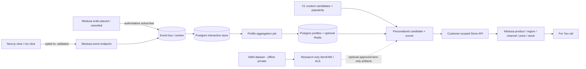

# Personalized Recommendation Engine — Master Implementation Plan

> **ID:** PERS-PLAN-01 · **Version:** 1.1 · **Status:** PARTIALLY IMPLEMENTED; NOT RELEASED · **Date:** 2026-11-07
> **Scope:** cá nhân hóa cho logged-in Customer và (giai đoạn sau) guest session có quyền xử lý dữ liệu; private-first.
> **Specification:** [spec.md](spec.md) · **Protocol:** [evaluation_protocol.md](evaluation_protocol.md) · **Index:** [README.md](README.md).

## 1. Mục tiêu kinh doanh và điều không được nhầm lẫn

Khách A xem nhiều áo thun và đã mua áo đen: hệ thống ưu tiên các áo phù hợp với A. Khách B xem váy thì danh sách khác. Khách chưa có lịch sử hoặc không cho phép cá nhân hóa được phục vụ bằng Popular Products/Metadata Similarity hiện có. Không chặn mua hàng.

**Phân biệt:** H&M `customer_id` thuộc dataset nghiên cứu lịch sử, **không liên quan** tài khoản Medusa. Không nối, suy danh tính hoặc nhập H&M transactions thành Medusa Orders. Báo cáo V2 LAION OpenCLIP là visual relevance research, không phải dữ liệu hành vi người dùng trên storefront. Các nhãn Astra là proxy cho product similarity, không phải nhãn cá nhân hóa.

**In scope (MVP):** logged-in customers có lựa chọn cá nhân hóa hợp lệ; product view, recommendation click, Medusa order-derived purchase; hồ sơ sở thích; 12 cards “Dành cho bạn” ở Home hoặc Account, fallback; API được bảo vệ; consent/withdraw/delete; unit/integration/E2E/performance. Session guest chỉ khi đủ privacy controls.

**Out of scope (MVP):** liên kết H&M customers với khách thật, live-training bằng ảnh, deep ranking/transformer, inferencing model trong HTTP, random user IDs từ client, gửi PII/behavior đến Hugging Face, public launch chưa xác nhận quyền, A/B uplift khi chưa đủ traffic.

## 2. Baseline xác thực và rủi ro hiện tại

| Thành phần | Evidence | Quyết định |
|---|---|---|
| Git | Local `recommendation-pdp` tại SHA `cf16e0ba2e2af3519f79f5d1b516708d64a28605` khi audit; có thay đổi Hybrid V2 chưa commit. Trạng thái remote cần kiểm tra lại. | Không giả định mọi thứ đã merge; không ghi đè thay đổi chưa commit. |
| Current rec | Recommendation module/publisher và `GET /store/recommendations` hỗ trợ Home/`product_detail`; chưa thấy per-customer pipeline trên các remote này. | Reuse valid product resolution, version/fallback; không cấy `customer:<id>` vào public candidate table. |
| Dữ liệu H&M | Đã đo tại máy: 500 Products, 1.874 articles/Variants trong mapping, 979.342 giao dịch khớp catalog. Trạng thái ảnh cần kiểm tra theo từng môi trường. | Chỉ nghiên cứu offline; báo rõ sai lệch do chọn catalog và khác biệt với người dùng storefront. |
| Hybrid V2 | Nhãn Astra proxy: V1 nDCG@6 0,9152; weighted V2 0,8974. Chưa chứng minh khác biệt chắc chắn. DB `commerce` được kiểm tra chưa có bảng recommendation. | Dùng logic metadata V1 làm đầu vào khi có candidate run hợp lệ; V2 giữ đóng băng và không tự kích hoạt. |
| PDP throughput | PDP test đã báo 30 RPS / 60s có nhiều 503/capacity, không đạt NFR. | Phase 06/08 phải profile tối ưu Medusa Store hydration trước khi nhận SLO personalization. |
| Quyền và PII | H&M redistribution/public rights chưa xác nhận; customer behavior là personal data. | Private sandbox; separate legal/privacy decision và deletion tests trước go-live. |

## 3. Chiến lược 3 bậc (cần giữ thứ tự)

**Bậc A — Personalized Rules (MVP/ưu tiên P0):** sử dụng profile xây từ views, clicks, purchases thực của website; lấy candidate qua V1 metadata, co-view/co-buy khi đủ dữ liệu, popularity cho cold-start; score và re-rank offline/nhẹ, không ML model service. Mục tiêu là end-to-end có privacy & tests.

**Bậc B — Collaborative Filtering (P1/experimental):** H&M offline để benchmark Item-KNN/Implicit ALS/BPR trên *H&M users trong sandbox*; nếu có traffic website thật, đánh giá CF trên Medusa interactions riêng, chỉ promote sau holdout & rights gate. Không copy user factors H&M sang Medusa.

**Bậc C — Advanced personalization (future P2):** embeddings content/image, two-tower, learned ranking, contextual bandits/A-B khi có đủ consented impressions/clicks/orders; không yêu cầu cho đồ án MVP.

## 4. Kiến trúc đề xuất

- **Identity:** server derives actor from Medusa Auth; guest has optional opaque short-lived session only after proper controls. Never accept `customer_id` as query parameter.
- **Source of truth:** product, stock, pricing, orders remain Medusa; profile/interactions are disposable derived features; only Medusa order events count as purchases.
- **Privacy:** default no personalized tracking; consent/withdraw, data minimization, retention/erasure, no cross-user cache.
- **Serving:** 100–300 preselected IDs (configurable), bounded hydration using existing Medusa semantics, `Cache-Control: private, no-store`, feature flags and safe generic fallback.
- **Failure:** profiling/model/Redis unavailable → known-good V1 generic recommendations. Commerce outage means product availability cannot be guaranteed; never fabricate sellability.

## 5. Phase table and dependencies

| Phase | Ước tính ngày công | Bắt đầu khi | Exit gate và kết quả bắt buộc |
|---|---:|---|---|
| [00 Baseline](phase_00_baseline_feasibility.md) | 1–2 | Có repo, docs | Source+DB/data audit; identity/privacy decisions; no unsafe rights assumptions. |
| [01 Identity & consent](phase_01_identity_consent_privacy.md) | 2–3 | 00 | Consent state/withdraw/delete design & authorization tests. |
| [02 Event pipeline](phase_02_interaction_events.md) | 3–4 | 01 | Server-validated view/click + order subscriber, dedupe, replay tests. |
| [03 Profiles](phase_03_customer_session_profiles.md) | 2–3 | 02 | Deterministic customer/category/item profiles; staleness, deletion, opt-out. |
| [04 Behavioral ranker](phase_04_behavioral_mvp_ranker.md) | 3–4 | 03 + V1 catalog | Personalized vs generic differs under crafted profiles; baseline/fallback tests. |
| [05 CF research](phase_05_collaborative_filtering_research.md) | 3–5 (optional P1) | 00/02; H&M rights | Reproducible temporal H&M CF evaluation; **not required for MVP launch**. |
| [06 API/UI](phase_06_serving_api_storefront.md) | 3–4 | 04 | Secure API + For You UI, no identity leakage, E2E. |
| [07 Evaluation](phase_07_evaluation_quality_gates.md) | 2–3 + label/traffic time | 04/06; 05 optional | Offline/online instrumentation, honest baseline comparison, GO/NO-GO. |
| [08 Reliability/release](phase_08_reliability_release.md) | 2–3 | 06/07 | Full regression, per-user isolation, k6, privacy/rights/runbook, rollout gate. |

**Tổng MVP P0:** ~18–26 ngày công kỹ thuật (không cộng Phase 05, external reviews, traffic collection); đây là estimate, không phải kết quả chạy. P1 CF có thể làm song song như R&D; không block P0. Phase 01/02 có thể tạo dữ liệu QA synthetic, tuyệt đối không dựng “user thật” từ H&M.

## 6. Success criteria (đề xuất phải chốt Phase 00)

1. **Correctness:** với hai tài khoản consented có histories khác nhau, ra danh sách khác nhau khi sở thích đủ phân biệt; trường hợp no history, opt-out, guest trả generic an toàn.
2. **Security:** 0 trường hợp lộ profile, recommendations cache hoặc lịch sử khách B cho khách A; API không có `customer_id` input. Delete/withdraw xóa dữ liệu phục vụ và chặn tái sinh từ raw events.
3. **Behavior:** event dedup, order cancellation compensation, no client-forged purchase, anonymous identity expires.
4. **Offline:** baseline V1-popularity, category rules, Item-KNN/ALS only after eligible dataset; report Recall@12, nDCG@12, coverage, cold-start and fairness slices; no leakage.
5. **Serving:** bounded queries + load test; workload đề xuất 10 RPS pilot và 30 RPS target, error <1%, latency measured over successful responses separately; existing PDP 30 RPS failures remain blocking if shared bottleneck persists. Thresholds are **proposed**, not achieved.
6. **Business:** never claim CTR, conversion or revenue uplift without logged impressions/online test of adequate sample and controls.
7. **Release:** private test first; public demo requires H&M rights and Vietnam personal data law review; privacy controls verifiably working.

## 7. Reporting & delivery

For each phase create `docs/recommendation/personalization/reports/phase_NN_report.md` with baseline SHA/dirty state, commands+exit code, modified files, unit/integration/e2e result, measured metric, acceptance matrix, blockers and rollback. At end `system_test_report.md`, `final_implementation_report.md`. Report `NOT_RUN` and `BLOCKED` honestly. All new docs in this folder. No destructive DB reset, force push, public storage or synthetic uplift claim.

## 8. Source references

- [Medusa protected API routes](https://docs.medusajs.com/learn/fundamentals/api-routes/protected-routes)
- [Medusa events/subscribers](https://docs.medusajs.com/learn/fundamentals/events-and-subscribers)
- [Google: candidate generation/scoring/re-ranking](https://developers.google.com/machine-learning/recommendation/overview/types)
- [Implicit collaborative filtering library](https://benfred.github.io/implicit/)
- [Vietnam Personal Data Protection Law 91/2025/QH15](https://bocongan.gov.vn/chinh-sach-phap-luat/co-so-du-lieu-van-ban/luat-bao-ve-du-lieu-ca-nhan-1753688803)

## 9. Quyết định hợp nhất và trạng thái triển khai

Kế hoạch này kết hợp ZIP `HM_Personalized_Recommendation_Engine_Plan.zip` với [kết quả kiểm tra dữ liệu tại máy](data-readiness.md) và [quyết định đóng băng V2](v2-freeze.md). P0 sử dụng hành vi phát sinh từ tài khoản Medusa đã chọn tham gia. Lịch sử khách H&M chỉ phục vụ nghiên cứu offline P1; không tự gán lịch sử đó cho người đăng ký thật. Persona demo phải được ghi rõ là dữ liệu mô phỏng hoặc được gắn thủ công theo chính sách riêng.

**[VERIFIED]** DB `commerce` có 500 sản phẩm H&M và 40 customer rows, nhưng chưa có bảng `recommendation_active`; vì vậy chưa thể xác nhận V1 hay V2 đang active ở DB đó. CSV có 31.788.324 giao dịch; 979.342 giao dịch khớp 500 Products, tương đương 3,08%. Chỉ 4.112 giao dịch khớp ở khoảng test thời gian đề xuất. Đây là số liệu sẵn sàng dữ liệu, chưa phải độ chính xác của mô hình.

**[IMPLEMENTED IN CODE, DEFAULT OFF]** Đã tạo module consent/event/profile, workflow, API cá nhân hóa và Home rail. Chưa chạy migration hoặc bật tính năng trên `commerce`. Kết quả kiểm thử phải xem báo cáo từng phase; tài liệu kế hoạch không tự chứng minh release readiness.

**[BLOCKER FOR PUBLIC RELEASE]** Quyền công khai dữ liệu/ảnh H&M và chính sách xử lý, lưu, xóa dữ liệu khách hàng cần được xác nhận riêng. Cho đến khi có quyết định, chỉ thử nghiệm trên DB test riêng với các cờ mặc định tắt. Luật và nghĩa vụ cụ thể cần được người phụ trách xác minh từ nguồn hiện hành; liên kết tham khảo ở trên không thay thế phê duyệt pháp lý.

Thứ tự P0: Phase 00 → 01 → 02 → 03 → 04 → 06 → 07 → 08. Phase 05 là nghiên cứu độc lập, không chặn MVP. Không chạy migration trên `commerce` chỉ để hoàn thành kế hoạch.
