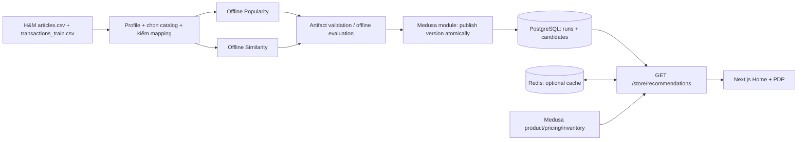

# Implementation Plan — H&M Popularity & Similar Products MVP

> **Document ID:** REC-PLAN · **Version:** 2.0 · **Reviewed baseline:** 2026-11-04
> **Status:** IMPLEMENTED — private pilot; xem [báo cáo tổng hợp](reports/final_implementation_report.md). Public release NO-GO.
> **Scope:** Hai vị trí gợi ý: **Popular Products** (trang chủ, mục tiêu 12 sản phẩm) và **Similar Products** (Product Detail, mục tiêu tối đa 6 sản phẩm).
> **Document owner:** Recommendation/Data lead; Backend, Frontend và QA/DevOps review.
> **Specification:** [spec.md](spec.md) · **Parent requirements:** [Project Definition](../01_Project_Definition.md), [Scope](../02_Project_Scope_and_Assumptions.md), [SRS](../03_Software_Requirements_Specification.md).

## 1. Tóm tắt dễ hiểu

Nhóm dùng dữ liệu H&M để **tính trước** hai danh sách: sản phẩm được mua nhiều trong lịch sử H&M và các sản phẩm giống nhau về thuộc tính. Python tạo danh sách offline; Medusa lưu và kiểm tra sản phẩm còn có thể bán; Next.js chỉ hiển thị kết quả. Khi hệ thống gợi ý gặp lỗi, trang mua hàng vẫn hoạt động. Đây là **gợi ý không cá nhân hóa**, không phải một hệ thống AI/LLM hay collaborative filtering.

**Không nằm trong MVP:** cá nhân hóa theo customer, cart recommendation, frequently bought together, ML embedding, vector DB, tracking CTR/conversion, real-time training, service Python phục vụ request, thay đổi Cart/Checkout/Order/Payment, import lịch sử H&M thành Medusa Orders.

**Ưu tiên:** Recommendation là phần **COULD/Optional** theo tài liệu dự án. Không trì hoãn các yêu cầu bắt buộc Tuần 7–12 (payment idempotency, notification, cloud, observability, NFR) để làm gợi ý.

## 2. Baseline và sự thật cần kiểm tra

| Thành phần | Bằng chứng đã biết | Chưa thể kết luận |
|---|---|---|
| Source | `main` GitHub: `f4845ba6e240288c2ed7dbe8d3156ac5cbfc7f12`; `recommendation`: `a98457c3de911963d12878b9143c996df017732a` tại lần kiểm 2026-11-04. | File kế hoạch cũ nêu merge local `024bf27`, **chưa thấy commit này trên remote**; cần kiểm tra/push branch phù hợp. |
| ETL | `scripts/hm/prepare.py` tạo `catalog.jsonl`/manifest, tùy chọn interactions; `build-popularity-candidates.py` ánh xạ sang Medusa Product ID. | Chưa có report coverage của tập mua được xác nhận ở DB hiện tại. |
| Catalog pilot | README và plan cũ ghi 500 Medusa Products, 1.874 Variants/Inventory Levels; importer là `apps/backend/src/scripts/import-hm-catalog.ts`. | Đây là kết quả local được báo cáo, **không phải đã query lại database đang chạy**. |
| Selection | `prepare.py` chọn `sorted(groups)[:max_products]`; một product là nhóm articles theo product code + type/group/department/section. | 500 nhóm đầu chưa chắc đại diện cho phân bố lịch sử mua; 5k–10k không phải điều kiện bắt buộc của MVP này. |
| Giao diện | Có homepage collection và `RelatedProducts` trên PDP; `ProductPreview` hỗ trợ placeholder. | Chưa có Popularity/Similarity chạy từ model hoặc online API. |
| Serving | Medusa v2 + PostgreSQL + Redis có sẵn; chưa thấy route `/store/recommendations`/custom module tương ứng. | Không tuyên bố đã có active version/candidate store/cache cho recommendation. |

**Nguồn repo:** [`prepare.py`](https://github.com/kieuquy283/EnterpriseE-commercePlatform/blob/main/scripts/hm/prepare.py), [`import-hm-catalog.ts`](https://github.com/kieuquy283/EnterpriseE-commercePlatform/blob/main/apps/backend/src/scripts/import-hm-catalog.ts), [`scripts/hm/README.md`](https://github.com/kieuquy283/EnterpriseE-commercePlatform/blob/main/scripts/hm/README.md), [`RelatedProducts`](https://github.com/kieuquy283/EnterpriseE-commercePlatform/blob/main/apps/storefront/src/modules/products/components/related-products/index.tsx).

> **Audit limitation:** Chỉ đối chiếu files và GitHub; chưa chạy local Python, Medusa, PostgreSQL hoặc k6 trong phiên lập plan. Không ghi các kết quả đề xuất như thể đã đạt.

## 3. Kiến trúc mục tiêu



- **Source of truth:** Medusa Product, Pricing, Region, Sales Channel, Inventory và Order vẫn thuộc Medusa; dữ liệu gợi ý chỉ là **read model**.
- **Offline:** Python chạy bằng job/script, không hoạt động trên đường request HTTP.
- **Serving:** phiên bản candidate đã publish ở PostgreSQL; Redis tăng tốc tùy chọn; không làm thay đổi checkout.
- **Data rights:** mọi dữ liệu và ảnh dùng trong demo công khai phải được rà quyền sử dụng; có thể thay bằng assets được phép hoặc demo hạn chế truy cập.
- **Lỗi:** Redis lỗi → đọc PostgreSQL; không có candidates hợp lệ → Medusa catalog fallback; nếu chính commerce backend/DB lỗi thì không thể cam kết vẫn trả sản phẩm.

## 4. Danh sách phase, phụ thuộc, đầu ra

| Phase | File | Mô tả một câu | Điều kiện bắt đầu | Exit gate bắt buộc |
|---|---|---|---|---|
| **00 — Baseline & Rights** | [phase_00_baseline_rights.md](phase_00_baseline_rights.md) | Chốt commit/code đang làm và quyền dùng H&M trước khi mở tính năng. | Có quyền xem repo và dữ liệu nguồn nội bộ | Branch baseline + rights decision + không publish dữ liệu nhạy cảm |
| **01 — Data Readiness** | [phase_01_data_readiness.md](phase_01_data_readiness.md) | Kiểm tra 500 Products, giao dịch và mapping Medusa để biết dữ liệu có đủ dùng. | Phase 00; catalog/CSV/mapping hoặc ghi nhận blocker | Coverage report + đối soát DB + quyết định giữ 500 hay mở rộng |
| **02 — Popularity Offline** | [phase_02_popularity_offline.md](phase_02_popularity_offline.md) | Tính danh sách Top-K từ lượt mua lịch sử và đánh giá không bị leakage. | Phase 01 | Candidate + train-only evaluation + tests deterministic |
| **03 — Similarity Offline** | [phase_03_similarity_offline.md](phase_03_similarity_offline.md) | Tính Top-K theo loại/nhóm/màu/mô tả và kiểm tra tính hợp lý. | Phase 01; có thể làm song song Phase 02 | Candidate + kiểm tra self/duplicate/score + manual evaluation |
| **04 — Candidate Publishing** | [phase_04_candidate_publishing.md](phase_04_candidate_publishing.md) | Lưu và kích hoạt phiên bản candidates trong Medusa an toàn, có rollback. | Phase 02 & 03 pass | Versioned data/migration + idempotent publish + rollback test |
| **05 — Recommendation API** | [phase_05_serving_api.md](phase_05_serving_api.md) | Trả sản phẩm hợp lệ qua Store API, lọc/cấp giá bởi Medusa và fallback. | Phase 04 | HTTP integration tests + failure behavior + no N+1 |
| **06 — Storefront Integration** | [phase_06_storefront.md](phase_06_storefront.md) | Hiển thị Popular 12 ở Home và Similar tối đa 6 ở PDP không chặn mua hàng. | Phase 05 | UI/E2E tests + feature flag + responsive/fallback |
| **07 — Evaluation & Release** | [phase_07_evaluation_release.md](phase_07_evaluation_release.md) | Đánh giá thuật toán, đo latency, xem xét data rights và quyết định đưa vào demo. | Phase 06; offline evaluation có từ Phase 02/03 | Report và release decision (GO/NO-GO) |

**Lưu ý:** Phase là **work package**, không đồng nghĩa tuần học. Phase 02 và 03 được phép làm song song; Phase 04 không được bắt đầu trước khi mapping và hai artifact pass. Nếu core hệ thống chưa ổn định, dừng optional track ở một gate rõ ràng.

## 5. Yêu cầu và thiết kế được khóa ở `spec.md`

- **REC-FR-01/02:** 12 Popular ở Home và tối đa 6 Similar trên PDP; không cần login; không cá nhân hóa.
- **REC-ALG-01/02:** Popularity từ purchase counts theo Medusa Product ID và content similarity theo metadata; split thời gian cho đánh giá.
- **REC-DATA-01..04:** ID mapping chính xác, không nhập transaction thành Order, provenance và quyền sử dụng, published/region/price/inventory check.
- **REC-API-01..05:** `GET /store/recommendations`, valid input, StoreProduct data, dedupe/fallback, versioning, no customer ID.
- **REC-NFR-01..05:** determinism, safe failure, security/privacy, latency đo theo workload, bounded DB connections.

Các API/data model cụ thể là **contract dự kiến** và phải được rà tương thích Medusa 2.21.2 trước coding. Nếu cần sửa spec, cập nhật theo PR có lý do và test.

## 6. Quy tắc triển khai và bàn giao cho Codex

1. **Một PR theo phase (hoặc phần nhỏ có test)**, không thay đổi code/DB ở phase khác nếu chưa qua gate. PR chứa code, test, bản cập nhật phase document và evidence paths tương ứng.
2. **Không tự push hoặc reset branch** khi local có thay đổi; chốt baseline; không merge remote `recommendation` cũ nguyên khối khi đang diverged.
3. **Không chỉnh các bảng commerce bằng SQL trực tiếp**, không fork Medusa core, không thay giá/tồn kho bằng số liệu H&M.
4. **Không lưu secrets/customer hashes/raw CSV/images trong Git**. Các sản phẩm và ảnh công khai chỉ dùng khi đã xác minh quyền.
5. **Không dùng `docker compose down -v`** hoặc xóa dữ liệu Medusa để xử lý lỗi import; database backup trước migration và thử trên môi trường biệt lập.
6. **Không chạy k6 checkout trên DB demo có đơn hàng thật/cần giữ**; Recommendation API dùng benchmark riêng.
7. **Không nâng scope** lên ML cá nhân hóa hoặc 10k Products nếu Phase 01 chưa chỉ ra lợi ích và ngân sách tài nguyên cho phép.
8. Mỗi phase có mục **Stop/Go**: không đạt phải ghi blocker/decision thay vì tự đoán kết quả.

## 7. Cấu trúc tài liệu bắt buộc

```text
docs/
  recommendation/
    plan.md                         # Tổng quan, dependency, roadmap, quyết định
    spec.md                         # Yêu cầu, API, dữ liệu, thuật toán, NFR, acceptance
    phase_00_baseline_rights.md
    phase_01_data_readiness.md
    phase_02_popularity_offline.md
    phase_03_similarity_offline.md
    phase_04_candidate_publishing.md
    phase_05_serving_api.md
    phase_06_storefront.md
    phase_07_evaluation_release.md
    evidence/                       # Tạo sau khi có log/report thực, không tạo kết quả giả
```

**Mọi tài liệu mới** (ADR, rights decision, coverage report, evaluation report, benchmark, release checklist) chỉ đặt trong `docs/recommendation/` hoặc thư mục con `docs/recommendation/evidence/`. Code, test và dữ liệu xử lý vẫn đặt đúng thư mục kỹ thuật (`scripts/hm`, `apps/backend`, `apps/storefront`, `load`, `data/hm/processed`); `data/hm` không được commit.

### Template tối thiểu cho việc cập nhật từng `phase_*.md`

Mỗi phase document phải có: **(1) Mô tả đơn giản — vì sao làm; (2) Dependencies; (3) Inputs; (4) Tasks và đường dẫn code; (5) Outputs/evidence; (6) Acceptance criteria với pass/fail; (7) Risks & rollback; (8) PR/owner/status**. Các file phase được tạo cùng bộ plan này là bản hướng dẫn triển khai; khi chạy thật, bổ sung kết quả, commit SHA và evidence, không xóa phần kế hoạch ban đầu.

## 8. Cross-phase Definition of Done (DoD)

- [ ] Source branch/commit, license/rights và catalog mapping được xác nhận.
- [ ] Mỗi offline artifact có source SHA/checksum, catalog selection, config và model version.
- [ ] Test không leakage với evaluation split; Popularity/Similarity có baseline/quality report.
- [ ] Publish candidates chạy lại không tạo trùng, version active chỉ đổi sau khi batch hoàn chỉnh.
- [ ] API trả đúng region/sales channel/price và chỉ products đủ điều kiện mua; không N+1.
- [ ] UI đáp ứng responsive, loading/empty/error và có thể tắt bằng feature flag.
- [ ] Checkout/Order không gọi/không phụ thuộc recommendation; core regression pass.
- [ ] Có latency/error/availability/failure benchmark; chưa đạt thì báo rõ.
- [ ] Public demo không phát tán dữ liệu/ảnh không được phép.
- [ ] Mỗi phase có evidence hoặc blocker và review decision.

## 9. Nguồn tham chiếu

- Plan gốc do nhóm cung cấp: `hm-popularity-similar-products-plan.md` (9 bước R-01..R-09, scope hai placements).
- [`docs/architecture/hm-recommendation-implementation-plan.md`](https://github.com/kieuquy283/EnterpriseE-commercePlatform/blob/main/docs/architecture/hm-recommendation-implementation-plan.md) — roadmap dài hạn.
- [`docs/architecture/cloud-system-architecture.md`](https://github.com/kieuquy283/EnterpriseE-commercePlatform/blob/main/docs/architecture/cloud-system-architecture.md) — boundary cloud.
- [`scripts/hm/README.md`](https://github.com/kieuquy283/EnterpriseE-commercePlatform/blob/main/scripts/hm/README.md) — báo cáo pilot/công cụ hiện có.

**Change log:** v2.0 — chia 8 phase, thêm baseline/rights, data gates, offline evaluation trước publishing, API contract và release checklist; thống nhất tài liệu trong `docs/recommendation/`.

## Execution record — 2026-11-04

Baseline thực tế: `recommendation` / `de9b437f613d9cff300428f5e6e6161ed441ad62`; remote recommendation khớp sau fetch. Local merge `024bf27` có thật trong lịch sử; bảng baseline cũ ở trên được giữ như lịch sử audit, không dùng để điều khiển triển khai.

Phase 00 PASS cho private development; Phase 01 đã profile CSV và đối soát DB local. Reports trong [reports](reports/). Offline implementation được hợp nhất vào `scripts/hm/build-mvp-candidates.py` để dùng cùng mapping/version/config cho cả hai placement; không thay script legacy đang có người dùng sử dụng. Public NO-GO; manual similarity review là gate độc lập, không thể thay bằng unit tests. Không tự publish khi chưa qua gate đó.
