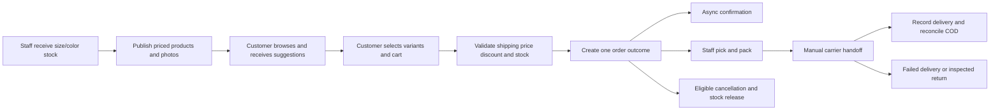
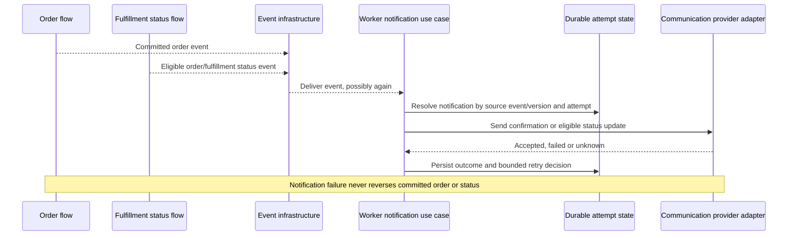

```mermaid
stateDiagram-v2
  [*] --> OrderAccepted
  OrderAccepted --> Picking: Staff review
  Picking --> HandedToCarrier: Fulfillment and manual handoff
  OrderAccepted --> Cancelled: Eligible cancellation
  Picking --> Cancelled: Eligible before shipment
  HandedToCarrier --> DeliveryConfirmed: Carrier evidence
  HandedToCarrier --> DeliveryException: Failed or disputed delivery
  DeliveryException --> ReturnInspected: Parcel returned
  ReturnInspected --> RestockOrDispose: Staff disposition
  DeliveryConfirmed --> CODReconciled: Collection evidence verified
  CODReconciled --> [*]
  Cancelled --> [*]
  note right of OrderAccepted: Business view only; payment and fulfillment have separate native states
```

<a id="daymark--end-to-end-business-flows"></a>
# DAYMARK — luồng nghiệp vụ xuyên suốt

[Đặc tả lấy nghiệp vụ làm gốc](../README.md#primary-business-first-specification) được ưu tiên về phạm vi và chính sách. Tài liệu này ánh xạ ý định sang triển khai DAYMARK, giữ đề xuất chưa đối chiếu thống nhất. Xem [ánh xạ và quyết định còn mở](../technical/requirements-mapping.md); có mã không đồng nghĩa chính sách mở đã được duyệt.

Đây là hợp đồng luồng nghiệm thu cho [FR-01–FR-09](01-business.md#functional-requirements-and-flow-ownership), mô tả hành vi bắt buộc, không khẳng định mọi nhánh đã có. Chuyển trạng thái, ranh giới giao dịch và thời điểm giữ tồn thực tế của Medusa cần kiểm chứng với phiên bản đã cài. Sơ đồ dùng khái niệm nghiệp vụ, không tự đặt giá trị enum chưa có tài liệu.

<a id="whole-business-journey"></a>
## Hành trình toàn nghiệp vụ



Thao tác thủ công cần tác nhân và bằng chứng; không được giả định API vận chuyển để lấp chỗ trống. Tương tác thành phần và quyền sở hữu lưu trữ ở [kiến trúc](03-architecture.md), [dữ liệu/API](04-data-api.md).

<a id="flow-01--registration-and-login"></a>
## FLOW-01 — đăng ký và đăng nhập

**Mục đích / tác nhân:** FR-01; khách thiết lập danh tính và chỉ truy cập thông tin của mình.

- **Kích hoạt/tiền điều kiện:** Khách chọn đăng ký/đăng nhập qua HTTPS. Backend và kho xác thực truy cập được. Danh mục công khai vẫn duyệt được không cần tài khoản.
- **Luồng chính:** Kiểm tra thông tin xác thực và hồ sơ; dùng xác thực Medusa được hỗ trợ; hoàn thành bước xác minh đã cấu hình; thiết lập phiên; tạo/liên kết bản ghi khách khi cần; hiển thị tài khoản và lịch sử đơn sở hữu. Đăng xuất xóa phiên cục bộ và gọi hành vi đăng xuất được hỗ trợ.
- **Thay thế/thất bại:** Dữ liệu sai có hướng dẫn theo trường; thông tin đăng nhập sai có thông báo không nhạy cảm. Email đã có không được âm thầm tạo khách thứ hai. Nếu cần xác minh, hoàn tất tài khoản phải chờ luồng xác minh được cấu hình và gửi được. Lỗi phụ thuộc trả lỗi có thể thử lại, không giả đăng nhập.
- **Dữ liệu/hậu điều kiện:** Danh tính xác thực và khách ở PostgreSQL qua Medusa; token phiên trong cookie storefront HTTP-only an toàn. Không ghi log mật khẩu/token. Phân giải danh tính phía server.
- **Nghiệm thu:** Đăng ký/nhập/xuất; nhánh xác minh được cấu hình; trùng email; hết phiên; khách A không đọc/sửa hồ sơ hoặc đơn khách B. Dữ liệu thử là tổng hợp.

<a id="flow-02--catalog-search-and-suggestions"></a>
## FLOW-02 — danh mục, tìm kiếm và gợi ý

**Mục đích / tác nhân:** FR-02; khách tìm quần áo và biến thể hợp lệ.

- **Kích hoạt/tiền điều kiện:** Khách mở bộ sưu tập, tìm từ khóa, dùng bộ lọc hỗ trợ hoặc mở sản phẩm. Sản phẩm công bố có ảnh được phép, giá, biến thể và tồn kho.
- **Luồng chính:** Phân giải thị trường/vùng và kênh; lấy sản phẩm công khai theo khả năng hiển thị thương mại gốc; tìm/lọc/sắp xếp trên toàn kết quả; phân trang; hiển thị ảnh và chọn kích cỡ/màu. Lấy gợi ý không cá nhân hóa trong giới hạn thời gian/tài nguyên và kiểm tra bán được trước hiển thị.
- **Thay thế/thất bại:** Không có kết quả có trạng thái rỗng hữu ích. Không thêm biến thể không khả dụng như hàng bán được. Ảnh lỗi có khung thay thế trung tính. Gợi ý timeout/tắt/không ứng viên thì bỏ vùng hoặc dự phòng bằng danh mục hợp lệ, không chặn trang. Cá nhân hóa cần cổng đồng ý/danh tính riêng.
- **Dữ liệu/hậu điều kiện:** Danh mục/giá/tồn do Medusa sở hữu trong PostgreSQL. Byte ảnh là đối tượng S3 riêng đi qua proxy ảnh công khai được duyệt. Bản ghi ứng viên/phiên bản đã công bố ở PostgreSQL; artifact nguồn ngoại tuyến không trở thành đơn hàng.
- **Nghiệm thu:** Tìm, kích cỡ/màu, sắp xếp và phân trang quá 100 kết quả; phân phối đúng URL ảnh; loại bản nháp/sai kênh; lọc gợi ý hết tồn; dự phòng khi tắt/lỗi; mục tiêu tải ở [kiểm thử](05-testing.md).

<a id="flow-03--shopping-cart"></a>
## FLOW-03 — giỏ hàng

**Mục đích / tác nhân:** FR-03; khách duy trì giao dịch mua tạm tính.

- **Kích hoạt/tiền điều kiện:** Khách chọn biến thể và số lượng nguyên dương. Đã biết vùng và kênh bán.
- **Luồng chính:** Tạo/lấy giỏ Medusa; thêm/đổi/xóa dòng; lấy giá và tổng có thẩm quyền; lưu mã giỏ trong cookie an toàn; liên kết danh tính bằng thao tác có xác thực được hỗ trợ khi phù hợp.
- **Thay thế/thất bại:** Từ chối biến thể không có, số lượng sai và mua không khả dụng. Hiển thị giá/tồn đã đổi khi làm mới. Thử lại mạng theo ngữ nghĩa thao tác; thêm giỏ lặp không tự tương đương idempotency checkout. Giỏ mất/hết hạn có trạng thái rỗng phục hồi được.
- **Dữ liệu/hậu điều kiện:** Giỏ/dòng là bản ghi thương mại PostgreSQL. Trình duyệt chỉ là cách nhìn giỏ, không có thẩm quyền đơn hoặc tồn. Chỉ nội dung giỏ không bảo đảm phân bổ tồn vĩnh viễn.
- **Nghiệm thu:** Thêm/đổi/xóa theo biến thể; số lượng sai; quyền sở hữu xuyên phiên; cập nhật tồn/giá; khách không điều khiển tổng có thẩm quyền hoặc danh tính.

<a id="flow-04--checkout-and-order-creation"></a>
## FLOW-04 — checkout và tạo đơn

**Mục đích / tác nhân:** FR-04; khách chốt một giao dịch mua logic.

- **Kích hoạt/tiền điều kiện:** Giỏ hợp lệ không rỗng, thông tin liên hệ/địa chỉ, lựa chọn vận chuyển hợp lệ và phương thức thanh toán. Giỏ chưa hoàn tất.
- **Luồng chính:** Kiểm tra đầu vào/bối cảnh thương mại; lấy giá/giảm giá/vận chuyển/tồn hiện tại; xác nhận tổng đã đối soát; thiết lập phiên thanh toán; gọi hoàn tất giỏ được hỗ trợ; hiển thị kết quả đơn trả về; xóa/thay tham chiếu giỏ hoàn tất. Vận hành tìm thấy cùng đơn.
- **Thay thế/thất bại:** Địa chỉ/vận chuyển sai, giảm giá hết hạn hoặc thiếu tồn ngăn thành công và giải thích cách sửa. Timeout thì phân giải kết quả cùng giỏ trước tạo giao dịch logic khác. Hoàn tất đồng thời/lặp không được tạo hiệu ứng đơn/thanh toán trùng. Kết quả chốt chưa rõ phải hiển thị chờ/hướng dẫn thử lại, không bịa thành công/thất bại.
- **Dữ liệu/hậu điều kiện:** Đơn, dòng, tham chiếu thanh toán và kết quả giữ/tồn đối soát trong PostgreSQL. Đơn chấp nhận vẫn hợp lệ khi thông báo phía sau thất bại.
- **Nghiệm thu:** Mua qua trình duyệt thấy được ở khách và Admin; gửi cùng giỏ đồng thời; timeout sau chốt; giảm giá hết hạn; cạnh tranh đơn vị cuối; đối soát chính xác đơn/thanh toán/tồn.

```mermaid
sequenceDiagram
  actor C as Customer
  participant W as Next.js
  participant M as Medusa commerce workflows
  participant D as PostgreSQL
  participant R as Redis and worker
  C->>W: Confirm current checkout
  W->>M: Complete the same cart
  M->>D: Validate and persist supported commerce outcome
  D-->>M: Order or conflict/outcome
  M-->>W: Authoritative result
  W-->>C: Order reference or recoverable error
  M-->>R: Order event for secondary processing
  Note over M,D: Exact transaction and compensation boundaries require verification
  Note over W,M: Retry resolves the same logical purchase; does not create a fresh cart
```

<a id="flow-05--payment-and-duplicate-handling"></a>
## FLOW-05 — thanh toán và xử lý trùng

**Mục đích / tác nhân:** FR-05; khách và vận hành phân biệt chốt giao dịch, ủy quyền và thu tiền.

- **Kích hoạt/tiền điều kiện:** Demo công khai chọn COD hoặc môi trường nghiệm thu cô lập chọn bộ mô phỏng hiện có. Không bật bộ mô phỏng production để làm demo đạt.
- **Luồng chính:** Tạo/tái dùng phiên thanh toán phù hợp; hoàn tất qua Medusa; mô tả COD là chưa thanh toán/chờ thu; nhân viên đối soát bằng chứng thu qua thao tác thanh toán được phép. Mô phỏng thử thành công/thất bại không dùng tiền thật.
- **Thay thế/thất bại:** Thanh toán lỗi không được báo đã trả/đặt thành công giả. Hoàn tất lặp, thao tác provider lặp hoặc mất phản hồi không tạo hiệu ứng logic trùng. Kết quả đơn/thanh toán không nhất quán là ngoại lệ cần vận hành đối soát, không sửa trực tiếp cơ sở dữ liệu.
- **Dữ liệu/hậu điều kiện:** Medusa sở hữu collection/session/bản ghi thanh toán. Đặt COD không chứng minh đã thu tiền, giao hàng hoặc quyết toán chuyển tiền. Ứng dụng không thu dữ liệu thẻ.
- **Nghiệm thu:** Mô phỏng thành công/thất bại/phát lại cô lập; từ chối bộ mô phỏng production; duy nhất đơn/thanh toán cùng giỏ; phân biệt COD với tiền đã thu. Giữ bằng chứng ID/số lượng/kết quả tồn, không thông tin xác thực.

<a id="flow-06--warehouse-and-inventory"></a>
## FLOW-06 — kho và tồn kho

**Mục đích / tác nhân:** FR-06; vận hành duy trì số lượng bán được tại một kho.

- **Kích hoạt/tiền điều kiện:** Nhân viên có quyền nhận hàng, sửa chênh lệch tồn, xuất giao hoặc hủy đơn. Biến thể liên kết inventory item và địa điểm/kênh đã chọn.
- **Luồng chính:** Nhân viên ghi nhập/điều chỉnh có lý do; mua hàng dùng giữ tồn/khả năng cung ứng được hỗ trợ; nhân viên lấy đúng kích cỡ/màu và tạo fulfillment; hủy/giải phóng bằng thao tác hỗ trợ với đơn đủ điều kiện chưa giao.
- **Thay thế/thất bại:** Mua đồng thời đơn vị cuối chỉ tạo phân bổ thành công được phép; tắt bán vượt tồn cho dữ liệu nghiệm thu. Thiếu hàng khi lấy là ngoại lệ hiển thị được. Hàng trả/giao thất bại không tự bán lại: kiểm tra trước nhập lại. Không sửa bất nhất bằng đổi bảng lõi.
- **Dữ liệu/hậu điều kiện:** PostgreSQL lưu địa điểm, inventory item/level, giữ chỗ và liên kết thương mại. Kệ vật lý, máy quét, mua hàng và lao động là thao tác thủ công bên ngoài. Có thể đối soát lượng nhận, phân bổ và trả cho SKU thử.
- **Nghiệm thu:** Nhập/cập nhật phản ánh vào khả năng bán; cạnh tranh đơn vị cuối; xuất giao và giải phóng khi hủy hợp lệ; xử lý hàng trả đã kiểm tra; bằng chứng tồn trước/sau không âm lượng bán được.

<a id="flow-07--fulfillment-and-order-status"></a>
## FLOW-07 — xử lý giao hàng và trạng thái đơn

**Mục đích / tác nhân:** FR-07; vận hành hoàn tất bàn giao vật lý, khách thấy tiến độ đúng thực tế.

- **Kích hoạt/tiền điều kiện:** Đơn được chấp nhận thấy trong Medusa Admin; có nhân viên có quyền và hàng tồn.
- **Luồng chính:** Rà đơn; lấy/đóng biến thể; tạo fulfillment qua Admin hỗ trợ; bàn giao kiện thủ công; ghi vận chuyển/theo dõi khi hỗ trợ; cập nhật bằng chứng giao và đối soát thu COD. Khách xem đơn của mình với trạng thái thanh toán/xử lý giao riêng.
- **Thay thế/thất bại:** Hủy trước giao theo điều kiện hợp lệ. Đã giao đi theo quy trình giao thất bại/đổi trả; liên hệ khách, ghi lý do, bằng chứng vận chuyển, quyết định nhập lại và đối soát tiền/hoàn tiền. Báo cáo vận chuyển chậm là chưa rõ kết quả, không tự thành công.
- **Dữ liệu/hậu điều kiện:** Đơn/fulfillment/thanh toán do Medusa sở hữu. Bằng chứng giao bắt buộc mà Admin đã cài chưa hỗ trợ cần phần mở rộng/quy trình được ghi rõ trước nghiệm thu. Không tự đặt giá trị trạng thái gốc.
- **Nghiệm thu:** Ghi hành trình nhân viên từ đơn đến giao và đối soát COD; trạng thái khách khớp bằng chứng; từ chối khách khác; nhánh lỗi/hủy giữ lịch sử.



<a id="flow-08--customer-notification"></a>
## FLOW-08 — thông báo khách hàng

**Mục đích / tác nhân:** FR-08; khách nhận xác nhận đơn và cập nhật cho mốc trạng thái đơn/giao đủ điều kiện, không chặn thao tác thương mại; vận hành phục hồi lỗi.

- **Kích hoạt/tiền điều kiện:** `OrderAccepted` hoặc chuyển trạng thái đơn/giao hợp lệ đã được duyệt công bố; kênh/liên hệ và mẫu đã cấu hình. Liên hệ lấy từ bối cảnh đơn được phép.
- **Luồng chính:** Subscriber chuyển sự kiện sang xử lý nền; chỉ tạo thông báo cho xác nhận đơn hoặc mốc trạng thái đủ điều kiện; nội dung tối thiểu phản ánh đúng mã đơn/trạng thái sự kiện. Chống trùng theo event ID + phiên bản trạng thái/kênh/mẫu; gửi qua adapter trung lập với provider; ghi lần gửi và kết quả quan sát được. Khách tiếp tục tra trạng thái từ trang đơn có thẩm quyền.
- **Thay thế/thất bại:** Provider timeout/lỗi không đổi đơn hay trạng thái nguồn; thử lại hữu hạn; hiển thị lỗi hết lượt cho vận hành xử lý. Event trùng/cũ không tạo thông báo trùng hoặc đảo mốc. Không thông báo trạng thái không được duyệt công bố hoặc “đã giao” khi thiếu chứng cứ. Provider chấp nhận không chứng minh khách đã nhận; không khẳng định gửi mạng exactly-once sau timeout mơ hồ.
- **Dữ liệu/hậu điều kiện:** Trạng thái lần gửi/chống trùng phải bền vững; chỉ bộ nhớ tiến trình Redis không phải nguồn nghiệm thu có thẩm quyền. Payload giảm dữ liệu cá nhân; log chứa tham chiếu, không thông tin xác thực/địa chỉ đầy đủ.
- **Nghiệm thu:** Kênh thử đã được chốt/cấu hình; xác minh đơn nhận và mốc trạng thái đủ điều kiện, event trùng/cũ, provider gián đoạn, khởi động lại/thử lại và hiển thị hết lượt; checkout/trạng thái nguồn không bị đổi do lỗi gửi. Chưa có kênh thông báo khách nào được xác nhận đã triển khai.



<a id="flow-09--administration-and-reporting"></a>
## FLOW-09 — quản trị và báo cáo

**Mục đích / tác nhân:** FR-09; vận hành chạy cửa hàng; quản trị viên kiểm soát truy cập và triển khai.

- **Kích hoạt/tiền điều kiện:** Admin đầu được cấp qua quy trình vận hành một lần có bảo vệ; không mật khẩu admin seed dùng chung. Vai trò/quyền và môi trường được ghi rõ.
- **Luồng chính:** Nhân viên công bố sản phẩm với ảnh được phép/biến thể/giá; nhập kho; rà/lọc đơn; xử lý giao và ngoại lệ. Báo cáo có số lượng/giá trị đơn theo kỳ rõ, phân biệt hủy và thu COD, chỉ ra biến thể tồn thấp. Quản trị viên cấu hình quyền/provider, theo quy trình triển khai/quay lui/giám sát.
- **Thay thế/thất bại:** Từ chối thao tác không có quyền. Từ chối dữ liệu sản phẩm/ảnh sai. Tổng báo cáo giải thích kỳ, tiền tệ và trạng thái gồm trong đó; giá trị đơn không phải doanh thu ghi nhận hay tiền đã thu. Nếu báo cáo gốc thiếu góc nhìn cần thiết, định nghĩa bản xuất/góc nhìn chỉ đọc giới hạn, không khẳng định năng lực phân tích chưa có.
- **Dữ liệu/hậu điều kiện:** Thay đổi Admin dùng API/workflow hỗ trợ và giữ lịch sử thương mại. Báo cáo đọc cùng nguồn có thẩm quyền. Không đưa bí mật hạ tầng vào storefront hoặc tệp báo cáo.
- **Nghiệm thu:** Truy cập admin đầu; từ chối thay đổi không xác thực/không quyền; công bố sản phẩm/ảnh; xử lý tồn/đơn; đối soát báo cáo giá trị đơn và tiền thu với dữ liệu mẫu; bằng chứng triển khai/dashboard từ [vận hành](06-operations.md).

<a id="acceptance-execution"></a>
## Thực hiện nghiệm thu

Chạy hành trình toàn nghiệp vụ với một đơn mẫu xác định rõ, sau đó chạy ca phủ định/cạnh tranh cô lập. Giữ định danh phiên bản/ảnh phát hành, môi trường, ID mẫu, thời gian, kết quả dự kiến/thực tế và cách xử lý dữ liệu sau thử. Không dùng thành công lịch sử chứng minh phiên bản mới. Ngưỡng và công cụ có thẩm quyền ở [kiểm thử](05-testing.md).
