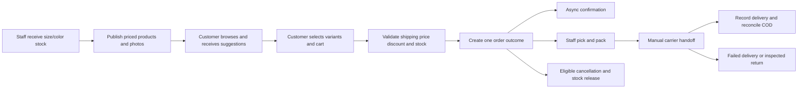
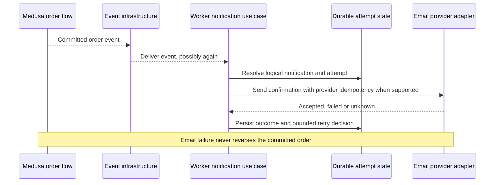

# DAYMARK — end-to-end business flows

Authority update — 15 November 2026: the [business-first specification](../README.md#primary-business-first-specification) takes precedence for business scope and policy. This file maps that intent to DAYMARK implementation and retains earlier proposals where not yet reconciled. See the [crosswalk and held decisions](../reference/spec-consolidation.md); open policies are not approved merely because code exists.

This is the acceptance flow contract for [FR-01–FR-09](01-business.md#functional-requirements-and-flow-ownership). It specifies required behavior, not a claim that every path exists today. Medusa's actual state transitions, transaction boundaries and reservation timing must be verified against the installed version. Diagrams below use business concepts rather than undocumented enum values.

## Whole-business journey



Manual actions require an actor and evidence; they are not missing arrows filled by an imaginary carrier API. For component interaction and storage ownership see [architecture](03-architecture.md) and [data/API](04-data-api.md).

## FLOW-01 — registration and login

**Purpose / actor:** FR-01; Customer establishes an identity and accesses only owned information.

- **Trigger/preconditions:** Customer selects register/login over HTTPS. Backend and authentication store are reachable. Public catalog remains browsable without an account.
- **Normal:** Validate credentials and profile fields; use supported Medusa authentication; complete any configured verification step; establish the session; create/link the customer record where required; show account and owned order history. Logout removes the local session and invokes supported logout behavior.
- **Alternatives/failures:** Invalid input gets field-level guidance; invalid credentials get a non-sensitive message. Existing email must not silently create a second customer. If verification is required, account completion must wait for a deliverable configured verification flow. A dependency outage returns a retryable error, not a fabricated login.
- **Data/postconditions:** Authentication identity and customer record live in PostgreSQL through Medusa; session token is held in a secure HTTP-only storefront cookie. No password or token is logged. Customer identity is resolved server-side.
- **Acceptance:** Registration/login/logout; configured verification branch; duplicate email; expired session; Customer A cannot read/update Customer B's profile or orders. Test data is synthetic.

## FLOW-02 — catalog, search and suggestions

**Purpose / actor:** FR-02; Customer finds clothing and an eligible variant.

- **Trigger/preconditions:** Customer opens a collection, searches by a term, applies supported filters or opens a product. Published products have permitted images, prices, variants and warehouse stock.
- **Normal:** Resolve market/region and channel; fetch public products using native commerce visibility; apply search/filter/sort across the full result set; paginate; render images and size/color selection. Fetch non-personalized suggestions with a finite time/resource budget and validate their sellability before display.
- **Alternatives/failures:** No results shows a useful empty state. Unavailable variants cannot be added as sellable. Broken media uses a neutral placeholder. Suggestion timeout/disabled feature/no candidates removes the section or uses eligible catalog fallback without blocking the page. Personalized results require the separate consent/identity gate.
- **Data/postconditions:** Catalog/pricing/inventory remain Medusa-owned PostgreSQL data. Image bytes are private S3 objects delivered through the approved public-image proxy. Published candidate/version records reside in PostgreSQL; offline source artifacts do not become orders.
- **Acceptance:** Fixture search, size/color, sort and pagination beyond 100 results; exact image URL delivery; no draft/channel-ineligible products; out-of-stock suggestion filtering; disabled/outage fallback; catalog load target in [testing](05-testing.md).

## FLOW-03 — shopping cart

**Purpose / actor:** FR-03; Customer maintains a provisional purchase.

- **Trigger/preconditions:** Customer chooses a product variant and positive whole quantity. Region and sales channel are known.
- **Normal:** Create/retrieve Medusa cart; add/update/remove line; retrieve authoritative prices and totals; persist cart identifier in the secure cookie; associate identity using supported authenticated operations when appropriate.
- **Alternatives/failures:** Reject nonexistent variant, invalid quantity and unavailable purchase. Display changed price/stock on refresh. Network retry must use the operation's defined semantics; repeating an add-to-cart action is not automatically equivalent to checkout idempotency. Lost/expired cart yields a recoverable empty-cart state.
- **Data/postconditions:** Cart and lines are PostgreSQL commerce records. Browser state is a view of the cart, not the order or inventory authority. Cart contents alone do not promise a permanent stock allocation.
- **Acceptance:** Variant-specific add/change/remove; invalid quantities; cross-session ownership rules; stock/price refresh; no client-controlled authoritative totals or customer identity.

## FLOW-04 — checkout and order creation

**Purpose / actor:** FR-04; Customer commits one logical purchase.

- **Trigger/preconditions:** A non-empty valid cart, contact/address data, eligible shipping option and selected payment method. The cart has not already completed.
- **Normal:** Validate input and current commerce context; obtain current price/discount/shipping/stock; confirm reconciled totals; establish the payment session; invoke supported cart completion; show the returned order outcome; clear/replace the completed cart reference. Operations can find the same order.
- **Alternatives/failures:** Invalid address/shipping, expired promotion or insufficient stock prevents success and explains the correction. On timeout, resolve the same cart's outcome before initiating another logical purchase. Concurrent/repeated completion must not create duplicate order/payment effects. If the commit outcome is unknown, show pending/retry guidance rather than an invented success/failure.
- **Data/postconditions:** Order, lines, payment references and reservation/inventory outcomes reconcile in PostgreSQL. An accepted order remains valid even when downstream notification fails.
- **Acceptance:** Browser purchase visible to customer and Admin; concurrent same-cart submit; timeout after commit; discount expiry; final-unit contention; exact order/payment/inventory reconciliation.

```mermaid
sequenceDiagram
  actor C as Customer
  participant W as Next.js
  participant M as Medusa commerce workflows
  participant D as PostgreSQL
  participant R as Redis and worker
  C->>W: Confirm current checkout
  W->>M: Complete the same cart
  M->>D: Validate and persist supported commerce outcome
  D-->>M: Order or conflict/outcome
  M-->>W: Authoritative result
  W-->>C: Order reference or recoverable error
  M-->>R: Order event for secondary processing
  Note over M,D: Exact transaction and compensation boundaries require verification
  Note over W,M: Retry resolves the same logical purchase; does not create a fresh cart
```

## FLOW-05 — payment and duplicate handling

**Purpose / actor:** FR-05; Customer and Operations distinguish commitment, authorization and collection.

- **Trigger/preconditions:** Checkout selects COD in the public demo, or the isolated acceptance environment selects the existing simulator. Never enable the simulator in production to make a demo pass.
- **Normal:** Create/reuse the appropriate payment session; complete the purchase through Medusa; label COD as unpaid/pending collection in business wording; staff later reconcile collection evidence through permitted payment operations. Simulator tests exercise successful and failed outcomes without real money.
- **Alternatives/failures:** Payment failure prevents a false paid/order-success message. Repeated completion, repeated provider action or response loss must not duplicate logical payment/order effects. Inconsistent order/payment outcomes become an operator exception requiring reconciliation, not direct database edits.
- **Data/postconditions:** Medusa owns payment collection/session/payment records. COD order placement is not proof of a captured payment, delivery or settled remittance. No card data is collected by this application.
- **Acceptance:** Isolated simulator success/failure and replay tests; production simulator rejection; same-cart order/payment uniqueness; COD remains distinguishable from collected cash. Preserve evidence of IDs/counts and inventory outcomes without credentials.

## FLOW-06 — warehouse and inventory

**Purpose / actor:** FR-06; Operations maintains sellable units for one warehouse.

- **Trigger/preconditions:** Authorized staff receive stock, correct an inventory discrepancy, fulfill or cancel an order. Product variants are linked to inventory items and the chosen stock location/channel.
- **Normal:** Staff record a reasoned receipt/adjustment; customer purchases invoke supported inventory reservation/availability behavior; staff pick the correct size/color and create fulfillment; use supported cancellation/release operations for eligible unshipped orders.
- **Alternatives/failures:** Concurrent purchases of the final unit produce only permitted successful allocations; backorders are disabled for acceptance fixtures. Missing stock at pick time becomes a visible exception. Returned/failed-delivery items are not automatically resellable: inspect before restocking. Never repair inconsistencies by mutating core tables.
- **Data/postconditions:** PostgreSQL stores location, inventory item/level, reservation and commerce links. Physical bins, scanners, procurement and staff labor are external manual operations. Receipt, allocation and return quantities can be reconciled for a test SKU.
- **Acceptance:** Receipt/update reflected in sellability; final-unit contention; fulfillment and eligible cancellation release; inspected return disposition; before/after inventory evidence with no negative sellable units.

## FLOW-07 — fulfillment and order status

**Purpose / actor:** FR-07; Operations completes the physical handoff and Customer sees truthful progress.

- **Trigger/preconditions:** Accepted order is visible in Medusa Admin; authorized staff and stocked items are available.
- **Normal:** Review the order; pick/pack variants; create fulfillment through supported Admin operations; hand parcel to carrier manually; record shipment/tracking information where supported; update delivery evidence and reconcile COD collection. Customer views the owned order and distinct payment/fulfillment statuses.
- **Alternatives/failures:** Customer cancellation before shipment follows eligibility rules. Once shipped, use failed-delivery/return procedure; contact customer and record reason, carrier evidence, restock decision and cash/refund reconciliation. A delayed carrier report is unknown delivery, not automatic success.
- **Data/postconditions:** Order/fulfillment/payment records stay Medusa-owned. Any required delivery evidence not supported by installed Admin must receive an explicit documented extension/procedure before acceptance. Do not invent native state values.
- **Acceptance:** Recorded staff journey from placed order to shipment and COD reconciliation; customer status matches evidence; another customer is denied; failure/cancellation branch preserves history.

```mermaid
stateDiagram-v2
  [*] --> OrderAccepted
  OrderAccepted --> Picking: Staff review
  Picking --> HandedToCarrier: Fulfillment and manual handoff
  OrderAccepted --> Cancelled: Eligible cancellation
  Picking --> Cancelled: Eligible before shipment
  HandedToCarrier --> DeliveryConfirmed: Carrier evidence
  HandedToCarrier --> DeliveryException: Failed or disputed delivery
  DeliveryException --> ReturnInspected: Parcel returned
  ReturnInspected --> RestockOrDispose: Staff disposition
  DeliveryConfirmed --> CODReconciled: Collection evidence verified
  CODReconciled --> [*]
  Cancelled --> [*]
  note right of OrderAccepted: Business view only; payment and fulfillment have separate native states
```



## FLOW-08 — customer notification

**Purpose / actor:** FR-08; Customer receives confirmation without blocking checkout; Operations can recover failures.

- **Trigger/preconditions:** A committed order event and configured notification provider/template. Customer address comes from the authorized order context.
- **Normal:** Subscriber dispatches a notification use case to background processing; produce a minimal order summary/link; deduplicate by logical order/event/channel; send through the provider adapter; record delivery attempt and observable outcome.
- **Alternatives/failures:** Provider timeout/failure leaves the order untouched; retry with a finite policy; expose exhausted failures for operator replay. Duplicate events must not create duplicate logical notifications. Provider acceptance is not proof of inbox delivery; label evidence precisely. Do not claim exactly-once network delivery after an ambiguous timeout.
- **Data/postconditions:** Notification attempt/deduplication state must be durable; Redis process memory alone is not the acceptance source of truth. Message payload minimizes personal data; logs contain references, not credentials/full addresses.
- **Acceptance:** Delivered test email, duplicate event, provider outage, restart/retry and exhausted retry visibility; checkout remains successful. No customer email provider is established as implemented by this spec.



## FLOW-09 — administration and reporting

**Purpose / actor:** FR-09; Operations runs the store; Administrator controls access and deployment.

- **Trigger/preconditions:** First admin is provisioned by a protected one-off operator procedure; there is no shared seeded admin password. Staff roles/permissions and environment are documented.
- **Normal:** Staff publish a product with permitted photos/variants/prices; receive stock; review/filter orders; process fulfillment and exceptions. Basic reporting provides order counts/value by explicit period, distinguishes cancellations and COD collection, and identifies low-stock variants. Administrator configures access/providers and follows deployment/rollback/monitoring procedures.
- **Alternatives/failures:** Unauthorized actions are denied. Bad product/media input is rejected. Report totals explain date range, currency and included states; order value is not recognized revenue or cash collected. If native reporting lacks the required view, define a bounded read-only export/view rather than claiming unavailable analytics.
- **Data/postconditions:** Admin mutations use supported APIs/workflows and preserve commerce history. Reports read the same authoritative records. Infrastructure secrets are not entered into storefront or exposed in report files.
- **Acceptance:** First admin access; denied unauthenticated/unauthorized mutations; product/image publication; inventory/order processing; order-value and collection-report reconciliation against fixtures; deployment/dashboard evidence linked from [operations](06-operations.md).

## Acceptance execution

Run the whole-business journey with one clearly identified fixture order, then run isolated negative/concurrency cases. Preserve test release/image identifiers, environment, fixture IDs, timestamps, expected results, actual results and cleanup disposition. Do not reuse a historical success report as proof of a new release. The authoritative thresholds and tools are in [testing](05-testing.md).
