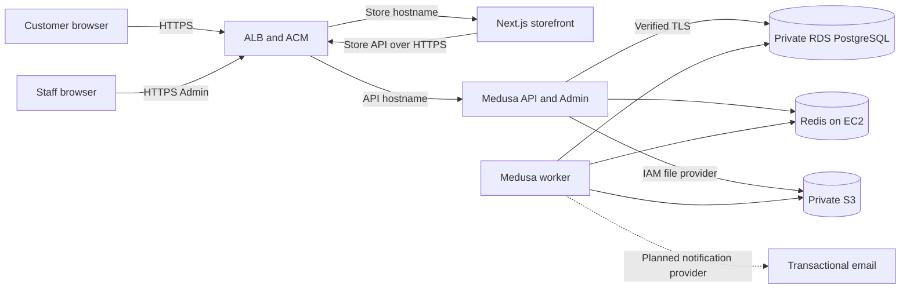

# Component architecture and decisions

DAYMARK is a production-oriented clothing-commerce MVP with product suggestions. This document defines the target design and distinguishes it from the code inherited on 14 November 2026. Read [business requirements](01-business.md), [flows](02-flows.md) and [acceptance targets](05-testing.md) first. Deployment procedures remain in [operations](06-operations.md).

## 1. Architecture pattern

**Use a Medusa modular monolith, deployed as separate API and worker processes, with a Next.js storefront.** These are runtime boundaries, not independently owned commerce microservices. The API and worker share application code and module definitions. PostgreSQL is the authoritative transactional store; Redis supports Medusa cache, events, workflows and locks; S3 stores media.



Cloudflare is DNS-only in the existing deployment. TLS terminates at ALB; application traffic inside its security-group boundary uses HTTP. Regional resources belong in `ap-southeast-2`. A lease-based demo shutdown means this environment is not a continuously available storefront.

## 2. Code structure and dependency direction

```text
HTTP route / authenticated subscriber / scheduled job
  -> application workflow (use case and orchestration)
  -> module service + domain policy (rules and owned data)
  -> Medusa persistence or external provider adapter
  -> explicit response projection
```

| Layer | Owns | Must not own |
| --- | --- | --- |
| Next.js pages and components | Rendering, forms, interaction and pending/error states | Authoritative prices, inventory or order creation |
| Storefront `src/lib/data` | SDK calls, server actions, cookies and presentation cache policy | Database access or a second commerce database |
| Backend `api/**/route.ts` | Transport controller: validated input, identity, workflow invocation and response | Ranking orchestration, cross-module writes or provider SDK logic |
| `workflows` | Business use cases, step coordination, explicit failure/compensation behavior | Imports from HTTP route files |
| `modules/<domain>` | Owned models, persistence services and reusable policies | Direct writes into another module's tables |
| Providers/adapters | File, payment, email and carrier boundary implementations | Decisions about whether a business order is valid |
| Subscribers/jobs | Translate verified events/schedules into use cases | A second implementation of the same business operation |

Routes already act as controllers; extra controller classes are unnecessary. Use runtime request schemas and inferred DTO types at custom API boundaries. Return explicit response DTOs, not database models. Reuse Medusa module services rather than wrapping every generated method in a redundant repository. Apply ports-and-adapters where an external dependency needs substitution or failure testing; this is not a claim that every Medusa internal follows hexagonal architecture.

Core commerce remains owned by Medusa: catalog/pricing, cart, payment, inventory, order and fulfillment. Custom modules own recommendation and personalization. Cross-module relationships use supported services, workflows and links. Verify the installed framework behavior before specifying its transaction sequence or extending it.

## 3. Synchronous and asynchronous boundaries

| Operation | Decision | Reason and failure behavior |
| --- | --- | --- |
| Price, promotion, shipping and stock validation; cart completion | Synchronous authoritative commerce workflow | Customer needs a committed result. Timeout is an unknown outcome until reconciled, not proof that no order exists. |
| Customer reads own order | Synchronous authorized read | Never infer payment/delivery from order existence. |
| Confirmation/status email | Asynchronous after the business change | Email failure must not undo an order. Use stable delivery keys, bounded retries and operator-visible failure state. Implementation is still required. |
| Recommendation generation | Offline bounded job, separate from checkout | Import a validated immutable candidate run, then select its active version. Generation failure leaves the previous run active. |
| Recommendation serving | Optional synchronous read with bounded work and fallback | Return eligible catalog suggestions or omit the section; do not hold checkout open. |
| Profile refresh | Event/scheduled background workflow | Respect consent epoch and idempotency; the current code contains examples but cloud flags remain off. |

A Redis event bus is not, by itself, proof of durable business notification delivery. The notification implementation must document its persistence/reconciliation strategy, retry horizon and duplicate-delivery handling. Do not claim exactly-once messaging. Payment/order idempotency must hold at the authoritative operation, not just by disabling the browser button.

## 4. Read-heavy and promotion behavior

Current templates configure API scaling from **one to two tasks** at a **60% average CPU target**, with scale-out cooldown 60 seconds and scale-in cooldown 180 seconds. Each API task has 1 vCPU/2 GB. The storefront is one 0.5 vCPU/1 GB task and the worker one 0.5 vCPU/2 GB task. RDS is a private Single-AZ `db.t4g.micro`; Redis is a single `t4g.micro` EC2 host. These are demo settings, not an established capacity claim.

Public media is currently streamed through the API. Thus image traffic consumes API capacity. Public product pages/queries can be cached only with an explicit region, currency, sales-channel and freshness policy. Private cart, customer and order results must not enter a public shared cache. Checkout revalidates current commerce state regardless of displayed availability.

At 5x load, measure storefront, ALB, API, PostgreSQL connections/CPU and Redis together. CPU scaling may not trigger for database-bound work. Pre-scaling for an announced campaign is a valid operational choice but must be reported separately from automatic scaling evidence. At 10x, find the failure boundary and demonstrate controlled errors and recovery; successful service at 10x is not a release promise. Larger database instances, more storefront tasks, connection-pool budgets and alternative media delivery require measured justification and a revised cost estimate.

## 5. Architecture decisions and trade-offs

| ADR | Decision | Alternative considered | Trade-off and revisit trigger |
| --- | --- | --- | --- |
| ADR-01 | Medusa modular monolith with API/worker roles | Commerce microservices | Simpler transactional ownership and operations; modules share release/database dependencies. Revisit only with evidence of independent scaling or ownership needs. |
| ADR-02 | PostgreSQL for commerce and published recommendation records | Document database as order authority | Relational constraints and transactions fit orders/stock; connection and write capacity require management. No separate search datastore until measured need. |
| ADR-03 | Medusa Store API product search/filter/pagination initially | Dedicated search service | Fewer integrations/costs; relevance and full-catalog behavior must meet FR-02. Current 100-product client sorting is a gap, not the intended contract. |
| ADR-04 | Private S3 with backend public-image proxy | CloudFront distribution | Fits the existing project restriction/recovery decision and IAM provider; no edge cache, API bandwidth/CPU cost. Revisit if access or measured media load changes. |
| ADR-05 | Fargate, managed RDS and IaC | Single EC2 Compose as primary | Independent runtime sizing and managed database, with more baseline cost/operational parts. EC2 remains a fallback, not a second production truth. |
| ADR-06 | Offline, evaluated product recommendations | Generative shopping assistant | Predictable serving and no token cost; less conversational capability. Suggestions must pass the relevance gate without regressing the measured baseline; retain the baseline unless a more complex strategy demonstrates a benefit. |
| ADR-07 | Shared recommendation product policy and serving-cache state live in `modules/recommendation`; routes and publishing import them | Workflow importing HTTP cache invalidation; one route importing another route's policies | Removes those upward dependencies without changing auth, DTOs, ranking or cache behavior. Route orchestration and the version-coupled product adapter remain follow-up work. |
| ADR-08 | Oxfmt replaces direct Prettier usage; retain Medusa/Next ESLint as the single linter | Adding Oxlint alongside existing framework lint; bulk formatting | Medusa custom rules have no verified complete replacement. Stage-based formatting ratchets legacy source without a repository rewrite; CI checks the adopted tooling baseline. |
| ADR-09 | Reusable storefront tokens/components and Motion enhancement; Medusa workflows for an owned local catalog upsert | Per-page styling and a destructive demo reset | User-authorized storefront/catalog scope, 15 November 2026. Only palette is agreed; visual choices remain proposed. Existing stock is preserved, and seed validation uses disposable local services. See design-system/catalog docs for current evidence. |
| ADR-10 | Representative class-preview product photos may be attached only by an explicit loopback-only local Medusa file-provider mode; production importer media remains exact-product only through the configured provider | Treating illustrative stock photos as verified product/variant imagery or publishing them to S3 | User-authorized catalog preview, 15 November 2026. Existing product identities and stock remain stable. |

These decisions formalize the chosen direction; migration/refactoring tasks remain in [delivery](07-delivery.md). The historical [AWS decision](../architecture/adr/0001-aws-cloud-stack.md) records the deployment context and does not prove current uptime.

## 6. Observed gaps to close before architecture acceptance

- Recommendation routes still perform orchestration and filtering. Shared saleability/public-product projection and serving-cache state now live below HTTP in `modules/recommendation/product-policy.ts` and `serving-cache.ts`; publishing and personalized serving no longer import route helpers. Extracting the remaining use-case orchestration is follow-up work.
- The recommendation product adapter calls installed Medusa route/middleware internals in-process. Keep it explicit, version-coupled and covered by compatibility tests until replaced with a supported application boundary.
- Recommendation anonymous product results and candidates have process-local caches (default result TTL five seconds outside tests). Clearing one process does not invalidate other replicas. Candidate and popularity entries use the configured TTL and run ID; candidate entries clear above 2,000 keys. Product-group and valid-region caches have no TTL or independent size bound, and popularity entries have no size bound. Publication clears these maps only in the publishing process. Define eviction/freshness and cross-replica behavior before enabling them publicly.
- Custom catalog/cart/auth endpoints coexist with standard APIs. Inventory their consumers, validate identity/DTO contracts and remove unsupported duplication only through a reviewed implementation change.
- Production pool limits are not explicitly set by the current test-only pool configuration. Budget total connections across maximum API tasks, worker, migrations and operator tasks.
- Storefront latest sorting now delegates pagination to Medusa; price sorting reads every matching API page before sorting. The first-100 truncation is removed in source; the 120/1,000-product correctness/performance acceptance fixtures still require separate evidence.
- Customer notifications, complete staff fulfillment/COD reconciliation and current-cloud peak/recovery demonstrations remain acceptance work.

No microservice extraction, cloud provisioning or application refactor is authorized by this documentation alone; this stage establishes the implementation contract.

## 7. Why this technology and provider

AWS is selected because the shared project already has regional infrastructure, CloudFormation, service-role policies and dated operational evidence, and ECS/RDS/S3 cover the teacher's required compute/transaction/object-storage boundaries. Other providers could meet the same requirements; changing provider now would consume effort without evidence of a business benefit. The managed project restricts regional resources to ap-southeast-2 and CloudFront access was blocked in the recorded deployment context, so the current design uses an explicit backend media proxy trade-off. Revalidate access/prices before new operations rather than assuming historical restrictions or credits are permanent.

Medusa is chosen over writing commerce primitives from scratch because catalog, pricing, cart, inventory and fulfillment already have supported module/workflow boundaries. This reduces scope but introduces framework/version coupling; our installed configuration still needs business correctness tests. Next.js is the existing storefront stack and supports server-rendered browsing and server actions without owning commerce data. Redis reuses supported Medusa coordination providers, not a second transactional database. PostgreSQL and S3 responsibilities are justified in ADR-02/04. None of these choices requires extracting microservices or adding a generative assistant.
