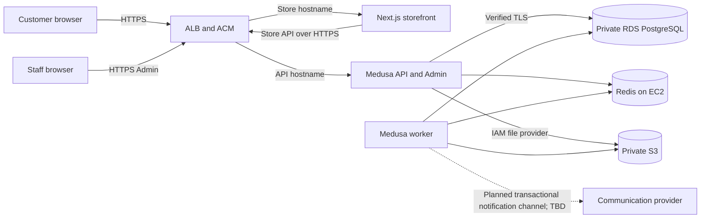

<a id="component-architecture-and-decisions"></a>
# Kiến trúc thành phần và quyết định

DAYMARK là MVP thương mại quần áo hướng đến vận hành thực tế, có gợi ý sản phẩm. Tài liệu xác định thiết kế mục tiêu và phân biệt với hành vi mã cần kiểm chứng. Đọc [nghiệp vụ](01-business.md), [luồng](02-flows.md), [mục tiêu nghiệm thu](05-testing.md) trước. Quy trình triển khai ở [vận hành](06-operations.md).

<a id="1-architecture-pattern"></a>
## 1. Mẫu kiến trúc

**Dùng Medusa modular monolith, triển khai thành tiến trình API và worker riêng, cùng Next.js storefront.** Đây là ranh giới môi trường chạy, không phải microservice thương mại sở hữu độc lập. API và worker dùng chung mã ứng dụng và định nghĩa module. PostgreSQL là nguồn giao dịch có thẩm quyền; Redis hỗ trợ cache, sự kiện, workflow và khóa của Medusa; S3 lưu nội dung đa phương tiện.



Cloudflare chỉ làm DNS trong ánh xạ triển khai hiện có. TLS kết thúc ở ALB; lưu lượng ứng dụng trong ranh giới security group dùng HTTP. Tài nguyên vùng thuộc `ap-southeast-2`. Demo tắt theo lease nên không phải storefront sẵn sàng liên tục.

<a id="2-code-structure-and-dependency-direction"></a>
## 2. Cấu trúc mã và hướng phụ thuộc

```text
HTTP route / authenticated subscriber / scheduled job
  -> application workflow (use case and orchestration)
  -> module service + domain policy (rules and owned data)
  -> Medusa persistence or external provider adapter
  -> explicit response projection
```

| Lớp | Sở hữu | Không được sở hữu |
| --- | --- | --- |
| Trang và thành phần Next.js | Hiển thị, biểu mẫu, tương tác và trạng thái chờ/lỗi | Giá, tồn hoặc tạo đơn có thẩm quyền |
| Storefront `src/lib/data` | Gọi SDK, server action, cookie và chính sách cache hiển thị | Truy cập cơ sở dữ liệu hoặc cơ sở dữ liệu thương mại thứ hai |
| Backend `api/**/route.ts` | Controller truyền tải: đầu vào hợp lệ, danh tính, gọi workflow và phản hồi | Điều phối xếp hạng, ghi xuyên module hoặc logic SDK provider |
| `workflows` | Ca sử dụng, điều phối bước, hành vi lỗi/bù trừ rõ ràng | Import từ tệp route HTTP |
| `modules/<domain>` | Mô hình sở hữu, dịch vụ lưu trữ và chính sách tái sử dụng | Ghi trực tiếp bảng module khác |
| Provider/adapter | Triển khai ranh giới tệp, thanh toán, email và vận chuyển | Quyết định đơn nghiệp vụ có hợp lệ không |
| Subscriber/job | Chuyển sự kiện/lịch đã xác minh thành ca sử dụng | Triển khai lần hai cùng thao tác nghiệp vụ |

Route đã đóng vai trò controller; không cần lớp controller bổ sung. Dùng schema kiểm tra lúc chạy và kiểu DTO suy ra ở API tùy chỉnh. Trả DTO tường minh, không trả model cơ sở dữ liệu. Tái dùng module service Medusa, không bọc mỗi phương thức sinh tự động bằng repository dư thừa. Dùng ports-and-adapters khi cần thay thế phụ thuộc ngoài hoặc thử lỗi; không khẳng định mọi phần nội bộ Medusa theo kiến trúc lục giác.

Medusa sở hữu lõi danh mục/giá, giỏ, thanh toán, tồn, đơn và fulfillment. Module tùy chỉnh sở hữu gợi ý/cá nhân hóa. Quan hệ xuyên module dùng service, workflow và link được hỗ trợ. Kiểm chứng framework đã cài trước mô tả thứ tự giao dịch hoặc mở rộng.

<a id="3-synchronous-and-asynchronous-boundaries"></a>
## 3. Ranh giới đồng bộ và bất đồng bộ

| Thao tác | Quyết định | Lý do và hành vi lỗi |
| --- | --- | --- |
| Kiểm tra giá, khuyến mãi, vận chuyển, tồn; hoàn tất giỏ | Workflow thương mại đồng bộ có thẩm quyền | Khách cần kết quả đã chốt. Timeout là chưa rõ kết quả đến khi đối soát, không chứng minh chưa có đơn. |
| Khách đọc đơn của mình | Đọc đồng bộ có phân quyền | Không suy thanh toán/giao nhận từ việc đơn tồn tại. |
| Email xác nhận/trạng thái | Bất đồng bộ sau thay đổi nghiệp vụ | Lỗi email không hoàn tác đơn. Dùng khóa gửi ổn định, thử lại giới hạn và trạng thái lỗi cho vận hành. Còn cần triển khai. |
| Sinh gợi ý | Job ngoại tuyến giới hạn, tách checkout | Nhập lượt ứng viên bất biến đã kiểm tra rồi chọn phiên bản hoạt động. Sinh lỗi giữ lượt cũ. |
| Phục vụ gợi ý | Đọc đồng bộ tùy chọn, công việc giới hạn và dự phòng | Trả gợi ý danh mục hợp lệ hoặc bỏ vùng; không giữ checkout chờ. |
| Làm mới hồ sơ | Workflow nền theo sự kiện/lịch | Tôn trọng consent epoch và idempotency; mã có ví dụ nhưng cờ cloud còn tắt. |

Event bus Redis tự nó không chứng minh gửi thông báo nghiệp vụ bền vững. Triển khai phải ghi chiến lược lưu/đối soát, giới hạn thời gian thử lại và xử lý trùng. Không khẳng định thông điệp exactly-once. Idempotency thanh toán/đơn phải ở thao tác có thẩm quyền, không chỉ tắt nút trình duyệt.

<a id="4-read-heavy-and-promotion-behavior"></a>
## 4. Tải đọc lớn và khuyến mãi

Template cấu hình API từ **một đến hai task**, mục tiêu **CPU trung bình 60%**, chờ tăng 60 giây và giảm 180 giây. Mỗi API task có 1 vCPU/2 GB. Storefront một task 0,5 vCPU/1 GB; worker một task 0,5 vCPU/2 GB. RDS riêng Single-AZ `db.t4g.micro`; Redis một EC2 `t4g.micro`. Đây là cấu hình demo, không phải năng lực đã chứng minh.

Ảnh công khai truyền qua API nên dùng năng lực API. Chỉ cache trang/truy vấn sản phẩm với chính sách vùng, tiền tệ, kênh và độ mới rõ ràng. Giỏ, khách và đơn riêng không vào cache công khai dùng chung. Checkout kiểm tra lại trạng thái bất kể khả năng cung ứng đã hiển thị.

Ở tải 5x, đo cùng storefront, ALB, API, kết nối/CPU PostgreSQL và Redis. Tăng theo CPU có thể không kích hoạt khi nghẽn cơ sở dữ liệu. Tăng trước chiến dịch là lựa chọn vận hành hợp lệ nhưng báo riêng với bằng chứng tự tăng. Ở 10x, tìm ranh giới lỗi, chứng minh lỗi có kiểm soát và phục hồi; không hứa phục vụ thành công 10x. Tăng cỡ cơ sở dữ liệu, task storefront, ngân sách connection pool hoặc đổi phân phối ảnh cần số đo và ước tính chi phí sửa đổi.

<a id="5-architecture-decisions-and-trade-offs"></a>
## 5. Quyết định kiến trúc và đánh đổi

| ADR | Quyết định | Phương án đã cân nhắc | Đánh đổi và điều kiện xét lại |
| --- | --- | --- | --- |
| ADR-01 | Medusa modular monolith với API/worker | Microservice thương mại | Đơn giản quyền sở hữu giao dịch/vận hành; module chung phụ thuộc phát hành/cơ sở dữ liệu. Chỉ xét lại khi có bằng chứng cần mở rộng hoặc sở hữu độc lập. |
| ADR-02 | PostgreSQL cho thương mại và bản ghi gợi ý công bố | Cơ sở dữ liệu tài liệu làm nguồn đơn | Ràng buộc quan hệ/giao dịch hợp đơn/tồn; cần quản lý kết nối và ghi. Chưa thêm kho tìm kiếm đến khi đo được nhu cầu. |
| ADR-03 | Ban đầu tìm/lọc/phân trang bằng Medusa Store API | Dịch vụ tìm kiếm riêng | Ít tích hợp/chi phí; độ liên quan và toàn danh mục phải đạt FR-02. Cắt 100 sản phẩm khi sắp xếp phía client không phải hợp đồng mong muốn. |
| ADR-04 | S3 riêng với proxy ảnh công khai backend | CloudFront | Phù hợp hạn chế/quyết định khôi phục và IAM provider hiện có; thiếu edge cache, tốn băng thông/CPU API. Xét lại khi quyền truy cập hoặc tải ảnh đo được đổi. |
| ADR-05 | Fargate, RDS quản lý và IaC | Một EC2 Compose làm chính | Cỡ chạy độc lập và cơ sở dữ liệu quản lý, chi phí nền/thành phần vận hành cao hơn. EC2 là dự phòng, không phải nguồn production thứ hai. |
| ADR-06 | Gợi ý ngoại tuyến có đánh giá | Trợ lý mua sắm sinh nội dung | Phục vụ dự đoán được, không phí token; ít khả năng hội thoại. Phải qua cổng độ liên quan, không giảm so nền đã đo; giữ nền nếu chiến lược phức tạp chưa chứng minh lợi ích. |
| ADR-07 | Chính sách sản phẩm và cache phục vụ gợi ý dùng chung ở `modules/recommendation`; route và công bố import từ đó | Workflow import vô hiệu hóa cache HTTP; route import chính sách route khác | Bỏ phụ thuộc ngược, không đổi auth, DTO, xếp hạng/cache. Điều phối route và adapter sản phẩm gắn phiên bản còn cần xử lý. |
| ADR-08 | Oxfmt thay dùng trực tiếp Prettier; giữ Medusa/Next ESLint làm linter duy nhất | Thêm Oxlint cạnh lint framework; định dạng hàng loạt | Chưa có thay thế đủ đã kiểm chứng cho quy tắc Medusa. Định dạng theo staged cải thiện dần mã cũ; CI kiểm tra nền công cụ. |
| ADR-09 | Token/thành phần storefront tái sử dụng, Motion tăng cường; workflow Medusa upsert danh mục cục bộ có sở hữu | Kiểu riêng từng trang và đặt lại demo phá dữ liệu | Phạm vi storefront/danh mục được người dùng cho phép ngày 15 tháng 11 năm 2026. Nhận diện/hướng thiết kế được duyệt theo [quyết định thương hiệu](../brand/README.md#approval--15-november-2026); không suy ra duyệt nghiệp vụ. Giữ tồn hiện có, kiểm chứng seed trên dịch vụ cục bộ dùng riêng. |
| ADR-10 | Ảnh đại diện xem thử chỉ gắn qua chế độ local file provider Medusa tường minh, chỉ loopback; ảnh nhập production phải đúng sản phẩm qua provider cấu hình | Coi ảnh minh họa là sản phẩm/biến thể xác thực hoặc công bố lên S3 | Người dùng cho phép xem thử danh mục ngày 15 tháng 11 năm 2026. Giữ định danh sản phẩm và tồn hiện có. |

| ADR-11 | Image Node 24 trên Alpine 3.24, cập nhật bản vá distro và quét image trước phát hành | Debian Bookworm slim với các finding OS chưa vá; đổi framework hoặc cloud | Loại nhóm package Debian gây chặn triển khai nhưng đổi glibc sang musl; phải kiểm build, Sharp/SWC, API/worker/Admin, media và browser trên image thật. Giữ image cũ làm bằng chứng, không dùng rollback có finding HIGH/CRITICAL chưa xử lý. |

Các quyết định xác định hướng chọn; migration/tái cấu trúc còn ở [công việc](07-delivery.md). [Quyết định AWS lịch sử](../architecture/adr/0001-aws-cloud-stack.md) ghi bối cảnh triển khai, không chứng minh uptime hiện tại.

<a id="6-observed-gaps-to-close-before-architecture-acceptance"></a>
## 6. Khoảng trống trước nghiệm thu kiến trúc

- Route gợi ý vẫn điều phối/lọc. Chính sách bán được, chiếu sản phẩm công khai và trạng thái cache ở `modules/recommendation/product-policy.ts`, `serving-cache.ts`; công bố/phục vụ cá nhân không import helper route. Còn phải tách điều phối ca sử dụng.
- Adapter sản phẩm gọi nội bộ route/middleware Medusa đã cài trong tiến trình. Ghi rõ phụ thuộc phiên bản và kiểm thử tương thích đến khi thay bằng ranh giới ứng dụng được hỗ trợ.
- Kết quả ẩn danh và ứng viên gợi ý có cache cục bộ tiến trình (TTL kết quả mặc định ngoài test là năm giây). Xóa một tiến trình không vô hiệu các bản sao khác. Ứng viên/phổ biến dùng TTL cấu hình và run ID; cache ứng viên xóa khi hơn 2.000 khóa. Cache nhóm sản phẩm/vùng hợp lệ không có TTL hoặc giới hạn kích thước riêng; mục phổ biến không giới hạn kích thước. Công bố chỉ xóa các map trong tiến trình công bố. Xác định loại bỏ/độ mới và hành vi xuyên bản sao trước bật công khai.
- Endpoint danh mục/giỏ/auth tùy chỉnh cùng tồn tại API chuẩn. Lập bản đồ bên dùng, kiểm tra danh tính/DTO; chỉ bỏ trùng không hỗ trợ qua thay đổi triển khai được đánh giá.
- Cấu hình pool chỉ dành test chưa đặt rõ giới hạn production. Tính tổng kết nối API tối đa, worker, migration và task vận hành.
- Sắp xếp mới nhất storefront giao phân trang cho Medusa; sắp giá đọc mọi trang khớp trước sắp. Mã không còn cắt 100 đầu; dữ liệu nghiệm thu 120/1.000 sản phẩm vẫn cần bằng chứng đúng/hiệu năng riêng.
- Thông báo khách, toàn bộ xử lý giao/COD nhân viên và trình diễn tải đỉnh/khôi phục cloud còn cần nghiệm thu.

Tài liệu không cấp quyền tách microservice, tạo cloud hoặc tái cấu trúc ứng dụng; chỉ xác định hợp đồng triển khai.

<a id="7-why-this-technology-and-provider"></a>
## 7. Lý do chọn công nghệ và provider

Chọn AWS vì dự án chung đã có hạ tầng vùng, CloudFormation, chính sách service role và bằng chứng vận hành có ngày; ECS/RDS/S3 đáp ứng ranh giới tính toán/giao dịch/lưu đối tượng theo yêu cầu giảng viên. Provider khác có thể đáp ứng; đổi lúc này tốn công khi chưa chứng minh lợi ích nghiệp vụ. Dự án quản lý giới hạn tài nguyên vùng ở ap-southeast-2; CloudFront từng bị chặn trong bối cảnh đã ghi nên thiết kế dùng proxy ảnh backend với đánh đổi rõ. Xác minh lại quyền/giá trước thao tác mới; không coi hạn chế hoặc tín dụng lịch sử là vĩnh viễn.

Chọn Medusa thay tự viết lõi thương mại vì đã có ranh giới module/workflow hỗ trợ cho danh mục, giá, giỏ, tồn và fulfillment. Giảm phạm vi nhưng gắn framework/phiên bản; cấu hình đã cài vẫn cần kiểm thử đúng nghiệp vụ. Next.js là nền storefront hiện có, hỗ trợ duyệt render server và server action, không sở hữu thương mại. Redis tái dùng provider điều phối Medusa, không là cơ sở dữ liệu giao dịch thứ hai. Trách nhiệm PostgreSQL/S3 ở ADR-02/04. Không lựa chọn nào đòi tách microservice hoặc thêm trợ lý sinh nội dung.
