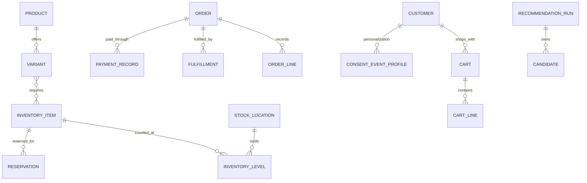

# Quyền sở hữu dữ liệu và hợp đồng API

[Đặc tả lấy nghiệp vụ làm gốc](../README.md#primary-business-first-specification) được ưu tiên về phạm vi và chính sách. Tài liệu ánh xạ ý định sang triển khai DAYMARK, giữ đề xuất chưa đối chiếu thống nhất. Xem [ánh xạ và quyết định còn mở](../technical/requirements-mapping.md); có mã không phê duyệt chính sách mở.

Tài liệu hỗ trợ [nghiệp vụ](01-business.md), [luồng xuyên suốt](02-flows.md) và [kiến trúc thành phần](03-architecture.md). Hợp đồng là quy tắc mục tiêu cho triển khai/kiểm thử, không tạo bộ endpoint thương mại trùng lặp.

## 1. Quyền sở hữu và lưu trữ

| Dữ liệu | Chủ sở hữu có thẩm quyền | Lưu trữ | Quy tắc |
| --- | --- | --- | --- |
| Sản phẩm, biến thể, kích cỡ/màu, bộ sưu tập, danh mục | Module sản phẩm Medusa | RDS PostgreSQL | Biến thể/SKU xác định lựa chọn mua được. Tham chiếu nội dung khác byte nội dung. |
| Giá, khuyến mãi, vùng/tiền tệ, lựa chọn vận chuyển | Năng lực pricing/promotion/region/fulfillment Medusa | RDS | Backend tính tiền có thẩm quyền; VND nhất quán quy ước framework. |
| Địa điểm kho, inventory item, mức tồn, giữ chỗ | Năng lực inventory/stock-location Medusa | RDS | Ban đầu một kho DAYMARK. Nhận/lấy hàng vật lý do nhân viên. |
| Giỏ, checkout, collection/session thanh toán, đơn, fulfillment | Module thương mại Medusa tương ứng | RDS | Trạng thái đơn, thanh toán, giao riêng; tạo COD không phải thu tiền. |
| Danh tính, tài khoản, địa chỉ khách | Năng lực xác thực/customer Medusa | RDS | Mật khẩu dùng biểu diễn được provider bảo vệ; không lưu rõ hoặc log thông tin xác thực. |
| Byte ảnh sản phẩm | File provider Medusa | S3 riêng | Chỉ định dạng ảnh được duyệt trong `public-images/` được phục vụ công khai qua proxy backend. Không đặt tài liệu riêng ở đó. |
| Lượt ứng viên, thứ hạng, manifest/checksum, con trỏ hoạt động | Module recommendation tùy chỉnh | RDS | Nhập lượt staging, kiểm tra, đánh dấu ready rồi kích hoạt. Giữ lượt ready cũ để quay lui. |
| Đồng ý, sự kiện hành vi, hồ sơ quan tâm | Module personalization tùy chỉnh | RDS | Danh tính khách xác minh server; consent epoch chặn dữ liệu khi rút đồng ý. Cờ cloud tắt đến khi nghiệm thu. |
| Nghiên cứu thô và artifact sinh ra | Pipeline ngoại tuyến | `data/hm/`, `data/hm/processed/` cục bộ bị ignore | Không là tài sản Git, đơn production hoặc nội dung thương hiệu tự động được duyệt công khai. |
| Cache/sự kiện/workflow/khóa | Provider hạ tầng Medusa | Redis; một số map gợi ý cục bộ tiến trình | Redis không là nguồn thương mại có thẩm quyền. Mất Redis cần hành vi suy giảm/khôi phục được thử. |
| Tham chiếu phiên trình duyệt | Server action storefront | Cookie HTTP-only, secure trong production | Tham chiếu/token, không cơ sở dữ liệu đơn thứ hai; backend phân quyền mọi yêu cầu riêng. |
| Bản ghi gửi/thử lại thông báo | Tích hợp thông báo dự kiến | Bản ghi bền vững do ứng dụng sở hữu, schema chờ triển khai | Chống trùng và đối soát sau lỗi provider/worker. Không khẳng định bảng đã tồn tại. |

Migration AWS ngày 9 tháng 11 và trạng thái chưa kích hoạt dữ liệu gợi ý là thông tin lịch sử. Seed cũ có ba sản phẩm chung không ảnh. Bộ mẫu học tập DAYMARK 30 sản phẩm có ảnh đại diện xem thử cục bộ; ảnh hàng sản xuất chính xác và từng biến thể là khoảng trống riêng.

## 2. Quan hệ logic

Đây là sơ đồ khái niệm quyền sở hữu, không phải schema vật lý Medusa hoặc khẳng định lực lượng quan hệ chính xác cho mọi checkout tùy chọn. Link framework và schema sinh tự động có thẩm quyền triển khai. Không thêm join thủ công hoặc viết lại bảng lõi theo phác thảo này.

Với SKU kiểm soát, đối soát tồn đầu, điều chỉnh nhân viên, giữ chỗ hoạt động, lượng xuất giao và nhập lại được phép. Không giả định tạo đơn trừ ngay tồn vật lý; kiểm chứng vòng đời Medusa đã cài. Hủy trước fulfillment và trả sau giao có tác động tồn khác nhau.

## 3. Bề mặt API

Dùng hợp đồng Medusa đã cài cho thao tác lõi. Các lệnh gọi storefront chính:

| Yêu cầu | Năng lực API | Ranh giới và nghiệm thu |
| --- | --- | --- |
| FR-01 | Đăng ký/đăng nhập khách Medusa; `/store/customers/me` | Token theo tác nhân, không tin `customer_id` từ client; thử cùng tạo tài khoản và xác minh tùy chọn. |
| FR-02 | `GET /store/products`, truy vấn danh mục/bộ sưu tập/chi tiết | Sản phẩm công bố/thấy theo kênh, giá theo vùng, lọc/phân trang giới hạn trên toàn danh mục khớp. |
| FR-03 | `/store/carts` và thao tác dòng giỏ | Mã giỏ không là thông tin xác thực nhân viên; kiểm số lượng/biến thể qua workflow backend. |
| FR-04 | Chi tiết/lựa chọn vận chuyển giỏ và `/store/carts/{id}/complete` | Chỉ hoàn tất qua workflow có thẩm quyền. Đối soát kết quả timeout chưa rõ. |
| FR-05 | Collection/session thanh toán | Ban đầu COD production; bộ mô phỏng cô lập thử thành công/thất bại/trùng. Không bật mô phỏng production. |
| FR-06 | Thao tác inventory/location Medusa Admin có quyền | Điều chỉnh nhân viên và checkout đồng thời được truy vết/đối soát. |
| FR-07 | Đọc đơn theo khách; thao tác đơn/fulfillment Admin có quyền | Khách chỉ đọc đơn mình; trạng thái công khai không lộ thông tin nhân viên/thanh toán riêng. |
| FR-08 | Sự kiện đơn/trạng thái nội bộ đến ca sử dụng thông báo | Không endpoint công khai không xác thực cho gửi email tùy ý. |
| FR-09 | Medusa Admin và truy vấn báo cáo | Phân biệt nhân viên với cấu hình quản trị; chứng minh chính sách truy cập thực trước tuyên bố quyền chi tiết. |
| REC-01 | `GET /store/recommendations`; `/for-you` có xác thực tùy chọn | Schema truy vấn chặt, chiếu công khai rõ, sản phẩm hợp lệ, độ trễ giới hạn, cờ và bỏ/dự phòng an toàn. |
| Ảnh | `GET /product-images/{prefix}/{key}` | Ảnh công khai được duyệt không cần publishable key; từ chối tiền tố riêng, tên tệp lồng và định dạng không hỗ trợ. |

`/store/cart` số ít, `/store/catalog` và lớp auth tùy chỉnh là bề mặt cũ/tùy chỉnh cần rà soát, không yêu cầu xây API lõi song song. Trước xóa phải có bản đồ bên dùng, hợp đồng hỗ trợ và lộ trình ngừng dùng.

## 4. DTO và lỗi

Route tùy chỉnh phải kiểm schema lúc chạy, từ chối trường ngoài dự kiến khi phù hợp, giới hạn phân trang và lấy danh tính từ bối cảnh server đã xác thực. Interface TypeScript riêng lẻ không đủ. DTO thuộc truyền tải; đầu vào miền/workflow không phụ thuộc `MedusaRequest` hoặc đối tượng response.

Truy vấn gợi ý mục tiêu: `placement` thuộc `home|product_detail`, `region_id` hợp lệ, chỉ yêu cầu `product_id` cho chi tiết, `limit` nguyên giới hạn. Phản hồi gồm placement, chiến lược/phiên bản, sản phẩm với trường công khai chọn rõ; không metadata nguồn/khách thô hoặc chi tiết provider. Giữ hình dạng phản hồi hiện có hoặc migration có chủ đích.

| Lỗi | Quy tắc hợp đồng |
| --- | --- |
| Đầu vào sai | 400 với thông báo an toàn, có thể hành động và bối cảnh trường nếu hỗ trợ |
| Thao tác riêng chưa xác thực | 401 |
| Đã xác thực nhưng không quyền | 403 hoặc 404 không tiết lộ theo hợp đồng API đã cài |
| Đối tượng thiếu/không thấy | 404 |
| Xung đột tồn/trạng thái/idempotency | Ghi phản hồi xung đột thực của endpoint đã cài và kiểm thử; không đổi mã mù quáng |
| Phụ thuộc gián đoạn/quá tải | Lỗi an toàn có thể thử lại; không báo đơn thành công khi chưa xác nhận có thẩm quyền |

Lỗi Medusa lõi giữ cấu trúc hỗ trợ. Hợp đồng tùy chỉnh mới nên có mã máy ổn định, thông báo an toàn và correlation ID nếu có. Không trả stack trace, thông điệp provider, token, metadata nguồn hay dữ liệu khách khác. Log đủ bối cảnh đã che để điều tra. Bao phủ correlation là mục tiêu cần triển khai/kiểm chứng, chưa bảo đảm xuyên suốt.

## 5. Toàn vẹn, riêng tư và cache

- Gán định danh idempotency cho thao tác, không lượt xem trang. Hoàn tất checkout/thanh toán hoặc sự kiện lặp không tạo thêm đơn, hiệu ứng thanh toán hay giữ tồn. Thử yêu cầu đồng thời, thử lại timeout và tín hiệu provider trùng.
- Ưu tiên cơ chế framework gốc và kiểm chứng phiên bản đã cài. Cache ứng dụng hoặc tắt nút frontend không là idempotency thanh toán.
- Không cache công khai phản hồi khách/giỏ/đơn. Cache công khai phải gồm vùng/tiền tệ/kênh, truy vấn và phiên bản phù hợp. Định nghĩa TTL/vô hiệu hóa rõ; độ mới hiển thị không có thẩm quyền checkout.
- Cache kết quả gợi ý hiện cục bộ tiến trình, TTL ngoài test mặc định năm giây; yêu cầu có xác thực bỏ cache dùng chung đó. Kiểm con trỏ lượt và TTL không chứng minh vô hiệu toàn cục hoặc độ mới không giới hạn.
- Dùng khách tổng hợp, ảnh có quyền trong mẫu DAYMARK công khai. Giữ hạn chế quyền nghiên cứu ở tham chiếu gợi ý. Không biến kiểm chứng H&M riêng thành bằng chứng thương hiệu công khai.
- Giảm thông tin cá nhân đơn demo, che log và quy định dọn/lưu dữ liệu theo lần thử. Không dùng bản ghi khách thật làm mẫu tải.

## 6. Dữ liệu ban đầu và migration

[Công cụ nhập DAYMARK](../catalog/DATASET.md) tạo/cập nhật mẫu có tên thuộc sở hữu qua workflow Medusa. Bộ 30 sản phẩm/230 biến thể có bằng chứng chạy lặp cục bộ dùng riêng; ảnh chính xác và nghiệm thu công khai/nhân viên trên phiên bản cần xét còn thiếu. Seed lặp lại được phải cập nhật mẫu DAYMARK sở hữu mà không đặt lại dữ liệu thương mại; báo thêm/cập nhật/bỏ qua, checksum ảnh, tồn biến thể, bộ sưu tập, cấu hình giao/thanh toán và khóa kênh publishable. Chạy hai lần và chứng minh số lượng ổn định. Tạo admin là thao tác vận hành an toàn riêng, không mật khẩu mặc định/dùng chung.

Thêm migration cho model tùy chỉnh đổi; không sửa migration đã áp dụng. Thử cơ sở dữ liệu rỗng dùng riêng và nâng cấp từ schema trước. Quay lui ứng dụng khác quay lui schema/dữ liệu. Xem [vận hành](06-operations.md), [công việc](07-delivery.md).

## 7. Hợp đồng thông báo bất đồng bộ mục tiêu

FR-08 là tích hợp ứng dụng mới, không phải topic cảnh báo vận hành SNS. Chọn provider còn cần ADR triển khai, giới hạn trong dịch vụ/vùng được phép và ngân sách thống nhất.

Bản ghi ý định thông báo đề xuất: `id`, `order_id`, `source_event_id`, `source_state_version`, `notification_type`, `channel`, `template_version`, `dedupe_key`, `state`, `attempt_count`, `next_attempt_at`, `provider_reference`, `last_error_code` đã che, các mốc thời gian. Khóa duy nhất gắn với event nguồn + phiên bản trạng thái + kênh/loại/mẫu; các trạng thái hợp lệ khác nhau của cùng đơn được phép tạo thông báo khác nhau, còn event trùng dùng lại ý định cũ. Trạng thái pending, processing, retry_wait, sent và failed là khái niệm ứng dụng, không khẳng định model Medusa gốc.

- Consumer tạo/nhận xử lý ý định qua module/workflow hỗ trợ. Claim/lease lưu bền ngăn worker gửi đồng thời; claim cũ phục hồi sau timeout được ghi rõ.
- Lịch thử lại mục tiêu: lần đầu, rồi 1, 5, 15 phút sau lần lỗi trước, tối đa bốn lần. Lỗi cuối hiển thị cho người có quyền thử lại thủ công bằng cùng khóa nghiệp vụ.
- Chọn adapter/kênh hỗ trợ idempotency phía provider hoặc hợp đồng chống trùng tương đương đã kiểm chứng. Timeout mơ hồ phải đối soát provider; cờ sent cục bộ không chứng minh exactly-once. Kênh vẫn chờ OPEN-USR-009.
- Chỉ phát thông báo trạng thái từ chuyển trạng thái hợp lệ được duyệt công bố; kiểm phiên bản để bỏ event cũ và không thông báo “đã giao” khi thiếu bằng chứng. Danh sách trạng thái còn OPEN-USR-006/OPEN-FUL-001.
- Lưu chuyển trạng thái trước xác nhận xử lý sự kiện thành công. Kiểm ranh giới giao dịch/công bố sự kiện framework đã cài; nếu có thể bỏ lỡ `OrderAccepted` hoặc chuyển trạng thái đủ điều kiện, thêm outbox bền hoặc đối soát Order/Fulfillment với ý định gửi trước nghiệm thu FR-08. Chỉ đăng ký Redis không đủ bằng chứng.
- Lỗi thông báo không đổi kết quả đơn đã chốt. Chỉ giữ tham chiếu người nhận/mẫu cần thiết; không lộ địa chỉ hộp thư hoặc payload provider trong log/bằng chứng công khai.

Đây là hợp đồng mục tiêu cho triển khai/kiểm thử. Tài liệu không tạo bảng hoặc provider thông báo.
