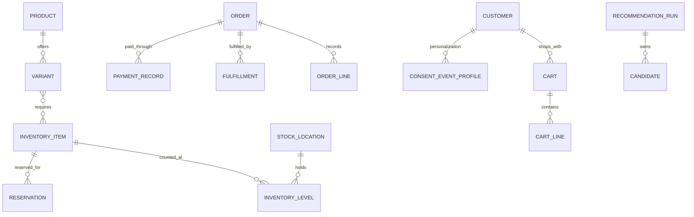

# Data ownership and API contracts

Authority update — 15 November 2026: the [business-first specification](../README.md#primary-business-first-specification) takes precedence for business scope and policy. This file maps that intent to DAYMARK implementation and retains earlier proposals where not yet reconciled. See the [crosswalk and held decisions](../reference/spec-consolidation.md); open policies are not approved merely because code exists.

This document supports [business requirements](01-business.md), [end-to-end flows](02-flows.md) and the [component architecture](03-architecture.md). Contracts below are target rules for implementation and testing, not a new set of duplicate commerce endpoints.

## 1. Ownership and storage

| Data | Authoritative owner | Storage | Important rule |
| --- | --- | --- | --- |
| Product, variant, size/color, collection and category | Medusa product modules | RDS PostgreSQL | Variant/SKU identifies a purchasable clothing choice. Media references are not the media bytes. |
| Prices, promotions, region/currency and shipping option | Medusa pricing/promotion/region/fulfillment capabilities | RDS | Backend computes authoritative amounts; VND is handled consistently with framework money conventions. |
| Stock location, inventory item, levels and reservations | Medusa inventory and stock-location capabilities | RDS | One DAYMARK warehouse initially. Physical receiving/picking is a staff responsibility. |
| Cart, checkout, payment collection/session, order and fulfillment | Respective Medusa commerce modules | RDS | Separate order, payment and fulfillment states; COD order creation is not cash collection. |
| Customer identity, account and addresses | Medusa authentication/customer capabilities | RDS | Passwords use the authentication provider's protected representation; never store plaintext or log credentials. |
| Product image bytes | Medusa file provider | Private S3 | Only approved image formats in `public-images/` are publicly served through the backend proxy. Private documents never belong there. |
| Candidate runs, ranks, manifest/checksum and active pointer | Custom recommendation module | RDS | Import staging run, validate it, mark ready, then activate. Preserve old ready run for rollback. |
| Consent, behavioral events and interest profiles | Custom personalization module | RDS | Server-verified customer identity; consent epoch fences withdrawn consent. Cloud feature flags remain disabled until accepted. |
| Raw research data and generated artifacts | Offline data pipeline | Ignored local `data/hm/` and `data/hm/processed/` | Not Git assets, production orders or automatically approved public brand content. |
| Cache/events/workflows/locks | Medusa infrastructure providers | Redis; some current process-local recommendation maps | Redis is not the commerce source of truth. Redis loss requires tested degraded/recovery behavior. |
| Browser session references | Storefront server actions | HTTP-only secure cookies in production | References/tokens, not a second order database; backend authorizes every private request. |
| Notification delivery/retry record | Planned notification integration | Durable application-owned record, exact schema pending implementation | Must support deduplication and reconciliation after provider/worker failure. No claim that this table exists today. |

The deployed AWS database was migrated on 9 November; recommendation data was not activated. The historical seed has three generic products without images. DAYMARK's 30-product class fixture has representative local-preview photos; exact manufactured-item and per-variant images remain a separate gap.

## 2. Logical relationships

This is a conceptual ownership diagram, not Medusa's physical schema or an assertion of exact cardinalities for every optional checkout case. Framework links and generated schemas are the implementation authority. Do not add hand-written joins or rewrite core tables to match this sketch.

For a controlled SKU, reconcile opening stock, staff adjustments, active reservations, fulfilled quantities and authorized restocking. Do not assume order creation immediately decrements physical stock; verify the installed Medusa lifecycle. Cancellation before fulfillment and return after shipment have different stock effects.

## 3. API surface

Use installed Medusa contracts for core operations. The principal existing storefront calls are:

| Requirement | API capability | Boundary and acceptance |
| --- | --- | --- |
| FR-01 | Medusa customer auth registration/login; `/store/customers/me` | Actor-scoped tokens, no trust in client `customer_id`; account creation and optional verification behavior tested together. |
| FR-02 | `GET /store/products`, category/collection and product-detail queries | Published/channel-visible products, region-aware prices, bounded filtering/pagination over the entire matching catalog. |
| FR-03 | `/store/carts` and cart line-item operations | Cart ID is not a staff credential; validate quantity and variant through backend commerce workflows. |
| FR-04 | Cart shipping details/options and `/store/carts/{id}/complete` | Complete only through the authoritative workflow. Reconcile unknown timeout outcomes. |
| FR-05 | Payment collections and sessions | Production COD initially; isolated simulator exercises success/failure/duplicate cases. Never enable the test simulator in production. |
| FR-06 | Authorized Medusa Admin inventory/location operations | Staff stock adjustment and concurrent checkout are audited and reconciled. |
| FR-07 | Customer-scoped order reads; authorized Admin order/fulfillment operations | Customer can read only own order; public status does not expose staff/private payment details. |
| FR-08 | Internal order/status event to notification use case | No unauthenticated public endpoint that can send arbitrary emails. |
| FR-09 | Medusa Admin and reporting reads | Distinguish staff operations from administrator configuration; prove the actual supported access policy before claiming granular roles. |
| REC-01 | `GET /store/recommendations`; optional authenticated `/for-you` | Strict query schema, explicit public projection, eligible products, bounded latency, feature flag and safe omission/fallback. |
| Media | `GET /product-images/{prefix}/{key}` | No publishable key required for approved public images; reject private prefixes, nested filenames and unsupported formats. |

The existing singular `/store/cart`, `/store/catalog` and custom auth wrappers are legacy/custom surfaces to audit. They are not a mandate to build parallel core APIs. The consumer map, supported contract and deprecation path must precede deletion.

## 4. DTO and error rules

Custom routes must perform runtime schema validation, reject unexpected fields where appropriate, bound pagination and derive identity from authenticated server context. TypeScript interfaces alone are insufficient. DTOs belong to the transport boundary; domain/workflow inputs do not depend on `MedusaRequest` or response objects.

Target recommendation query: `placement` in `home|product_detail`, valid `region_id`, `product_id` required only for product detail, bounded integer `limit`. Target response: placement, strategy/version, products with explicitly selected public fields; no raw dataset/customer metadata or provider details. Existing response shapes must be maintained or migrated deliberately.

| Failure | Contract rule |
| --- | --- |
| Invalid input | 400 with safe actionable message and field context where supported |
| Unauthenticated private action | 401 |
| Authenticated but unauthorized | 403 or non-disclosing 404 according to the installed API contract |
| Missing/invisible object | 404 |
| Stock/state/idempotency conflict | Document installed endpoint's actual conflict response and assert it in tests; do not remap blindly |
| Dependency outage/overload | Safe retryable failure; do not report a successful order without authoritative confirmation |

Core Medusa errors retain their supported envelopes. New custom contracts should expose a stable machine-readable code and safe message, with a correlation ID when available. Never return stack traces, provider messages, tokens, source metadata or another customer's information. Log enough redacted context to investigate. Correlation coverage is a target to implement and validate, not a current end-to-end guarantee.

## 5. Integrity, privacy and cache contracts

- Assign idempotency identity to an operation, not a page view. Repeating checkout/payment completion or an event must not create an additional order, payment effect or inventory reservation. Test concurrent requests, timeout retries and provider duplicate signals.
- Use native framework mechanisms first and verify behavior against the installed version. An application cache or frontend disabled button is not payment idempotency.
- Do not cache customer/cart/order responses publicly. Public cached reads must include region/currency/channel, query and applicable version context. Define TTL and invalidation explicitly; display freshness is not checkout authority.
- Current recommendation result caches are process-local with a default five-second TTL outside tests; authenticated requests bypass that shared result cache. Run-pointer checks and TTL do not establish global invalidation or unlimited freshness guarantees.
- Use synthetic customers and permissioned images in public DAYMARK fixtures. Preserve research rights restrictions in the existing recommendation reference material. Do not promote private H&M validation into public-brand evidence.
- Use minimal personal information for demo orders, redact logs and specify dataset cleanup/retention per test run. Do not repurpose real customer records as load-test fixtures.

## 6. Initial dataset and migrations

The implemented [DAYMARK importer](../catalog/DATASET.md) creates/updates its own named fixtures through Medusa workflows. Its 30 products/230 variants have disposable-local repeat-run evidence; exact product photography and current public/staff acceptance remain incomplete. A repeatable seed must create/update its own named DAYMARK fixtures without resetting existing commerce data; report inserted/updated/skipped records, image checksums, variant stock, collections, shipping/payment setup and publishable channel key. Run twice and prove stable counts. Administrator creation remains a separate secure operator action, with no shared/default password.

Add migrations for changed custom models; never edit already applied migrations. Test on an empty disposable database and upgrade from the previous schema. Application rollback and schema/data rollback are separate operations. See [operations](06-operations.md) and [delivery](07-delivery.md).

## 7. Target asynchronous notification contract

FR-08 is a new application integration, not the existing SNS operational-alert topic. Provider selection remains an implementation ADR, constrained to a permitted service/Region and the agreed budget.

Proposed owned notification-intent record: `id`, `order_id`, `template_version`, `dedupe_key`, `state`, `attempt_count`, `next_attempt_at`, `provider_reference`, redacted `last_error_code`, timestamps. Unique key is order + notification type + template version; repeated order events reuse that intent. States are pending, processing, retry_wait, sent and failed (application concepts, not asserted Medusa built-in models).

- Consumer creates/claims an intent through the supported module/workflow boundary. A persisted claim/lease prevents concurrent worker delivery; stale claims recover after a documented timeout.
- Target retry schedule: initial attempt, then 1, 5 and 15 minutes after the preceding failure, maximum four attempts. Terminal failures remain visible for an authorized manual retry with the same business key.
- Select an adapter supporting provider-side idempotency or an equivalent verified deduplication contract. An ambiguous provider timeout must be reconciled with that provider; a local sent flag alone cannot prove exactly-once delivery.
- Persist state transitions before acknowledging successful event handling. Verify the installed framework's transaction/event-publication boundary; if an order commit can be missed, add a durable outbox or an order-to-intent reconciliation process before accepting FR-08. Redis registration alone is insufficient proof.
- A notification failure never changes the committed order outcome. Retain only necessary recipient/template references; do not expose inbox addresses or provider payloads in public logs/evidence.

This is the target contract for implementation/testing. No notification table/provider is introduced by this documentation change.
