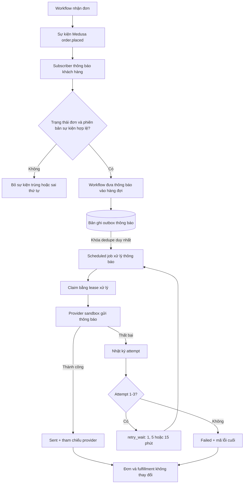

# BE-04 — Sơ đồ luồng sự kiện thông báo

## Luồng nghiệp vụ

## Quy tắc idempotency và sự kiện sai thứ tự

- Dedupe key: `orderId:notificationType:channel:templateVersion:stateVersion`.
- Sự kiện lặp lại tái sử dụng bản ghi outbox hiện có.
- `order.placed` bị bỏ khi đơn đã ở trạng thái hủy.
- `order.canceled` bị bỏ trừ khi trạng thái hoặc thời điểm hủy đơn chứng minh đơn đã hủy.
- Các mốc hợp lệ khác nhau của cùng đơn được phép tạo bản ghi khác nhau.
- Provider sandbox dùng dedupe key làm khóa idempotency phía provider.

## Chính sách thử lại

Job xử lý tối đa bốn attempt: lần đầu ngay lập tức, sau đó 1 phút, 5 phút và 15 phút sau lần lỗi trước. Thất bại cuối được lưu với `attempt_count = 4` và `last_error_code`.
