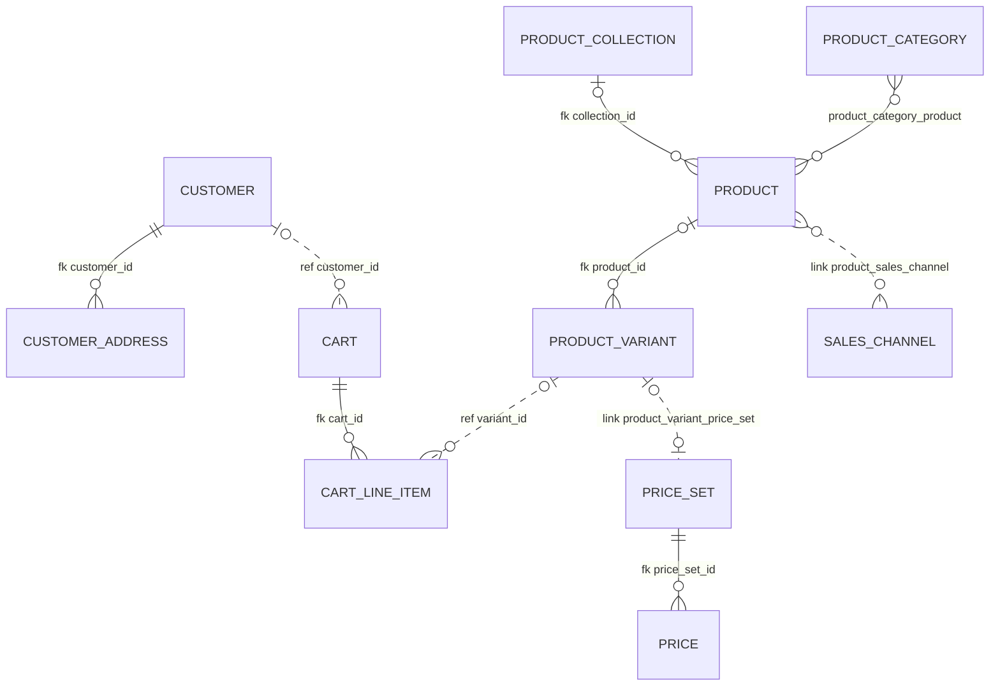
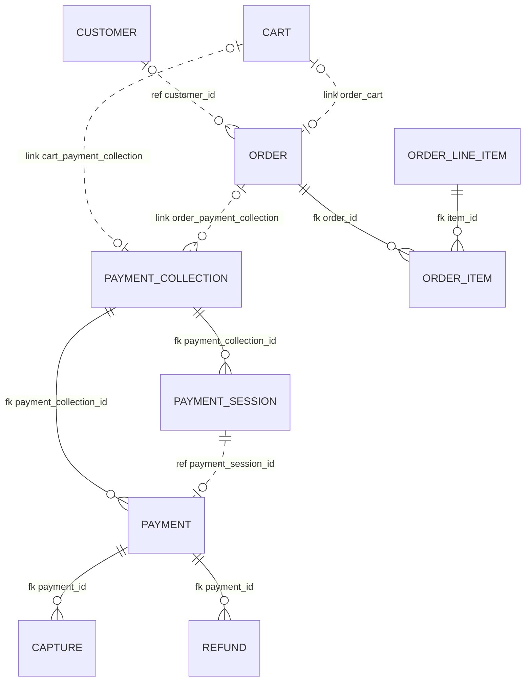
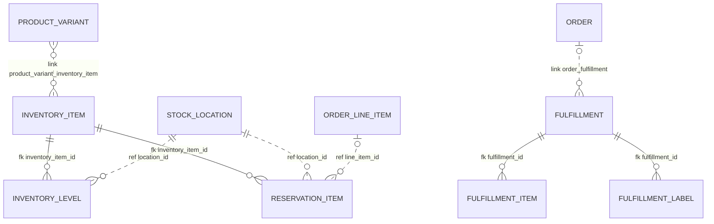
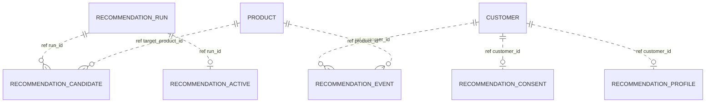

# DATA-01 — Baseline cơ sở dữ liệu DAYMARK

**Baseline ngày 18/11/2026** · `main` `1b6a668` · Medusa `2.21.2` theo [manifest backend](../../apps/backend/package.json) và [npm lockfile](../../package-lock.json).

ERD v3 và từ điển dưới đây mô tả schema từ model, migration và định nghĩa link đã đối chiếu trong các package cài đặt, cùng cấu hình và mã DAYMARK tại baseline. Tình trạng migration của từng database cần bằng chứng riêng. [Mô hình nghiệp vụ](../05-data/domain-model.md) và [từ điển nghiệp vụ](../05-data/data-dictionary.md) giữ định nghĩa và các quyết định chính sách.

- **Phạm vi** gồm FR-01 đến FR-09 và dữ liệu gợi ý/cá nhân hóa. Dùng [RTM](../03-requirements/requirements-traceability.md) để xác định ca nghiệm thu theo yêu cầu.
- **Nguồn dữ liệu có thẩm quyền** là module sở hữu bản ghi trên PostgreSQL. Luồng ghi xuyên module đi qua workflow, service và link Medusa. Redis hỗ trợ cache, sự kiện, workflow và khóa. Storefront giữ tham chiếu phiên, giỏ và bản đọc phục vụ hiển thị. Byte ảnh thuộc file provider, còn URL và mô tả sản phẩm thuộc Product. [Hợp đồng dữ liệu/API](../spec/04-data-api.md)
- **Đơn vị tiền** lấy từ `currency_code` của bản ghi. VND của fixture là số nguyên đồng, ví dụ `279000` biểu thị 279.000 ₫. Order giữ đơn giá lúc mua và dữ liệu tổng hợp của đơn. Payment giữ số tiền đã authorize, capture hoặc refund. [Fixture danh mục](../catalog/DATASET.md) · [Đối soát VND trong test](../../apps/backend/integration-tests/http/checkout-order.spec.ts#L281-L299)

## ERD v3

Tên thực thể trong sơ đồ tương ứng với tên bảng được chọn. Nhãn `fk` chỉ quan hệ nội bộ có khóa ngoại, `link` chỉ định nghĩa link được Medusa quản lý, còn `ref` chỉ ID mà ứng dụng hoặc graph dùng để tham chiếu. Lực lượng quan hệ trên cạnh `link` mô tả bề mặt graph/workflow. Nhãn `ref` biểu thị quan hệ logic, kể cả khi đích có thể thiếu. Bảng trung gian được ghi ngay trên cạnh.

### Khách hàng, danh mục, giá và giỏ

Auth giữ `auth_identity` và `provider_identity`. Workflow tạo tài khoản ghi `app_metadata.customer_id` từ ID Customer. Customer sở hữu hồ sơ, cờ `has_account` và địa chỉ. Store API xác định actor từ bối cảnh xác thực server. Cart có thể thiếu `customer_id`, phù hợp hành vi giỏ guest hiện tại. Chính sách cho guest hoàn tất và tra cứu đơn vẫn theo OPEN-USR-001/002. [Ranh giới Auth/Cart](../spec/07-delivery.md#ranh-giới-cartauth-kế-thừa) · [Sổ quyết định còn mở](../00-project/source-and-assumption-register.md)

### Checkout, đơn hàng và thanh toán

Workflow complete cart lấy khóa theo cart ID, tìm `order_cart` trước khi tạo đơn, rồi ghi link, `cart.completed_at` và liên kết payment collection khi giỏ đã có collection. Đọc kết quả checkout qua `order_cart` và `order.id`. Lực lượng một đơn cho mỗi giỏ trong sơ đồ đến từ graph/workflow. Bảng link được định danh theo cặp ID. `order_item` quản lý phiên bản và số lượng của dòng đơn, còn `order_line_item` giữ dữ liệu sản phẩm và đơn giá lúc mua. Các trường API `payment_status` và `fulfillment_status` được tổng hợp từ Payment và Fulfillment, độc lập với `order.status`. [Hợp đồng checkout](../spec/04-data-api.md#3-api-surface)

### Tồn kho, giữ chỗ và giao hàng

Link biến thể–inventory item giữ `required_quantity`. Mỗi mức tồn đang hoạt động có cặp `inventory_item_id, location_id` duy nhất. `available_quantity` được tính từ `stocked_quantity − reserved_quantity`. Khi checkout tạo reservation cho dòng đơn, `line_item_id` tham chiếu ID `ordli_`. `fulfillment_item` cũng có các tham chiếu dòng và inventory item tùy chọn, còn tracking đi qua `fulfillment_label`. Đối soát giữ chỗ, tồn vật lý và fulfillment theo từng mốc của workflow. [Test checkout hiện có](../../apps/backend/integration-tests/http/checkout-order.spec.ts#L372) · [ADR nhất quán đơn và tồn](../06-architecture/adr/ADR-003-order-inventory-consistency.md)

### Gợi ý và cá nhân hóa

Các migration tùy chỉnh lưu ID tham chiếu dạng text. Quy trình xuất bản kiểm tra sản phẩm và lượt dữ liệu trước khi chuyển con trỏ. Cá nhân hóa kiểm tra khách và consent epoch, rồi ghi sự kiện hoặc dựng lại profile. [Workflow xuất bản](../../apps/backend/src/workflows/recommendation/publish.ts) · [Subscriber sự kiện đơn](../../apps/backend/src/subscribers/personalization-order-events.ts) · [Xóa dữ liệu cá nhân hóa](../../apps/backend/src/modules/personalization/erase.ts)

### Thông báo giao dịch — thiết kế mục tiêu

Theo FR-NOT-01..03, Order/Fulfillment cung cấp sự kiện xác nhận hoặc thay đổi trạng thái đủ điều kiện. Module thông báo dự kiến lưu `NotificationIntent` theo `order_id`, định danh và phiên bản sự kiện. Module này sẽ sở hữu kết quả gửi và lịch thử lại. Bảng/migration `NotificationIntent`, subscriber giao dịch và provider DAYMARK chưa hiện diện trong baseline. [Hợp đồng mục tiêu](../spec/04-data-api.md#7-target-asynchronous-notification-contract) · [Subscriber hiện có](../../apps/backend/src/subscribers/README.md)

## Data inventory và từ điển triển khai

Tiền tố ID thể hiện quy ước sinh mã của model. Định danh phải được so khớp bằng ID đầy đủ. Bảng dùng trạng thái hiện có của từng model và ghi rõ trạng thái đề xuất cho `NotificationIntent`. Trạng thái được phép công bố cho khách thuộc chính sách nghiệp vụ.

| Thực thể và ID | Module sở hữu | Trường chuẩn, trạng thái và quan hệ |
| --- | --- | --- |
| `auth_identity` (`authid_`), `provider_identity` | Auth | Danh tính theo provider. Customer ID liên kết qua `app_metadata.customer_id`, dạng JSON do workflow ghi. |
| `customer` (`cus_`), `customer_address` (`cuaddr_`) | Customer | Hồ sơ, `email` nullable, `has_account` mặc định false. Cặp `email, has_account` duy nhất trên bản ghi hoạt động có email. Địa chỉ tài khoản thuộc khách. Địa chỉ giao trên đơn là snapshot của Order. |
| `product` (`prod_`), `product_variant` (`variant_`) | Product | Handle, tên, định danh `sku`. Product có `draft`, `proposed`, `published`, `rejected`. Variant dùng `manage_inventory`, `allow_backorder`. SKU nullable và duy nhất giữa các biến thể hoạt động có SKU. Fixture DAYMARK yêu cầu mỗi biến thể có SKU. Size/màu nối từ biến thể tới `product_option_value` qua `product_variant_option`. Collection, category và ảnh là dữ liệu danh mục. |
| `sales_channel` (`sc_`), `region` (`reg_`) | Sales Channel, Region | Channel giữ `is_disabled` và bề mặt mở bán qua link sản phẩm. Region giữ `currency_code` và phạm vi thị trường. Cart tham chiếu region/channel bằng ID. Route catalog legacy lọc cả sản phẩm published lẫn kênh của publishable key. |
| `price_set` (`pset_`), `price` (`price_`) | Pricing | Price thuộc một price set, chứa `amount`, `currency_code` và điều kiện như số lượng, rule hoặc price list. Giá hiện hành phụ thuộc bối cảnh Pricing. Order giữ đơn giá lịch sử. |
| `cart` (`cart_`), `cart_line_item` (`cali_`), `cart_address` (`caaddr_`) | Cart | `currency_code`, `completed_at`, địa chỉ thanh toán/giao và dòng giỏ. Dòng có `quantity`, `unit_price` và tham chiếu product/variant có thể rỗng. `completed_at` là dấu mốc hoàn tất của Cart. |
| `order` (`order_`), `order_item` (`orditem_`), `order_line_item` (`ordli_`) | Order | Dùng `order.id` cho link và đối soát. `display_id` là số để hiển thị. Order lưu `customer_id` tùy chọn, `currency_code`, snapshot địa chỉ và hàng mua. `order_item` giữ `version` và số lượng đã xử lý, giao, nhận. `order.status` gồm `pending`, `completed`, `draft`, `archived`, `canceled`, `requires_action`. |
| `payment_collection` (`pay_col_`) | Payment | `amount`, `currency_code`, `authorized_amount`, `captured_amount`, `refunded_amount`. Enum `not_paid`, `awaiting`, `authorized`, `partially_authorized`, `canceled`, `failed`, `partially_captured`, `completed`. Checkout được nhận và simulator được authorize là các mốc riêng với xác nhận COD đã thu. |
| `payment_session` (`payses_`), `payment` (`pay_`), `capture` (`capt_`), `refund` (`ref_`) | Payment | Session giữ provider, amount, currency và data của lần thử. Enum `authorized`, `captured`, `pending`, `requires_more`, `error`, `canceled`, `pending_authorization`. Simulator ngoài production dùng UUID `id` và cờ `simulated_outcome` trong `payment_session.data`. Payment giữ `captured_at`, `canceled_at` và có các bản ghi capture/refund. `payment.payment_session_id` là tham chiếu text có chỉ mục duy nhất cho bản ghi đang hoạt động. |
| `stock_location` (`sloc_`), `inventory_item` (`iitem_`), `inventory_level` (`ilev_`), `reservation_item` (`resitem_`) | Stock Location, Inventory | Stock Location giữ định danh kho. Inventory giữ SKU kho, `stocked_quantity`, `reserved_quantity`, `incoming_quantity` và `reservation_item.quantity`. Lượng là số đơn vị hàng, lưu dạng numeric. Reservation giữ `location_id` và `line_item_id` tùy chọn. |
| `fulfillment` (`ful_`), `fulfillment_item` (`fulit_`), `fulfillment_label` (`fulla_`) | Fulfillment | Giao hàng theo kho và phương thức. Vòng đời dựa trên `packed_at`, `shipped_at`, `delivered_at`, `canceled_at` và lượng xử lý. Label giữ `tracking_number`, `tracking_url`, `label_url`. Trạng thái hiển thị ở API Order là giá trị tổng hợp. |
| `recommendation_run` (`recrun_`), `recommendation_candidate` (`recc_`), `recommendation_active` (khóa `recommendation_active`) | Recommendation DAYMARK | Run giữ version duy nhất cho bản ghi hoạt động, checksum, manifest và `staging`, `ready`, `failed`. Candidate giữ rank, score và strategy. Rank và sản phẩm đích có ràng buộc duy nhất riêng theo run, placement và context đối với bản ghi hoạt động. Active trỏ tới run đang phục vụ. |
| `recommendation_consent` (`perscons_`), `recommendation_event` (`persevt_`), `recommendation_profile` (`persprof_`) | Personalization DAYMARK | Mỗi khách có tối đa một consent và một profile hoạt động. Consent giữ `granted`, `epoch`, `terms_version`. Event giữ `event_key` duy nhất trên bản ghi hoạt động, `customer_id`, `product_id`, `consent_epoch` và `occurred_at`. Loại event gồm `product_view`, `recommendation_click`, `order_placed`, `order_canceled`. Profile dẫn xuất giữ `interests`, `recent_product_ids`, `consent_epoch` và `profile_version`. |
| `notification` (`noti_`), `notification_provider` (`notpro_`) | Notification gốc Medusa | Package có model/migration, với trạng thái `pending`, `success`, `failure` và tham chiếu provider. Cấu hình nền tảng có local feed. |
| `NotificationIntent` — mục tiêu, ID và schema chờ triển khai | Tích hợp thông báo DAYMARK | `order_id`, `source_event_id`, `source_state_version`, channel/type/template, `dedupe_key`, số lần thử, lịch thử lại, mã lỗi đã che. Trạng thái đề xuất `pending`, `processing`, `retry_wait`, `sent`, `failed`. Bản ghi gửi do tích hợp sở hữu, còn trạng thái nghiệp vụ vẫn do Order/Fulfillment quyết định. |

## Nguồn đối chiếu

Các đường dẫn package bên dưới tính từ `node_modules/@medusajs/`, phiên bản `2.21.2`. Tên model và migration dùng để tái lập kiểm tra sau khi cài theo lockfile.

| Phạm vi | Model, migration, link và workflow đã đọc |
| --- | --- |
| Auth và Customer | `auth/dist/models/{auth-identity,provider-identity}.js`, `customer/dist/models/{customer,address}.js`, migrations `Migration20240124154000` và `Migration20240524123112` của Customer. `core-flows/dist/customer/workflows/create-customer-account.js` và `core-flows/dist/auth/steps/set-auth-app-metadata.js`. |
| Product, Pricing, Channel, Region | `product/dist/models/{product,product-variant,product-category,product-collection,product-option-value}.js` và `InitialSetup20240401153642`. `pricing/dist/models/{price,price-set}.js` và `Migration20230929122253`. `sales-channel/dist/models/sales-channel.js`, `region/dist/models/region.js`, link `product-sales-channel` và `product-variant-price-set`. [Catalog route](../../apps/backend/src/api/store/catalog/route.ts) |
| Cart, Order và Payment | `cart/dist/models/{cart,line-item,address}.js` và migrations `Migration20240222170223`, `Migration20240831125857`. `order/dist/models/{order,order-item,line-item}.js` và `Migration20240219102530`. `payment/dist/models/{payment-collection,payment-session,payment,capture,refund}.js` và migrations `Migration20240225134525`, `Migration20241211151053`, `Migration20250120110552`, `Migration20250625084134`, `Migration20260411223700`. Link `order-cart`, `cart-payment-collection` và `order-payment-collection`. `core-flows/dist/cart/workflows/complete-cart.js` và `core-flows/dist/order/utils/aggregate-status.js`. [Payment simulator](../../apps/backend/src/modules/payment-simulator/provider.ts) |
| Stock Location, Inventory và Fulfillment | `stock-location/dist/models/stock-location.js`, `inventory/dist/models/{inventory-item,inventory-level,reservation-item}.js` và migrations `Migration20240307132720`, `Migration20241213063611`. `fulfillment/dist/models/{fulfillment,fulfillment-item,fulfillment-label}.js` và `Migration20240311145700_InitialSetupMigration`. Link `product-variant-inventory-item` và `order-fulfillment`. [Khởi tạo vận chuyển](../../apps/backend/src/scripts/seed-commerce.ts) |
| Recommendation và Personalization | [Migration recommendation](../../apps/backend/src/modules/recommendation/migrations/Migration20261103195231.ts) · [Consent](../../apps/backend/src/modules/personalization/migrations/Migration20261107144837.ts) · [Event và Profile](../../apps/backend/src/modules/personalization/migrations/Migration20261107150232.ts) · [Mở rộng Event](../../apps/backend/src/modules/personalization/migrations/Migration20261107151743.ts) · [Cấu hình module](../../apps/backend/medusa-config.ts) |
| Notification | `notification/dist/models/{notification,notification-provider}.js` và migrations `Migration20240509083918_InitialSetupMigration`, `Migration20240830094712`. Cấu hình mặc định tại `utils/dist/common/define-config.js`. [Cấu hình DAYMARK](../../apps/backend/medusa-config.ts) · [Mục tiêu FR-08](../spec/04-data-api.md#7-target-asynchronous-notification-contract) |

Các link Medusa trong bảng nằm dưới `link-modules/dist/definitions/`. Các bảng core lấy cấu trúc từ migrations của package, kể cả khi repo DAYMARK chỉ lưu migrations của module tùy chỉnh.

## Khoảng trống và bàn giao

| Khoảng trống | Tình trạng tại baseline | Bằng chứng cần có và người phối hợp |
| --- | --- | --- |
| Schema đang áp dụng trên database test | Đã đối chiếu mã và package. Phiên rà soát này chưa xác minh database đang chạy. | Trung và Thắng đối chiếu migration đã áp dụng, bảng/link và ràng buộc trên PostgreSQL test riêng. Quân ghi môi trường và SHA vào RTM. |
| Ranh giới guest và tra cứu đơn · OPEN-USR-001/002 | Schema hỗ trợ Customer tùy chọn ở Cart/Order. Chính sách checkout và xác minh quyền tra đơn đang mở. | Hoàng xác nhận workflow và readback. Quân chạy ca Customer A/B và guest theo chính sách được duyệt. |
| Checkout, COD và tồn · DATA-03, BE-02/03 | Lượt PostgreSQL test 20/11 đạt các ca simulator, hủy trước fulfillment, gửi lại cùng giỏ, tranh tồn 20/5 và capture kỹ thuật COD trên một tiến trình. [Báo cáo và snapshot DATA-03](../report/checkout-reconciliation-2026-11-20.md) | Hoàng và Quân đối chiếu lại trên bản tích hợp, kiểm timeout và xác nhận thu COD theo quy trình Staff. |
| Quyền Staff và tracking · BE-05/08 | Dữ liệu fulfillment và tracking có model. Quyền ghi thực tế, trạng thái công bố và quy trình thu COD cần duyệt và chạy walkthrough. | Hoàng xác nhận các bước được phép, Quân kiểm allow/deny trực tiếp và đối chiếu trạng thái khách thấy với Order/Fulfillment. [Ma trận quyền](staff-admin-permission-matrix.md) |
| Dữ liệu thông báo · FR-NOT-01..03, BE-04 | `NotificationIntent` và luồng gửi giao dịch còn là mục tiêu. Kênh, mốc được công bố và vòng đời dữ liệu chờ OPEN-USR-006/009 và OPEN-FUL-001. | Hoàng và Thắng thu bằng chứng provider sandbox, event trùng/sai thứ tự, retry và lỗi cuối. Quân dùng AT-05 để kiểm lỗi gửi không đổi đơn. |
| Dữ liệu gợi ý và consent | Model/migration và workflow hiện diện. Cấu hình kích hoạt, lượt active, dữ liệu có quyền sử dụng và vòng đời revoke cần bằng chứng theo môi trường. | Trung đối chiếu DATA-06. Hoàng xác nhận epoch và vòng đời dữ liệu dẫn xuất. Quân ghi phạm vi nghiệm thu trong RTM. |

Bằng chứng hành vi được tham chiếu từ [báo cáo HTTP mục tiêu ngày 18/11](../report/api-boundary-regression-2026-11-18.md) và các assertion đã ghi. Hoàng, Quân và Thắng cần xác nhận phần workflow, truy vết và database test tương ứng trước khi ký nghiệm thu DATA-01. [Kế hoạch DATA-01](../DAYMARK_Ke_Hoach_Tuan_1_Checkpoints_18_20_22_11_2026_v1.3_PhanBoCheckpoint.md#data-01--database-baseline-erd-và-data-dictionary-p0-checkpoint-chính-1811)
