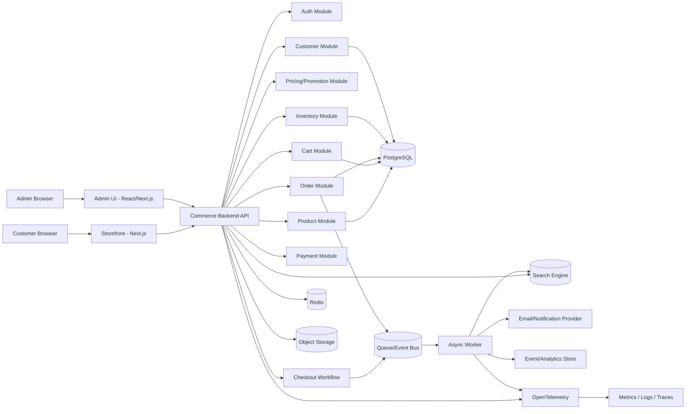
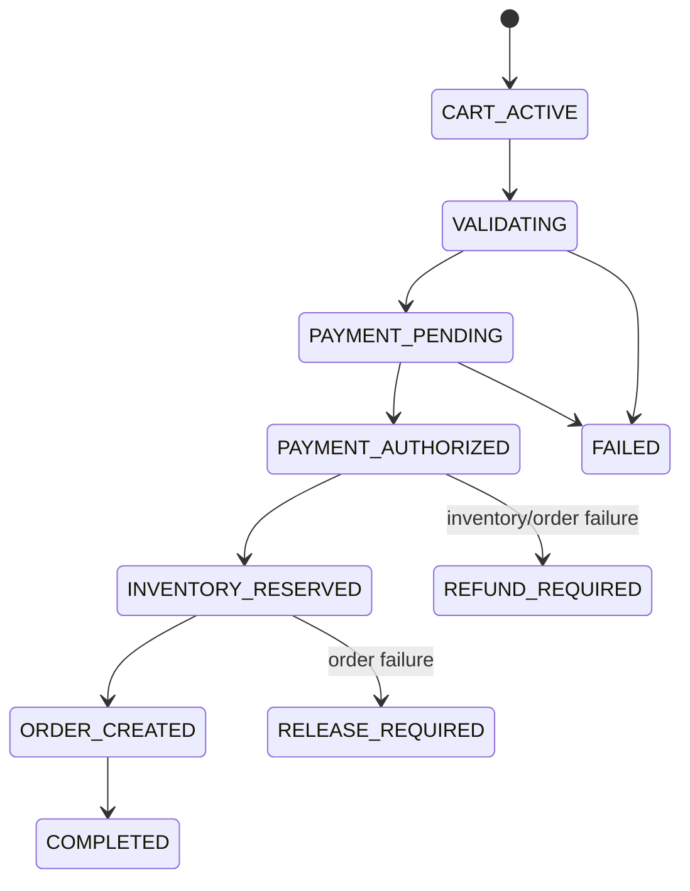

# Kế hoạch dự án — Clone Medusa (Enterprise E-commerce Platform)

> **Mục tiêu:** xây một **production-oriented MVP** của nền tảng thương mại điện tử theo hướng kiến trúc của Medusa: commerce modules + workflows + REST APIs + storefront/admin tách biệt.
>
> **Phạm vi:** clone **ý tưởng, domain model và luồng nghiệp vụ**, không sao chép source code Medusa.
>
> **Thời lượng:** 12 tuần  
> **Quy mô nhóm:** 5–7 sinh viên  
> **Định hướng:** làm ít tính năng hơn nhưng phải triển khai thật, đo được, giải thích được trade-off và vận hành được trên cloud.

---

## 1. Mục tiêu học phần cần đáp ứng

Project phải thể hiện đầy đủ chuỗi:

**Business → Requirements → Workload → Architecture → App/Data → Security/DevOps → Reliability/Observability/FinOps → AI**

Các yêu cầu nền tảng của đề tài E-commerce:

1. User registration / login
2. Product catalog & product search
3. Shopping cart
4. Checkout & order creation
5. Payment simulation / integration
6. Inventory update
7. Order status tracking
8. Customer notification
9. Basic administration / reporting

Yêu cầu kỹ thuật chính:

- Transactional order database
- Product search capability
- Cache cho hot data
- Object storage cho media
- Async notification
- Payment idempotency
- Scale under simulated peak
- Safe duplicate payment/order handling
- CI/CD deployment
- Monitoring dashboard
- Architecture + ADRs

---

## 2. “Clone Medusa” nghĩa là gì trong project này?

Medusa hiện tổ chức commerce logic theo **modules**, kết hợp bằng **workflows**; storefront chạy như một ứng dụng riêng và gọi Store APIs. Project này sẽ học theo tư tưởng đó.

### 2.1. Những phần sẽ clone

- Cấu trúc commerce theo domain/module
- Store API cho storefront
- Admin API cho backoffice
- Product / Variant / Pricing
- Inventory / Stock Location
- Cart
- Checkout workflow
- Payment abstraction
- Order
- Fulfillment/status
- Customer/Auth
- Promotion cơ bản
- Notification event
- Admin dashboard tối giản
- Search
- Event-driven processing cho tác vụ không cần đồng bộ

### 2.2. Những phần KHÔNG clone trong MVP

- Marketplace multi-vendor
- Multi-region phức tạp
- Tax engine đầy đủ theo nhiều quốc gia
- Multi-currency nâng cao
- Subscription
- Return / exchange / claim đầy đủ như enterprise
- Plugin ecosystem hoàn chỉnh
- Workflow engine tổng quát như sản phẩm framework
- Hàng chục microservices
- Full feature parity với Medusa

---

## 3. Vertical slice bắt buộc

Luồng demo chính phải chạy end-to-end:

```text
Customer đăng ký / đăng nhập
        ↓
Xem + tìm kiếm sản phẩm
        ↓
Xem variant + giá + tồn kho
        ↓
Thêm vào giỏ hàng
        ↓
Checkout
        ↓
Tạo payment intent mô phỏng
        ↓
Confirm payment với idempotency key
        ↓
Reserve / trừ inventory
        ↓
Tạo order
        ↓
Phát event order.placed
        ↓
Gửi notification async
        ↓
Admin cập nhật trạng thái order
        ↓
Customer theo dõi trạng thái
```

Đây là flow quan trọng nhất. Các tính năng khác chỉ làm nếu không ảnh hưởng chất lượng flow này.

---

## 4. Kiến trúc đề xuất

### 4.1. Kiểu kiến trúc

**Modular Monolith + Event-driven Async Workers**

Lý do:

- Nhóm 5–7 người, 12 tuần: microservices sẽ tạo quá nhiều overhead.
- Transaction checkout/order/inventory cần consistency tốt.
- Vẫn có thể tách domain rõ ràng như Medusa.
- Notification, indexing, analytics phù hợp xử lý async.
- Có đường nâng cấp thành service riêng khi workload lớn hơn.

### 4.2. Sơ đồ high-level



---

## 5. Tech stack đề xuất

### Backend

- **Node.js + TypeScript**
- **NestJS** hoặc **Fastify + modular architecture**
- **PostgreSQL**
- ORM: **Prisma** hoặc **Drizzle**
- **Redis**
  - cache
  - rate limiting
  - optional job metadata
- Queue:
  - local/dev: BullMQ
  - cloud: managed queue hoặc Redis-backed worker
- Search:
  - ưu tiên **Meilisearch** cho MVP
  - hoặc PostgreSQL Full Text Search nếu muốn giảm hạ tầng
- Object storage:
  - S3-compatible storage
- OpenAPI/Swagger cho API documentation

### Frontend

- **Next.js**
- Storefront tách khỏi backend
- Admin UI tách route/app
- TanStack Query
- Tailwind CSS hoặc component library tùy nhóm

### DevOps

- Docker
- GitHub Actions
- Infrastructure as Code: Terraform
- Cloud deployment: chọn **một** provider và giữ đơn giản
- OpenTelemetry
- Grafana stack hoặc dịch vụ monitoring tương đương
- k6 cho load test

---

## 6. Mapping Medusa-style modules → MVP modules

| Module | Trách nhiệm | MVP |
|---|---|---:|
| Auth | Login, token/session, admin auth | ✅ |
| Customer | Customer profile, addresses | ✅ |
| Product | Product, variant, category | ✅ |
| Pricing | Giá theo variant | ✅ |
| Promotion | Coupon đơn giản | Stretch |
| Inventory | Stock + reservation | ✅ |
| Stock Location | Một hoặc vài kho | ✅ tối giản |
| Cart | Cart + line items | ✅ |
| Checkout | Orchestrate checkout | ✅ |
| Payment | Payment provider abstraction | ✅ |
| Order | Order + status history | ✅ |
| Fulfillment | Shipping/fulfillment status | ✅ tối giản |
| Search | Product indexing/search | ✅ |
| File | Product image upload | ✅ |
| Notification | Order email/event | ✅ |
| Analytics | Basic event/report | Stretch |
| Recommendation/AI | Recommend / shopping assistant | Stretch |

---

## 7. Data model tối thiểu

### 7.1. Core entities

```text
User
- id
- email
- password_hash
- role
- created_at

Customer
- id
- user_id
- first_name
- last_name
- phone

Address
- id
- customer_id
- type
- line1
- city
- country

Product
- id
- title
- description
- status
- category_id

ProductVariant
- id
- product_id
- sku
- title
- price
- weight

ProductImage
- id
- product_id
- object_key
- url

InventoryItem
- id
- variant_id
- location_id
- quantity_on_hand
- quantity_reserved
- version

StockLocation
- id
- name

Cart
- id
- customer_id / session_id
- status
- currency
- subtotal
- discount_total
- total

CartItem
- id
- cart_id
- variant_id
- quantity
- unit_price

Payment
- id
- cart_id
- provider
- status
- amount
- idempotency_key
- external_ref

Order
- id
- customer_id
- payment_id
- status
- currency
- subtotal
- discount_total
- total
- created_at

OrderItem
- id
- order_id
- variant_id
- sku_snapshot
- title_snapshot
- quantity
- unit_price

OrderStatusHistory
- id
- order_id
- from_status
- to_status
- actor_id
- created_at

OutboxEvent
- id
- aggregate_type
- aggregate_id
- event_type
- payload
- status
- created_at
```

### 7.2. Nguyên tắc dữ liệu

- Giá và tên sản phẩm trong `OrderItem` phải snapshot tại thời điểm mua.
- Không tính lại order từ Product hiện tại.
- Inventory update dùng optimistic lock hoặc row lock.
- Checkout phải nằm trong transaction boundary rõ ràng.
- Event quan trọng dùng **Transactional Outbox** để tránh DB commit thành công nhưng publish event thất bại.
- Payment request dùng **idempotency key** và unique constraint.

---

## 8. API design

### 8.1. Store API

```http
POST   /store/auth/register
POST   /store/auth/login
POST   /store/auth/logout

GET    /store/products
GET    /store/products/:id
GET    /store/search?q=

POST   /store/carts
GET    /store/carts/:id
POST   /store/carts/:id/items
PATCH  /store/carts/:id/items/:itemId
DELETE /store/carts/:id/items/:itemId

POST   /store/carts/:id/checkout
POST   /store/payments/:id/confirm

GET    /store/orders
GET    /store/orders/:id
```

### 8.2. Admin API

```http
POST   /admin/auth/login

POST   /admin/products
PATCH  /admin/products/:id
POST   /admin/products/:id/images

GET    /admin/inventory
PATCH  /admin/inventory/:variantId

GET    /admin/orders
GET    /admin/orders/:id
PATCH  /admin/orders/:id/status

GET    /admin/reports/overview
```

### 8.3. API conventions

- JSON only
- Versioning: `/api/v1/...` nếu cần
- Pagination cursor hoặc limit/offset
- Error format thống nhất:

```json
{
  "code": "INVENTORY_INSUFFICIENT",
  "message": "Not enough stock",
  "request_id": "req_..."
}
```

- Mọi response có `request_id`
- Sensitive write endpoints yêu cầu auth + RBAC
- Rate limit cho login, checkout, search

---

## 9. Checkout workflow

### 9.1. State machine



### 9.2. Steps

1. Validate cart ownership
2. Re-read current product/variant availability
3. Recalculate authoritative total server-side
4. Check inventory
5. Create or reuse Payment by idempotency key
6. Authorize/simulate payment
7. Reserve inventory
8. Create order + order items snapshot
9. Mark cart completed
10. Write `order.placed` to outbox
11. Commit transaction
12. Worker publishes/processes event
13. Send email notification
14. Update search/analytics asynchronously nếu cần

### 9.3. Idempotency strategy

Header:

```http
Idempotency-Key: <uuid>
```

Database:

```text
UNIQUE(operation, idempotency_key)
```

Behavior:

- Cùng key + cùng payload → trả lại kết quả cũ
- Cùng key + payload khác → `409 IDEMPOTENCY_CONFLICT`
- Timeout từ client → retry an toàn
- Không tạo duplicate payment hoặc duplicate order

---

## 10. Product search

### MVP

Index:

- product title
- description
- category
- variant SKU

Features:

- full-text
- typo tolerance nếu search engine hỗ trợ
- filter category
- sort price
- pagination

### Consistency

- PostgreSQL là source of truth
- Search index là derived data
- Khi product đổi:
  - commit DB trước
  - tạo outbox event `product.updated`
  - worker update index
- Chấp nhận eventual consistency vài giây

---

## 11. Cache strategy

Cache chỉ dùng cho read-heavy data:

```text
product:{id}
product-list:{query-hash}
category:{id}
```

Không cache authoritative checkout state.

### Policy

- TTL 30–120s
- cache-aside
- invalidate trên product update
- đo cache hit ratio
- fallback DB khi Redis unavailable

---

## 12. Media/object storage

Product image không lưu binary trong PostgreSQL.

Flow:

```text
Admin upload
→ Backend validate MIME/size
→ Object Storage
→ lưu metadata/object key trong DB
→ CDN/public URL
```

Yêu cầu:

- file size limit
- allow-list MIME type
- random object key
- không tin file extension
- signed URL nếu asset private

---

## 13. Async notification

Events:

```text
customer.registered
order.placed
order.status_changed
payment.failed
inventory.low
```

Worker:

```text
Queue/Event Bus
   ↓
Notification Worker
   ↓
Email provider / mock SMTP
```

Yêu cầu:

- retry exponential backoff
- max retry
- dead-letter queue
- duplicate event protection
- notification failure không rollback order

---

## 14. Security plan

### Authentication

- Customer: email/password
- Admin: separate role
- Password hashing: Argon2id hoặc bcrypt
- JWT access + refresh hoặc secure server session
- HttpOnly + Secure cookie nếu dùng cookie auth

### Authorization

Roles:

```text
CUSTOMER
STAFF
ADMIN
```

Quy tắc:

- Customer chỉ đọc order của chính mình
- Staff xem/manage order
- Admin manage catalog/inventory/users
- Admin API không dùng chung authorization policy với Store API

### Application security

- Input schema validation
- SQL injection handled by ORM + parameterized queries
- XSS prevention
- CSRF protection nếu cookie auth
- Rate limiting
- Brute-force protection
- Secrets từ secret manager/environment
- Không log password/token/payment secret
- Audit log cho admin write operations

### Threat model bắt buộc

Ít nhất phân tích:

- account takeover
- credential stuffing
- broken access control
- price tampering
- cart/order manipulation
- duplicate payment
- inventory race
- malicious file upload
- API abuse / DoS
- leaked secrets

---

## 15. Observability

### Metrics

```text
http_requests_total
http_request_duration_ms
http_5xx_rate
checkout_success_rate
checkout_duration_ms
payment_duplicate_prevented_total
inventory_conflict_total
queue_depth
queue_retry_total
notification_failure_total
db_pool_usage
cache_hit_ratio
```

### Logs

Structured JSON:

```json
{
  "timestamp": "...",
  "level": "info",
  "service": "commerce-api",
  "request_id": "...",
  "customer_id": "...",
  "order_id": "...",
  "event": "checkout.completed"
}
```

### Traces

Trace flow:

```text
Storefront
→ API
→ DB
→ Payment Provider
→ Outbox
→ Worker
→ Notification
```

### Dashboard bắt buộc

1. API latency + error rate
2. Checkout throughput/success rate
3. DB health
4. Queue depth/retry
5. Cache hit rate
6. Order creation rate

---

## 16. SLI / SLO / NFR đề xuất

> Các con số dưới đây là **giả định thiết kế của nhóm**, cần load test để bảo vệ.

| NFR | Target MVP |
|---|---:|
| Peak API throughput | 150 RPS |
| Concurrent active users | 500 |
| Product browse p95 | < 300 ms |
| Search p95 | < 500 ms |
| Cart mutation p95 | < 400 ms |
| Checkout p95 | < 1.5 s, không tính external payment delay |
| API availability target | 99.5% |
| Checkout error rate | < 1% ở target load |
| Notification delivery start | < 30 s p95 |
| RPO | ≤ 15 phút |
| RTO | ≤ 60 phút |
| Duplicate order from retry | 0 |
| Duplicate payment from retry | 0 |
| Monthly cloud budget | mục tiêu ≤ 80 USD cho môi trường demo |

### Capacity scenario

Phải giải thích điều gì xảy ra tại:

- 1× normal load
- 5× load
- 10× load

Không cần chạy 10× production thật, nhưng cần benchmark + capacity reasoning.

---

## 17. Reliability & failure scenarios

### Scenario A — Duplicate checkout request

```text
Client timeout
→ retry cùng Idempotency-Key
→ backend lookup previous execution
→ return same order/payment result
```

Expected: không duplicate order/payment.

### Scenario B — Notification provider down

```text
Order commit thành công
→ event queue
→ notification fail
→ retry
→ DLQ nếu vượt threshold
```

Expected: order không bị rollback.

### Scenario C — Redis down

Expected:

- product browse chậm hơn nhưng vẫn chạy từ DB
- checkout không phụ thuộc cache
- health dashboard cảnh báo

### Scenario D — Search engine down

Expected:

- search degraded
- có thể fallback simple DB search
- product detail vẫn hoạt động

### Scenario E — Inventory race

Hai request mua SKU cuối cùng đồng thời.

Expected:

- chỉ một transaction reserve thành công
- request còn lại nhận `409 OUT_OF_STOCK`

### Scenario F — Worker crash

Expected:

- job/event không mất
- được retry sau restart
- observability thể hiện queue lag

---

## 18. CI/CD

### Pull Request pipeline

```text
checkout
→ install
→ lint
→ typecheck
→ unit test
→ integration test
→ build
→ dependency/security scan
```

### Main branch deployment

```text
merge main
→ build container
→ push registry
→ migrate DB
→ deploy
→ health check
→ smoke test
→ mark release successful
```

### Rollback

- giữ ít nhất 2 image versions
- deploy immutable image tag theo commit SHA
- DB migration theo backward-compatible strategy
- rollback app image nhanh
- migration destructive tách thành phase riêng

---

## 19. Infrastructure as Code

Quản lý bằng Terraform:

```text
network
container runtime
managed PostgreSQL
Redis/cache
object storage
queue
container registry
monitoring/logging
secret configuration
```

Không cấu hình production thủ công nếu có thể IaC hóa.

---

## 20. Repo structure

```text
medusa-clone/
├─ apps/
│  ├─ api/
│  │  └─ src/
│  │     ├─ modules/
│  │     │  ├─ auth/
│  │     │  ├─ customer/
│  │     │  ├─ product/
│  │     │  ├─ pricing/
│  │     │  ├─ inventory/
│  │     │  ├─ cart/
│  │     │  ├─ checkout/
│  │     │  ├─ payment/
│  │     │  ├─ order/
│  │     │  ├─ fulfillment/
│  │     │  └─ notification/
│  │     ├─ infra/
│  │     └─ main.ts
│  ├─ worker/
│  ├─ storefront/
│  └─ admin/
├─ packages/
│  ├─ contracts/
│  ├─ config/
│  └─ observability/
├─ infra/
│  └─ terraform/
├─ docs/
│  ├─ adr/
│  ├─ architecture/
│  ├─ api/
│  ├─ threat-model/
│  └─ test-reports/
├─ tests/
│  ├─ e2e/
│  └─ load/
├─ docker-compose.yml
└─ README.md
```

---

## 21. Testing strategy

### Unit

- pricing calculation
- cart totals
- state transition
- inventory reservation rule
- idempotency decision

### Integration

- PostgreSQL transaction
- Redis cache fallback
- search sync
- queue retry
- outbox dispatcher

### E2E

```text
register
→ login
→ browse
→ add cart
→ checkout
→ payment confirm
→ order created
→ inventory changed
→ notification event
```

### Concurrency test

- 20–100 concurrent buyers
- SKU có stock nhỏ
- assert `quantity_reserved <= quantity_on_hand`

### Load test

k6 scenarios:

1. Browse heavy
2. Search heavy
3. Cart mutation
4. Checkout peak
5. Mixed traffic

---

## 22. ADRs cần viết

```text
ADR-001 Modular monolith vs microservices
ADR-002 PostgreSQL as transactional source of truth
ADR-003 Redis cache strategy
ADR-004 Search engine choice
ADR-005 Transactional outbox for domain events
ADR-006 Payment idempotency
ADR-007 Inventory concurrency control
ADR-008 Storefront deployed separately
ADR-009 Queue/retry/DLQ strategy
ADR-010 Cloud provider + deployment model
```

Mỗi ADR:

```text
Context
Decision
Alternatives
Trade-offs
Consequences
```

---

## 23. Phân chia nhóm 5–7 người

### Nhóm 5 người

| Role | Phụ trách |
|---|---|
| 1. Tech Lead / Backend | architecture, checkout, code review |
| 2. Backend Commerce | product, pricing, inventory |
| 3. Backend Platform | auth, order, queue, notification |
| 4. Frontend | storefront + admin |
| 5. Cloud/QA | CI/CD, IaC, observability, load/reliability tests |

### Nhóm 6–7 người

Tách thêm:

- Storefront Engineer
- Admin Frontend Engineer
- SRE/Cloud
- QA/Performance

Không chia module tuyệt đối. Mọi thành viên phải hiểu end-to-end flow.

---

## 24. Kế hoạch 12 tuần

## Tuần 1 — P1: Business + Scope

**Mục tiêu**

- Chốt vertical slice
- Viết Business Problem Statement
- Xác định users/stakeholders
- Use cases
- Out-of-scope
- Workload assumptions

**Deliverables**

- `docs/business.md`
- use-case diagram
- initial backlog
- definition of done

---

## Tuần 2 — P1: Architecture + NFR

**Mục tiêu**

- Initial architecture
- Data ownership
- Sync vs async
- NFR có số
- ADR 001–004

**Deliverables**

- architecture diagram
- NFR table
- workload model
- ADRs
- risk register

---

## Tuần 3 — Foundation

**Backend**

- repo + lint/typecheck/test
- Docker Compose
- PostgreSQL
- Redis
- auth skeleton
- database migration

**Frontend**

- storefront skeleton
- admin skeleton
- API client

**DevOps**

- CI pipeline
- dev deployment skeleton

---

## Tuần 4 — Catalog + Search

**Features**

- Product
- Variant
- Category
- Image upload
- Search
- Cache

**Demo**

- admin create/update product
- storefront browse/search
- cache hit metrics

---

## Tuần 5 — Cart + Customer

**Features**

- register/login
- customer profile
- cart
- cart items
- authoritative pricing
- validation

**Tests**

- cart total
- invalid SKU
- out-of-stock precheck
- access-control tests

---

## Tuần 6 — Checkout + Payment

**Features**

- checkout workflow
- payment simulation/provider abstraction
- idempotency
- order creation
- transaction boundary

**Critical tests**

- duplicate request
- timeout + retry
- payment success/failure

---

## Tuần 7 — Inventory + Order Status

**Features**

- inventory reservation
- stock location
- order status state machine
- status history
- customer order tracking

**Critical test**

- concurrent checkout for last item

---

## Tuần 8 — Async + Notification

**Features**

- outbox event
- queue
- worker
- email notification
- retry
- DLQ

**Failure demo**

- notification service unavailable
- worker crash and recover

---

## Tuần 9 — Security + DevOps

**Security**

- RBAC
- audit log
- rate limit
- threat model
- secret handling
- security test

**DevOps**

- IaC
- production-like deployment
- rollback procedure

---

## Tuần 10 — Observability + Reliability

**Features**

- structured logs
- metrics
- tracing
- monitoring dashboards
- alert rules

**Failure drills**

- Redis unavailable
- search unavailable
- worker failure
- DB connection pressure

---

## Tuần 11 — Performance + Cost

**Tasks**

- k6 load tests
- 1× / 5× workload analysis
- identify bottleneck
- tuning
- capacity estimate
- cloud cost estimate

**Deliverables**

- load-test report
- latency/error graphs
- cost breakdown

---

## Tuần 12 — Hardening + Final Demo

**Tasks**

- bug fixing
- freeze features
- final architecture review
- rehearse failure scenarios
- final documentation
- demo script
- presentation

**Demo sequence**

1. Deploy
2. Customer flow
3. Admin flow
4. Duplicate checkout
5. Inventory concurrency
6. Notification retry
7. Monitoring dashboard
8. Load-test results
9. Cost
10. Architecture defense

---

## 25. Mapping theo P1–P5 của môn

### P1 — Business & Architecture

- Business Problem Statement
- Users / Stakeholders
- Functional Requirements
- NFRs with targets
- Workload Analysis
- Initial Cloud Architecture

### P2 — App, Data & Integration

- Component Architecture
- API design
- Data model / ownership
- Sync vs Async decisions
- Integration architecture

### P3 — Security & DevOps

- Threat model
- IAM / access control
- CI/CD
- Containerization
- IaC
- Deploy / rollback strategy

### P4 — Production Engineering

- Load / performance test
- Reliability / failure scenario
- Observability dashboard
- SLI / SLO
- Capacity & cost analysis

### P5 — AI Engineering (optional)

Nếu làm AI shopping assistant/recommendation:

- AI architecture
- evaluation dataset
- quality metrics
- guardrails
- latency
- token/cost analysis

---

## 26. AI feature — Stretch goal

Chỉ làm sau khi checkout/order chạy ổn định.

### Option A — Recommendation

MVP recommendation:

```text
popular products
+ same-category products
+ co-view/co-purchase heuristic
```

Evaluation:

- Precision@K
- Recall@K
- CTR trong demo synthetic dataset

### Option B — Shopping Assistant

Assistant chỉ hỗ trợ:

- search product
- compare products
- explain product attributes
- suggest products theo nhu cầu

Guardrails:

- không tự đặt hàng
- không tự thanh toán
- mọi action nhạy cảm cần user confirmation
- câu trả lời product phải dựa trên catalog hiện tại

---

## 27. Definition of Done cho MVP

MVP chỉ được xem là hoàn thành nếu:

- [ ] Deployed trên cloud
- [ ] Storefront dùng được
- [ ] Admin dùng được
- [ ] Registration/login chạy
- [ ] Product catalog chạy
- [ ] Search chạy
- [ ] Cart chạy
- [ ] Checkout chạy
- [ ] Payment simulation chạy
- [ ] Inventory update chính xác
- [ ] Order tracking chạy
- [ ] Notification async chạy
- [ ] Duplicate payment/order được chặn
- [ ] Có CI/CD
- [ ] Có IaC
- [ ] Có logs/metrics/traces
- [ ] Có dashboard
- [ ] Có load test
- [ ] Có ít nhất 3 failure scenarios
- [ ] Có threat model
- [ ] Có ADRs
- [ ] Có cloud cost estimate
- [ ] Có rollback procedure
- [ ] Có tài liệu API

---

## 28. Tiêu chí demo cuối kỳ

### Functional

- Happy path hoàn chỉnh
- Admin thay đổi dữ liệu và storefront phản ánh đúng
- Order status tracking rõ ràng

### Architecture

- Module boundaries rõ
- Data ownership rõ
- Sync/async có lý do
- Không over-engineering

### Reliability

- Retry
- Idempotency
- Failure recovery
- Queue/DLQ
- Transaction safety

### Security

- Authentication
- Authorization
- Audit
- Secret handling
- Abuse protection

### Operations

- Automated deployment
- Monitoring
- Rollback
- Cost awareness

### Performance

- Có workload giả định
- Có test
- Có số liệu p95/error/throughput
- Có phân tích bottleneck

---

## 29. Các câu hỏi architecture defense phải chuẩn bị

1. Business problem là gì?
2. Tại sao chọn clone Medusa-style architecture?
3. Tại sao modular monolith thay vì microservices?
4. Workload assumptions là gì?
5. NFR nào đo được?
6. Tại sao chọn PostgreSQL?
7. Tại sao cần Redis?
8. Search index consistency xử lý thế nào?
9. Checkout transaction boundary ở đâu?
10. Payment retry có tạo duplicate không?
11. Inventory race xử lý thế nào?
12. DB commit thành công nhưng queue publish fail thì sao?
13. Notification provider down thì sao?
14. Redis down thì hệ thống còn chạy không?
15. 5× / 10× load thì bottleneck ở đâu?
16. Deploy và rollback thế nào?
17. Dữ liệu nhạy cảm được bảo vệ thế nào?
18. Làm sao biết hệ thống healthy?
19. Cloud bill bao nhiêu?
20. Nếu có AI: đo quality/safety/cost thế nào?

---

## 30. Backlog ưu tiên

### P0 — bắt buộc

- Auth
- Product catalog
- Search
- Cart
- Checkout
- Payment simulation
- Inventory
- Order
- Order tracking
- Notification
- Admin basic
- CI/CD
- Monitoring
- Load test
- Security basics

### P1 — nên có

- Promotion/coupon
- Product image pipeline
- Rich audit log
- DLQ management UI
- Better reporting

### P2 — stretch

- Recommendation
- AI shopping assistant
- Advanced analytics
- Multi-location inventory UI
- Advanced fulfillment

---

## 31. Không được làm

Để tránh project vỡ scope:

- Không tách mỗi domain thành một microservice ở tuần đầu.
- Không làm AI trước checkout.
- Không dành phần lớn thời gian clone UI.
- Không hard-code payment success.
- Không bỏ load test.
- Không chỉ deploy frontend mà gọi là cloud deployment.
- Không đưa Redis/search/queue vào kiến trúc nếu không chứng minh được lý do.
- Không ghi NFR kiểu “fast”, “highly available” mà không có số.
- Không demo bằng dữ liệu thủ công nếu có thể seed/reproduce.
- Không để flow chính phụ thuộc thao tác sửa DB trực tiếp.

---

## 32. Tài liệu cần có trong repository

```text
README.md
docs/
├─ business.md
├─ requirements.md
├─ workload.md
├─ nfr.md
├─ architecture.md
├─ data-model.md
├─ api.md
├─ security.md
├─ threat-model.md
├─ reliability.md
├─ observability.md
├─ cost.md
├─ demo-script.md
├─ adr/
│  ├─ 001-modular-monolith.md
│  ├─ 002-postgresql.md
│  ├─ 003-cache.md
│  ├─ 004-search.md
│  ├─ 005-outbox.md
│  ├─ 006-idempotency.md
│  └─ ...
└─ reports/
   ├─ load-test.md
   ├─ failure-tests.md
   └─ security-tests.md
```

---

## 33. Tài liệu tham khảo Medusa

Official Medusa documentation:

- https://docs.medusajs.com/
- https://docs.medusajs.com/learn/fundamentals/modules
- https://docs.medusajs.com/resources/commerce-modules
- https://docs.medusajs.com/learn/storefront-development
- https://docs.medusajs.com/resources/infrastructure-modules

Các ý tưởng tham khảo chính:

- commerce logic chia theo module/domain
- workflow phối hợp nhiều module
- storefront tách biệt khỏi commerce backend
- core APIs phục vụ store/admin clients
- event/cache/file/notification là các infrastructure concerns có thể thay provider

---

## 34. Kết quả cuối cùng kỳ vọng

Một **Medusa-inspired commerce MVP** có:

```text
Storefront
+ Admin
+ Modular commerce backend
+ PostgreSQL
+ Search
+ Redis cache
+ Object storage
+ Async queue/worker
+ Payment idempotency
+ Inventory concurrency safety
+ CI/CD
+ IaC
+ Observability
+ Load/reliability/security evidence
```

Mục tiêu không phải “clone hết Medusa”, mà là chứng minh nhóm có thể:

> **design → implement → deploy → measure → break → recover → defend**

một e-commerce platform theo tiêu chuẩn production-oriented MVP.
